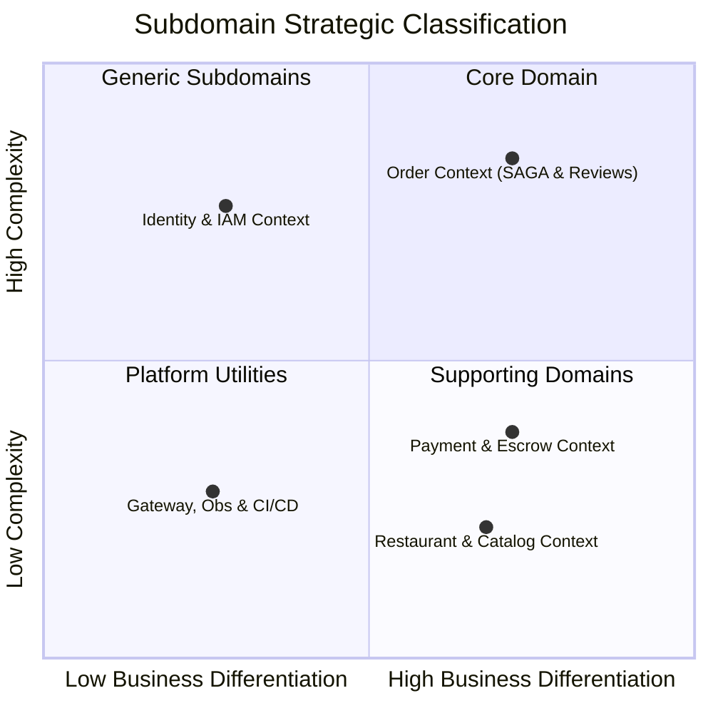
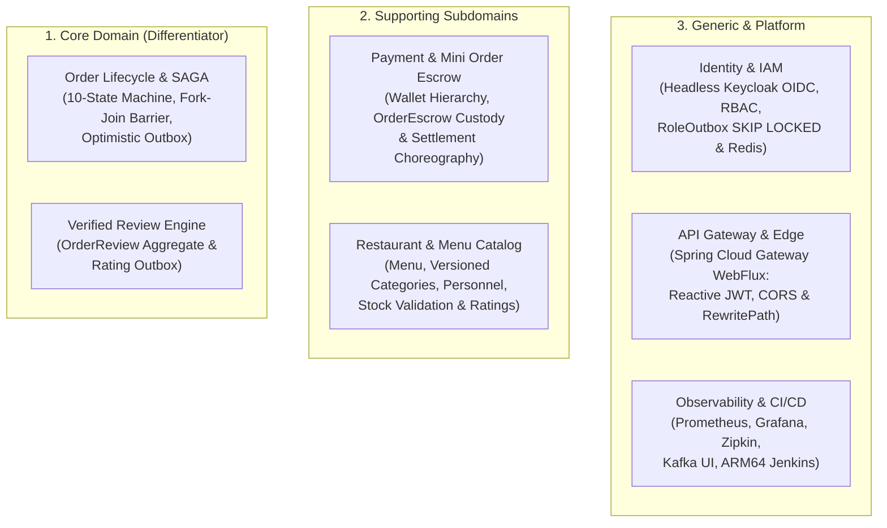
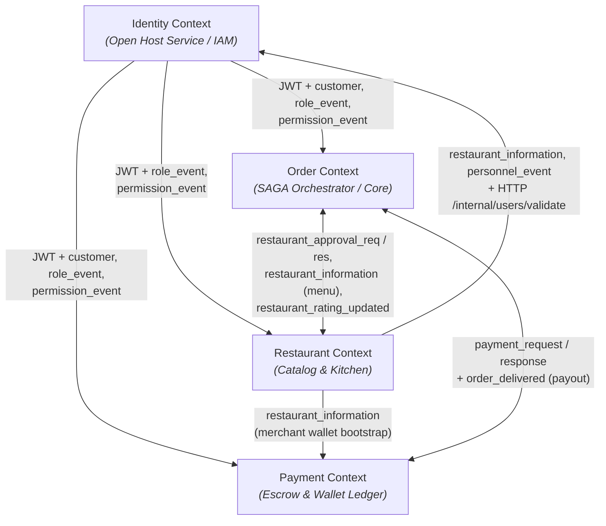
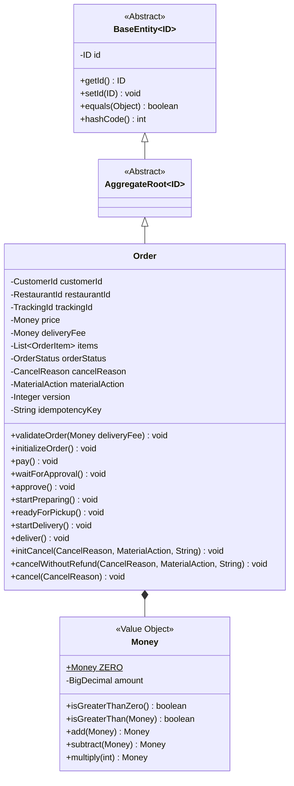

# Domain-Driven Design (DDD) & Bounded Contexts

## 1. Strategic Design & Subdomain Classification

**Domain-Driven Design (DDD)** shapes the service boundaries of **Take My Order**. Rather than partitioning the platform by technical layers, the business problem space is decomposed into distinct **Bounded Contexts**, concentrating engineering depth where business differentiation and invariant complexity are highest:



### 1.1 Subdomain Categorization

| Bounded Context | Domain Type | Strategic Business Role | Primary Invariants & Complexity |
| :--- | :--- | :--- | :--- |
| **Order Context** (`order-service`) | **Core Domain** | Competitive differentiator. Owns customer checkout, 10-state order progression, distributed forward/cancel SAGA orchestration, and verified post-delivery buyer reviews (`OrderReview`). | `Order` item + delivery-fee price equality, 10-state transitions, Cancel SAGA Fork-Join barrier (`RESTORE_STOCK` vs. `RECORD_WASTE`), 7-day review reply window & irreversible moderation. |
| **Payment Context** (`payment-service`) | **Supporting Domain** | Manages customer & merchant wallets (`CustomerWallet`, `RestaurantWallet`), immutable transaction ledger (`WalletTransaction`), order-scoped escrow custody (`OrderEscrow`), and delivery settlement / refunds. | Non-negative wallet balances, single-deposit cap (`99999.99`), `OrderEscrow` transitions (`HOLDING` → `RELEASED` / `REFUNDED`), row-level pessimistic locking (`FOR UPDATE`), idempotent ledger writes. |
| **Restaurant Context** (`restaurant-service`) | **Supporting Domain** | Manages merchant restaurants, menus (`Product`), versioned categories (`ProductCategory`), cuisines (`Cuisine`), personnel onboarding (`RestaurantPersonnel`), kitchen order validation, and rating projection. | Validate-First / Mutate-Last stock deduction (`validateOrder`), stock restoration (`restoreStock`), optimistic `categoryVersion` control, non-empty category deletion guard, LWW `ratingUpdatedAt` gating. |
| **Identity & IAM Context** (`identity-service`) | **Generic Subdomain** | Headless OIDC authentication facade over Keycloak, user lifecycle management, dual-tier RBAC (`INTERNAL` & `MERCHANT`), and Redis-backed token revocation. | Single-active-intent constraint (`user_update_intent`), static role immutability (`isStatic`), subset permission delegation, `RoleOutboxJpaRepository` `SKIP LOCKED` polling, Redis `multiGet` revocation. |



---

## 2. Bounded Context Map & Upstream/Downstream Relationships

Each bounded context owns its own **Ubiquitous Language** and isolated PostgreSQL schema (`order`, `payment`, `restaurant`, `identity`). Context boundaries communicate exclusively through **10+ Apache Avro schemas**, OIDC JWT claims, and one narrowly scoped internal validation HTTP call:



### 2.1 Context Integration Patterns

*   **Customer / Supplier & Choreography (`Order` ↔ `Payment` / `Restaurant`):** `order-service` acts as SAGA orchestrator issuing commands (`payment_request`, `restaurant_approval_request`) and processing asynchronous supplier replies (`payment_response`, `restaurant_approval_response`). Post-lifecycle side effects use event choreography: `order_delivered` settles merchant escrow in `payment-service`, and `restaurant_rating_updated` projects rating aggregates into `restaurant-service`.
*   **Published Language (`infrastructure/kafka/kafka-model`):** Rather than sharing domain entity JARs across services, all inter-context events are governed by **10+ Apache Avro contracts** (such as `payment_request.avsc`, `restaurant_approval_request.avsc`, `role_event.avsc`, etc.) validated through Confluent Schema Registry.
*   **Open Host Service / Conformist (`Identity` → Consumers):** `identity-service` fronts Keycloak OIDC and publishes RBAC/user replication events. Downstream services conform to standardized JWT claims (e.g., `internal_id`, `user_type`, `role_ids`, etc.) while replicating `roles` and `permissions` locally for real-time `@PreAuthorize` checks backed by scalar Caffeine caches.
*   **Anti-Corruption Layer (ACL) via Local Read Replicas:** Consuming contexts never import another context's domain model. Dedicated `*MessagingDataMapper` classes translate incoming Avro records into lean context-local projections—for example, `order-service` keeps its own lightweight `Customer` and `Restaurant` read-replica aggregates containing only checkout fields (`active`, `available`, `minimumOrderAmount`, `deliveryFee`, `products`), completely insulated from `identity-service`'s `User` and `restaurant-service`'s full `Restaurant`.

---

## 3. Tactical Domain-Driven Design Patterns

Every domain microservice implements tactical DDD building blocks on top of `common-domain` (`BaseEntity<ID>`, `AggregateRoot<ID>`, `BaseId<T>`, `DomainEvent<T>`, `Money`, and shared lifecycle value objects):



### 3.1 Aggregate Roots, Child Entities & Domain Events Inventory

| Bounded Context | Aggregate Roots (`extends AggregateRoot`) | Internal Entities (`extends BaseEntity`) | Domain Events (`implements DomainEvent`) |
| :--- | :--- | :--- | :--- |
| **Order** | `Order`, `OrderReview` *(+ local read replicas `Customer`, `Restaurant`)* | `OrderItem`, `Product` | `OrderCreatedEvent`, `OrderPaidEvent`, `OrderCancelledEvent` |
| **Payment** | `Payment`, `Wallet` (`CustomerWallet`, `RestaurantWallet`), `OrderEscrow` | `WalletTransaction` | `PaymentCompletedEvent`, `PaymentFailedEvent`, `PaymentCancelledEvent` |
| **Restaurant** | `Restaurant`, `Cuisine` | `Product`, `ProductCategory`, `OrderApproval`, `OrderDetail`, `RestaurantPersonnel` | `OrderApprovedEvent`, `OrderRejectedEvent`, `RestaurantInformationEvent` |
| **Identity** | `User`, `Role`, `Address`, `OrganizationalUnit` | `Permission`, `UserUpdateIntent`, `RoleOutboxEntity` | `RoleCreatedEvent`, `RoleUpdatedEvent`, `RoleDeletedEvent`, `UserUpdatedEvent` |

*   **Aggregate Consistency Boundary:** External callers never mutate child entities directly. For example, `OrderItem.initializeOrderItem(...)` and `OrderItem.validatePrice()` use package-private visibility so only the `Order` aggregate root can invoke them during `validateOrder(...)` and `initializeOrder()`.
*   **Referential Integrity by Identity Only:** Aggregates reference other aggregates exclusively through strongly-typed ID value objects (`CustomerId`, `RestaurantId`, `OrderId`, `RoleId`)—never via cross-aggregate object references—preserving strict transactional independence.

### 3.2 Entities vs. Value Objects

| Trait | Domain Entity (e.g., `Order`, `OrderEscrow`, `User`) | Value Object (e.g., `Money`, `StreetAddress`, `OrderId`) |
| :--- | :--- | :--- |
| **Identity** | Unique strongly-typed identifier extending `BaseId<T>` (`UUID` across domain aggregates; `Long` for `OrderItemId`). | Defined purely by its attribute values; has no independent identity. |
| **Equality** | Determined solely by `Objects.equals(id, that.id)` in `BaseEntity`. | Determined by structural equality across attributes (e.g., `BigDecimal.compareTo` in `Money.equals`). |
| **Mutability** | Evolves through explicit domain methods (`pay()`, `release()`, `approveMerchant()`). | Strictly **Immutable**. Operations (`Money.add`, `subtract`, `multiply`) return new instances. |
| **Lifecycle** | Persisted and tracked across database transactions. | Ephemeral; created and discarded alongside its owning entity. |

### 3.3 Self-Validating Rich Domain Invariants

Business invariants live directly inside domain aggregates rather than anemic service scripts. During checkout, `OrderDomainServiceImpl.validateAndInitiateOrder(order, restaurant)` confirms restaurant availability, product prices, minimum order amount, and delivery fee, then delegates core aggregate self-validation to `Order.validateOrder(Money deliveryFee)`:

```java
// Excerpt from order-service/.../entity/Order.java
public void validateOrder(Money deliveryFee) {
    validateInitialOrder();
    validateTotalPrice();
    validateItemsPrice(deliveryFee);
}

private void validateInitialOrder() {
    if (orderStatus != null || getId() != null) {
        throw new OrderDomainException("Order is not in correct state for initialization");
    }
}

private void validateTotalPrice() {
    if (price == null || !price.isGreaterThanZero()) {
        throw new OrderDomainException("Total price must be greater than zero!");
    }
}

public void validateItemsPrice(Money deliveryFee) {
    Money orderItemsTotal = items.stream().map(orderItem -> {
        orderItem.validatePrice();
        return orderItem.getSubTotal();
    }).reduce(Money.ZERO, Money::add);

    Money expectedTotal = orderItemsTotal.add(deliveryFee != null ? deliveryFee : Money.ZERO);

    if (!price.equals(expectedTotal)) {
        throw new OrderDomainException("Total price (" + price.getAmount()
                + ") not equal to total item price (" + orderItemsTotal.getAmount()
                + ") + delivery fee (" + (deliveryFee != null ? deliveryFee.getAmount() : "0")
                + ") = " + expectedTotal.getAmount());
    }
}
```

Comparable self-validating invariants protect every other bounded context:

*   **Validate-First, Mutate-Last Stock Deduction (`Restaurant.validateOrder()`):** Reads restaurant status, `OrderStatus.PAID`, product visibility/hidden flags, stock levels, minimum order amount, and `itemsTotal + deliveryFee == totalAmount` in Phase 1; deducts stock atomically in Phase 2 only when every check passes (paired with `Restaurant.restoreStock(OrderDetail)` during cancel compensation).
*   **Wallet Overdraft & Escrow Custody Guards (`Wallet`, `OrderEscrow`):** `Wallet.addBalance` rejects non-positive amounts and enforces `MAX_DEPOSIT_AMOUNT` (`99999.99`); `CustomerWallet` and `RestaurantWallet` block overdrafts in `subtractBalance`; `OrderEscrow.release()` and `refund()` allow transitions strictly out of `HOLDING`.
*   **Verified Buyer Review Lifecycle (`OrderReview`):** Enforces `1–5` star bounds in `initializeReview()`, restricts merchant replies to a single non-empty response within `7` days (`reply()`), and treats admin moderation deactivation (`deactivate()`) as strictly irreversible.
