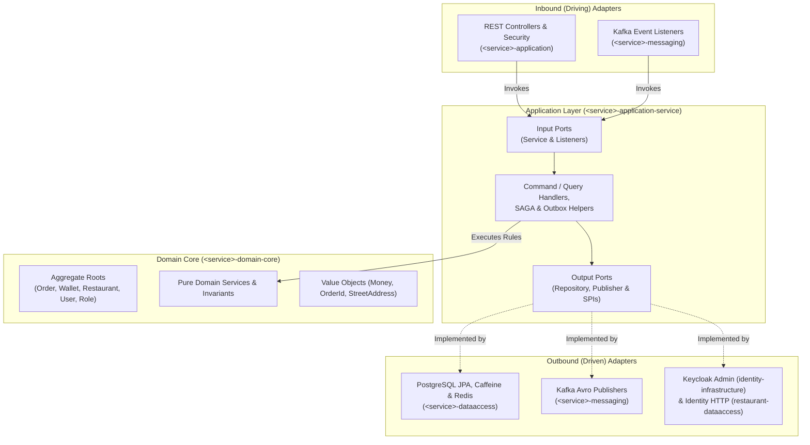
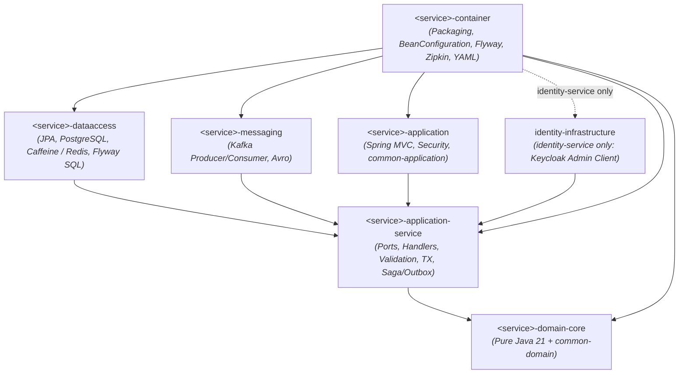
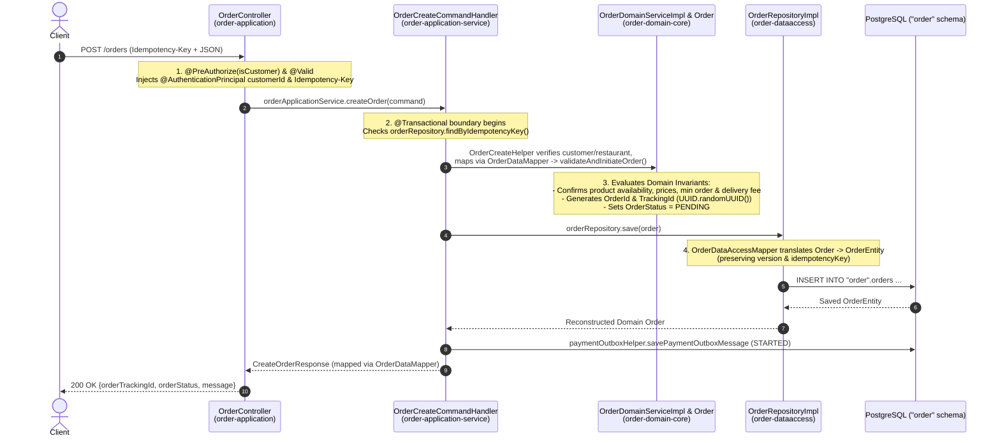

# Clean & Hexagonal Architecture (Ports and Adapters)

## 1. Architectural Intent & Scope

Enterprise microservices frequently suffer from framework entwinement: persistence libraries (Spring Data JPA, Hibernate) and transport frameworks (Spring WebMVC, Jackson, Kafka clients) leak directly into core business rules. Over time, entities degrade into **Anemic Domain Models**—passive data bags dominated by getters and setters, with invariants scattered across procedural service classes.

To protect business rules from infrastructure churn, **Take My Order** enforces **Hexagonal Architecture (Ports and Adapters)** combined with **Clean Architecture** dependency inversion across all **four domain microservices** (`order-service`, `payment-service`, `restaurant-service`, and `identity-service`).

!!! info "Scope Boundary (`gateway-service`)"
    `gateway-service` is intentionally a single-module reactive **Spring Cloud Gateway (WebFlux)** edge router focused purely on routing, OAuth2 resource-server validation, CORS, and OpenAPI aggregation; it contains no business domain hexagon.



---

## 2. Inbound and Outbound Port Mechanics

The Hexagon is defined by its boundaries: **Ports** (owned by `<service>-application-service`) declare technology-agnostic contracts, while **Adapters** translate external protocols and persistence models into domain-native objects.

### 2.1 Inbound (Driving) Ports

Inbound ports expose the use cases supported by each service. Synchronous HTTP requests invoke `ports.input.service.*` interfaces from `<service>-application`, while asynchronous Kafka consumers invoke `ports.input.message.listener.*` interfaces from `<service>-messaging`.

```java
// Excerpt from order-service/.../OrderApplicationService.java
package com.berkay.order.service.domain.ports.input.service;

import com.berkay.order.service.domain.dto.create.CreateOrderCommand;
import com.berkay.order.service.domain.dto.create.CreateOrderResponse;
import com.berkay.order.service.domain.dto.track.TrackOrderQuery;
import com.berkay.order.service.domain.dto.track.TrackOrderResponse;
import jakarta.validation.Valid;

public interface OrderApplicationService {
    CreateOrderResponse createOrder(@Valid CreateOrderCommand createOrderCommand);
    TrackOrderResponse trackOrder(@Valid TrackOrderQuery trackOrderQuery);
    // ... additional order lifecycle, query, and review use cases
}
```

*   **Encapsulation Guarantee:** Controllers in `<service>-application` (such as `OrderController`) have zero knowledge of JPA entities, SQL queries, or Kafka topics; they delegate exclusively to inbound service ports (`OrderApplicationService`, implemented by package-private `OrderApplicationServiceImpl`).

### 2.2 Outbound (Driven) Ports

Outbound ports declare external capabilities required by use-case handlers—database repositories (`ports.output.repository.*`), Kafka publishers (`ports.output.message.publisher.*`), security/cache queries (`ports.output.security.*`), and external system SPIs (`IdentityProviderPort`, `TokenRevocationPort`, `IdentityServiceApiPort`).

```java
// Excerpt from order-service/.../OrderRepository.java
package com.berkay.order.service.domain.ports.output.repository;

import com.berkay.domain.valueobject.OrderId;
import com.berkay.order.service.domain.entity.Order;
import com.berkay.order.service.domain.valueobject.TrackingId;
import java.util.Optional;

public interface OrderRepository {
    Order save(Order order);
    Optional<Order> findById(OrderId orderId);
    Optional<Order> findByIdWithLock(OrderId orderId);
    Optional<Order> findByTrackingId(TrackingId trackingId);
    Optional<Order> findByIdempotencyKey(String idempotencyKey);
    // ... paginated queries and read/auth projections
}
```

*   **Dependency Inversion Guarantee:** `OrderCreateCommandHandler` and `OrderCreateHelper` depend solely on the `OrderRepository` interface without importing Hibernate or Spring Data JPA. The concrete `OrderRepositoryImpl` adapter lives in `order-dataaccess`.

---

## 3. Maven Multi-Module Partitioning Standard

Every domain microservice (`order-service`, `payment-service`, `restaurant-service`, `identity-service`) is partitioned into explicit Maven submodules so architectural boundaries are enforced at compile time rather than by convention alone:

```text
<service>-service/
 ├── <service>-domain/
 │    ├── <service>-domain-core         (Java 21 Aggregates, VOs, Services)
 │    └── <service>-application-service (Ports, Handlers, SAGA & Outbox)
 ├── <service>-dataaccess               (JPA, Mappers, Caffeine/Redis, SQL)
 ├── <service>-messaging                (Kafka Listeners, Publishers, Avro)
 ├── <service>-application              (Spring MVC, @PreAuthorize, Auth)
 ├── identity-infrastructure            (Identity only: Keycloak Client)
 └── <service>-container                (Spring Boot Main, BeanConfig, YAML)
```

Shared cross-cutting contracts are isolated into dedicated top-level parent modules:

*   **`common/`:** `common-domain` (shared base entities `BaseEntity`/`AggregateRoot` and immutable value objects like `Money`, `OrderId`, `OrderStatus`) and `common-application` (shared `JwtSecurityFilter`, `JwtAuthenticationToken`, and global REST exception handling).
*   **`infrastructure/`:** `saga` (`SagaStep`, `SagaStatus`), `outbox` (`OutboxScheduler`, `OutboxStatus`), and `kafka/` (`kafka-config-data`, `kafka-model` Avro schemas, `kafka-producer`, `kafka-consumer`).

### 3.1 Module Dependency Graph & Enforcement Matrix



| Module | Declared / Used Dependencies | Architectural Boundary (Strictly Excluded) |
| :--- | :--- | :--- |
| `<service>-domain-core` | Module POM declares only `common-domain` (plus `uuid-creator` in `identity-domain-core` for UUIDv7 `RoleId` generation); inherits Lombok (`provided`) & SLF4J from root POM. | Zero Spring Framework, JPA/Hibernate, Jackson, WebMVC, or Kafka imports in source code. |
| `<service>-application-service` | `<service>-domain-core`, `common-domain`, `saga`, `outbox`, `spring-boot-starter-validation`, `spring-tx`, `spring-boot-starter-json` *(plus `kafka-model` in `identity-application-service` for `RestaurantPersonnelAvroModel`)*. | JPA Repositories, Hibernate Entities, Spring WebMVC Controllers, Kafka Producer/Consumer templates, `common-application`. |
| `<service>-dataaccess` | `<service>-application-service`, `spring-boot-starter-data-jpa`, `postgresql`; plus `spring-boot-starter-cache` & `caffeine` (`order`/`payment`/`restaurant`), `spring-boot-starter-data-redis` (`identity`), `outbox` (`restaurant`), and Flyway SQL migrations (`db/migration/`). | Spring WebMVC Controllers, Kafka Producer/Consumer drivers. |
| `<service>-messaging` | `<service>-application-service`, `kafka-producer`, `kafka-consumer`, `kafka-model` *(plus `postgresql` driver in `order`/`payment`/`restaurant-messaging` for `PSQLState.UNIQUE_VIOLATION` idempotency checks in listeners)*. | Spring Data JPA Repositories, Spring WebMVC Controllers. |
| `<service>-application` | `<service>-application-service`, `common-application`, `spring-boot-starter-web`, `spring-boot-starter-validation`, `spring-boot-starter-security`, `spring-boot-starter-oauth2-resource-server` *(plus `caffeine` in `identity-application`)*. | JPA Repositories, Hibernate Entities, Kafka Producers/Consumers. |
| `identity-infrastructure` *(Identity only)* | `identity-application-service`, `keycloak-admin-client`, `resteasy-client`, `resteasy-jackson2-provider`. | JPA Repositories, Kafka Drivers, WebMVC Controllers. |
| `<service>-container` | All sibling service modules + `flyway-core`, `flyway-database-postgresql`, `springdoc-openapi-starter-webmvc-api`, `micrometer-tracing-bridge-brave`, `zipkin-reporter-brave`. | Business logic (acts strictly as composition root, `BeanConfiguration`, and runtime configuration). |

---

## 4. End-to-End Request Translation Pipeline (`POST /orders`)

Data entering the system undergoes strict translation at every hexagonal boundary so JPA entities and HTTP DTOs never leak into the domain core:



---

## 5. Architectural Invariants & Battle-Tested Guardrails

To keep the hexagon intact under real production complexity, the codebase enforces six concrete engineering guardrails:

1.  **Annotation-Free Domain Services Wired in `*-container` (`BeanConfiguration`):** Pure domain service implementations (`OrderDomainServiceImpl`, `PaymentDomainServiceImpl`, `RestaurantDomainServiceImpl`, `IdentityDomainServiceImpl`) carry no `@Service` or `@Component` annotations. Each service's `*-container` module owns a `BeanConfiguration` class that explicitly registers them as Spring `@Bean` instances, keeping `*-domain-core` completely unaware of Spring's IoC container.
2.  **Immutable Value Objects:** Domain identifiers (`OrderId`, `CustomerId`, `RestaurantId`, `RoleId`) and financial values (`Money`, enforcing `BigDecimal` scale `2` with `RoundingMode.DOWN`) are immutable. Arithmetic methods (`Money.add`, `subtract`, `multiply`) always return new instances without mutating state.
3.  **Zero Persistence Annotations in Domain Core:** JPA/Hibernate annotations (`@Entity`, `@Table`, `@Column`, `@Id`) are strictly prohibited in `*-domain-core` and `common-domain`; persistence schemas live exclusively inside `*-dataaccess`.
4.  **Dedicated Boundary Mappers & Optimistic Lock Version Preservation:** Objects cross architectural boundaries solely through explicit mappers (`OrderDataMapper`, `OrderDataAccessMapper`, `OrderMessagingDataMapper`, `PaymentDataAccessMapper`, `RestaurantMessagingDataMapper`, `KeycloakMapper`). Crucially, `OrderDataAccessMapper` maps the `version` field bidirectionally between domain `Order` and JPA `OrderEntity` so Hibernate's `@Version` optimistic locking check is never silently bypassed on `merge()` (while new aggregates such as `Role.initializeRole()` explicitly leave `version = null` so Spring Data JPA invokes `persist()`).
5.  **ORM Collection Isolation (Preventing Hibernate `PersistentBag` Aliasing):** Aggregate roots such as `User` (`identity-domain-core`) and persistence adapters such as `UserRepositoryImpl` defensively copy list fields (`new ArrayList<>(...)`) before mutating or syncing `@ElementCollection` tables (`user_organizational_units`), preventing shared Hibernate `PersistentBag` references from wiping rows during `clear()` / `addAll()`.
6.  **Pragmatic CQRS Read Bypass for Paginated Queries & Authorization:** While write commands hydrate full Aggregate Roots to protect invariants, paginated read paths (`RoleQueryRepositoryImpl`, `UserQueryRepositoryImpl`, `PermissionQueryRepositoryImpl` in `identity-dataaccess`) and `@PreAuthorize` checks (`RolePermissionQueryAdapter`, `OrderAuthProjection`) project directly from JPA to response DTOs or scalar types, preventing N+1 queries and circular module dependencies.
