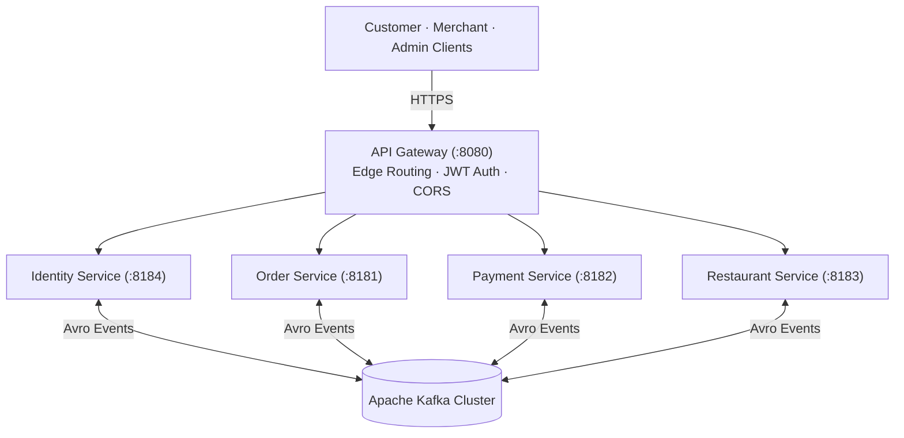

# Project Overview & Architecture Guide

### Cross-Tenancy & Multi-Cloud Event-Driven Microservices Architecture

  
<small><strong>BACKEND &amp; ARCHITECTURE</strong></small>

  

    
    
    
    
  

 

  
<small><strong>CLOUD &amp; EDGE INFRASTRUCTURE</strong></small>

  

    
    
    
    
  

 

  
<small><strong>DATA, MESSAGING &amp; SECURITY</strong></small>

  

    
    
    
    
  

  

    
    
    
    
  

 

  
<small><strong>DEVOPS, CI/CD &amp; OBSERVABILITY</strong></small>

  

    
    
    
  

  

    
    
    
  

  <strong>Production-grade microservices ecosystem</strong> engineered with <strong>Java 21</strong>, <strong>Spring Boot 3</strong>, and <strong>Apache Kafka</strong>; 
  orchestrated across <strong>Cross-Tenancy OCI</strong> &amp; <strong>Hybrid Multi-Cloud Kubernetes (K3s)</strong> topologies, uniting <strong>Hexagonal Architecture</strong>, <strong>DDD</strong>, <strong>Orchestrated SAGA</strong>, and <strong>Two-Tier Idempotency</strong> for strict distributed consistency.

---

## 📖 Executive Summary

**Take My Order** is a production-grade food ordering, catalog management, and escrow payment platform built with **Java 21**, **Spring Boot 3**, and **Apache Kafka**. Rather than bundling all domains into a single monolithic database, the ecosystem separates responsibilities across decoupled microservices running on **Kubernetes (K3s)**—supporting both **cross-tenancy Oracle Cloud (OCI) peering** and **hybrid multi-cloud infrastructure (Oracle OCI & AWS)**, proving the ability to orchestrate heterogeneous workloads (**ARM64 & x86**) in a unified network. From declarative **Infrastructure as Code (Kustomize)** to **zero-downtime rolling deployment pipelines** (`maxUnavailable: 0` with readiness probes), every component is engineered to mirror a real-world enterprise production environment.

The architecture follows **Hexagonal Architecture (Ports & Adapters)** and **Domain-Driven Design (DDD)** to keep core business rules completely independent from frameworks and transport layers. To guarantee data consistency and high throughput across network boundaries without distributed locks, the platform relies on foundational distributed patterns:

*   **SAGA Orchestration:** Coordinates multi-service order fulfillment and executes parallel compensating rollbacks when failures occur.
*   **Transactional Outbox & `SKIP LOCKED`:** Ensures atomic state and event persistence within local transactions, eliminating dual-write anomalies while preventing concurrent poller contention.
*   **CQRS & Event-Carried State Transfer:** Replicates external domain data into local read-only tables, eliminating synchronous inter-service HTTP dependencies during checkout.
*   **Two-Tier End-to-End Idempotency:** Protects the platform against duplicate order initialization, double-charging, and redundant event handling across both network boundaries:
    *   *Edge / Ingress Level:* Enforces mandatory HTTP `Idempotency-Key` headers on checkout (`POST /orders`) backed by a unique database constraint (`orders.idempotency_key UNIQUE`), returning existing order tracking details without duplicate charges.
    *   *Consumer / Egress Level:* Guards Kafka message consumers against at-least-once redeliveries via Transactional Outbox status (`OutboxStatus`), `saga_id`, and aggregate state validation.

---

## 🎯 Key Engineering Competencies

This project serves as a practical implementation guide for the following advanced architectural patterns and engineering principles:

### 🏛️ Clean & Hexagonal Architecture
*   **Ports & Adapters:** Strictly isolates core business logic from databases, REST controllers, and Kafka messaging adapters via input and output ports.
*   **Rich Domain Models:** Encapsulates business rules directly within domain entities to prevent the **"Anemic Domain Model" anti-pattern** and ensure high testability without framework dependencies.

### 🎼 Distributed Consistency & Tactical DDD
*   **Orchestrated SAGA:** Uses `order-service` as the central coordinator managing the 10-state order finite state machine (FSM).
*   **Parallel Fork-Join Compensation:** When an active post-approval order is cancelled, `order-service` simultaneously triggers two independent compensation paths (**Fork**)—refunding customer escrow in `payment-service` and restoring reserved inventory in `restaurant-service`—and waits for both Kafka acknowledgments (**Join**) before sealing the order as terminal `CANCELLED`.
*   **Pessimistic Concurrency Control:** Enforces `LockModeType.PESSIMISTIC_WRITE` on critical entities (orders, wallets, order escrows, and restaurant stock) to prevent race conditions and double-spending under high concurrency.
*   **Consistency Model:** Combines local ACID transactions within each aggregate with eventual consistency across microservices.

| # | State | Lifecycle Phase | Triggering Event / Action | Distributed Actions & Messaging Impact | Terminal? |
| :-: | :--- | :--- | :--- | :--- | :-: |
| 1 | `PENDING` | Forward SAGA | Order initialized (`POST /orders` with `Idempotency-Key`) | Publishes `PaymentRequest` to `payment_outbox` | No |
| 2 | `PAID` | Forward SAGA | Consumed `PaymentResponse` (`COMPLETED`) | Funds held in escrow; publishes `RestaurantApprovalRequest` | No |
| 3 | `WAITING_FOR_APPROVAL` | Forward SAGA | Consumed `RestaurantApprovalResponse` (`VALIDATED`) | Menu & stock verified; awaiting kitchen acceptance | No |
| 4 | `APPROVED` | Branch Operations | Merchant clicks Accept (`POST /orders/{id}/approve`) | Internal domain transition (Zero Kafka traffic) | No |
| 5 | `PREPARING` | Kitchen Operations | Kitchen clicks Preparing (`POST /orders/{id}/start-preparing`) | Meal preparation in progress (Zero Kafka traffic) | No |
| 6 | `READY_FOR_PICKUP` | Packaging | Kitchen clicks Ready (`POST /orders/{id}/ready-for-pickup`) | Order packaged and ready for delivery (Zero Kafka) | No |
| 7 | `IN_DELIVERY` | Transit | Merchant clicks Start Delivery (`POST /orders/{id}/start-delivery`) | Out for delivery (Zero Kafka traffic) | No |
| 8 | **`DELIVERED`** | Fulfillment | Merchant clicks Deliver (`POST /orders/{id}/deliver`) | **`SagaStatus.SUCCEEDED`**; seals order and triggers escrow settlement payout | **Yes (Success)** |
| 9 | `CANCELLING` | Rollback SAGA | Validation rejection or authorized cancellation | **Parallel Fork-Join Barrier:** Simultaneously emits wallet refund and stock release outbox requests | No |
| 10 | **`CANCELLED`** | Rollback SAGA | Dual compensation acknowledgments joined | **`SagaStatus.COMPENSATED`**; funds refunded, inventory adjusted/waste logged | **Yes (Cancelled)** |

### 💾 Database Architecture & CQRS Isolation
*   **Schema-per-Service Architecture:** While enterprise microservices theoretically favor a physical Database-per-Service model, this platform implements dedicated logical schemas (`keycloak`, `identity`, `"order"`, `payment`, `restaurant`) within a single PostgreSQL instance. This drastically cuts RAM and CPU overhead on resource-constrained servers while preserving strict data boundaries, ensuring individual domains can be split into separate physical databases seamlessly in the future.
*   **CQRS & Event-Carried State Transfer (Replica Tables):** Downstream services maintain local read-only replica tables populated asynchronously via Kafka:
    *   `order-service` maintains `restaurant_replica`, `product_replica`, and `customers` to validate incoming carts and customer identity during checkout with **zero synchronous HTTP calls** to other services.
    *   `identity-service` maintains `organizational_units_replica` to validate restaurant branch scopes.
    *   **Bounded Review Engine:** Customer reviews reside in `order-service` (which owns the physical `DELIVERED` status and 7-day review window) to prevent distributed 2PC locks; aggregated scores are propagated asynchronously to `restaurant-service` via Kafka (`restaurant-rating-updated`).
*   **Domain-Filtered Role & Permission Replicas:** Each domain service listens to global RBAC events from Kafka but **strictly filters permissions by its own domain prefix** (e.g., `order-service` only persists `ORDER` permissions into `permissions_replica`; `payment-service` only persists `PAYMENT` permissions), keeping local authorization tables compact and isolated.
*   **Bare-Metal Storage & Flyway:** Deploys **PostgreSQL 16** directly on the infrastructure host in production to maximize I/O throughput without container storage overhead, versioned via **Flyway**.

### 📦 Messaging & Data Integrity
*   **Transactional Outbox & `SKIP LOCKED`:** Eliminates dual-write risks by persisting domain entities and outbound events within the same atomic database transaction. Background pollers query pending events using PostgreSQL's `FOR UPDATE SKIP LOCKED`, preventing concurrent application replicas from locking or processing the same outbox records simultaneously.
*   **Type-Safe Contracts:** Governs asynchronous event-driven communication using strongly typed **Apache Avro** schemas validated centrally against **Confluent Schema Registry**.
*   **Edge-to-Core Two-Tier Idempotency:** Guarantees absolute consistency against duplication across both communication layers:
    *   *HTTP Ingress Guard:* `order-service` mandates a client-generated `Idempotency-Key` header (IETF standard) on `POST /orders`. If a client resubmits an order due to network timeouts or client retries, the server returns the existing order's tracking details with `HTTP 200 OK` without duplicate payments or SAGA triggers.
    *   *Saga & Outbox Idempotency:* Prevents at-least-once Kafka redeliveries from double-charging wallets or duplicating stock mutations by querying existing outbox records via `saga_id` alongside `SagaStatus` and `OutboxStatus` guards.

### 🛡️ Security, Identity & Two-Tier Caching
*   **Centralized Headless IAM (OAuth2 / OIDC):** Integrates **Keycloak 24** via a headless facade in `identity-service` (`/auth/**`), implementing **OAuth2 / OIDC** standards to issue cryptographically signed RS256 JWTs (`internal_id`, `user_type`, `role_ids`, etc.) without exposing Keycloak UI directly to end-users.
*   **Edge OAuth2 Resource Server (JWT Validation & Propagation):** `gateway-service` acts as a reactive OAuth2 Resource Server validating Bearer JWT signatures at the edge and propagating verified tokens downstream.
*   **Two-Tier Caching Strategy:**
    *   **L1 In-Memory Cache (Caffeine):** Every domain microservice caches local `roles_replica` permissions and organization scopes in JVM memory with **Caffeine** (`@Cacheable`), providing sub-millisecond RBAC lookups without repetitive database queries.
    *   **L2 Distributed Cache (Redis):** Centralized token blacklist enabling instant multi-device logout (`POST /users/logout-all`), immediate ban enforcement, and cluster-wide `O(1)` role-level token revocation (`role:{roleId}:revoke`).
*   **Decoupled Local Authorization (Zero-SQL IDOR Shield):** Downstream microservices evaluate resource ownership, roles, and merchant branch scopes locally by combining lightweight JWT claims (`internal_id`, `user_type`, `role_ids`, etc.) with role-bound branch scopes in local Caffeine-cached replica tables—enforcing a **Stateless Zero-SQL IDOR Shield** without bloating tokens or making synchronous HTTP calls back to `identity-service`.
*   **Infrastructure & Database Hardening:** Minimizes the external attack surface by closing PostgreSQL (`:5432`) and internal platform ports to `0.0.0.0/0`, restricting database access strictly to private VCN CIDRs and the K3s Flannel Pod network (`10.42.0.0/16`) via `pg_hba.conf` (`scram-sha-256`).

### 📊 Observability & Cloud-Native Operations
*   **Distributed Tracing:** Integrates **Zipkin** (Micrometer Tracing Bridge Brave) to trace end-to-end HTTP request propagation and latency across API Gateway and downstream service boundaries.
*   **Metrics & Dashboards:** Scrapes Spring Boot Actuator (`/actuator/prometheus`) across all microservices—collecting JVM memory, CPU, thread, and HTTP request metrics alongside Kubernetes API server metrics—visualized on **Grafana** dashboards.
*   **Declarative IaC & Dual Zero-Downtime CI/CD:** Decouples shared `base` Kubernetes manifests from environment-specific `overlays` (`overlays/dev` for local NodePort exposure and selector stripping vs. `overlays/central-hub` for production ConfigMaps and Secrets) using **Kustomize**, enforcing `RollingUpdate` (`maxSurge: 1`, `maxUnavailable: 0`) paired with Spring Boot Actuator `liveness` and `readiness` probes (`/actuator/health`) for self-healing. Supports two cost-free delivery pipelines over SSH: a self-hosted **Jenkins** pipeline (`Jenkinsfile`) streaming native ARM64 builds directly into K3s `containerd` with manual approval gates and automatic `kubectl rollout undo`, and a **GitHub Actions** pipeline (`deploy.yml`) using **QEMU** and **Docker Buildx** (`amd64`/`arm64`) via Docker Hub followed by SSH rolling restarts.
*   **Workload Placement & Lightweight Containers:** Pins services across heterogeneous cluster nodes (`nodeSelector`: `infra`, `app`, `gateway`, `monitoring`) with `podAntiAffinity` for high availability, packaged as minimal `eclipse-temurin:21-jre-alpine` images.
*   **Cross-Cloud Overlay Networking (Flannel VXLAN):** Bridges multi-cloud pod-to-pod communication (`10.42.0.0/16`) between Oracle Cloud (ARM64) and AWS (x86) nodes via **Flannel VXLAN** (`UDP 8472`) tunneling restricted to node `/32` IPs.
*   **Edge SSL & 7-Subdomain Multi-Portal Routing:** Offloads TLS termination to **Cloudflare Edge SSL & Origin Rules** (`443` → NodePorts) across 7 role-isolated subdomains—3 frontend portals (**Customer**, **Partners**, **Backoffice**) and 4 backend/platform endpoints (**API Gateway**, obfuscated **Keycloak IAM**, **Grafana**, **Jenkins**)—while decoupling public JWT `iss` validation from internal `keycloak-service` JWKS fetches.
*   **Stateful Resilience (Split-Disk PVC):** In early cluster deployments, sharing a single persistent volume between Zookeeper and Kafka caused severe production incidents: upon node restarts, Zookeeper initialized before the volume settled and generated a fresh ephemeral cluster ID in `/cluster/id`, while Kafka read the previous cluster ID from its volume's `meta.properties`, triggering an unrecoverable `InconsistentClusterIdException` crash loop. Furthermore, Kafka's heavy write-ahead commit logs (WAL) contended with Zookeeper's snapshot writes on the same disk channel. Allocating isolated Persistent Volume Claims (`zookeeper-pvc` & `zookeeper-log-pvc` vs `kafka-broker-{1..3}-pvc`) paired with a deterministic `init-kafka` topic provisioning Job completely eliminated disk I/O bottlenecks and metadata desynchronization.

---

## 🏗️ System Architecture & Microservices

All external traffic enters through the **API Gateway** and routes to four isolated domain microservices that communicate asynchronously through **Apache Kafka**.

| Service | Port | Core Responsibility |
| :--- | :---: | :--- |
| **🛡️ API Gateway** (`gateway-service`) | `8080` | Single edge entry point built on Spring Cloud Gateway. Handles reverse-proxy routing, Bearer JWT validation, global CORS, and aggregates downstream OpenAPI 3 documentation into a centralized Swagger UI hub. |
| **👤 Identity Service** (`identity-service`) | `8184` | Manages Keycloak OIDC login/registration, user and merchant profiles, delivery addresses, dynamic RBAC governance, and Redis token revocation. |
| **🧠 Order Service** (`order-service`) | `8181` | Orchestrates the 10-state order FSM, forward SAGA execution, Fork-Join cancellation rollbacks, local CQRS catalog replicas, and verified reviews. |
| **💳 Payment Service** (`payment-service`) | `8182` | Manages customer & merchant wallets, holds and releases order escrow funds, settles merchant payouts on delivery, and processes SAGA refunds. |
| **🍽️ Restaurant Service** (`restaurant-service`) | `8183` | Governs restaurant branches, menus, categories, cuisines, branch personnel, pre-approval stock validation, and synchronized ratings. |

*   **Centralized Swagger UI Hub (`:8080/swagger-ui.html`):** Rather than exposing multiple documentation ports, `gateway-service` utilizes SpringDoc WebFlux UI to rewrite and aggregate `/api-docs/{identity,order,payment,restaurant}` routes to downstream services' `/v3/api-docs` endpoints—allowing consumers to inspect 90+ REST endpoint contracts and schemas from a single dropdown interface without touching internal container ports. In production, it operates in **Read-Only Showcase Mode** (`SWAGGER_SUPPORTED_SUBMIT_METHODS=""`, disabling browser "Try it out" execution), while remaining fully interactive in local and Kubernetes `dev` environments.

!!! note "Merchant-Managed Delivery & Non-Cancellable Order Policy"
    Delivery handoffs (`start-delivery`, `deliver`) are executed by authorized **`MERCHANT`** branch personnel; there is no separate courier service. Order cancellations are restricted to authorized `MERCHANT` staff, `INTERNAL` admins (`/force-cancel`), or automated `restaurant-service` validation rejections—customers cannot cancel orders directly.

---

## 🛠️ Technology Ecosystem

| Category | Technology & Tools |
| :--- | :--- |
| **Language & Frameworks** | **Java 21 (LTS)**, **Spring Boot 3.x**, **Spring Cloud Gateway**, **Spring Data JPA**, **Spring Security** |
| **Messaging & Streaming** | **Apache Kafka**, **Zookeeper**, **Schema Registry (Confluent)**, **Apache Avro** |
| **Data & Persistence** | **PostgreSQL 16** (Bare Metal / Schema-per-Service), **Flyway** (Migration) |
| **Caching (Two-Tier)** | **Caffeine** (L1 In-Memory), **Redis** (L2 Distributed Cache) |
| **API Docs** | **SpringDoc OpenAPI 3** (Centralized Swagger UI Hub) |
| **Infrastructure & Cloud** | **Kubernetes (K3s)**, **Docker**, **Oracle Cloud (ARM64)**, **AWS EC2 (x86)**, **Flannel (CNI)**, **Cloudflare** (Edge SSL & Origin Rules) |
| **DevOps & CI/CD** | **Jenkins**, **GitHub Actions**, **Docker Buildx** (Multi-Arch), **QEMU**, **Kustomize**, **Maven**, SSH Automation |
| **Observability** | **Prometheus**, **Grafana**, **Zipkin** (Distributed Tracing), **Micrometer** |
| **Security & IAM** | **Keycloak** (OAuth2 / OIDC), **JWT / JWKS** (RS256) |

---

## 🌍 Production Topologies & CI/CD

The platform supports two documented Kubernetes production topologies plus Docker-backed local development:

| Topology | Infrastructure | Deployment Pipeline | Setup Guide |
| :--- | :--- | :--- | :--- |
| **7-Node Cross-Tenancy** *(Primary)* | Two **Oracle Cloud (OCI) ARM64** accounts connected via private LPG VCN peering (`8 OCPU / 48 GB RAM` total) | **Jenkins (`Jenkinsfile`)** on ARM64 streaming images directly into K3s `containerd` over SSH | [7-Node Cluster Setup](../installation/seven-node-cluster-setup.md) |
| **4-Node Hybrid Multi-Cloud** *(Alternative)* | **1x OCI ARM64** account (App Workers + DB + Kafka) + **1x AWS x86** node (Gateway) over VXLAN | **GitHub Actions** multi-arch Buildx (`arm64` / `amd64`) via **QEMU** push to Docker Hub + SSH rollout | [Hybrid AWS + OCI Setup](../installation/hybrid-cloud-aws-oracle-setup.md) |
| **Local Environment** | **Mode A:** Host PostgreSQL 16 *(or optional Compose Postgres)* + Docker Compose (`Kafka`, `Keycloak`, `Redis`, `Zipkin`) · **Mode B:** Docker Desktop K8s (`overlays/dev`) | Native IntelliJ IDEA / Maven boot (**Mode A**) or full local K8s cluster (**Mode B**) | [Local Setup Guide](../installation/local-setup.md) |

### Zero-Cost Cluster Node Specifications

#### Option B: 7-Node Cross-Tenancy OCI Cluster *(Primary — Private LPG Peering)*

| Account / Provider | Server Name | Specs | Role |
| :--- | :--- | :--- | :--- |
| **Oracle OCI (#1)** | `k8s-master-infra` | 2 OCPU, 12 GB RAM (ARM64) | Master Node (`node-type=infra` + Bare-Metal PG 16 + Kafka) |
| **Oracle OCI (#1)** | `k8s-worker-01` | 1 OCPU, 6 GB RAM (ARM64) | App Worker (`node-type=app` — Java Workloads) |
| **Oracle OCI (#1)** | `k8s-worker-02` | 1 OCPU, 6 GB RAM (ARM64) | App Worker (`node-type=app` — Java Workloads) |
| **Oracle OCI (#2)** | `k8s-worker-03` | 1 OCPU, 6 GB RAM (ARM64) | App Worker (`node-type=app` — Java Workloads) |
| **Oracle OCI (#2)** | `k8s-worker-edge` | 1 OCPU, 6 GB RAM (ARM64) | Edge Gateway Worker (`node-type=gateway`) |
| **Oracle OCI (#2)** | `k8s-worker-obs` | 1 OCPU, 6 GB RAM (ARM64) | Observability Worker (`node-type=monitoring`) |
| **Oracle OCI (#2)** | `devops-jenkins-server` | 1 OCPU, 6 GB RAM (ARM64) | Stand-Alone CI/CD Server *(Outside K3s)* |

#### Option A: 4-Node Hybrid Multi-Cloud Cluster *(Alternative — Flannel VXLAN)*

| Provider | Server Name | Specs | Role |
| :--- | :--- | :--- | :--- |
| **Oracle OCI** | `k8s-master-infra` | 2 OCPU, 12 GB RAM (ARM64) | Master Node (`node-type=infra` + Bare-Metal PG 16 + Kafka + Monitoring) |
| **Oracle OCI** | `k8s-worker-01` | 1 OCPU, 6 GB RAM (ARM64) | App Worker (`node-type=app` — Java Workloads) |
| **Oracle OCI** | `k8s-worker-02` | 1 OCPU, 6 GB RAM (ARM64) | App Worker (`node-type=app` — Java Workloads) |
| **AWS EC2** | `aws-gateway-worker` | 1 vCPU, 1 GB RAM (x86_64) | Gateway Node (`node-type=gateway` — Edge Entry Point) |

---

## 📑 Reference Metrics & Deep Dives

*   **Platform Footprint:** `4` domain microservices + `1` edge API Gateway, covering **`90+` REST endpoints** and **`100+` automated integration requests** verified via `TakeMyOrder.postman_collection.json` alongside the centralized **Swagger UI Hub (`:8080/swagger-ui.html`)** (read-only showcase mode in production, interactive locally).
*   **Data & Event Topology:** `5` dedicated PostgreSQL schemas and **`10+` Avro-backed Kafka topics** provisioned across a **3-broker cluster** (`3` partitions and replication factor `3`).
*   **Next Chapters:** Continue to [System Design & Topology](../architecture/system-design.md), [Order Service](../services/order-service.md), or [SAGA Orchestration](../distributed-systems/saga-orchestration.md) for implementation-level deep dives.
