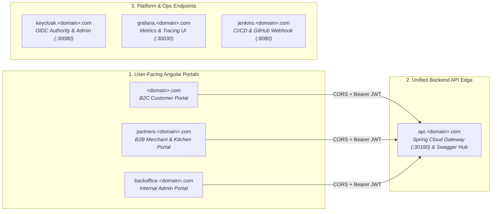
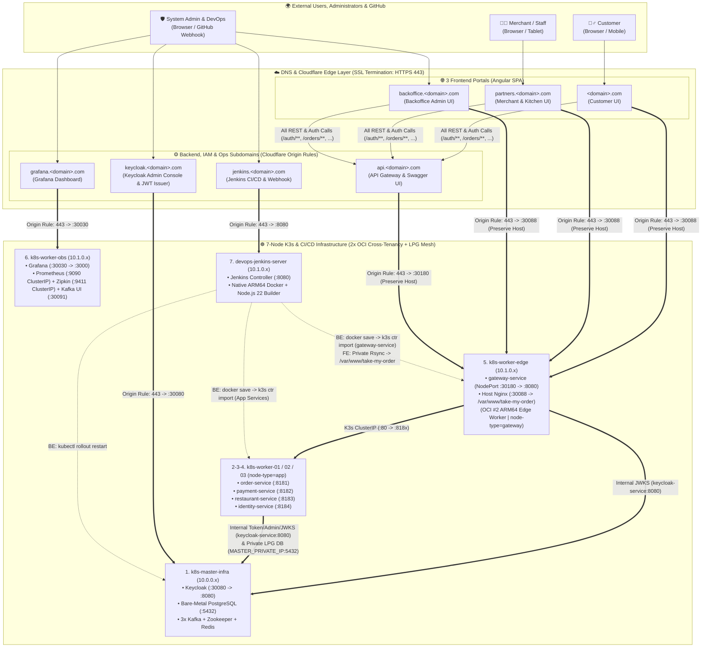
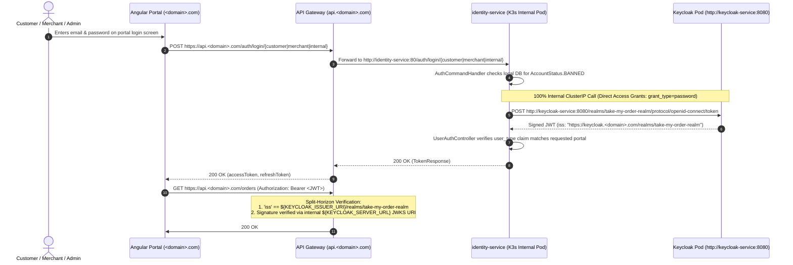

# Subdomain Topology, Multi-Portal Routing & Cloudflare Edge Architecture

## 1. Executive Summary & Architectural Motivation

In an enterprise food ordering and delivery ecosystem, user interactions are divided across three distinct persona groups with fundamentally different security models, operational workflows, and UI lifecycles:

1.  **B2C Consumers (`CUSTOMER`):** Browse restaurant menus, manage shopping carts, make wallet-based payments, track live order status, and submit verified post-delivery reviews.
2.  **B2B Restaurant Partners (`MERCHANT`):** Manage branches, menus, and stock; operate real-time kitchen screens (`WAITING_FOR_APPROVAL` → `APPROVED` → `PREPARING` → `READY_FOR_PICKUP` → `IN_DELIVERY` → `DELIVERED`); reply to customer reviews; and track escrow settlements.
3.  **Internal Backoffice Administrators (`INTERNAL` / `SYSTEM_ADMIN`):** Govern platform-wide settings, manage internal personnel and dynamic RBAC roles, audit orders across all branches (`force-cancel`), and moderate customer reviews.

To isolate these personas while providing unified HTTPS entry points without deploying resource-heavy reverse proxies inside the Kubernetes cluster, the **Take My Order** platform implements a **7-Subdomain Topology** on **`<domain>.com`**, powered by **Cloudflare Edge SSL Termination & Origin Rules**, **Spring Cloud Gateway CORS Governance**, and a **Headless IAM Facade**.

---

## 2. Multi-Portal Isolation & DNS Plane Separation Strategy

Rather than bundling all personas under sub-paths of a single domain (e.g., `/shop`, `/merchant`, `/admin`, `/grafana`), **Take My Order** partitions traffic into **three distinct DNS subdomain planes**:

1.  **3 Persona-Isolated Frontend Portals (`<domain>.com`, `partners.<domain>.com`, `backoffice.<domain>.com`):** Prevents cross-persona JS bundle bloat, keeps role-specific login routes completely separate (`/auth/login/{customer|merchant|internal}`), and isolates portal UIs behind independent Host-based virtual servers.
2.  **1 Unified API & OpenAPI Edge (`api.<domain>.com`):** Centralizes CORS enforcement, OAuth2 Resource Server JWT validation, `RewritePath` routing, and Swagger UI aggregation behind one Spring Cloud Gateway hostname.
3.  **3 Platform & Ops Endpoints (`keycloak.<domain>.com`, `grafana.<domain>.com`, `jenkins.<domain>.com`):** Separates the OIDC identity authority (`iss` and Keycloak admin UI), Grafana observability dashboards, and Jenkins CI/CD webhooks onto dedicated Cloudflare-proxied HTTPS subdomains isolated from user portals and the customer API. *(Note: `keycloak.`, `grafana.`, and `jenkins.` are used throughout this document for readability; in production deployments, choosing hard-to-guess custom subdomain names is recommended.)*



---

## 3. Complete Seven-Subdomain Topology (`<domain>.com`)

<div class="topology-table" markdown="1">

| Subdomain | Target Node | Edge & Service | Role |
| :--- | :--- | :--- | :--- |
| **1. `<domain>.com`**<br>🌐 Frontend | `k8s-worker-edge`<br>`<EDGE_PRIVATE_IP>` / `<EDGE_PUBLIC_IP>` | 🟠 `443 → :30088`<br>Nginx (`/customer`) | **B2C Customer Portal:** Restaurant discovery, cart checkout, live order tracking, and verified reviews. |
| **2. `partners.<domain>.com`**<br>🌐 Frontend | `k8s-worker-edge`<br>`<EDGE_PRIVATE_IP>` / `<EDGE_PUBLIC_IP>` | 🟠 `443 → :30088`<br>Nginx (`/merchant`) | **B2B Merchant Portal:** Branch & menu management, real-time kitchen order operations, review replies, and escrow dashboard. |
| **3. `backoffice.<domain>.com`**<br>🌐 Frontend | `k8s-worker-edge`<br>`<EDGE_PRIVATE_IP>` / `<EDGE_PUBLIC_IP>` | 🟠 `443 → :30088`<br>Nginx (`/admin`) | **Internal Admin Portal:** System administration, dynamic role & permission management, `force-cancel`, and review moderation. |
| **4. `api.<domain>.com`**<br>⚙️ Backend | `k8s-worker-edge`<br>`<EDGE_PRIVATE_IP>` / `<EDGE_PUBLIC_IP>` | 🟠 `443 → :30180`<br>`gateway-service` | **Spring Cloud API Gateway & Swagger Hub:** Unified entry point for all REST API traffic across all 3 portals and `/swagger-ui.html`. |
| **5. `keycloak.<domain>.com`**<br>🔐 IAM | `k8s-master-infra`<br>`<MASTER_PRIVATE_IP>` / `<MASTER_PUBLIC_IP>` | 🟠 `443 → :30080`<br>`keycloak-service` | **Keycloak OIDC Authority & Admin Console:** Official JWT `iss` (Issuer) authority and administrative realm console. |
| **6. `grafana.<domain>.com`**<br>📊 SRE | `k8s-worker-obs`<br>`<OBS_PRIVATE_IP>` / `<OBS_PUBLIC_IP>` | 🟠 `443 → :30030`<br>`grafana-service` | **Grafana Observability Dashboard:** Centralized visualization for internal `ClusterIP` Prometheus (`:9090`) metrics and Zipkin (`:9411`) traces. |
| **7. `jenkins.<domain>.com`**<br>🚀 CI/CD | `devops-jenkins-server`<br>`<JENKINS_PRIVATE_IP>` / `<JENKINS_PUBLIC_IP>` | 🟠 `443 → :8080`<br>`jenkins` | **Jenkins CI/CD Factory:** GitHub webhook receiver (`/github-webhook/`) and multi-pipeline controller (backend K3s rollout & frontend `rsync`). |

</div>

*(Note: Prometheus `:9090` and Zipkin `:9411` intentionally stay on internal `ClusterIP` services with no public subdomain or NodePort exposure; they are queried inside the cluster by Grafana or inspected via SSH tunnel.)*

---

## 4. End-to-End Traffic & Network Flow Diagram



### 4.1 Centralized Swagger UI Hub & Production Read-Only Showcase Mode
Because `gateway-service` aggregates downstream OpenAPI definitions, navigating to **`https://api.<domain>.com/swagger-ui.html`** exposes a unified API portal with a top-right specification dropdown:

1.  **`00 - Architecture & Security Hub`** (`/v3/api-docs` — configured via `OpenApiConfig`)
2.  **`Identity API`** (`/api-docs/identity` → `http://identity-service:80/v3/api-docs`)
3.  **`Order API`** (`/api-docs/order` → `http://order-service:80/v3/api-docs`)
4.  **`Payment API`** (`/api-docs/payment` → `http://payment-service:80/v3/api-docs`)
5.  **`Restaurant API`** (`/api-docs/restaurant` → `http://restaurant-service:80/v3/api-docs`)

!!! note "Production Guardrail (`Read-Only Showcase Mode`)"
    In `infrastructure/k8s/base/global/config-maps.yaml`, `SWAGGER_ENABLED: "true"` keeps contracts inspectable for portfolio/architecture review, while `SWAGGER_SUPPORTED_SUBMIT_METHODS: ""` disables interactive browser *"Try it out"* execution in production (`overlays/dev` re-enables all HTTP verbs locally).

---

## 5. Deep Architectural Decisions: CORS, Headless IAM & Network Separation

### 5.1 Gateway CORS Governance & Route Perimeter (`ALLOWED_ORIGINS`)
All three Angular frontend portals run on distinct origins (`https://<domain>.com`, `https://partners.<domain>.com`, `https://backoffice.<domain>.com`) and send Fetch/XHR calls to `https://api.<domain>.com`.

In `gateway-service`, `ALLOWED_ORIGINS` is injected from `service-secrets` into both `gateway-service/src/main/resources/application.yml` (`globalcors.cors-configurations.[/**].allowedOrigins`) and `gateway-service/src/main/java/com/berkay/gateway/config/SecurityConfig.java` (`corsConfigurationSource()`, with `allowCredentials: true` for `GET`, `POST`, `PUT`, `PATCH`, `DELETE`, `OPTIONS`):
```text
ALLOWED_ORIGINS=http://localhost:4200,http://localhost:4201,http://localhost:4202,https://<domain>.com,https://partners.<domain>.com,https://backoffice.<domain>.com
```

*   Notice that `api`, `keycloak`, `grafana`, and `jenkins` subdomains are **not** needed in `ALLOWED_ORIGINS` because the browser sends `Origin: <frontend-portal-domain>` when calling `api.<domain>.com`.
*   At the security filter layer, `SecurityConfig.permitAllWebFilterChain` permits unauthenticated requests to `/auth/**`, `/public/**`, `GET /orders/restaurants/*/reviews`, `/swagger-ui/**`, `/api-docs/**`, `/v3/api-docs/**`, `/webjars/**`, and `/actuator/**`, while `springSecurityFilterChain` requires a validated Bearer JWT for all other routes.

### 5.2 Headless IAM & Identity Facade (Why Frontend Portals Never Call Keycloak Directly)
A critical architectural distinction in **Take My Order** is that **the Angular frontend applications have zero direct connection to Keycloak (`keycloak.<domain>.com`)**:



1.  **Zero Keycloak Coupling in Frontend:** Portal-segregated logins (`POST /auth/login/{customer|merchant|internal}`), onboarding registrations (`POST /auth/register/{customer|merchant}`), token refreshes (`POST /auth/refresh`), password updates (`PUT /auth/password`), and session revocations (`POST /users/logout`, `POST /users/logout-all`) are all routed through `https://api.<domain>.com` to `identity-service` (`AuthCommandHandler` / `KeycloakIdentityProviderAdapter` / `UserAuthController`).
2.  **Two Exclusive Roles of `keycloak.<domain>.com`:**
    *   **Admin Console Access:** Allows system administrators to access the Keycloak UI over HTTPS without exposing raw IP/port combinations.
    *   **Split-Horizon OIDC Issuer (`iss`) Identity:** `service-secrets` (`central-secrets.env`) sets the base host `KEYCLOAK_ISSUER_URI=https://keycloak.<domain>.com` consumed by `keycloak.yaml` (`KC_HOSTNAME_URL`, `KC_HOSTNAME_ADMIN_URL`) and all microservice Deployments (`gateway`, `identity`, `order`, `payment`, `restaurant`), while `patch-config-maps.yaml` mirrors it in `service-config`. Spring Security appends `/realms/${KEYCLOAK_REALM}` to validate the JWT `iss` claim (`https://keycloak.<domain>.com/realms/take-my-order-realm`), while fetching JWKS signing keys internally via `KEYCLOAK_SERVER_URL` (`http://keycloak-service:8080`) from `service-config` without round-tripping through Cloudflare.

### 5.3 Why `MASTER_PRIVATE_IP` Must Never Be Replaced by a Public Domain
In `central-secrets.env` (`service-secrets`) and microservice deployments (`keycloak.yaml`, `identity.yaml`, `order.yaml`, `payment.yaml`, `restaurant.yaml`), database connectivity binds directly to **`MASTER_PRIVATE_IP`** (`10.0.0.x`) instead of `keycloak.<domain>.com`:

*   **Cloudflare Free Proxy Port Restriction:** When a DNS record is proxied through Cloudflare (Orange Cloud 🟠), Cloudflare only proxies HTTP/HTTPS web ports (`80`, `443`, `8080`, `8443`, etc.). It **blocks raw TCP PostgreSQL traffic on port `5432`**.
*   If PostgreSQL JDBC URLs (`jdbc:postgresql://$(MASTER_PRIVATE_IP):$(DB_PORT)/$(DB_NAME)`) were pointed at a Cloudflare-proxied hostname, every microservice and Keycloak itself would fail with `Connection timed out` on startup.
*   Using `MASTER_PRIVATE_IP` (`10.0.0.x`) keeps all database traffic strictly inside the private OCI Local Peering Gateway (LPG) network without touching Cloudflare or the public internet.

---

## 6. Cloudflare Flexible SSL, Origin Rules & Kustomize Environment Isolation

### 6.1 Port Bridging Without In-Cluster Reverse Proxies (Cloudflare Origin Rules)
Services exposed on high Kubernetes NodePorts or edge ports (`:30088`, `:30180`, `:30080`, `:30030`, `:8080`) normally require either appending port numbers to URLs or running an in-cluster Nginx/Traefik Ingress controller that consumes scarce worker RAM.

!!! note "Status of `ingress.yaml`"
    Although `infrastructure/k8s/base/global/ingress.yaml` is preserved in the base Kustomize manifest tree as a declarative reference, active production routing bypasses in-cluster Nginx Ingress via **Cloudflare Flexible SSL + Origin Rules** directly targeting edge/NodePort listeners (`Host Header: Preserve`).

<div class="topology-table" markdown="1">

| Rule / Purpose | Incoming Match (`Hostname equals`) | Destination Port | Target Server |
| :--- | :--- | :---: | :--- |
| `Frontend Port 30088` | `<domain>.com`<br>`partners.<domain>.com`<br>`backoffice.<domain>.com` | **`30088`** | `k8s-worker-edge`<br>`<EDGE_PUBLIC_IP>` |
| `Gateway Port 30180` | `api.<domain>.com` | **`30180`** | `k8s-worker-edge`<br>`<EDGE_PUBLIC_IP>` |
| `Keycloak Origin Rule` | `keycloak.<domain>.com` | **`30080`** | `k8s-master-infra`<br>`<MASTER_PUBLIC_IP>` |
| `Grafana Origin Rule` | `grafana.<domain>.com` | **`30030`** | `k8s-worker-obs`<br>`<OBS_PUBLIC_IP>` |
| `Jenkins Origin Rule` | `jenkins.<domain>.com` | **`8080`** | `devops-jenkins-server`<br>`<JENKINS_PUBLIC_IP>` |

</div>

### 6.2 Kustomize Dev vs. Prod Parameterization for Keycloak (`KC_PROXY`)
In `infrastructure/k8s/base/platform/keycloak.yaml`, `quay.io/keycloak/keycloak:24.0.1` runs with `args: ["start-dev"]`, `KC_HTTP_ENABLED: "true"`, and `Service` `type: NodePort` (`port: 8080`, `nodePort: 30080`). When Cloudflare terminates HTTPS and forwards HTTP to `:30080`, Keycloak must trust external `https://keycloak.<domain>.com` metadata without duplicating Deployment YAML patches—achieved parametrically via `service-secrets` (`secretGenerator` backed by each overlay's `central-secrets.env`) alongside `patch-config-maps.yaml`:

*   **Local / Dev Overlay (`infrastructure/k8s/overlays/dev/`):**
    *   `central-secrets.env` sets `KC_PROXY=none` and `KEYCLOAK_ISSUER_URI=http://localhost:30080`, while `patch-config-maps.yaml` configures `KEYCLOAK_ISSUER_URI: "http://localhost:30080"`, `SPRING_PROFILES_ACTIVE: "dev"`, and `SWAGGER_SUPPORTED_SUBMIT_METHODS: "get,put,post,delete,options,head,patch,trace"`.
*   **Production Overlay (`infrastructure/k8s/overlays/central-hub/`):**
    *   `central-secrets.env` sets `KC_PROXY=edge` and `KEYCLOAK_ISSUER_URI=https://keycloak.<domain>.com` (consumed by `keycloak.yaml`'s `KC_HOSTNAME_URL` and `KC_HOSTNAME_ADMIN_URL` and microservice Deployments), while `patch-config-maps.yaml` sets `KEYCLOAK_ISSUER_URI` in `service-config` and inherits `SWAGGER_SUPPORTED_SUBMIT_METHODS: ""` from `base/global/config-maps.yaml`.

!!! note "Production Secrets on GitHub"
    For security reasons, production secret files (`infrastructure/k8s/overlays/central-hub/central-secrets.env` and `monitoring-secrets.env`) are excluded via `.gitignore` and not committed to GitHub. However, working dev environment files (`infrastructure/k8s/overlays/dev/central-secrets.env` and `monitoring-secrets.env`) are included in the repository as concrete templates, making it straightforward to prepare your own production `.env` configuration.

---

## 7. Live Edge Hosting (`k8s-worker-edge`) & Unified Jenkins CI/CD Delivery

While external traffic enters across the 7 subdomains via Cloudflare Edge, continuous delivery for **both** the Kubernetes backend microservices and the Edge-hosted Angular portals is orchestrated by the same self-hosted Jenkins controller (`https://jenkins.<domain>.com` on `devops-jenkins-server`, `<JENKINS_PRIVATE_IP>`):

1.  **Bare-Metal Host Nginx on `k8s-worker-edge` (`<EDGE_PRIVATE_IP>`, Port `:30088`):**
    *   All three Angular SPA bundles (`customer`, `merchant`, `admin`) are hosted on `k8s-worker-edge` via Bare-Metal Host Nginx. Because K3s Traefik binds ports `80` and `443`, `/etc/nginx/sites-enabled/default` is removed and Nginx listens exclusively on **`30088`** (`/etc/nginx/sites-available/take-my-order.conf`), allowed via OCI VCN-2 Security List (`TCP 30088`) and host `iptables`.
    *   Because Cloudflare's `Frontend Port 30088` Origin Rule leaves `Host Header: Preserve` enabled, Nginx dispatches incoming traffic across three virtual host `server` blocks:
        *   `<domain>.com` → `/var/www/take-my-order/customer`
        *   `partners.<domain>.com` → `/var/www/take-my-order/merchant`
        *   `backoffice.<domain>.com` → `/var/www/take-my-order/admin`
    *   Each virtual host configures `try_files $uri $uri/ /index.html;` for Angular HTML5 routing, `gzip` compression, static-asset `Cache-Control` (`immutable`), and `X-Frame-Options: SAMEORIGIN`, `X-Content-Type-Options: nosniff`, `Referrer-Policy: no-referrer` headers.
2.  **Backend Microservices Jenkins CI/CD (`Jenkinsfile`):**
    *   Triggered via GitHub webhook (`https://jenkins.<domain>.com/github-webhook/`), the backend pipeline packages targeted Maven modules (`gateway-service`, `identity-service`, `order-service`, `payment-service`, `restaurant-service`, or `ALL`) and builds native ARM64 Docker images (`berkayozr/<service>:v1`).
    *   Without pushing to any external container registry, Jenkins streams compressed images over private SSH (`docker save | gzip` → `gunzip | sudo k3s ctr -n k8s.io images import -`) directly into `k8s-worker-edge` (for `gateway-service` behind `api.<domain>.com`) and `k8s-worker-01 / 02 / 03` (for backend microservices), supports an optional `MANUAL_APPROVAL` gate, and executes `kubectl rollout restart` + `kubectl rollout status --timeout=300s` on `k8s-master-infra` (`<MASTER_PRIVATE_IP>`) with automatic `kubectl rollout undo` rollback if health verification fails.
3.  **Frontend Multi-Portal Jenkins CI/CD (`take-my-order-fe/Jenkinsfile`):**
    *   *(Documented here as well because the frontend repository is kept private.)* Triggered via the same `https://jenkins.<domain>.com/github-webhook/` endpoint on `devops-jenkins-server` (`Node.js 22 LTS`, `npm ci --legacy-peer-deps`), the frontend pipeline inspects `git diff` paths (`projects/customer/`, `projects/merchant/`, `projects/admin/`, or shared root files like `angular.json` / `package.json`) to compile only affected Angular portals with `environment.production.ts` (`apiUrl: 'https://api.<domain>.com'`).
    *   Built bundles (`dist/<portal>/browser/`) are synchronized over the private network via `rsync` (`AUTO_DEPLOY` or `MANUAL_APPROVAL`) to `/var/www/take-my-order/` and immediately locked with `sudo chmod -R 755` and `chown <user>:www-data` so Nginx (`www-data`) can read `i18n/*.json` translation files directly without triggering the SPA `index.html` fallback.
