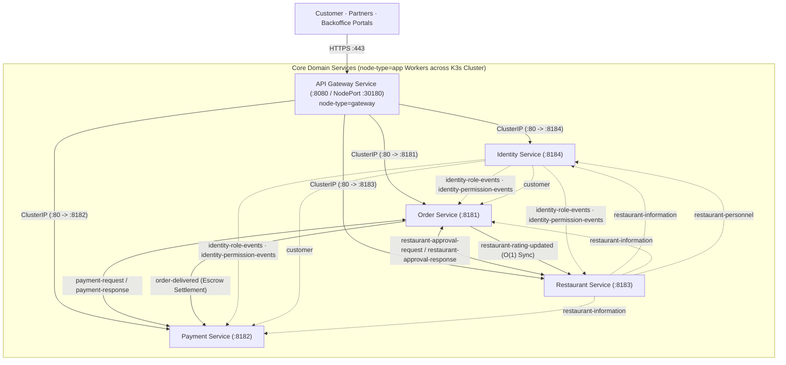
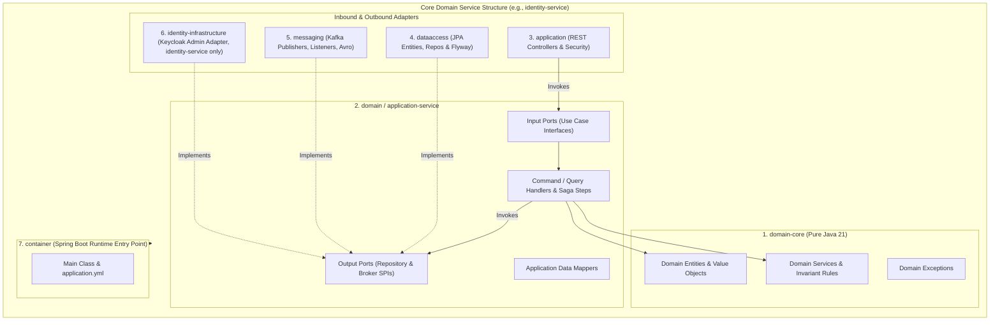
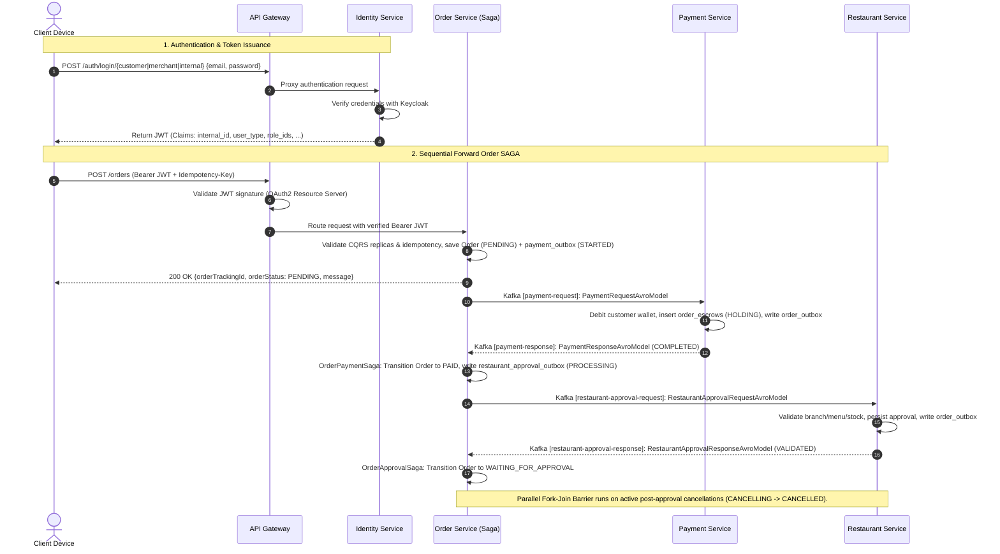

# System Design & Microservices Architecture

## 1. System Overview & Architectural Decomposition

The **Take My Order** ecosystem is decomposed into localized, bounded microservices aligned with specific business subdomains following Domain-Driven Design (DDD) principles. The system enforces strict physical and logical isolation boundaries: business logic within domain cores remains completely decoupled from databases, network transports, messaging brokers, and third-party identity providers.

### 1.1 Microservices Inventory & Responsibilities

| Service | Placement & Runtime | Core Subdomain Responsibility | Ingress / Transport | Persistence & Cache Layer |
| :--- | :--- | :--- | :--- | :--- |
| **🛡️ Gateway Service** | Edge Gateway (`node-type=gateway`)<br>*(Single-Module Reactive WebFlux)* | Reverse proxy routing, `RewritePath` normalization (`/{orders,payments,restaurants}/management/**` & `/api-docs/*`), OAuth2 Resource Server JWT signature validation, global CORS, and centralized Swagger UI Hub (`/swagger-ui.html`). | Public HTTPS (`:443` via Cloudflare) → NodePort (`:30180` → `:8080`) | Stateless (No direct DB) |
| **🧠 Order Service** | Saga Orchestrator & Reviews (`node-type=app`) | Lifecycle management of orders across 10 states. Orchestrates sequential forward SAGAs, Fork-Join cancellation rollbacks, escrow settlements, and verified reviews. | ClusterIP (`:80` → `:8181`) + Kafka | PostgreSQL (`order` schema) + Redis (L2) + Caffeine (L1) |
| **💳 Payment Service** | Escrow & Ledger Core (`node-type=app`) | Customer/merchant wallets (`PESSIMISTIC_WRITE`), hotspot-free per-order Mini Order Escrow Pool (`order_escrows` with `@Version` + `PESSIMISTIC_WRITE`), transaction history, and refunds. | ClusterIP (`:80` → `:8182`) + Kafka | PostgreSQL (`payment` schema) + Redis (L2) + Caffeine (L1) |
| **🍽️ Restaurant Service** | Catalog & Domain Validator (`node-type=app`) | Restaurant branches, menus, categories, cuisines, stock validation, branch personnel, and `O(1)` pre-computed rating updates. | ClusterIP (`:80` → `:8183`) + Kafka | PostgreSQL (`restaurant` schema) + Redis (L2) + Caffeine (L1) |
| **🔐 Identity Service** | Security & IAM Core (`node-type=app`) | User lifecycle, Keycloak OIDC headless proxy, Flat/Tenant RBAC governance, Redis token revocation, and crash-safe distributed user updates. | ClusterIP (`:80` → `:8184`) + Kafka | PostgreSQL (`identity` schema) + Redis (L2) + Caffeine (L1) |



---

## 2. Hexagonal Architecture (Ports and Adapters) Standard

The **four core domain microservices** (`order-service`, `payment-service`, `restaurant-service`, `identity-service`) are structured into independent Maven sub-modules following strict Hexagonal Architecture principles (while `gateway-service` operates as a single-module reactive Spring WebFlux edge proxy). Inside each core domain service, dependencies point inward: the domain core has zero external framework dependencies (pure Java 21), ensuring immunity against technology churn and framework deprecations.



### 2.1 Layer Responsibilities & Isolation Rules

1.  **`<service>-domain/<service>-domain-core`:**
    *   Contains pure domain entities, value objects, and domain events.
    *   **Strict Dependency Rule:** Contains no Spring, JPA, Hibernate, Jackson, or external framework dependencies. All invariants (e.g., price calculations, status transitions) must be evaluated within entity methods to eliminate Anemic Domain Models.
2.  **`<service>-domain/<service>-application-service`:**
    *   Implements application use cases (`CommandHandler`, `QueryHandler`, `SagaStep`).
    *   Defines inbound interfaces (Input Ports) for callers and outbound interfaces (Output Ports) for database access, event publishing, and third-party adapters.
    *   Manages transaction boundaries via Spring's declarative transaction manager (`@Transactional`).
3.  **`<service>-dataaccess`:**
    *   Outbound adapter implementing repository ports.
    *   Maintains JPA entities, Spring Data JPA repositories, and pessimistic/optimistic locking queries.
    *   Translates between database records and domain entities using deterministic mappers, and owns all Flyway SQL migration scripts (`src/main/resources/db/migration/`).
4.  **`<service>-messaging`:**
    *   Outbound/inbound adapter implementing Kafka messaging ports.
    *   Consumes and publishes type-safe Avro records generated from Schema Registry definitions.
5.  **`<service>-application`:**
    *   Inbound adapter exposing HTTP REST APIs.
    *   Contains Spring MVC controllers, request validation (`@Valid`), method-level authorization guards (`@PreAuthorize` backed by `*AuthService` / `RoleAuthorizationService`), and local JWT/revocation filters (`JwtAuthenticationFilter` in `identity-service`, `JwtSecurityFilter` in `common-application`).
6.  **`<service>-container`:**
    *   Executable packaging module. Houses the `@SpringBootApplication` entry point, Spring `BeanConfiguration`, and environment profiles (`application.yml`).

### 2.2 Shared Platform Libraries (`common` & `infrastructure`)

To avoid code duplication across microservices while preserving Hexagonal boundaries, cross-cutting contracts and infrastructure abstractions are centralized in two shared multi-module Maven libraries:

| Parent Module | Sub-Module | Core Responsibility |
| :--- | :--- | :--- |
| **`common`** | `common-domain` | Pure Java 21 DDD building blocks (`AggregateRoot`, `BaseEntity`, `DomainEvent`, `Money`, `OrderStatus`, `PaymentStatus`, `CancelReason`, strongly typed IDs). |
| **`common`** | `common-application` | Shared web/security adapters (`GlobalExceptionHandler`, `ErrorDTO`, `JwtSecurityFilter` with pipelined Redis L2 revocation checks, `JwtAuthenticationToken`, `MicroserviceSecurityConfig`). |
| **`infrastructure`** | `outbox` | Transactional Outbox abstractions (`OutboxScheduler`, `OutboxStatus`, `AbstractRetryableScheduler`, `RetryMechanism`). |
| **`infrastructure`** | `saga` | Distributed SAGA state machine contracts (`SagaStep<T>`, `SagaStatus`, `SagaConstants`). |
| **`infrastructure`** | `kafka` | Shared Kafka modules: `kafka-model` (Avro `.avsc` schemas and generated classes), `kafka-producer` (`KafkaProducer<K, V>`), `kafka-consumer` (`KafkaConsumer<T>`), and `kafka-config-data`. |

---

## 3. Bounded Context Interaction & Data Consistency Model

The ecosystem balances immediate consistency (ACID) within service aggregate boundaries and eventual consistency (BASE) across network boundaries:



### 3.1 Consistency Strategy Summary

*   **Intra-Aggregate Invariants (Strong ACID):** Within a single microservice, any state mutation involving the aggregate and its corresponding Outbox record executes within a single database transaction (`@Transactional`, running at PostgreSQL's default `READ COMMITTED` isolation).
*   **Inter-Service Invariants (Eventual Consistency):** Services never invoke direct synchronous HTTP endpoints on peer services for write operations. State propagation relies on Kafka event streaming guaranteed by the Transactional Outbox pattern (`FOR UPDATE SKIP LOCKED`).
*   **Sequential Forward & Parallel Fork-Join Compensation (Self-Healing):** Forward checkout executes sequentially (`PENDING` → `PAID` → `WAITING_FOR_APPROVAL`). When payment fails, `order-service` cancels immediately (`PENDING` → `CANCELLED`); when validation or an authorized merchant/admin cancels an active post-payment/post-approval order, `order-service` enters `CANCELLING` and executes a symmetric **Parallel Fork-Join** rollback (`payment-service` refunds escrow + `restaurant-service` releases/logs reserved stock) before sealing terminal `CANCELLED`.

---

## 4. Logical Data Architecture & Isolation

To balance strict microservice decoupling with infrastructure resource efficiency, the persistence architecture implements the **Schema-per-Service** pattern on a high-performance bare-metal PostgreSQL 16 cluster:

```
[PostgreSQL Database: takemyorder]
 ├── Schema: "keycloak"     ── Controlled exclusively by Keycloak IAM
 ├── Schema: "identity"     ── Controlled exclusively by identity-service
 ├── Schema: "order"        ── Controlled exclusively by order-service
 ├── Schema: "payment"      ── Controlled exclusively by payment-service
 └── Schema: "restaurant"   ── Controlled exclusively by restaurant-service
```

### 4.1 Isolation Guarantees

1.  **Zero Cross-Schema Joins:** Microservice connection pools (`HikariCP`) are restricted to their dedicated database schema via `currentSchema` connection parameters. Cross-schema queries are strictly forbidden at the application and database privilege levels.
2.  **Independent Migration Lifecycles:** Each service manages its own Flyway migration scripts exclusively inside `<service>-dataaccess/src/main/resources/db/migration/` (loaded at runtime via `classpath:db/migration`). Schema evolution operates autonomously without coordinating global database locks.
3.  **Physical Migration Readiness:** Because all tables, indexes, and sequences are fully contained within dedicated schemas, any microservice database can be extracted into an independent physical database cluster with zero schema refactoring.
