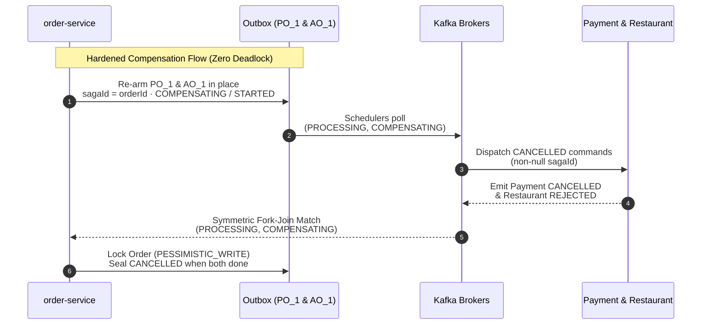
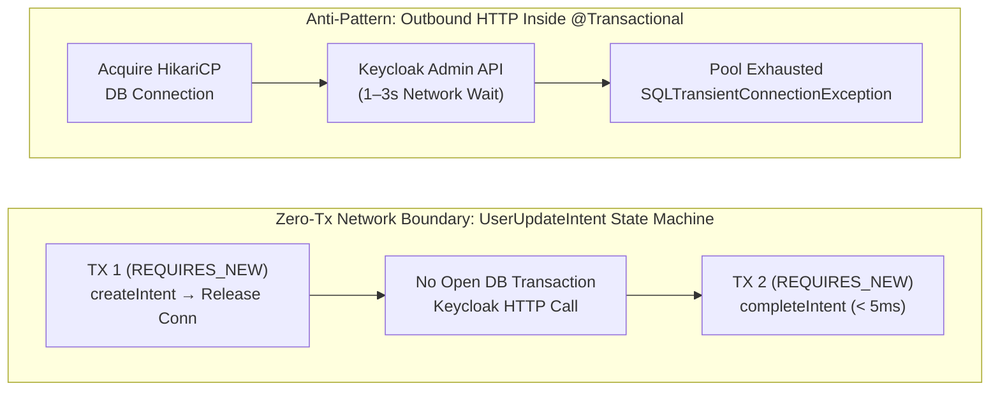

# Production Post-Mortems & Critical Incidents

## 1. Engineering Forensics Index

Operating a distributed, event-driven microservices ecosystem surfaces subtle concurrency hazards, container runtime incompatibilities, and distributed state bugs. This register records the key **engineering post-mortems** diagnosed and mitigated across the **Take My Order** platform:

| ID | Incident & Root Cause | Resolution & Scope |
| :--- | :--- | :--- |
| **INC&#8209;01** | **Caffeine Cache Key Collision** (`ClassCastException`) | Isolated cache regions (`roles` vs. `roleOrgUnits` / `role_org_units`) |
| **INC&#8209;02** | **SAGA `sagaId` Drift & Fork-Join Deadlock** | `sagaId == orderId` invariant + symmetric `COMPENSATING` lookup |
| **INC&#8209;03** | **Kafka `InconsistentClusterIdException`** | Split Zookeeper (`zookeeper-pvc` / `log-pvc`) & Broker PVCs |
| **INC&#8209;04** | **Concurrent Wallet Overdraft Race** | `PESSIMISTIC_WRITE` + `@Version` + `UNIQUE (idempotency_key)` |
| **INC&#8209;05** | **HikariCP Exhaustion via Keycloak Latency** | Zero-Tx Network Boundary (`UserUpdateIntent` + `REQUIRES_NEW`) |
| **INC&#8209;06** | **Alpine `musl libc` & Snappy JNI Crash** | `compression-type: none` on `eclipse-temurin:21-jre-alpine` |
| **INC&#8209;07** | **K8s Sequential `$(VAR)` Ordering Trap** | Strict prerequisite ordering (`KC_DB_URL_*` above `KC_DB_URL`) |

---

## INC-01: Caffeine Cache Key Collision (ClassCastException)

**Scope:** `order-service`, `payment-service`, `restaurant-service` (`RolePermissionQueryAdapter` & `CacheConfig`)

**Symptom:** Authorization checks fail intermittently at runtime with `java.lang.ClassCastException` (for example, `java.util.UUID` cannot be cast to `java.util.Set`, or vice versa) during concurrent RBAC lookups on the same role.

**Root Cause:** In domain services, `RolePermissionQueryAdapter` exposes two read-only methods keyed by the exact same `#roleId` parameter but returning **different Java types**: `getPermissionCodesByRoleId(UUID roleId)` returns `Set<String>`, whereas `getOrganizationalUnitIdByRoleId(UUID roleId)` returns `UUID`. Placing both `@Cacheable` annotations into a single shared cache region (`"roles"`) causes whichever method warms `#roleId` first to poison the cache entry for the second method; due to JVM type erasure, the mismatch only surfaces as a runtime `ClassCastException`.

**Resolution:** Every domain service's `CacheConfig` registers strictly isolated Caffeine regions in `CaffeineCacheManager` (`initialCapacity: 100`, `maximumSize: 500`, `expireAfterAccess: 60m`): `"roles"` stores `Set<String>` permission codes while `"roleOrgUnits"` (`order-service`, `restaurant-service`) and `"role_org_units"` (`payment-service`) store `UUID` tenant scopes. Meanwhile, `identity-service` isolates its full `Role` domain object inside its own dedicated `"roles_cache"` region (`RoleAuthorizationService`).

---

## INC-02: SAGA Correlation & Fork-Join Deadlock

**Scope:** `order-service` (`OrderCancelHelper`, `OrderPaymentSaga`, `OrderApprovalSaga`, `RestaurantApprovalOutboxScheduler`)

**Symptom:** Following a kitchen rejection or staff cancellation with `MaterialAction.RESTORE_STOCK`, orders stalled indefinitely in `OrderStatus.CANCELLING` without transitioning to `CANCELLED`.

**Root Cause:** Architectural forensics surfaced two interlocking failure paths on the compensation flow:

* **Broken `sagaId` Correlation:** Generating a fresh `UUID.randomUUID()` instead of binding `sagaId` to `order.getId().getValue()` severed returning `payment-response` and `restaurant-approval-response` events from the parent order's outbox rows.
* **Asymmetric `COMPENSATING` Lookups:** Re-arming `PO_1` and `AO_1` sets `saga_status = COMPENSATING`, yet legacy rollback listeners (`OrderPaymentSaga.rollback()`, `OrderApprovalSaga.rollback()`) and `RestaurantApprovalOutboxScheduler` queried only `SagaStatus.PROCESSING`—causing outbound stock-restore messages never to be polled and returning callbacks to treat active compensations as already processed.

**Resolution:** Enforced `sagaId == order.getId().getValue()` everywhere (backed by required non-null `sagaId` fields across all four SAGA `.avsc` contracts), updated both `OrderPaymentSaga` and `OrderApprovalSaga` rollback handlers plus `RestaurantApprovalOutboxScheduler` to include `SagaStatus.COMPENSATING`, and implemented the symmetric Fork-Join barrier with `PESSIMISTIC_WRITE` (`findByIdWithLock`)—see [Cancel SAGA Deep-Dive](../distributed-systems/cancel-saga-deep-dive.md).

---

## INC-03: Kafka Cluster ID Mismatch on Restart

**Scope:** `infrastructure/k8s/base/global/persistent-volumes.yaml`, `zookeeper.yaml`, `kafka-cluster.yaml`

**Symptom:** After a node reboot on `k8s-master-infra`, Kafka broker pods entered `CrashLoopBackOff` with `kafka.common.InconsistentClusterIdException: The Cluster ID ... doesn't match stored clusterId in meta.properties`.

**Root Cause:** When Zookeeper loses its durable state across restarts (or boots with ephemeral storage while Kafka brokers retain `meta.properties` on persistent volumes), Zookeeper generates a brand-new Cluster ID in `/cluster/id`. Upon startup, Kafka brokers compare Zookeeper's fresh ID against their persisted `meta.properties` and immediately abort to prevent split-brain log corruption.

**Resolution:** Provisioned five isolated `ReadWriteOnce` Persistent Volume Claims in `infrastructure/k8s/base/global/persistent-volumes.yaml` (`namespace: take-my-order`)—separating Zookeeper state (`zookeeper-pvc` `1Gi` → `/var/lib/zookeeper/data`, `zookeeper-log-pvc` `1Gi` → `/var/lib/zookeeper/log`) from each broker's log directory (`kafka-broker-1-pvc`, `kafka-broker-2-pvc`, `kafka-broker-3-pvc`, `2Gi` each → `/var/lib/kafka/data`). Complementing disk isolation, all three brokers disable auto-topic creation (`KAFKA_AUTO_CREATE_TOPICS_ENABLE: "false"`) while `init-kafka` deterministically provisions all topics (`3` partitions, replication factor `3`).

---

## INC-04: Concurrent Wallet Overdraft Race Condition

**Scope:** `payment-service` (`WalletApplicationServiceImpl`, `WalletJpaRepository`, `CustomerWallet`, `OrderDeliveredMessageListenerImpl`)

**Symptom:** Under concurrent checkout or withdrawal requests against the same account (e.g., two simultaneous `40 TRY` debits against a `50 TRY` balance), unserialized `READ COMMITTED` reads both observe `50 TRY >= 40 TRY` and allow a lost update or overdraft.

**Root Cause:** Evaluating `CustomerWallet.subtractBalance()` purely in memory after a non-locking `SELECT` allows interleaved transactions to validate against stale balances before either transaction commits.

**Resolution:** Enforced a layered concurrency defense across REST mutations, settlement, and SAGA ledgers:

* **Pessimistic Row Serialization (`PESSIMISTIC_WRITE`):** `WalletApplicationServiceImpl` (`deposit`, `withdraw`) and `OrderDeliveredMessageListenerImpl` (`settleOrder`) lock wallet rows via `WalletJpaRepository.findByOwnerIdWithLock()` (`SELECT ... FOR UPDATE`), while escrow release locks `payment.order_escrows` via `findByOrderIdWithLock()`.
* **Optimistic Lock & Domain Invariant:** `payment.wallets` enforces `UNIQUE (owner_id)` and `@Version` (`version integer NOT NULL`) alongside `CustomerWallet.subtractBalance()` rejecting insufficient balances with `PaymentDomainException`—catching concurrent lost updates during SAGA payment capture (`WalletPaymentStrategyImpl`).
* **Database-Level Idempotency:** `payment.wallet_transactions` enforces `UNIQUE (idempotency_key)` and `payment.order_escrows` enforces `UNIQUE (order_id)`, blocking duplicate debits, refunds, or payouts across retries.

---

## INC-05: HikariCP Pool Starvation on Keycloak Latency

**Scope:** `identity-service` (`UpdateUserProfileCommandHandler`, `UpdateUserStatusCommandHandler`, `UserUpdateIntentHelper`, `UserUpdateIntentScheduler`)

**Symptom:** Under elevated identity traffic or temporary Keycloak Admin API latency spikes, database health checks degrade and incoming requests fail with `SQLTransientConnectionException: HikariPool-1 - Connection is not available, request timed out after 30005ms`.

**Root Cause:** Wrapping outbound HTTP requests to Keycloak inside a Spring `@Transactional` method leases a PostgreSQL connection from HikariCP before the remote call starts and holds it idle for the entire network round-trip (often 1–3 seconds under load). A small burst of concurrent slow calls exhausts the default 10-connection pool and stalls unrelated endpoints across the service.

**Resolution:** Profile and status mutations (`UpdateUserProfileCommandHandler`, `UpdateUserStatusCommandHandler`) and the background recovery job (`UserUpdateIntentScheduler` — explicitly annotated without `@Transactional`) enforce the **Zero-Tx Network Boundary** via `UserUpdateIntentHelper`: short `Propagation.REQUIRES_NEW` transactions bracket the non-transactional Keycloak HTTP call so connections return to HikariCP immediately (see [Crash-Safe Distributed Update Engine](../security/user-update-engine.md)). Self-service registration (`RegisterCustomerCommandHandler`) currently retains a compensating `deleteUser` rollback pattern and can adopt the same split-transaction intent engine if registration concurrency becomes a bottleneck.

---

## INC-06: Alpine musl libc & Kafka Snappy JNI Crash

**Scope:** All microservice `Dockerfile` images & Kafka producer configs (`application.yml`, `config-maps.yaml`)

**Symptom:** Deploying services packaged on `eclipse-temurin:21-jre-alpine` with `compression-type: snappy` caused `KafkaProducer.doSend()` to crash on the very first publish with `java.lang.NoClassDefFoundError: Could not initialize class org.xerial.snappy.Snappy` (root `UnsatisfiedLinkError`).

**Root Cause:** `org.xerial.snappy:snappy-java` loads a bundled native shared library (`libsnappyjava.so`) dynamically linked against `glibc`. Because Alpine Linux uses `musl libc`, the container dynamic linker fails to resolve `glibc` JNI symbols when Snappy initializes its native compressor.

**Resolution:** To retain the slim memory and disk footprint of `eclipse-temurin:21-jre-alpine` across 1 OCPU ARM64 workers without installing `glibc` compatibility layers, all four domain `application.yml` files and `infrastructure/k8s/base/global/config-maps.yaml` standardize `KAFKA_PRODUCER_CONFIG_COMPRESSION_TYPE` to **`none`** (while brokers retain `KAFKA_COMPRESSION_TYPE: "producer"` so pure-Java `gzip` remains selectable via ConfigMap if payload compression is ever required).

---

## INC-07: K8s Env Sequential Interpolation Trap

**Scope:** `infrastructure/k8s/base/platform/keycloak.yaml` (and Kustomize manifests)

**Symptom:** Pods defining compound JDBC URLs with Kubernetes `$(VAR_NAME)` substitution failed startup health probes because the JDBC driver received unresolved literal strings (e.g., `$(KC_DB_URL_PORT)`) instead of numeric port values.

**Root Cause:** Kubernetes evaluates container `env:` entries strictly sequentially from top to bottom without topological dependency sorting. Any `$(VAR_NAME)` referenced *before* `VAR_NAME` is declared in the `env:` array is passed verbatim as literal text to the container process.

**Resolution:** Standardized strict prerequisite-first declaration order across Kustomize manifests—for example, `infrastructure/k8s/base/platform/keycloak.yaml` declares `KC_DB_URL_HOST`, `KC_DB_URL_PORT`, and `KC_DB_URL_DATABASE` strictly above `KC_DB_URL` (`jdbc:postgresql://$(KC_DB_URL_HOST):$(KC_DB_URL_PORT)/$(KC_DB_URL_DATABASE)?sslmode=disable`), while domain Spring Boot services delegate JDBC URL assembly to Spring Boot placeholders (`${MASTER_PRIVATE_IP}:${DB_PORT}`) inside `application.yml`.

!!! tip "Related Deep-Dives"
    * For the architectural trade-offs behind each subsystem, see [Architectural Decision Records (ADRs)](../devops/architectural-decision-records.md).
    * For full SAGA cancellation, escrow locking, and crash-safe identity state machines, see [Cancel SAGA Deep-Dive](../distributed-systems/cancel-saga-deep-dive.md) and [Crash-Safe Distributed Update Engine](../security/user-update-engine.md).
