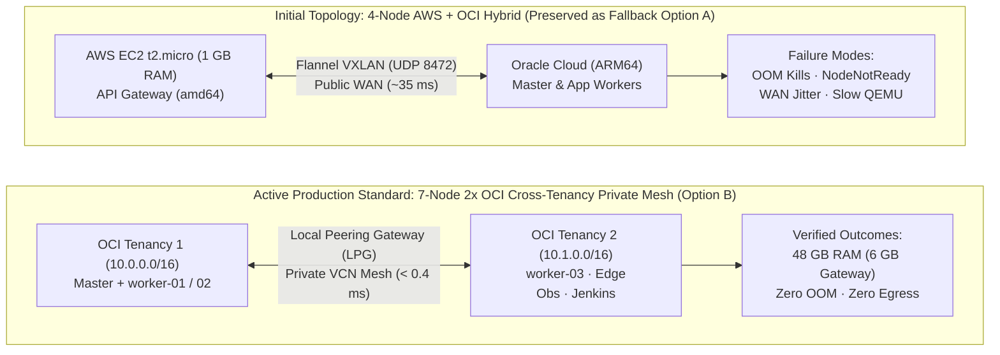

# Architectural Decision Records (ADRs)

## 1. Decision Framework & ADR Index

Engineering distributed microservices requires explicit trade-offs across availability, data consistency, resource quotas, security latency, and operational complexity. This register documents the foundational **Architectural Decision Records (ADRs)** adopted across the **Take My Order** platform—capturing context, rejected alternatives, verified resolutions, and links to each detailed specification:

| ADR | Adopted Architectural Decision | Status & Deep-Dive |
| :--- | :--- | :--- |
| **ADR&#8209;001** | **2× OCI Cross-Tenancy + LPG** over AWS+OCI Hybrid | **Accepted** · [Cross-Tenancy Topology](cross-tenancy-topology.md) |
| **ADR&#8209;002** | **Per-Order Escrow (`order_escrows`)** over Central Wallet | **Accepted** · [Escrow & Settlement](../distributed-systems/escrow-and-settlement.md) |
| **ADR&#8209;003** | **Review Context in `order-service`** over `restaurant-service` | **Accepted** · [Review & Rating Engine](../services/restaurant-rating-system.md) |
| **ADR&#8209;004** | **In-Place Outbox Re-Arming** over Multi-Row SAGA | **Accepted** · [Cancel SAGA Deep-Dive](../distributed-systems/cancel-saga-deep-dive.md) |
| **ADR&#8209;005** | **JWT `role_ids` + L1 Caffeine IDOR** over Per-Request SQL | **Accepted** · [Stateless IDOR Shield](../security/stateless-idor-shield.md) |
| **ADR&#8209;006** | **Native ARM64 Jenkins + SSH Stream** over QEMU Actions | **Accepted** · [ARM64 Jenkins CI/CD](jenkins-ci-cd-pipeline.md) |
| **ADR&#8209;007** | **Apache Avro + Schema Registry** over Raw Kafka JSON | **Accepted** · [Avro Contracts](../distributed-systems/avro-contracts.md) |
| **ADR&#8209;008** | **`O(1)` Role Redis Revocation** over `O(N)` Fan-Out | **Accepted** · [Token Revocation](../security/token-lifecycle-and-revocation.md) |

---

## ADR-001: 2x OCI Cross-Tenancy vs. AWS+OCI Hybrid

**Status:** Accepted *(Supersedes Initial Hybrid Production Deployment)* · **Scope:** Infrastructure & Networking

**Context & Empirical Failure Data:** The initial deployment bridged an **AWS EC2 `t2.micro` (`x86_64`, `1 vCPU / 1 GB RAM`)** edge node hosting `gateway-service` with an **Oracle Cloud (`ARM64`)** cluster hosting `k8s-master-infra` and domain services across the public WAN via **Flannel VXLAN (`UDP 8472`)**:

* **Severe Memory Starvation (`1 GB` Ceiling):** Spring Cloud Gateway (Java 21 / Spring Boot 3) plus Linux and the K3s agent regularly exhausted physical RAM on `t2.micro`, causing Linux OOM kills and `NodeNotReady` flapping.
* **Public WAN Latency & Jitter:** Unencrypted UDP VXLAN encapsulation over the public internet added ~25–45 ms of latency per hop and exposed cluster traffic to WAN packet drops.
* **Heterogeneous Build Overhead:** Targeting mixed `amd64` + `arm64` nodes forced slow QEMU cross-architecture builds (~12–18 minutes across all five services).

**Decision & Consequences:** Retired AWS `t2.micro` from active production and provisioned a second OCI Always Free tenancy in Frankfurt (`eu-frankfurt-1`), connecting `10.0.0.0/16` and `10.1.0.0/16` privately via **Local Peering Gateway (LPG)** (the 4-node hybrid setup remains preserved in the repository as an optional fallback). Cluster capacity expanded to **8 OCPU / 48 GB RAM** (`6 GB` dedicated to `k8s-worker-edge`, eliminating OOM crashes), inter-node latency dropped to **`< 0.4 ms`**, and internal VCN traffic incurs **0 bytes** of public egress billing.

---

## ADR-002: Per-Order Escrow vs. Platform Wallet

**Status:** Accepted · **Scope:** Financial Ledger (`payment-service`)

**Context & Evaluated Options:** Crediting restaurant wallets immediately upon `OrderStatus.PAID` creates early-withdrawal and negative-balance risks if an active order is later cancelled before delivery:

* **Option A — Central Platform Wallet Row:** Funnel all in-flight order funds through a single `OwnerType.PLATFORM` wallet row. Under concurrent checkouts, refunds, and deliveries, every transaction contends for `SELECT ... FOR UPDATE` on the exact same row (**hotspot lock contention**).
* **Option B — Mini Order Escrow Pool (`payment.order_escrows`):** Store one isolated row per paid order (`UNIQUE (order_id)`, states `HOLDING` → `RELEASED` or `REFUNDED`, optimistic `@Version` + per-order `PESSIMISTIC_WRITE` during settlement).

**Decision & Consequences:** Adopted **Option B**. Concurrent checkouts insert independent escrow rows with zero cross-order lock contention, cancellation refunds return funds directly from escrow without touching merchant balances, and merchant payouts trigger autonomously via the asynchronous `order-delivered` choreography event.

---

## ADR-003: Review Context in Order vs. Restaurant

**Status:** Accepted · **Scope:** Bounded Context Ownership (`order-service` & `restaurant-service`)

**Context & Evaluated Options:** Customer reviews rate restaurants, yet validating a verified review requires transactional state owned by `order-service`: order ownership, `OrderStatus.DELIVERED`, the 7-day `delivered_at` window, 1:1 `is_reviewed` enforcement, and account-owner name masking from `"order".customers`:

* **Option A — Host Reviews in `restaurant-service`:** Forces multiple synchronous cross-service HTTP checks against `order-service` and distributed 2-Phase Commit coordination to flip `is_reviewed = true`.
* **Option B — Host Reviews in `order-service` + Outbox Projection:** Validate all invariants and persist `"order".order_reviews` inside a single local ACID transaction (serializing same-restaurant recalculations via `PESSIMISTIC_WRITE` on `"order".restaurant_replica`), then publish snapshots over `restaurant-rating-updated`.

**Decision & Consequences:** Adopted **Option B**. Write-path validation runs with **zero synchronous network hops**, while `restaurant-service` applies an idempotent, timestamp-guarded `O(1)` update (`average_rating`, `total_reviews`, `rating_updated_at`) to power local public catalog sorting.

---

## ADR-004: In-Place Outbox vs. Multi-Row SAGA

**Status:** Accepted · **Scope:** SAGA Orchestration & Outbox Persistence (`order-service`)

**Context & Evaluated Options:** When an active order enters cancellation or rollback, `order-service` must emit compensation events to `payment-service` and/or `restaurant-service` while maintaining clean outbox indexing and scheduled cleanup:

* **Option A — Insert New Outbox Rows (`PO_2`, `AO_2`):** Leaves original forward rows (`PO_1`, `AO_1`) orphaned in `SagaStatus.PROCESSING`, violates the composite unique index `(type, saga_id, saga_status)` on `"order".payment_outbox` and `"order".restaurant_approval_outbox`, and breaks `Optional<Entity>` lookups (`findByTypeAndSagaId` / `findByTypeAndSagaIdAndSagaStatusIn`) with `NonUniqueResultException`.
* **Option B — In-Place Re-Arming (`PO_1` / `AO_1` Mutation):** Enforce **at most one `payment_outbox` row and one `restaurant_approval_outbox` row per order**; mutate existing rows in place to `order_status = CANCELLING`, `saga_status = COMPENSATING`, `outbox_status = STARTED`, overwrite the JSON `payload` with the rollback command, and increment `@Version`.

**Decision & Consequences:** Adopted **Option B**. Preserves database unique indexes and single-result JPA contracts, prevents zombie `PROCESSING` rows, and cleanly drives the symmetric Fork-Join cancellation barrier and `@midnight` cleanup.

---

## ADR-005: Role-Bound Caffeine IDOR vs. Per-Request SQL

**Status:** Accepted · **Scope:** Multi-Tenant Authorization & Security

**Context & Evaluated Options:** Preventing cross-branch Insecure Direct Object Reference (IDOR) and cross-branch privilege bleed (e.g., a user who is a waiter at Branch A and an owner at Branch B) is essential across multi-tenant endpoints:

* **Option A — Per-Request SQL Membership Queries:** Querying user-to-branch join tables on every protected HTTP request adds database latency and risks HikariCP pool exhaustion under traffic spikes or ID enumeration scans.
* **Option B — Flat JWT Branch Array Checks:** Evaluating flat `organizational_unit_ids` separately from a flat permission list fails against cross-branch privilege bleed.
* **Option C — JWT `role_ids` + Same-Role L1 Caffeine Cache:** Embed signed `internal_id`, `user_type`, and `role_ids` in RS256 JWTs (`organizational_unit_ids` is used only in `identity-service` query filters). `@PreAuthorize` guards (`RestaurantAuthService`, `OrderAuthService`, `PaymentAuthService`, and `RoleAuthorizationService` in `identity-service`) resolve each `roleId` via per-pod **L1 Caffeine caches** (`roles` / `roles_cache`, `roleOrgUnits` / `role_org_units`) backed by local role tables (`roles` in `identity-service`; Kafka-replicated `roles_replica` in domain services).

**Decision & Consequences:** Adopted **Option C**. Authorization succeeds only when a **single `roleId`** binds to both the target branch and the requested permission, achieving **0 SQL on cache hit** while blocking cross-branch privilege bleed without coupling microservices to `identity-service` at runtime.

---

## ADR-006: Native ARM64 Jenkins vs. GitHub Actions

**Status:** Accepted · **Scope:** CI/CD Build & Image Distribution

**Context & Evaluated Options:** Shipping Java 21 / Spring Boot microservices to Oracle Ampere ARM64 nodes required a fast, reliable build and container delivery strategy:

* **Option A — GitHub Actions (`ubuntu-latest`) + QEMU + Docker Hub:** Cross-compiling multi-arch (`linux/amd64,linux/arm64`) images via QEMU emulation takes ~12–18 minutes across all five services and depends on Docker Hub push/pull quotas (`imagePullPolicy: Always`).
* **Option B — Stand-Alone Native ARM64 Jenkins + Private SSH Streaming:** Provision a dedicated `1 OCPU / 6 GB RAM` server (`devops-jenkins-server`, outside K3s) to compile natively on ARM64 and pipe compressed images directly over private LPG SSH (`docker save | gzip` → `gunzip | sudo k3s ctr -n k8s.io images import -`) with `imagePullPolicy: Never`.

**Decision & Consequences:** Adopted **Option B** as the active pipeline (`.github/workflows/deploy.yml` stays available manually via `workflow_dispatch` for Option A hybrid clusters). Full builds dropped to **~2–3 minutes** (faster with single-service `-pl <module> -am` builds), bypassing Docker Hub pull limits and WAN egress while isolating build load from live K3s pods.

---

## ADR-007: Avro & Schema Registry vs. Raw JSON

**Status:** Accepted · **Scope:** Event-Driven Messaging Contracts (`kafka-model`)

**Context & Evaluated Options:** Kafka topics act as asynchronous public contracts across bounded contexts; evolving payloads safely without breaking downstream consumers is critical during rolling updates:

* **Option A — Untyped JSON Strings:** Human-readable, yet lacks compile-time contract checks, repeats field names in every record, and risks silent `null` deserialization or numeric/timestamp drift on field renames.
* **Option B — Binary Apache Avro + Confluent Schema Registry:** Author centralized `.avsc` contracts compiled by `avro-maven-plugin` into typed Java `SpecificRecordBase` models (`decimal` → `BigDecimal`, `timestamp-millis` → `Instant`) and validated against Confluent Schema Registry (`BACKWARD` default compatibility) with `specific.avro.reader = true`.

**Decision & Consequences:** Adopted **Option B**. Contract mismatches fail fast at Maven compile time rather than in production, compact binary framing eliminates repetitive JSON field overhead, and nullable union defaults (`["null", T]`) guarantee zero-downtime schema evolution across rolling deployments.

---

## ADR-008: O(1) Role Redis Revocation vs. O(N) Fan-Out

**Status:** Accepted · **Scope:** IAM Token Lifecycle & Revocation (`identity-service` & `common-application`)

**Context & Evaluated Options:** RS256 access tokens remain cryptographically valid for their 5-minute (`300s`) lifespan. When an administrator updates or deletes a shared role (`PUT /roles/{roleId}`, `DELETE /roles/{roleId}`), active tokens holding that role need immediate soft invalidation so portals refresh updated permissions without logging users out:

* **Option A — `O(N)` Per-User Fan-Out Loop:** Query `user_roles` for every holder of the role and execute `N` individual Redis writes (`user:{id}:revoke`). For large roles, this adds relational table scans and Redis write spikes.
* **Option B — `O(1)` Role-Level Timestamp Key + Batched `MGET`:** Execute a single Redis write (`role:{roleId}:revoke` → `{"type":"role_updated","iat":<epoch_sec>}`, `5m` TTL). Authentication filters (`JwtSecurityFilter`, `JwtAuthenticationFilter`) perform one batched Redis `MGET` across `user`, `sid`, and token `role_ids`, rejecting tokens where `iat <= revokedIat + 5` (5-second NTP clock-skew grace window) with HTTP `401` (`ACCESS_TOKEN_REVOKED`).

**Decision & Consequences:** Adopted **Option B**. Reduces revocation writes from `O(N)` to **`O(1)`** with zero SQL joins on role edits, triggers silent token refresh on clients without forced logout, and preserves checkout availability via fail-open handling in domain filters if Redis becomes temporarily unreachable.
