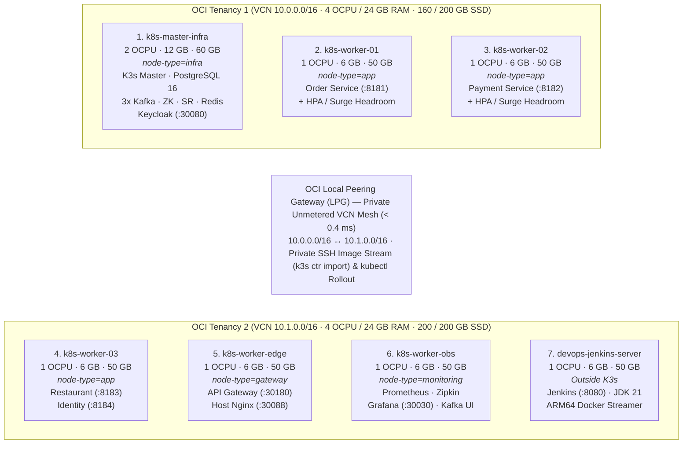

# Cross-Tenancy Infrastructure, LPG Mesh & K3s Scheduling

## 1. Dual Production Cloud Topology Options

The repository preserves **two reproducible cloud deployment topologies** so engineers can deploy the platform according to the Always Free / starter cloud accounts available to them:

* **Option A — 4-Node Hybrid Multi-Cloud (`1× Oracle Cloud ARM64` + `1× AWS Free Tier x86_64`):**
    Runs the K3s Control Plane, Bare-Metal PostgreSQL, Kafka, Keycloak, and Observability on `k8s-master-infra` (`2 OCPU / 12 GB RAM`), distributes domain microservices across `k8s-worker-01` and `k8s-worker-02` (`2× 1 OCPU / 6 GB RAM` ARM64), and isolates `gateway-service` on an **AWS EC2 `t2.micro` (`amd64`)** worker bridged across clouds via **Flannel VXLAN (`UDP 8472`)** and `--node-external-ip`. Multi-architecture images (`linux/amd64,linux/arm64`) are built via `.github/workflows/deploy.yml` (GitHub Actions + QEMU + Docker Buildx) and pushed to Docker Hub (`imagePullPolicy: Always`).
    *Full setup guide: [Alternative: 4-Node Hybrid Multi-Cloud Setup](../installation/hybrid-cloud-aws-oracle-setup.md).*
* **Option B — 7-Node Cross-Tenancy OCI (`2× Oracle Cloud ARM64` + `LPG Peering` — Active Architecture):**
    Orchestrates **8 OCPU / 48 GB RAM** and a **400 GB Block Volume quota (360 GB allocated + 40 GB reserve)** of native ARM64 (`VM.Standard.A1.Flex`) compute across **two independent Oracle Cloud Infrastructure (OCI) tenancies** in Frankfurt (`eu-frankfurt-1`): a 6-node K3s cluster plus 1 stand-alone CI/CD server. The two VCNs (`10.0.0.0/16` and `10.1.0.0/16`) connect via Oracle's **Local Peering Gateway (LPG)**, forming a private, unmetered, sub-millisecond (`< 0.4 ms`) internal mesh.
    *Full setup guide: [Seven-Node Cross-Tenancy Cluster Setup](../installation/seven-node-cluster-setup.md).*

---

## 2. Seven-Node Hardware & Compute Topology

### 2.1 Right-Sizing CI/CD to Unlock a 3rd Application Worker

The stand-alone Jenkins server (`devops-jenkins-server`) stays idle most of the day and only spikes during short Maven/Docker builds (`~3.1 GB` peak RAM across Jenkins JVM, Docker, and Maven). Allocating **1 OCPU / 6 GB RAM / 50 GB SSD** leaves ample build headroom while freeing **1 OCPU / 6 GB RAM** in OCI Tenancy 2 to provision **`k8s-worker-03`**—giving the application tier three dedicated workers (`3 OCPU / 18 GB RAM`) spanning two separate cloud accounts.

### 2.2 Seven-Node Placement & Defense Matrix

| Node, Tenancy & Specs | K3s Tier & Hosted Workloads | Architectural Rationale |
| :--- | :--- | :--- |
| **`k8s-master-infra`** OCI #1 (`10.0.0.0/16`) 2 OCPU · 12 GB · 60 GB | **K3s Master** (`node-type=infra`) Bare-Metal PostgreSQL 16 (`:5432`), Zookeeper, 3× Kafka Brokers, Schema Registry, Redis, Keycloak (NodePort `:30080`) | **Stateful Backbone Isolation:** Moving monitoring workloads off the Master preserves Linux OS Page Cache (`~5.5 GB` headroom) for PostgreSQL tables and Kafka log segments. |
| **`k8s-worker-01`** OCI #1 (`10.0.0.0/16`) 1 OCPU · 6 GB · 50 GB | **App Worker 1** (`node-type=app`) `order-service` (`:8181`) + HPA / `RollingUpdate` surge replicas | **Dedicated SAGA Orchestrator Compute:** Leaves `~5 GB` free RAM for HPA scale-out and zero-downtime surges. |
| **`k8s-worker-02`** OCI #1 (`10.0.0.0/16`) 1 OCPU · 6 GB · 50 GB | **App Worker 2** (`node-type=app`) `payment-service` (`:8182`) + HPA / surge replicas | **Fault & CPU Isolation:** Separates high-frequency SAGA ledger transactions from `order-service` to eliminate host CPU contention. |
| **`k8s-worker-03`** OCI #2 (`10.1.0.0/16`) 1 OCPU · 6 GB · 50 GB | **App Worker 3** (`node-type=app`) `restaurant-service` (`:8183`), `identity-service` (`:8184`) + HPA replicas | **Cross-Tenancy HA:** Reaches Master DB and Kafka over LPG in `< 0.4 ms` and provides the 3rd distinct physical host when HPA scales any service to 3 replicas. |
| **`k8s-worker-edge`** OCI #2 (`10.1.0.0/16`) 1 OCPU · 6 GB · 50 GB | **Edge / DMZ Worker** (`node-type=gateway`) `gateway-service` (NodePort `:30180`, HPA `1..2`) + Host Nginx (`:30088` serving 3 Angular portals) | **Perimeter Isolation:** Absorbs public Cloudflare traffic (`api.<domain>.com` → `:30180`, portals → `:30088`), keeping internal app and DB nodes off the public ingress path (see [Subdomain & Portal Routing](../architecture/subdomain-and-portals.md)). |
| **`k8s-worker-obs`** OCI #2 (`10.1.0.0/16`) 1 OCPU · 6 GB · 50 GB | **Observability Worker** (`node-type=monitoring`) Prometheus (`ClusterIP :9090`), Zipkin (`ClusterIP :9411`), Grafana (`NodePort :30030`), Kafka UI (`NodePort :30091`) | **Out-of-Band Telemetry:** Isolates 5-second Spring Actuator scraping, TSDB indexing, and trace ingestion from checkout latency; unauthenticated backends (`Prometheus`, `Zipkin`) remain `ClusterIP`-only. |
| **`devops-jenkins-server`** OCI #2 (`10.1.0.0/16`) 1 OCPU · 6 GB · 50 GB | **Stand-Alone CI/CD** *(Outside K3s)* Jenkins (`:8080`), Maven, JDK 21, ARM64 Docker Engine | **Out-of-Cluster Build Isolation:** Prevents Maven compilation and container builds from disturbing live K3s workloads (see [Native ARM64 Jenkins CI/CD](jenkins-ci-cd-pipeline.md)). |

---

## 3. Image Pre-Distribution vs. Active Pod Execution

A common operational distinction in this cluster is the separation between **container image caching on disk** and **active pod execution in memory**:

* **Pre-Streamed Local Image Cache (`imagePullPolicy: Never`):** During CI/CD, Jenkins builds native ARM64 images and streams compressed archives over private SSH (`docker save | gzip` → `gunzip | sudo k3s ctr -n k8s.io images import -`) directly into `k8s-worker-edge` (for `gateway-service`) and all three application workers (`k8s-worker-01`, `02`, `03` for domain services). Cached images on disk consume **0% CPU and 0 MB RAM**.
* **Active Pod Execution & Zero-Registry Scale-Out:** Under baseline load (`replicas: 1`), only a single pod per microservice consumes CPU and memory across the worker pool. When HPA spawns a 2nd or 3rd replica—or during a `RollingUpdate` (`maxSurge: 1`, `maxUnavailable: 0`)—container startup begins immediately from the local `containerd` cache with **zero Docker Hub pull delay**, and `kube-proxy` adds the new replica to the `ClusterIP` round-robin pool as soon as Spring Boot passes `/actuator/health` (`readinessProbe`).

---

## 4. Kubernetes Scheduling & Placement Strategies

The cluster combines four native Kubernetes mechanisms defined across `infrastructure/k8s/base/` (while local development strips `nodeSelector` via `overlays/dev/patch-global.yaml` so the stack runs on a single workstation node):

| Scheduling Mechanism | Manifest Configuration | Operational Guarantee |
| :--- | :--- | :--- |
| **`nodeSelector` Tier Segregation** | `node-type`: `infra`, `app`, `gateway`, `monitoring` across every Deployment | Hard isolation—stateful infrastructure never lands on Edge or App workers, and customer APIs never starve the Master node. |
| **Resource Quotas & `LeastAllocated`** | Explicit `requests` / `limits` (e.g., `300Mi–800Mi` RAM, `300m–1000m` CPU on domain services) | Prevents Noisy Neighbor starvation and lets K3s's default `LeastAllocated` scorer balance pods across the worker with the most free headroom. |
| **Soft `PodAntiAffinity`** | `preferredDuringSchedulingIgnoredDuringExecution` (`weight: 100`, `kubernetes.io/hostname`) | Spreads HPA and rolling-update replicas across distinct physical nodes (`worker-01`, `02`, `03`) while still allowing safe co-location if one node is under maintenance. |
| **CPU-Driven `HPA`** | `infrastructure/k8s/base/services/hpa.yaml` (`averageUtilization: 70` on `requests.cpu`) | Scales domain services `1..3` replicas and `gateway-service` `1..2` replicas automatically (see [HPA & Resilient Autoscaling](hpa-and-autoscaling.md)). |

**Intentionally Excluded Strategies:** Bin packing (`MostAllocated`) is avoided because concentrating pods on a single fixed-quota node increases CPU contention and creates a single point of failure; `TopologySpreadConstraints` is unnecessary at 3 application workers where `nodeSelector` + soft `PodAntiAffinity` already provide deterministic physical spreading.

---

## 5. The 40 GB Reserve Disk Strategy (`60 + 50 + 50 = 160 GB`)

Each OCI Always Free tenancy provides **200 GB of Block Volume storage**. Tenancy 2 allocates all 200 GB across four `50 GB` nodes, whereas Tenancy 1 deliberately provisions **`160 GB`** (`k8s-master-infra: 60 GB`, `k8s-worker-01: 50 GB`, `k8s-worker-02: 50 GB`) and holds **40 GB unallocated**:

1. **Cloud Block Volumes Expand Online, Never Shrink:** OCI allows online expansion of a running boot volume (`60 GB` → `100 GB` via `growpart` + `resize2fs`) without downtime, whereas an already-allocated boot volume can never be shrunk.
2. **Reserved Headroom for Stateful Growth:** Stateless application workers never accumulate durable data, whereas all stateful growth (PostgreSQL tables, Keycloak state, Kafka log segments) concentrates on `k8s-master-infra`. The 40 GB reserve can expand the Master boot volume online or attach as a dedicated volume for PostgreSQL data/backups.
3. **Maintenance & Snapshot Safety:** Keeping 40 GB unallocated prevents tenancy storage quota lockouts when cloning boot volumes or creating pre-upgrade backups.
