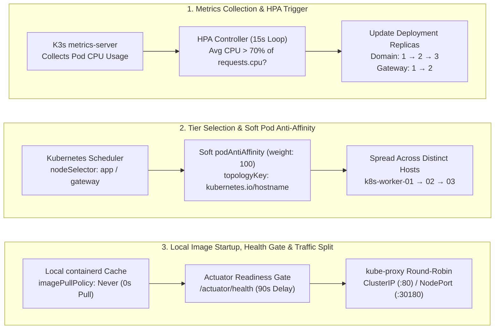

# Horizontal Pod Autoscaling (HPA) & Anti-Affinity Scheduling

## 1. Dynamic Elasticity Architecture

Food delivery workloads fluctuate sharply between off-peak hours and lunch/dinner rushes. Keeping multiple replicas running permanently wastes compute across fixed-quota cloud nodes, whereas pinning every service to a single static pod risks CPU starvation and latency spikes during traffic bursts.

The **Take My Order** platform implements **Dynamic Workload Elasticity** in `infrastructure/k8s/base/services/` by combining four native Kubernetes mechanisms:

1. **CPU-Driven `HorizontalPodAutoscaler` (`hpa.yaml`):** Evaluates pod CPU consumption against `requests.cpu` and scales the four domain microservices (`order`, `payment`, `restaurant`, `identity`) across **`1..3` replicas** and `gateway-service` across **`1..2` replicas** whenever average utilization exceeds **`70%`**.
2. **Soft `podAntiAffinity` Scheduling:** Spreads scaled replicas across distinct physical worker nodes (`kubernetes.io/hostname`) while still permitting graceful co-location if a node is offline or a tier has a single host.
3. **Pre-Cached Local `containerd` Images (`imagePullPolicy: Never`):** Eliminates external Docker Hub pulls during scale-out because Jenkins pre-streams native ARM64 images directly onto worker disks.
4. **Health-Gated Traffic Routing (`readinessProbe` + `kube-proxy`):** Admits scaled replicas into `ClusterIP` (domain services) or `NodePort` (`gateway-service`) load-balancing pools only after Spring Boot `/actuator/health` reports `UP`.

---

## 2. Peak-Load Scale-Out Lifecycle

When sustained request volume pushes a microservice above its `70%` CPU target, Kubernetes executes a three-stage automated scale-out sequence:

---

## 3. HPA & Resource Baseline Matrix

All five `autoscaling/v2` HPA manifests are declared in `infrastructure/k8s/base/services/hpa.yaml` under **`namespace: take-my-order`** (automatically included via `infrastructure/k8s/base/services/kustomization.yaml`). Because Kubernetes computes `Utilization` percentages relative to `resources.requests.cpu`, each tier scales at a predictable millicore threshold:

| Service & Node Tier | Requests / Limits | HPA Bounds & CPU Trigger |
| :--- | :--- | :--- |
| **Domain Services** `order`, `payment`, `restaurant`, `identity` `node-type: app` · `ClusterIP :80` | `300m` / `1000m` CPU `300Mi` / `800Mi` RAM | `minReplicas: 1` · `maxReplicas: 3` `averageUtilization: 70` (**`210m`** avg CPU) |
| **Edge API Gateway** `gateway-service` `node-type: gateway` · `NodePort :30180` | `200m` / `800m` CPU `256Mi` / `600Mi` RAM | `minReplicas: 1` · `maxReplicas: 2` `averageUtilization: 70` (**`140m`** avg CPU) |

* **Default `autoscaling/v2` Behavior & Stabilization:** `hpa.yaml` intentionally relies on Kubernetes's built-in defaults—CPU-only utilization metrics, the 15-second controller sync loop, and the default **5-minute (`300s`) scale-down stabilization window**—without custom `behavior` overrides or memory triggers. This prevents replica thrashing (rapid scale-up/scale-down flapping) after bursty traffic subsides.
* **Decoupled Observability:** Prometheus on `k8s-worker-obs` scrapes `/actuator/prometheus` every `5s` across all five services for Grafana dashboards and capacity forensics, independently of K3s `metrics-server` autoscaling decisions.

---

## 4. Pod Anti-Affinity & Placement

Allowing the scheduler to stack scaled replicas onto the same physical host causes two immediate failure modes: **host CPU contention** (both pods fight for the same single OCPU) and **correlated failure** (a single node crash kills every replica simultaneously).

Every microservice Deployment (`order.yaml`, `payment.yaml`, `restaurant.yaml`, `identity.yaml`, `gateway.yaml`) pairs a strict `nodeSelector` (`node-type: app` or `node-type: gateway`) with a **soft `podAntiAffinity`** rule (`preferredDuringSchedulingIgnoredDuringExecution`, `weight: 100`, `topologyKey: kubernetes.io/hostname`, matching label `app: <service>`):

* **Cross-Tenancy Domain Spreading (`k8s-worker-01`, `02`, `03`):** When HPA scales any domain service to 2 or 3 replicas, the scheduler prefers placing each replica on a separate physical app worker spanning OCI Tenancy 1 and Tenancy 2. If one worker is down for maintenance, the soft rule allows graceful co-location instead of leaving the pod stuck in `Pending`.
* **Safe Edge Scaling on One Gateway Host (`k8s-worker-edge`):** Because the 7-node topology provisions a single `node-type: gateway` worker (`1 OCPU / 6 GB RAM`), a hard (`required...`) anti-affinity constraint would deadlock `gateway-service` at 1 replica. Soft anti-affinity lets HPA scale `gateway-service` to 2 replicas on `k8s-worker-edge` (`400m` CPU / `512Mi` RAM combined requests) today, while automatically spreading replicas across nodes if a second edge worker is added later.
* **Single-Node Local Dev Override:** `infrastructure/k8s/overlays/dev/patch-global.yaml` strips `nodeSelector` from Deployments and Jobs so local workstation clusters can schedule every service onto a single node.

---

## 5. Image Caching, Probes & Rollouts

| Lifecycle Mechanism | Manifest Configuration | Operational Behavior & Trade-Off |
| :--- | :--- | :--- |
| **Local `containerd` Pre-Caching** | `imagePullPolicy: Never` (Jenkins pipes `docker save` / `gzip` over SSH into `gunzip` / `k3s ctr -n k8s.io`) | Eliminates 30–60s remote Docker Hub pulls and internet egress. Domain images pre-load onto `k8s-worker-01`, `02`, `03`; `gateway-service` pre-loads onto `k8s-worker-edge`, consuming `0%` CPU and `0 MB` RAM while idle on disk. |
| **Actuator Health Probes** | `livenessProbe` & `readinessProbe` on `/actuator/health` (`initialDelaySeconds: 90`, `periodSeconds: 10`, `timeoutSeconds: 5`, `failureThreshold: 10`) | Container startup begins immediately from disk, yet Kubernetes waits through the conservative **90-second** warmup gate before admitting live requests—protecting ARM64 JVM boot (plus Flyway validation and Kafka/DB pool initialization on domain services). |
| **Zero-Downtime `RollingUpdate`** | `maxSurge: 1`, `maxUnavailable: 0` across all five Deployments | During CI/CD releases, Kubernetes spins up the surge pod on an alternate worker via soft `podAntiAffinity` and keeps existing pods serving until the new pod passes `/actuator/health`. |

!!! note "Image Pull Speed vs. Readiness Gate Trade-Off"
    Pre-caching images in local `containerd` eliminates **network image-pull latency**, not Spring Boot JVM initialization time. Because all five Deployments configure `readinessProbe.initialDelaySeconds: 90` for ARM64 boot safety, newly scaled pods join the `kube-proxy` endpoint pool after the 90-second readiness gate rather than within seconds. Splitting a dedicated `startupProbe` from a shorter `readinessProbe` delay is the natural future optimization if faster burst cutover is required.

---

## 6. Kafka Partition & Replica Alignment

Setting `maxReplicas: 3` on all four domain services is intentionally synchronized with both the **three physical `node-type: app` workers** and the **Apache Kafka partition topology**:

* **3-Partition Consumer Ceiling:** `infrastructure/k8s/base/platform/init-kafka.yaml` provisions every platform topic with **`3` partitions** (replication factor `3`), matching `kafka-config.num-of-partitions: 3` and `kafka-consumer-config.concurrency-level: 3` across `order`, `payment`, `restaurant`, and `identity` services.
    * At **`replicas: 1`**, a single pod runs 3 listener threads consuming all 3 partitions.
    * At **`replicas: 2`–`3`**, Kafka rebalances the 3 partitions across separate physical pods (up to 1 active partition consumer per pod at `maxReplicas: 3`). Scaling beyond 3 replicas would leave extra pods with zero assigned Kafka partitions.
* **Multi-Replica Outbox & Consumer Safety:** Concurrent outbox schedulers across scaled pods coordinate safely via JPA `@Version` optimistic locking (plus `FOR UPDATE SKIP LOCKED` on `identity-service`'s `role_outbox`) alongside database-level consumer idempotency—see [Transactional Outbox & Concurrent Polling](../distributed-systems/transactional-outbox.md) and [Idempotency & Message Ordering](../distributed-systems/idempotency-and-messaging.md).

!!! tip "Related Infrastructure & CI/CD Guides"
    * For the 7-node hardware layout, `nodeSelector` tiers, and 40 GB disk reserve strategy, see [Cross-Tenancy Infrastructure](cross-tenancy-topology.md).
    * For how Jenkins streams native ARM64 images into K3s `containerd` (`-n k8s.io`) and triggers auto-rollback, see [Native ARM64 Jenkins CI/CD](jenkins-ci-cd-pipeline.md).
