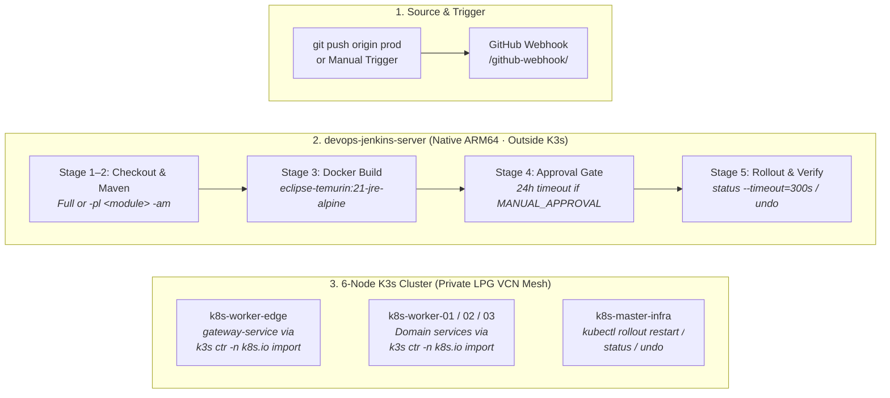

# CI/CD Pipelines: Native ARM64 Jenkins & Multi-Arch GitHub Actions

## 1. Dual CI/CD Paradigms Matched to Cloud Topology

The repository maintains **two complementary CI/CD pipelines** tailored to the two supported deployment topologies (see [Cross-Tenancy Infrastructure](cross-tenancy-topology.md)), plus an automated documentation publishing workflow:

* **Option A — Push-Based Multi-Arch CI/CD (`.github/workflows/deploy.yml`):**
    Preserved for the **4-Node Hybrid Multi-Cloud** topology (`1× Oracle ARM64` + `1× AWS x86_64`). Runs on GitHub-hosted `ubuntu-latest` runners via **QEMU** (`docker/setup-qemu-action@v3`) and **Docker Buildx** (`docker/setup-buildx-action@v3`) to build dual-architecture manifests (`linux/amd64,linux/arm64`), pushes them to Docker Hub (`imagePullPolicy: Always`), and triggers `kubectl rollout restart` on `k8s-master-infra` over SSH (`appleboy/ssh-action@v1.0.3`). Automatic `push` triggering on `prod` is commented out so it never races with Jenkins; it remains available on demand via `workflow_dispatch`.
* **Option B — Native ARM64 Jenkins & Direct SSH Streaming (`Jenkinsfile` — Active Standard):**
    Engineered for the **7-Node Cross-Tenancy OCI** topology (`2× Oracle ARM64` + LPG). Runs on the stand-alone **`devops-jenkins-server`** (`1 OCPU / 6 GB RAM / 50 GB SSD`, outside K3s), compiles Java 21 / Maven modules natively on Ampere ARM64 hardware, packages slim `eclipse-temurin:21-jre-alpine` images, and streams compressed archives directly over private LPG SSH into each worker's K3s `containerd` runtime (`k8s.io` namespace, `imagePullPolicy: Never`)—eliminating external registry pull limits and internet egress.
* **Automated Documentation Pipeline (`.github/workflows/docs.yml`):**
    Pushes to `prod` touching `docs/**` or `mkdocs.yml` automatically build and deploy the MkDocs Material site to GitHub Pages without triggering backend container builds.

---

## 2. Native ARM64 Build vs. QEMU Multi-Arch Trade-Offs

| Build Dimension | Option A: GitHub Actions + QEMU + Docker Hub | Option B: Native OCI ARM64 Jenkins + Private SSH (Active) |
| :--- | :--- | :--- |
| **Instruction Execution** | Software binary translation via QEMU (`arm64` on `x86_64`) | **100% Native Ampere A1 ARM64 hardware execution** |
| **End-to-End Build Speed** | ~12–18 minutes across all 5 microservices | **~2–3 minutes** full build (faster with single-service `-pl -am`) |
| **Registry & Egress** | Requires Docker Hub push/pull (`imagePullPolicy: Always`) | **Zero external registry** (`imagePullPolicy: Never`); `0 bytes` internet egress over private LPG |
| **Cluster Isolation** | External GitHub runner | Dedicated 7th OCI host outside K3s; zero impact on live pods |

---

## 3. Five-Stage `Jenkinsfile` Pipeline & Private Image Streaming

Triggered automatically via GitHub Webhook (`/github-webhook/`) on `prod` pushes or run manually with parameters (`TARGET_SERVICE`, `DEPLOY_MODE = MANUAL_APPROVAL | AUTO_DEPLOY`, `SKIP_TESTS`), the Declarative Pipeline enforces `disableConcurrentBuilds()` (serializing overlapping releases), `logRotator(numToKeepStr: '10')` (disk hygiene), and `post { always { docker image prune -f } }`:

### 3.1 Pipeline Stage Responsibilities

| Stage | Execution Behavior | Reliability & Safety Mechanism |
| :--- | :--- | :--- |
| **1–2. Checkout & Maven Build** | Checks out `prod` and compiles either the full multi-module reactor (`TARGET_SERVICE == ALL`) or only the targeted container module plus its dependencies (`mvn clean package -pl <module> -am`). | Compiles Avro schemas (`kafka-model`) and Spring Boot fat JARs cleanly; optional `SKIP_TESTS` parameter supports fast hotfix packaging. |
| **3. ARM64 Build & Targeted `containerd` Stream** | Builds `--no-cache` images (`berkayozr/<service>:v1` on `eclipse-temurin:21-jre-alpine`) and streams `docker save` → `gzip` over private SSH directly into `gunzip` → `sudo k3s ctr -n k8s.io images import -`. | Routes `gateway-service` exclusively to `k8s-worker-edge` and domain services to all three app workers (`worker-01/02/03`) so HPA can schedule replicas on any node immediately. Specifying `-n k8s.io` is mandatory so Kubelet (`imagePullPolicy: Never`) discovers the imported image instead of failing with `ErrImageNeverPull`. |
| **4. Optional Approval Gate** | Active only when `DEPLOY_MODE == MANUAL_APPROVAL`; pauses up to 24 hours after images are pre-loaded onto worker disks. | Separates build/transfer risk from live rollout timing; skipped automatically in `AUTO_DEPLOY` mode. |
| **5. Zero-Downtime Rollout & Auto-Rollback** | Connects via private SSH to `k8s-master-infra`, runs `kubectl rollout restart` and blocks on `kubectl rollout status --timeout=300s`. | Combined with `RollingUpdate` (`maxSurge: 1`, `maxUnavailable: 0`) and `/actuator/health` `readinessProbe`, existing pods keep serving until new pods turn healthy; any timeout or probe failure automatically executes `kubectl rollout undo`. |

---

## 4. Jenkins Credentials Vault Hygiene

The `Jenkinsfile` never stores IP addresses, OS usernames, or SSH keys in Git. All sensitive connection parameters are injected ephemerally per stage via `withCredentials(...)` from **Manage Jenkins → Credentials → System → Global credentials**:

| Credential Kind | Credential IDs | Purpose |
| :--- | :--- | :--- |
| `Secret text` (Private Node IPs) | `k8s-master-ip`, `k8s-worker1-ip`, `k8s-worker2-ip`, `k8s-worker3-ip`, `k8s-gateway-ip` | Private LPG IPv4 targets for SSH image streaming and `kubectl rollout` execution. |
| `Secret text` (OS User) | `k8s-master-user` | Non-root SSH operating system user authorized across cluster nodes. |
| `SSH Username with private key` | `k8s-master-ssh-key` | Private SSH key granting passwordless key-based access to all six K3s cluster nodes. |

!!! warning "Whitespace & Formatting Hygiene in Jenkins Secret Text"
    When pasting private IPv4 addresses into Jenkins `Secret text` credentials, ensure there are **no leading/trailing spaces, newlines, quotes, or `http://` prefixes**. Invisible whitespace prevents OpenSSH from recognizing the value as an IPv4 literal, causing a DNS lookup failure (`Could not resolve hostname: Temporary failure in name resolution`).

---

## 5. Option A Fallback: Multi-Arch GitHub Actions

When operating the **4-Node Hybrid Multi-Cloud** topology (`Oracle ARM64` + `AWS x86_64`), `.github/workflows/deploy.yml` targets heterogeneous K3s CPU instruction sets: Oracle workers run `linux/arm64` while the AWS Edge Gateway runs `linux/amd64`.

* **Unified Multi-Arch Manifests:** Combining QEMU + Docker Buildx compiles both architectures into a single manifest tag (`${{ secrets.DOCKER_USERNAME }}/<service>:v1`) pushed to Docker Hub; each node's `containerd` automatically pulls the layer matching its CPU architecture (`imagePullPolicy: Always`).
* **Repository Secrets & Rollout:** Step 12 uses `appleboy/ssh-action@v1.0.3` with five GitHub Repository Secrets (`DOCKER_USERNAME`, `DOCKER_PASSWORD`, `SERVER_IP`, `SERVER_USER`, `SERVER_SSH_KEY`) to trigger `sudo kubectl rollout restart deployment -n take-my-order` on `k8s-master-infra`.

!!! tip "Related Setup & Edge Frontend CI/CD"
    * For full Hybrid Multi-Cloud & AWS Gateway instructions (Security Groups, Flannel VXLAN `UDP 8472`, Docker Hub setup), see [Alternative: 4-Node Hybrid Multi-Cloud Setup](../installation/hybrid-cloud-aws-oracle-setup.md).
    * For how the same `devops-jenkins-server` builds and `rsync`-deploys the three Angular portals to Bare-Metal Host Nginx (`:30088`) on `k8s-worker-edge`, see [Subdomain & Portal Routing](../architecture/subdomain-and-portals.md).
