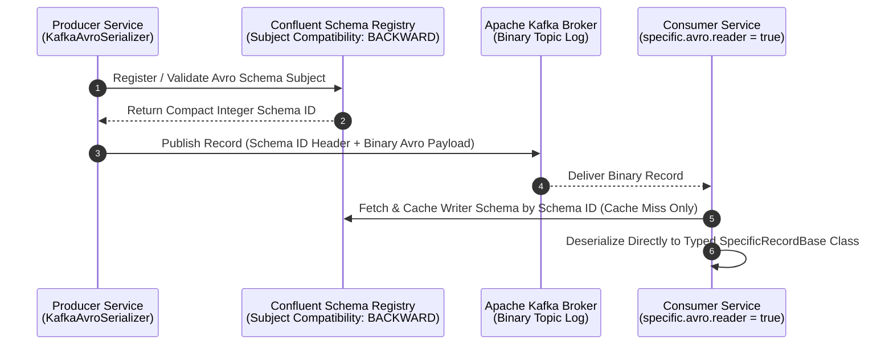
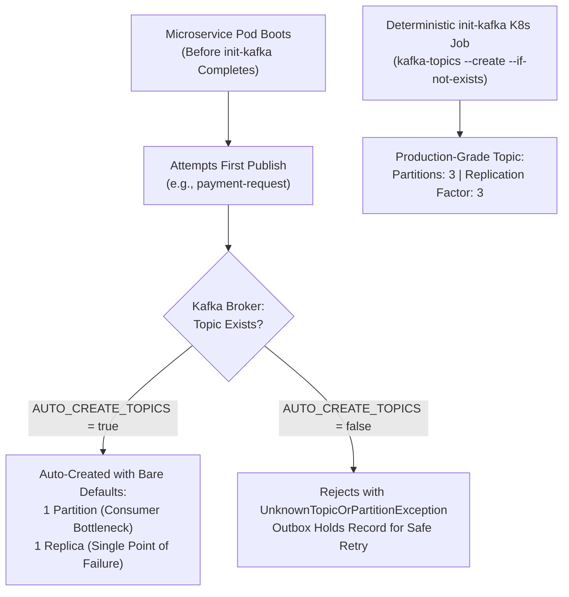

# Avro Event Schemas & Contract Governance

## 1. Schema Governance in Enterprise Messaging

In an event-driven microservices platform, Kafka topics serve as public asynchronous APIs between bounded contexts. Exchanging untyped JSON strings across those boundaries introduces silent breaking changes (renamed fields deserializing to `null`), inconsistent monetary and timestamp parsing, and repetitive key-name payload overhead.

To guarantee compile-time type safety and compact binary serialization, **Take My Order** standardizes on **Apache Avro** backed by **Confluent Schema Registry**:

---

## 2. Platform Avro Event Catalog

All Avro contracts are maintained centrally in `infrastructure/kafka/kafka-model/src/main/resources/avro/` and compiled into typed Java `SpecificRecordBase` models by `avro-maven-plugin`.

### 2.1 SAGA, Settlement & Rating Contracts

| Schema & Kafka Topic | Key Payload Attributes | Producer → Consumers |
| :--- | :--- | :--- |
| `payment_request.avsc` `payment-request` | `id`, `sagaId`, `customerId`, `restaurantId`, `orderId`, `price`, `createdAt`, `paymentOrderStatus` (`PENDING`, `CANCELLED`) | `order-service` → `payment-service` |
| `payment_response.avsc` `payment-response` | `id`, `sagaId`, `paymentId`, `customerId`, `orderId`, `price`, `createdAt`, `paymentStatus` (`COMPLETED`, `CANCELLED`, `FAILED`), `failureMessages` | `payment-service` → `order-service` |
| `restaurant_approval_request.avsc` `restaurant-approval-request` | `id`, `sagaId`, `restaurantId`, `orderId`, `restaurantOrderStatus` (`PAID`, `CANCELLED`), `productQuantities` (`{id, quantity}`), `price`, `createdAt` | `order-service` → `restaurant-service` |
| `restaurant_approval_response.avsc` `restaurant-approval-response` | `id`, `sagaId`, `restaurantId`, `orderId`, `createdAt`, `orderApprovalStatus` (`APPROVED`, `VALIDATED`, `REJECTED`), `failureMessages`, `cancelReason` (nullable) | `restaurant-service` → `order-service` |
| `order_delivered.avsc` `order-delivered` | `id`, `orderId`, `restaurantId`, `customerId`, `price`, `createdAt` | `order-service` → `payment-service` (Escrow release choreography) |
| `restaurant_rating_updated.avsc` `restaurant-rating-updated` | `id`, `restaurantId`, `averageRating` (nullable `double`), `totalReviews` (`int`), `updatedAt` | `order-service` → `restaurant-service` (Timestamp-guarded rating sync) |

### 2.2 Identity, RBAC & Catalog Contracts

| Schema & Kafka Topic | Key Payload Attributes | Producer → Consumers |
| :--- | :--- | :--- |
| `role_event.avsc` `identity-role-events` | `id`, `roleId`, `name`, `userType`, `organizationalUnitId`, `version` (`long`), `eventType`, `permissions` (`PermissionAvroModel` array) | `identity-service` → `order-service`, `payment-service`, `restaurant-service` |
| `permission_event.avsc` `identity-permission-events` | `id`, `permissionId`, `code`, `domain`, `active`, `isRestricted`, `createdAt`, `updatedAt`, `eventType` | `identity-service` → `order-service`, `payment-service`, `restaurant-service` |
| `customer.avsc` `customer` | `id`, `username`, `firstName`, `lastName`, `email` | `identity-service` → `order-service`, `payment-service` (Projection & wallet init) |
| `restaurant_information.avsc` `restaurant-information` | `restaurantId`, `merchantId`, `name`, `active`, `available`, `products` (`RestaurantProduct` array), `minimumOrderAmount`, `deliveryFee`, `createdAt`, `eventType` | `restaurant-service` → `identity-service`, `order-service`, `payment-service` |
| `restaurant_personnel_event.avsc` `restaurant-personnel` | `restaurantId`, `userId`, `addedByMerchantId`, `createdAt`, `eventType` | `restaurant-service` → `identity-service` (Branch staff binding) |

---

## 3. Logical Types & Code Generation

`infrastructure/kafka/kafka-model/pom.xml` configures `avro-maven-plugin` (`generate-sources` phase) with `stringType = String` and `enableDecimalLogicalType = true` to enforce consistent Java types across every microservice:

| Logical Type / Setting | Avro & Maven Representation | Platform Usage & Invariant |
| :--- | :--- | :--- |
| **Monetary `decimal`** | `bytes` (`logicalType: decimal`, `precision = 10`, `scale = 2`) → Java `BigDecimal`. | Applied to `price`, `minimumOrderAmount`, and `deliveryFee`, eliminating binary floating-point rounding drift. |
| **Temporal `timestamp-millis`** | `long` (`logicalType: timestamp-millis`) → Java `Instant` (UTC epoch ms). | Applied to `createdAt` / `updatedAt` on order, delivery, rating, restaurant, and personnel contracts to prevent timezone parsing ambiguity. |
| **Identifiers & Strings** | `<stringType>String</stringType>`; newer contracts declare `logicalType: uuid` (e.g., `role_event`, `permission_event`, `restaurant_information`, `restaurant_personnel_event`, `ProductQuantity.id`), while core SAGA records use plain `string` UUIDs. | Eliminates Avro `Utf8` wrapper friction while keeping UUID formatting consistent across producers and consumers. |
| **Nullable Evolution Unions** | `["null", T]` with `"default": null` (e.g., `cancelReason`, `minimumOrderAmount`, `deliveryFee`, `averageRating`, `eventType`). | Allows safe schema extensions without breaking deserialization of historical Kafka records. |

---

## 4. Schema Evolution & Compatibility Rules

Confluent Schema Registry defaults to **BACKWARD** compatibility across topic value subjects:

> **BACKWARD Compatibility Invariant:** Newer consumers must always be able to deserialize historical messages produced by older schema versions.

- **Additive Fields Require Defaults:** Every newly added field must be declared as a nullable union (`["null", T]`) with an explicit `"default": null` (as used when adding `cancelReason`, `minimumOrderAmount`, and `deliveryFee`).
- **Safe Field Removal:** Removing a field is permitted under `BACKWARD` compatibility only when optional/defaulted semantics are preserved across active producers and consumers.
- **Enum Stability:** Extending Avro `enum` symbol lists requires deploying consumers before producers emit new symbols (or modeling extensible discriminators such as `eventType` as nullable `string` fields).
- **Build-Time Codegen vs. Runtime Registry Validation:** `avro-maven-plugin` validates `.avsc` syntax and regenerates typed Java classes during Maven compilation (catching mapper mismatches before packaging), while Confluent Schema Registry enforces wire-level compatibility at publish time (`KafkaAvroSerializer`, configured via `SCHEMA_REGISTRY_URL` — `:8081` in-cluster, `:30081` NodePort locally) paired with `specific.avro.reader = true` on consumers.

---

## 5. Broker Governance: Prohibiting Auto-Topic Creation

A common production failure mode in Kafka clusters stems from leaving broker auto-topic creation enabled (`KAFKA_AUTO_CREATE_TOPICS_ENABLE=true`):

### 5.1 Why Auto-Creation Degrades Clusters

If a service pod starts slightly ahead of topic initialization while auto-creation is enabled, its first outbound message silently creates a **1-partition, 1-replica** topic. That caps consumer group parallelism at a single pod and eliminates broker fault tolerance; repairing it later requires manual partition expansion and replica reassignment.

### 5.2 Deterministic Topic Provisioning (`init-kafka`)

- **Broker Enforcement:** All three Kafka brokers in `infrastructure/k8s/base/platform/kafka-cluster.yaml` explicitly set **`KAFKA_AUTO_CREATE_TOPICS_ENABLE: "false"`** (alongside `KAFKA_OFFSETS_TOPIC_REPLICATION_FACTOR: "3"` and `KAFKA_COMPRESSION_TYPE: "producer"`).
- **Idempotent Topic Job:** The Kubernetes `batch/v1` Job **`init-kafka`** (`infrastructure/k8s/base/platform/init-kafka.yaml`, `confluentinc/cp-kafka:7.2.5`) polls `kafka-broker-1:9092` (up to `60s`) until the cluster is ready and provisions every platform topic — including `identity-user-events` alongside the Avro topics — using `kafka-topics --create --if-not-exists --replication-factor 3 --partitions 3`.
- **Outbox Resilience:** Any write attempted before `init-kafka` finishes fails fast with `UnknownTopicOrPartitionException`, and the Transactional Outbox preserves the pending record without degrading topic topology.

### 5.3 Related Documentation

- [SAGA Orchestration Pattern](saga-orchestration.md) — Payment and restaurant approval event flows.
- [Transactional Outbox Pattern](transactional-outbox.md) — Reliable Avro dispatch and callback lifecycle.
- [Escrow & Settlement](escrow-and-settlement.md) — `order-delivered` settlement choreography contract.
- [Idempotency & Messaging](idempotency-and-messaging.md) — Partition key binding and consumer deduplication.
- [Cross-Tenancy Topology](../devops/cross-tenancy-topology.md) — Kubernetes Kafka cluster and infrastructure placement.
