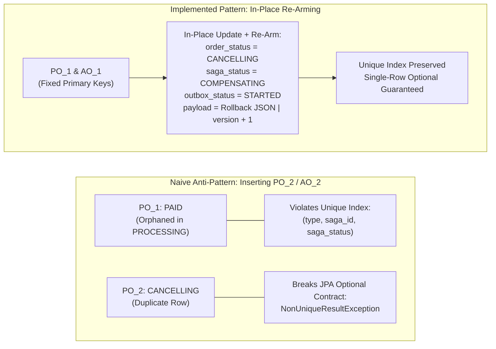
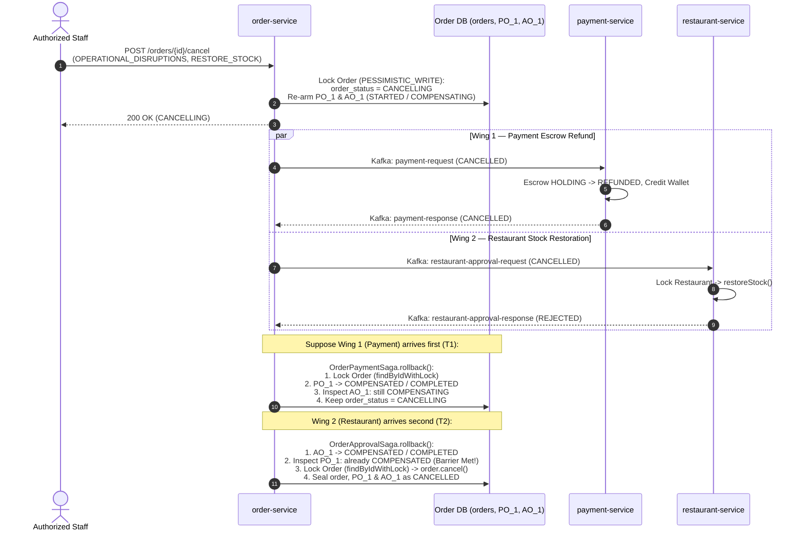

# Cancel SAGA & In-Place Outbox Architecture

## 1. Orchestrator-Centric Lean Architecture

In an asynchronous microservices platform, the forward happy path is only half the coordination problem. The harder engineering challenge is orchestrating **cancellations, automatic rejections, inventory restorations, and escrow refunds** safely under concurrent traffic and Kafka at-least-once delivery.

Rather than duplicating the full order lifecycle across `order-service` and `restaurant-service` and publishing Kafka events for every internal kitchen click, **Take My Order** implements an **Orchestrator-Centric Lean Architecture**:

1. **`order-service` (Operational & SAGA Authority):** Owns the order aggregate, its entire lifecycle state machine, and all operational kitchen/courier REST endpoints. Internal fulfillment transitions (`approve`, `start-preparing`, `ready-for-pickup`, `start-delivery`) execute locally with **zero Kafka traffic**.
2. **`restaurant-service` (Lean Catalog & Inventory Validator):** Validates restaurant status, pricing, and stock once during `PAID`, deducts stock atomically (`OrderApprovalStatus.VALIDATED`), and is contacted again via Kafka **only** when a cancellation requires `MaterialAction.RESTORE_STOCK` (`restoreStock()`).
3. **`payment-service` (Financial & Escrow Custodian):** Captures customer wallet funds into `payment.order_escrows` (`HOLDING`) during `PENDING`, refunds the customer (`REFUNDED`) when `PaymentOrderStatus.CANCELLED` arrives, and settles merchant payouts (`RELEASED`) via `order-delivered` choreography upon delivery.

> **Notation & Overview:** Throughout this deep-dive, `PO_1` refers to the order's row in `"order".payment_outbox` and `AO_1` refers to its row in `"order".restaurant_approval_outbox`. For the high-level lifecycle state diagram and sequential forward gating flow, see [SAGA Orchestration Pattern](saga-orchestration.md).

---

## 2. In-Place SAGA & Single Outbox Row

A common failure mode in naive SAGA implementations is inserting brand-new outbox rows (`PO_2`, `AO_2`) whenever a cancellation or rollback begins.

**Take My Order** enforces the **Single Outbox Row Invariant**: each order (`order_id` = `saga_id`) has **at most one `payment_outbox` row (`PO_1`)** and **at most one `restaurant_approval_outbox` row (`AO_1`)** across its entire lifetime.

### 2.1 Why In-Place Mutation Is Mandatory

- **Zero Orphaned `PROCESSING` Rows:** Inserting a second row (`PO_2`) leaves the original forward row (`PO_1`) stuck permanently in `SagaStatus.PROCESSING`, preventing scheduled cleanup from ever removing it.
- **PostgreSQL Unique Index Integrity:** Both `"order".payment_outbox` (`payment_outbox_saga_id`) and `"order".restaurant_approval_outbox` (`restaurant_approval_outbox_saga_id`) enforce a composite `UNIQUE` index on `(type, saga_id, saga_status)`. Duplicate rows sharing the same saga state abort the transaction immediately.
- **Spring Data JPA Single-Result Contract:** Both `PaymentOutboxJpaRepository` and `ApprovalOutboxJpaRepository` expose `findByTypeAndSagaId(...)` and `findByTypeAndSagaIdAndSagaStatusIn(...)` returning `Optional<Entity>`. A second row for the same `saga_id` triggers `IncorrectResultSizeDataAccessException` / `NonUniqueResultException`.

---

## 3. In-Place Re-Arming & Payload Mechanics

Once an order passes payment and restaurant validation, `PO_1` and `AO_1` rest in the database with `outbox_status = COMPLETED` and `saga_status = PROCESSING`. Because `PaymentOutboxScheduler` polls `STARTED` + `(STARTED, COMPENSATING)` and `RestaurantApprovalOutboxScheduler` polls `STARTED` + `(PROCESSING, COMPENSATING)`, triggering compensation requires **In-Place Re-Arming** inside `OrderCancelHelper.initCancelOrder()`, `OrderApprovalSaga.rollback()` (auto-rejection), or `OrderForceCancelCommandHandler.forceCancelOrder()`:

| Outbox Field | Resting Forward State | Re-Armed Compensation State |
| :--- | :--- | :--- |
| `outbox_status` | `COMPLETED` | **`STARTED`** — re-enables the row for pickup on the next scheduler poll. |
| `saga_status` | `PROCESSING` | **`COMPENSATING`** — routes the row into the rollback pipeline. |
| `order_status` | `PAID` / `WAITING_FOR_APPROVAL` | **`CANCELLING`** — reflects active distributed rollback. |
| `payload` | Forward JSON (`PENDING` / `PAID`) | **Re-serialized rollback JSON (Critical):** `PO_1` is overwritten with `PaymentOrderStatus.CANCELLED` (refund, not re-debit); `AO_1` is overwritten with `RestaurantOrderStatus.CANCELLED` (`restoreStock()`, not re-deduction). |
| `version` | Current `@Version` | Incremented atomically by Hibernate on save to guard against concurrent scheduler/listener writes. |

---

## 4. Fork-Join & Participant Idempotency

When an order is cancelled with `MaterialAction.RESTORE_STOCK`, `order-service` re-arms **both** `PO_1` and `AO_1` in the same database transaction. Because `payment-response` and `restaurant-approval-response` arrive asynchronously on separate Kafka consumer groups, either wing may finish first.

### 4.1 Symmetric Fork-Join & Locking

Both rollback handlers converge through a symmetric join check:

- The callback that finishes **first** transitions its own outbox row to `SagaStatus.COMPENSATED` / `OutboxStatus.COMPLETED` (keeping `order_status = CANCELLING`), inspects the peer outbox row, sees it is not yet `COMPENSATED`, and leaves the order in `CANCELLING`.
- The callback that finishes **second** marks its own outbox row `COMPENSATED` / `COMPLETED`, observes that **both** outboxes are `COMPENSATED`, locks `"order".orders` via `OrderSagaHelper.findOrder()` (`PESSIMISTIC_WRITE` / `findByIdWithLock`), transitions `CANCELLING` → `CANCELLED`, and seals **both** `PO_1` and `AO_1` with `order_status = CANCELLED` inside the same transaction.

### 4.2 Barrier Decision Matrix

Every cancellation path — dual-wing, single-wing, or zero-Kafka — reuses the same Fork-Join barrier cleanly by pre-sealing unused legs locally:

| Cancellation Scenario | Outbox Preparation (`PO_1` & `AO_1`) | Convergence to `CANCELLED` |
| :--- | :--- | :--- |
| **Dual-Wing `RESTORE_STOCK`** (Staff `/cancel` or admin `/force-cancel` with `forceRefund = true`) | Both `PO_1` and `AO_1` re-armed (`STARTED` / `COMPENSATING`). | Whichever callback arrives second sees both outboxes `COMPENSATED` and seals `CANCELLED`. |
| **Step 2 Auto-Reject (`PAID`)** (`OrderApprovalSaga` `PROCESSING` rollback) | `AO_1` closed locally (`COMPENSATED` / `COMPLETED`; stock never deducted). `PO_1` re-armed (`STARTED` / `COMPENSATING`). | When `PaymentStatus.CANCELLED` arrives, `OrderPaymentSaga` sees `AO_1` is already `COMPENSATED` and seals `CANCELLED`. |
| **Single-Wing `RECORD_WASTE`** (Staff `/cancel` or admin `/force-cancel` with `forceRefund = true`) | `AO_1` closed locally (`COMPENSATED` / `COMPLETED`; zero restaurant Kafka). `PO_1` re-armed (`STARTED` / `COMPENSATING`). | Payment refund callback satisfies the barrier immediately and seals `CANCELLED`. |
| **Single-Wing Stock Restore** (Admin `/force-cancel` with `forceRefund = false` + `RESTORE_STOCK`) | `PO_1` closed locally (`COMPENSATED` / `COMPLETED`; no refund). `AO_1` re-armed (`STARTED` / `COMPENSATING`). | Restaurant `REJECTED` stock-restore callback sees `PO_1` already `COMPENSATED` and seals `CANCELLED`. |
| **Zero-Kafka Direct Cancel** (`CUSTOMER_UNREACHABLE`, `WRONG_ADDRESS`, or admin `!forceRefund` + `RECORD_WASTE`) | Both `PO_1` and `AO_1` sealed locally (`CANCELLED` / `COMPENSATED` / `COMPLETED`). | Order transitions to `CANCELLED` synchronously within the REST transaction; zero Kafka messages published. |

### 4.3 Participant Composite Idempotency

Because a cancellation reuses the **same `saga_id`** as the original forward request, participant deduplication cannot check only `(type, saga_id, outbox_status = COMPLETED)` — doing so would match the earlier forward `VALIDATED` or `COMPLETED` row and silently skip stock restoration or refund!

Both participants include the target domain status in both their query lookup and PostgreSQL unique constraint:

- **`restaurant-service` (`restaurant.order_outbox`):** Unique index `restaurant_order_outbox_saga_id` covers `(type, saga_id, approval_status, outbox_status)`. `RestaurantApprovalRequestHelper.persistOrderApproval()` deduplicates on `OrderApprovalStatus.VALIDATED` / `APPROVED`, whereas `persistCancelOrderApproval()` deduplicates on **`OrderApprovalStatus.REJECTED`**.
- **`payment-service` (`payment.order_outbox`):** Unique index `payment_order_outbox_saga_id_payment_status_outbox_status` covers `(type, saga_id, payment_status, outbox_status)`. `PaymentRequestHelper.persistPayment()` deduplicates on `PaymentStatus.COMPLETED`, whereas `persistCancelPayment()` deduplicates on **`PaymentStatus.CANCELLED`** (reinforced by the `UNIQUE` `wallet_transactions.idempotency_key` constraint).

---

## 5. Outbox Lifecycle & Midnight Cleanup

### 5.1 Why `SUCCEEDED` Waits for `DELIVERED`

An order remains cancellable throughout `WAITING_FOR_APPROVAL`, `APPROVED`, `PREPARING`, `READY_FOR_PICKUP`, and `IN_DELIVERY`. If `APPROVED` were mapped to `SagaStatus.SUCCEEDED`, the midnight cleaner could delete `PO_1` and `AO_1` while the meal is still being cooked or delivered — destroying the outbox rows required to re-arm a cancellation!

To prevent premature deletion:

- `OrderSagaHelper.orderStatusToSagaStatus()` maps every active intermediate state (`PAID` through `IN_DELIVERY`) to **`SagaStatus.PROCESSING`**.
- `PaymentOutboxCleanerScheduler` and `RestaurantApprovalOutboxCleanerScheduler` (`@Scheduled(cron = "@midnight")`) delete only rows matching `OutboxStatus.COMPLETED` **and** `SagaStatus IN (SUCCEEDED, FAILED, COMPENSATED)`.
- Only when the courier confirms delivery (`OrderDeliverCommandHandler`) does `OrderSagaHelper.sealSagaAsSucceeded()` mark both `PO_1` and `AO_1` as `SagaStatus.SUCCEEDED` / `OrderStatus.DELIVERED` (while creating a `delivery_outbox` row for escrow settlement).

### 5.2 Outbox State Progression

| Lifecycle Stage | `order_status` | `PO_1` & `AO_1` (`outbox` / `saga`) | `@midnight` Cleaner |
| :--- | :--- | :--- | :--- |
| **Order Created** (`POST /orders`) | `PENDING` | `PO_1`: `STARTED` → `COMPLETED` / `STARTED` `AO_1`: *(not created yet)* | **Untouched** (`STARTED`) |
| **Payment Failed** (`PaymentStatus.FAILED`) | `CANCELLED` | `PO_1`: `COMPLETED` / **`FAILED`** `AO_1`: *(absent)* | **Eligible** (terminal `FAILED`) |
| **Paid & Validated** (`PAID` → `WAITING_FOR_APPROVAL`) | `PAID` → `WAITING_FOR_APPROVAL` | `PO_1`: `COMPLETED` / `PROCESSING` `AO_1`: `STARTED` → `COMPLETED` / `PROCESSING` | **Untouched** (`PROCESSING`) |
| **Kitchen & Courier Steps** (`APPROVED` .. `IN_DELIVERY`) | `APPROVED` .. `IN_DELIVERY` | Both remain `COMPLETED` / `PROCESSING` (**Zero Kafka**; fully cancellable) | **Untouched** (`PROCESSING`) |
| **Delivered** (`POST .../deliver`) | `DELIVERED` | Both sealed `COMPLETED` / **`SUCCEEDED`** + `delivery_outbox` (`STARTED`) | **Eligible** (terminal `SUCCEEDED`) |
| **Cancelling** (Auto-reject, `/cancel`, `/force-cancel`) | `CANCELLING` | Active leg(s): **`STARTED` / `COMPENSATING`** Unused leg(s): `COMPLETED` / `COMPENSATED` | **Untouched** (`COMPENSATING`) |
| **Cancelled** (Barrier met or direct zero-Kafka) | `CANCELLED` | Both sealed `COMPLETED` / **`COMPENSATED`** | **Eligible** (terminal `COMPENSATED`) |

---

## 6. Cancel API, Phantom Stock & Force-Cancel

### 6.1 Stage-by-Stage Cancel Rules

Operational cancellations (`POST /orders/{orderId}/cancel`) accept `currentStatus` (`@NotNull`), `cancelReason` (`@NotNull`), optional `materialAction`, and optional `internalNote` (`CancelOrderCommand`). `OrderCancelHelper.validateAndDetermineMaterialAction()` strictly enforces valid combinations per lifecycle state:

| Order Status & Permission | Allowed `cancelReason` & `materialAction` | Compensation Behavior |
| :--- | :--- | :--- |
| **`WAITING_FOR_APPROVAL`** (`can_cancel_waiting_order`) | • `OPERATIONAL_DISRUPTIONS` → auto **`RESTORE_STOCK`** • `INSUFFICIENT_STOCK` → auto **`RECORD_WASTE`** | Escrow refunded (`PO_1`); stock restored (`AO_1`) only for `OPERATIONAL_DISRUPTIONS`. |
| **`APPROVED`** (`can_cancel_approved_order`) | • `INSUFFICIENT_STOCK` → **`RECORD_WASTE`** (`RESTORE_STOCK` returns `400`) • `OPERATIONAL_DISRUPTIONS` → explicit `RESTORE_STOCK` or `RECORD_WASTE` required (`null` returns `400`) | Escrow refunded (`PO_1`); stock restored (`AO_1`) if `RESTORE_STOCK`, else closed locally. |
| **`PREPARING`** (`can_cancel_preparing_order`) | • `INSUFFICIENT_STOCK` → **`RECORD_WASTE`** (`RESTORE_STOCK` returns `400`) • `OPERATIONAL_DISRUPTIONS` → explicit `RESTORE_STOCK` or `RECORD_WASTE` required (`null` returns `400`) | Escrow refunded (`PO_1`); stock restored (`AO_1`) if `RESTORE_STOCK`, else closed locally. |
| **`READY_FOR_PICKUP`** (`can_cancel_ready_order`) | • **`OPERATIONAL_DISRUPTIONS` only** • **`RECORD_WASTE` only** (`RESTORE_STOCK` returns `400` — cooked meal cannot return to stock) | Escrow refunded (`PO_1`); `AO_1` closed locally (zero restaurant Kafka). |
| **`IN_DELIVERY`** (`can_cancel_in_delivery_order`) | • `LOGISTIC_DISRUPTIONS`, `CUSTOMER_UNREACHABLE`, or `WRONG_ADDRESS` • **`RECORD_WASTE` only** (`RESTORE_STOCK` returns `400`) | `LOGISTIC_DISRUPTIONS` refunds escrow (`PO_1`). `CUSTOMER_UNREACHABLE` / `WRONG_ADDRESS` invoke `cancelWithoutRefund()` (direct `CANCELLED`, zero Kafka, no refund). |
| **`CANCELLING` / `CANCELLED`** (Any restaurant cancel permission) | Idempotent double-click pass-through | Returns `200 OK` with current order state; zero outbox mutation. |
| **`PENDING`, `PAID`, `DELIVERED`** | Not cancellable via `/cancel` | Rejected at Stage 1 security (`403 Forbidden`); domain fallback throws `OrderConflictException` (`409 Conflict`). |

### 6.2 Phantom Stock Loop Guardrail

Why does `OrderCancelHelper` (and `Order.initCancel()`) strictly reject `MaterialAction.RESTORE_STOCK` whenever `cancelReason == INSUFFICIENT_STOCK`?

1. During `PAID` → `WAITING_FOR_APPROVAL`, `restaurant-service` decremented the menu item's stock in PostgreSQL (for example, from `2` to `0`).
2. When kitchen staff discover the physical ingredients are actually missing or spoiled and cancel with `INSUFFICIENT_STOCK`, restoring `+2` back to the database would manufacture **phantom stock**.
3. Another customer would immediately place an order for the same unavailable item, creating an infinite cancel-and-rebook loop. Forcing `RECORD_WASTE` keeps the database counter at `0` until the merchant manually restocks the item.

### 6.3 Admin Force-Cancel Contract

For support escalations or stuck orders, platform administrators holding `can_force_cancel_order` invoke `POST /orders/{orderId}/force-cancel` (`OrderForceCancelCommandHandler`):

- **Request Validation (`ForceCancelOrderCommand`):** `adminReason` is mandatory (`@NotBlank`, `@Size(min = 10)`) and saved into `orders.internal_note` prefixed with `"[ADMIN FORCE CANCEL] "`. `forceRefund` is an optional `Boolean` that defaults to **`false`** (`Boolean.TRUE.equals(forceRefund)` — fail-closed financial protection).
- **Automatic `MaterialAction` Selection:** Derives `RESTORE_STOCK` for `WAITING_FOR_APPROVAL`, `APPROVED`, and `PREPARING`, and `RECORD_WASTE` for `READY_FOR_PICKUP` and `IN_DELIVERY` (always recording `CancelReason.OPERATIONAL_DISRUPTIONS`).
- **Protected States (`409 Conflict`):** Allowed strictly in `WAITING_FOR_APPROVAL`..`IN_DELIVERY`. Orders in `PENDING`, `PAID`, `CANCELLING`, `DELIVERED`, or `CANCELLED` are rejected with `OrderConflictException` (`409 Conflict`).
- **Instant Zero-Kafka Finalization:** When `forceRefund == false` and `materialAction == RECORD_WASTE`, both outboxes are sealed locally (`CANCELLED` / `COMPENSATED` / `COMPLETED`) and the order transitions immediately to `CANCELLED` without publishing Kafka commands.

---

## 7. Security Projection & Concurrency Shield

### 7.1 Database-Driven Stage Authorization

`OrderController.cancelOrder()` **never trusts client-supplied `command.currentStatus` for RBAC**. Otherwise, a user holding only `can_cancel_waiting_order` could pass `"currentStatus": "WAITING_FOR_APPROVAL"` while cancelling an order that is actually `IN_DELIVERY`.

Instead, `@PreAuthorize("@orderAuthService.hasCancelPermissionForOrder(authentication, #orderId)")` loads a lightweight PostgreSQL projection (`OrderAuthProjection`: `customerId`, `restaurantId`, `orderStatus`):

1. **Multi-Tenant Scope:** Confirms the caller's role in `"order".roles_replica` belongs to `order.restaurantId` (or carries `organizational_unit_id IS NULL` for platform-level roles).
2. **Real Database Status Check:** Maps the **persisted `orderStatus`** to its exact cancel permission (`can_cancel_waiting_order` .. `can_cancel_in_delivery_order`).
3. **Double-Click Pass-Through:** If the database status is already `CANCELLING` or `CANCELLED`, Stage 1 checks whether the caller holds *any* cancel permission for that restaurant so Stage 2 can return an idempotent `200 OK` instead of a spurious `403 Forbidden`.

### 7.2 Pessimistic Lock & Stale-State Conflict

Inside `OrderCancelCommandHandler.cancelOrder()`, `orderRepository.findByIdWithLock(orderId)` locks the `"order".orders` row with `SELECT ... FOR UPDATE` (`LockModeType.PESSIMISTIC_WRITE`) before evaluating state:

- **Idempotent Double-Click:** If `order.getOrderStatus()` is already `CANCELLING` or `CANCELLED`, returns `200 OK` immediately without touching outbox rows.
- **Stale Client Tab (`409 Conflict`):** If `order.getOrderStatus() != command.getCurrentStatus()` (for example, another staff member already advanced `APPROVED` → `PREPARING`), throws `OrderConflictException` (`409 Conflict`, error code `ORDER_CONFLICT`) so the client refreshes its view.
- **Valid Match:** Delegates to `OrderCancelHelper.initCancelOrder()` within the same transaction.

### 7.3 Lost-Update Prevention

Under PostgreSQL's default `READ COMMITTED` isolation level, plain `SELECT` statements read non-blocking snapshots, allowing concurrent REST handlers and SAGA listeners to overwrite each other's updates (**Lost Update**).

The platform eliminates this anomaly at two layers:

- **Row-Level Serialization:** Operational command handlers and SAGA steps acquire `LockModeType.PESSIMISTIC_WRITE` via `OrderJpaRepository.findByIdWithLock()`.
- **Hexagonal `@Version` Propagation:** `OrderEntity` carries JPA `@Version Integer version`, mapped bidirectionally through `OrderDataAccessMapper` into the pure domain `Order` aggregate. Any unexpected concurrent modification triggers `OptimisticLockingFailureException` — mapped to `409 Conflict` in `OrderGlobalExceptionHandler` for REST requests and absorbed as an intentional no-op in SAGA Kafka listeners.

---

## 8. Structured `CancelReason` Taxonomy

Legacy versions of the platform stored free-text `List<String> failureMessages` in `"order".orders` and mutated a `List<String>` out-parameter inside `RestaurantDomainService.validateOrder()`. That approach broke client localization, risked leaking internal UUIDs to customers, and violated functional domain purity.

`"order".orders` dropped the `failure_messages` column in favor of strongly typed `cancel_reason`, `material_action`, and `internal_note` columns, while `Restaurant.validateOrder()` returns `Optional<CancelReason>` (retaining wire-level `failureMessages` only for Avro backward compatibility and logging low-level diagnostics at `WARN` level without stack traces):

| `CancelReason` | Lifecycle Phase & Trigger | Fault Attribution & System Effect |
| :--- | :--- | :--- |
| `PAYMENT_FAILED` | Automatic (`PENDING` → `CANCELLED`) | Payment / wallet failure. No charge occurred; filtered from restaurant dashboard summaries (`cancel_reason != 'PAYMENT_FAILED'`). |
| `AUTO_REJECTED_OUT_OF_STOCK` | Automatic (`PAID` → `CANCELLING`) | Restaurant inventory shortage during pre-validation. `AO_1` closed locally; escrow refunded. |
| `AUTO_REJECTED_RESTAURANT_DISRUPTIONS` | Automatic (`PAID` → `CANCELLING`) | Restaurant inactive/closed, hidden or unavailable item, minimum-order or price/delivery-fee mismatch. `AO_1` closed locally; escrow refunded. |
| `INSUFFICIENT_STOCK` | Staff cancel (`WAITING_FOR_APPROVAL`, `APPROVED`, `PREPARING`) | Physical kitchen stock shortage. Forces `RECORD_WASTE` (Phantom Stock Guardrail) + escrow refund. |
| `OPERATIONAL_DISRUPTIONS` | Staff cancel (`WAITING_FOR_APPROVAL` .. `READY_FOR_PICKUP`) & admin `/force-cancel` | Kitchen/operational disruption. Supports `RESTORE_STOCK` (before `READY_FOR_PICKUP`) or `RECORD_WASTE` + escrow refund (configurable via `forceRefund` for admin). |
| `LOGISTIC_DISRUPTIONS` | Staff/courier cancel (`IN_DELIVERY`) | Delivery/courier incident. Forces `RECORD_WASTE` + escrow refund. |
| `CUSTOMER_UNREACHABLE` | Staff/courier cancel (`IN_DELIVERY`) | Customer fault. Forces `RECORD_WASTE`; `cancelWithoutRefund()` transitions directly to `CANCELLED` (zero Kafka, no refund). |
| `WRONG_ADDRESS` | Staff/courier cancel (`IN_DELIVERY`) | Customer fault. Forces `RECORD_WASTE`; `cancelWithoutRefund()` transitions directly to `CANCELLED` (zero Kafka, no refund). |

### 8.1 Related Documentation

- [SAGA Orchestration Pattern](saga-orchestration.md) — End-to-end order lifecycle state machine, forward stage gating, and compensation overview.
- [Transactional Outbox Pattern](transactional-outbox.md) — Polling schedulers, cleaner jobs, and atomic database-plus-Kafka publishing.
- [Escrow & Settlement](escrow-and-settlement.md) — Mini Order Escrow Pool (`HOLDING` → `RELEASED` / `REFUNDED`) and wallet ledger invariants.
- [Idempotency & Messaging](idempotency-and-messaging.md) — End-to-end consumer deduplication and Kafka delivery guarantees.
- Service Specifications: [Order Service](../services/order-service.md) · [Payment Service](../services/payment-service.md) · [Restaurant Service](../services/restaurant-service.md)
