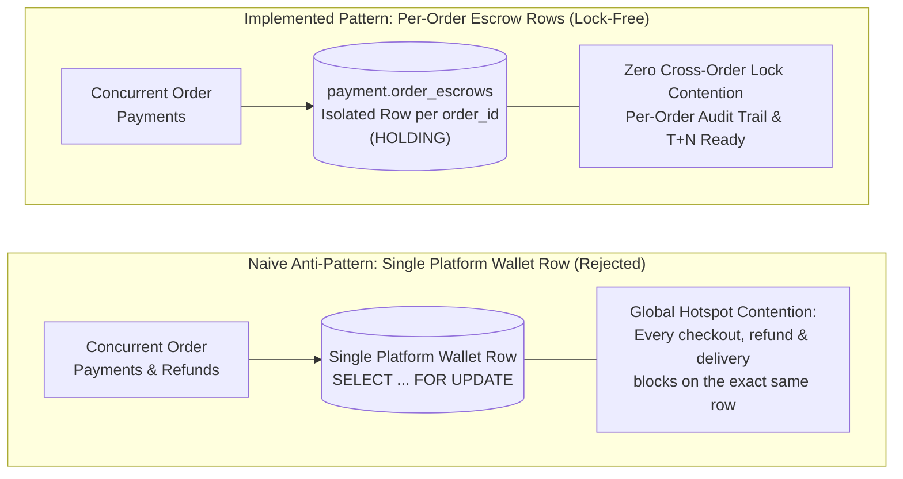
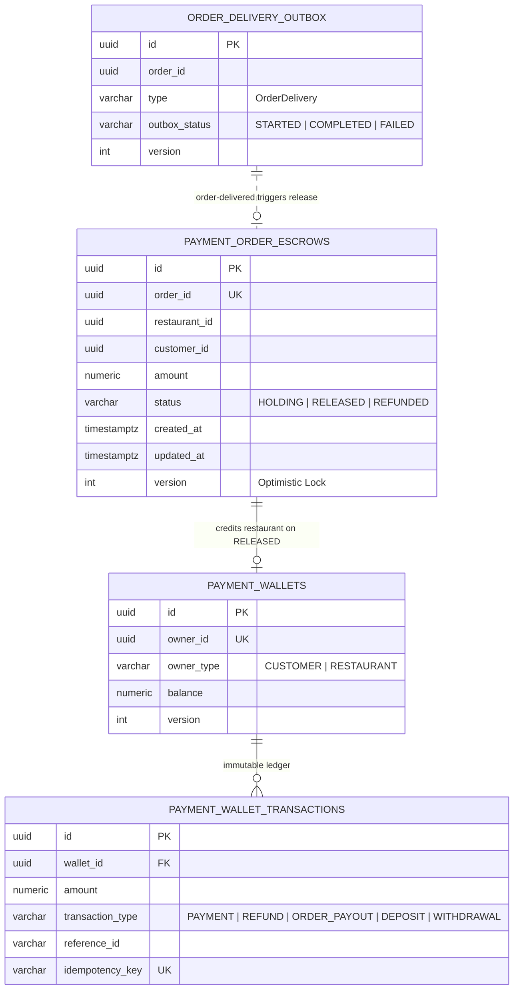
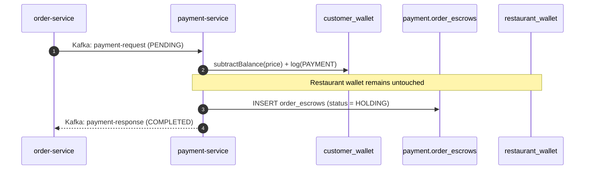
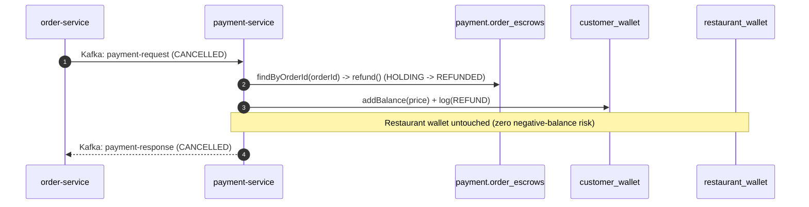
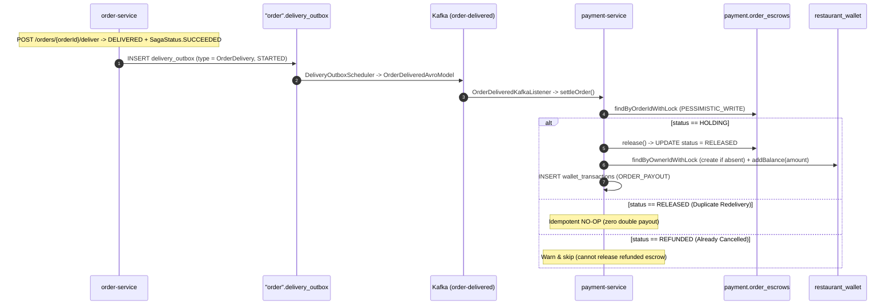

# Order Escrow Pool & Settlement Choreography

## 1. Financial Custody Motivation

In naive food ordering systems, capturing customer payment (`OrderStatus.PAID`) immediately credits the restaurant's withdrawable wallet (`restaurantWallet.addBalance`). At that point, however, the kitchen has not yet prepared the meal and the courier has not completed delivery.

Crediting merchants prematurely introduces two critical architectural hazards:

1. **Early Withdrawal & Negative Balance Risk:** If a merchant withdraws funds while orders are still active and one of those orders is cancelled, SAGA refund compensation (`cancelPayment`) either fails with `PaymentDomainException` or forces the merchant wallet into a negative balance.
2. **Distributed Monolith Coupling:** Blocking withdrawals by having `payment-service` synchronously query `order-service` for active order totals couples runtime availability and violates bounded-context autonomy.

**Take My Order** resolves both hazards by holding captured funds inside a lock-free **Mini Order Escrow Pool (`payment.order_escrows`)** until physical handover (`DELIVERED`), and releasing earnings to the merchant via asynchronous, SAGA-independent **Settlement Choreography (`order-delivered`)**.

---

## 2. Per-Order Escrow Design Principles

Instead of funneling all in-flight order funds through a single `OwnerType.PLATFORM` wallet row, each paid order creates its own isolated row in `payment.order_escrows`:

- **Zero Hotspot Contention:** Concurrent checkouts across thousands of customers and restaurants insert independent escrow rows (`UNIQUE (order_id)`) without contending on a shared global balance row.
- **Strict SAGA Boundary Separation:** Payment capture and cancellation refund stay inside the orchestrated Order SAGA (`payment-request` / `payment-response`), whereas settlement upon delivery is a one-way post-terminal choreography event (`order-delivered`).
- **Autonomous Merchant Payouts:** Because restaurant wallets only receive funds once orders reach `DELIVERED`, withdrawal validation remains 100% local to `payment-service`.

---

## 3. Persistence Model & State Semantics

All escrow, wallet, and delivery outbox tables are managed via Flyway migration scripts across `payment-service` and `order-service`:

### 3.1 Escrow Lifecycle & Ledger Mapping

| Entity / Escrow State | Schema, Locks & Indexes | Domain & Ledger Semantics |
| :--- | :--- | :--- |
| **`payment.order_escrows`** (`OrderEscrow`) | `UNIQUE (order_id)`, `@Version` optimistic lock, `PESSIMISTIC_WRITE` (`findByOrderIdWithLock`), indexes on `(restaurant_id, status)` and `(created_at)`. | Enforces strict one-to-one custody per order; `OrderEscrow` `release()` and `refund()` guard `status == HOLDING` (`PaymentDomainException` otherwise). |
| **`HOLDING`** | Created atomically inside `PaymentDomainServiceImpl` `validateAndInitiatePayment()`. | Customer wallet debited (`PAYMENT` ledger entry); funds held in escrow while merchant wallet stays untouched. |
| **`RELEASED`** | Updated under `PESSIMISTIC_WRITE` inside `settleOrder()` (`OrderDeliveredMessageListener`). | Locks restaurant wallet (`findByOwnerIdWithLock`), lazily creates a `RestaurantWallet` if absent, credits earnings, and records `ORDER_PAYOUT`. |
| **`REFUNDED`** | Updated inside `PaymentDomainServiceImpl` `validateAndCancelPayment()`. | Returns funds directly from escrow to customer wallet and logs `REFUND`; merchant wallet is never debited. |
| **`"order".delivery_outbox`** | Persisted inside `OrderDeliverCommandHandler` (`type = "OrderDelivery"`, `STARTED`). | Polled every `10s` by `DeliveryOutboxScheduler` to publish `OrderDeliveredAvroModel` on `order-delivered`, preventing lost settlements. |

---

## 4. End-to-End Financial & Settlement Flows

### 4.1 Order Payment Capture (`HOLDING`)

### 4.2 Cancellation Refund (`REFUNDED`)

### 4.3 Delivery Settlement (`RELEASED`)

When a courier confirms physical delivery (`POST /orders/{orderId}/deliver`), `OrderDeliverCommandHandler` transitions the order to `DELIVERED`, seals the SAGA outboxes as `SagaStatus.SUCCEEDED`, and inserts a `delivery_outbox` record (`type = "OrderDelivery"`) in the exact same database transaction:

### 4.4 Autonomous Merchant Withdrawal

Because `payment.wallets.balance` for a restaurant holds **only** settled earnings (`ORDER_PAYOUT`), `POST /wallets/{ownerId}/withdraw` (`WalletController`) executes completely autonomously inside `payment-service`:

- Enforces restaurant-scoped RBAC (`can_manage_payment` via `PaymentAuthService.hasPermissionForWallet`) and requires an `Idempotency-Key` header persisted on `wallet_transactions`.
- Acquires a `PESSIMISTIC_WRITE` wallet lock (`walletRepository.findByOwnerIdWithLock(ownerId)`), verifies sufficient local balance via `wallet.subtractBalance()`, and logs `WalletTransactionType.WITHDRAWAL` with zero runtime dependency on `order-service`.

### 4.5 Restaurant Financial Summary API

To maintain strict bounded-context separation, operational counts remain in `order-service` (`GET /orders/restaurants/{restaurantId}/summary`), while monetary telemetry lives in `payment-service`:

- **Endpoint:** `GET /wallets/{ownerId}/financial-summary`
- **Authorization:** `@PreAuthorize("@paymentAuthService.hasPermissionForWallet(authentication, 'can_read_payment', #ownerId)")` — applying the exact same IDOR shield as `/balance` and `/history`.
- **Response (`RestaurantFinancialSummaryResponse`):** Aggregates wallet balance plus a single native `FILTER` query in `OrderEscrowJpaRepository.getEscrowSummary()` anchored to UTC `startOfDay`:
    - `restaurantId`: Target restaurant owner UUID.
    - `withdrawableBalance`: Available restaurant wallet balance (`payment.wallets.balance`).
    - `dailySettledRevenue`: Sum of escrows with `status = 'RELEASED'` and `updated_at >= startOfDay (UTC)`.
    - `pendingPayout`: Sum of active escrows currently in `status = 'HOLDING'`.
    - `dailyRefundedAmount`: Sum of escrows with `status = 'REFUNDED'` and `updated_at >= startOfDay (UTC)`.

---

## 5. Solvency Custody & Reconciliation

Dedicated per-order escrow records allow finance and operations teams to reconcile platform liabilities cleanly using indexed aggregates over `payment.order_escrows`:

| Custody / Audit Metric | Escrow Filter & Index Path | Operational Guarantee |
| :--- | :--- | :--- |
| **Platform Escrow Liability (`Pending Payout`)** | `status = 'HOLDING'` (per-restaurant via `idx_order_escrows_restaurant_status`) | Real-time custody balance across all active orders, proving full backing for in-flight refunds. |
| **Daily Settled Revenue** | `status = 'RELEASED'` and `updated_at >= startOfDay (UTC)` | Reconciles directly against `ORDER_PAYOUT` credits posted to merchant wallets. |
| **Daily Refunded Volume** | `status = 'REFUNDED'` and `updated_at >= startOfDay (UTC)` | Reconciles directly against `REFUND` credits returned to customer wallets. |
| **`T+N` Rolling Reserve Readiness** | `created_at` & `updated_at` timestamps (`idx_order_escrows_created_at`) | Supports future delayed-payout or dispute-holdback policies without modifying table schemas. |

### 5.1 Related Documentation

- [SAGA Orchestration Pattern](saga-orchestration.md) — Order lifecycle states, payment capture, and cancellation triggers.
- [Cancel SAGA Deep Dive](cancel-saga-deep-dive.md) — Refund compensation legs and zero-Kafka no-refund delivery edge cases.
- [Transactional Outbox Pattern](transactional-outbox.md) — Reliable delivery outbox scheduling and at-least-once semantics.
- [Idempotency & Messaging](idempotency-and-messaging.md) — Consumer deduplication and ledger uniqueness constraints.
- Service Specifications: [Payment Service](../services/payment-service.md) · [Order Service](../services/order-service.md)
