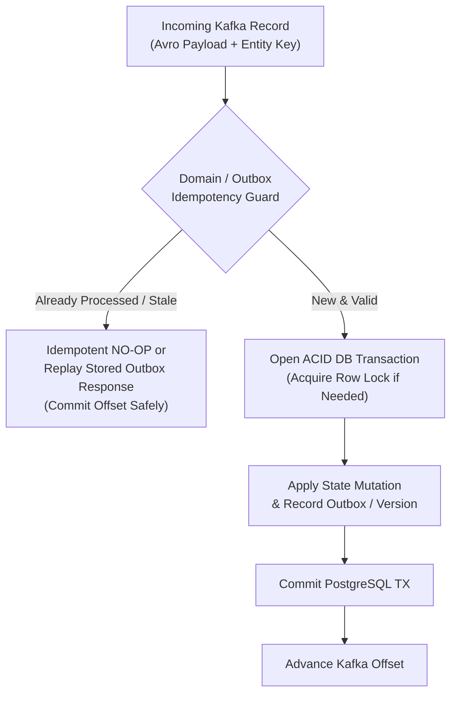
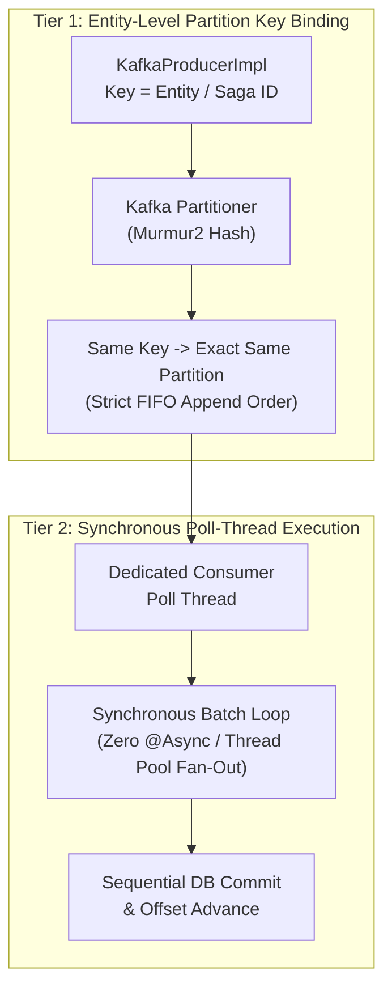
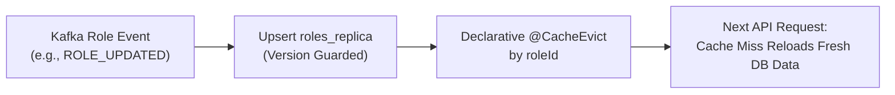
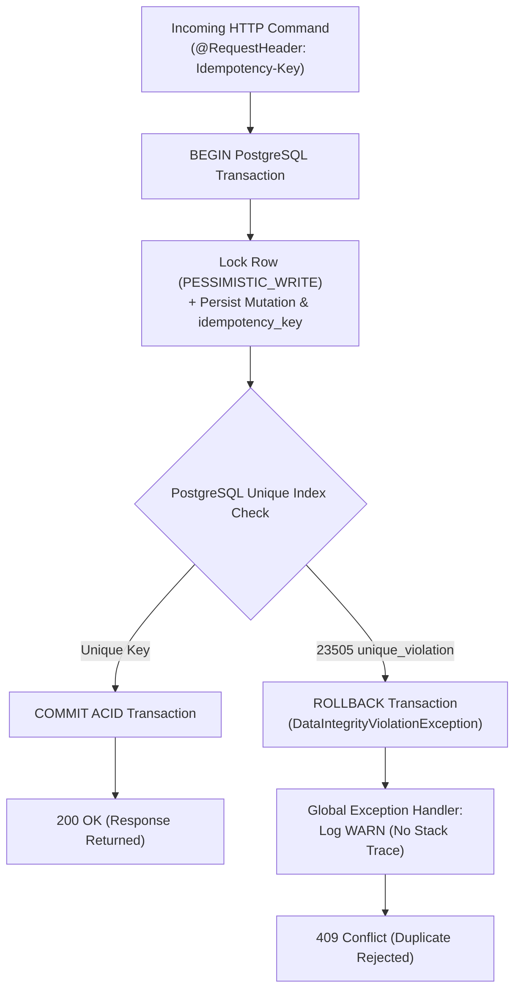

# Idempotency & Message Ordering Architecture

## 1. At-Least-Once Delivery Realities

Apache Kafka guarantees **at-least-once delivery** across distributed partitions. Under production network conditions, duplicate message delivery is a normal operational event caused by:

1. **Producer Retries:** Transient broker timeouts while awaiting `acks = all` acknowledgments cause producers to resend records already committed to the partition log.
2. **Consumer Rebalancing:** Pod restarts, rolling deployments, or pauses exceeding `max.poll.interval.ms` reassign partitions and replay uncommitted offsets.
3. **Post-Commit Crashes:** If a consumer commits its PostgreSQL transaction and crashes before committing the Kafka offset, the exact same message is redelivered on recovery.

Without strict multi-layer idempotency and partition-level ordering, redelivered or reordered events cause double wallet charges, duplicated stock changes, or resurrected deleted roles.

---

## 2. Multi-Layer Consumer Idempotency

Rather than relying on a single generic `processed_events` table, **Take My Order** embeds idempotency directly into each service's transactional outbox, aggregate locks, and monotonic version checks:

### 2.1 Deduplication Guards by Layer

| Layer / Context | Idempotency Mechanism | Duplicate / Stale Handling |
| :--- | :--- | :--- |
| **Order SAGA Orchestrator** (`OrderPaymentSaga`, `OrderApprovalSaga`) | `(type, saga_id, saga_status)` outbox queries, `PESSIMISTIC_WRITE` (`findByIdWithLock`), and JPA `@Version` optimistic locking. | Out-of-order or duplicate replies find no matching saga state or hit an optimistic lock conflict (swallowed as a no-op in Kafka listeners). |
| **SAGA Participants** (`payment-service`, `restaurant-service`) | Composite unique indexes on local response outboxes: `(type, saga_id, payment_status, outbox_status)` in `payment.order_outbox` and `(type, saga_id, approval_status, outbox_status)` in `restaurant.order_outbox`. | Re-publishes the previously completed response without re-debiting wallets, double-refunding, or double-restoring stock. |
| **Escrow Settlement** (`payment-service` delivery listener) | `PESSIMISTIC_WRITE` row lock on `payment.order_escrows` (`findByOrderIdWithLock`) with state precondition check (`HOLDING`). | Short-circuits cleanly if the escrow is already `RELEASED` (duplicate delivery) or `REFUNDED` (cancelled order). |
| **Event Replicas** (`roles_replica`, restaurant ratings) | Monotonic version guard (`incoming.version <= existing.version` ignored in `RoleRepositoryImpl`) and timestamp guard (`Restaurant.updateRating()`). | Drops stale or replayed synchronization events deterministically without regressing local state. |

---

## 3. Message Ordering & Zombie-Entity Prevention

When an entity undergoes rapid back-to-back mutations — for example, a role is updated (`ROLE_UPDATED`) and deleted seconds later (`ROLE_DELETED`) — out-of-order processing can resurrect the deleted record from the delayed update (**Zombie Entity Anomaly**).

The platform prevents intra-entity reordering with a **Two-Tier Ordering Shield**:

### 3.1 Partition Keys & Transport Configuration

- **Entity-Bound Partition Keys:** Every publisher routes related events to a single partition by binding the Kafka message key to the domain aggregate identifier — `sagaId` for SAGA payment and restaurant approval topics, `orderId` for `order-delivered`, `roleId` for `identity-role-events`, `restaurantId` for catalog, personnel, and rating updates, and `userId` for `customer` events.
- **Synchronous Consumer Execution:** Configured via `KafkaProducerConfig` (`acks: all`, `retry-count: 5`, Avro Schema Registry) and `KafkaConsumerConfig` (`batch-listener: true`, `concurrency-level: 3`, `auto-offset-reset: earliest`, `specific.avro.reader: true`). Each partition's dedicated consumer thread processes its batch sequentially without offloading records to `@Async` or `ExecutorService` pools, preserving strict FIFO order per entity key.

---

## 4. Replica L1 Cache & Negative Caching

Downstream services (`order-service`, `payment-service`, `restaurant-service`) maintain local PostgreSQL replicas (`roles_replica`, `permissions_replica`) topped by an in-memory **Caffeine L1 cache** for sub-millisecond RBAC checks without remote HTTP hops:

### 4.1 Selective Eviction vs. Full Cache Purging

Purging an entire L1 cache on every routine role change risks **Thundering Herd** spikes against the local database. Instead, replica adapters apply declarative Spring **`@CacheEvict`** annotations:

- **Key-Scoped Eviction on Role Changes:** `RoleReplicaRepository` across `order-service`, `payment-service`, and `restaurant-service` evicts `"roles"` selectively by `roleId` on save/delete (and `restaurant-service`'s `RoleRepositoryImpl` evicts both `"roles"` and `"roleOrgUnits"` by `roleId`).
- **Intentional Full Eviction Only on Global Permission Toggles:** In `restaurant-service`, `RoleRepositoryImpl.updatePermission()` evicts `allEntries = true` because deactivating a single permission code can affect multiple cached roles simultaneously.

### 4.2 Negative Caching with Caffeine W-TinyLFU

To prevent deleted or permission-less role IDs from triggering repeated database queries on every authorization check, `RolePermissionQueryAdapter` annotates `getPermissionCodesByRoleId()` with `@Cacheable(value = "roles", key = "#roleId")` and returns `Set.of()` when no active permissions exist, paired with `@Cacheable` on organizational-unit lookups (`roleOrgUnits` in `order-service` / `restaurant-service`, `role_org_units` in `payment-service`).

- **Bounded W-TinyLFU Capacity:** Downstream `CacheConfig` beans bound Caffeine caches with `initialCapacity(100)`, `maximumSize(500)`, and `expireAfterAccess(60m)`, while `identity-service` configures its authoritative `roles_cache` with `maximumSize=10000` and `expireAfterWrite=15m`.

---

## 5. HTTP Ingress & DB-Backed Atomic Idempotency

### 5.1 Why External Redis `GET-SET` Locks Fail

Implementing financial HTTP idempotency via an external Redis cache (`GET` → `SET PROCESSING` → DB write → `SET COMPLETED`) introduces two fundamental hazards:

- **TOCTOU Race Conditions:** Without atomic scripting, concurrent retries passing through multiple replicas read `null` simultaneously and double-mutate balances.
- **Dual-State Desynchronization:** If Redis records completion while the PostgreSQL transaction later rolls back on a serialization error or crash, Redis and the relational ledger diverge permanently and valid retries are rejected.

### 5.2 Database-Backed `Idempotency-Key` Enforcement

**Take My Order** binds HTTP idempotency directly to the PostgreSQL ACID transaction via a mandatory **`Idempotency-Key` HTTP header** (`@RequestHeader("Idempotency-Key")`) and physical `UNIQUE` constraints (managed via Flyway migration scripts):

- **Wallet Deposit & Withdrawal (`payment-service`):** `POST /wallets/{ownerId}/deposit` and `POST /wallets/{ownerId}/withdraw` lock the wallet via `findByOwnerIdWithLock` (`PESSIMISTIC_WRITE`) and write the ledger entry carrying the header's `idempotency_key` into `payment.wallet_transactions` (`UNIQUE (idempotency_key)`). A duplicate key rolls back the entire transaction atomically, and `PaymentGlobalExceptionHandler` logs at `WARN` level and returns **`409 Conflict`**.
- **Order Placement (`order-service`):** `POST /orders` requires the `Idempotency-Key` header. `OrderCreateCommandHandler` first checks `orderRepository.findByIdempotencyKey()` — returning an idempotent **`200 OK`** with the existing order for clean client retries — while a physical `UNIQUE` constraint on `"order".orders (idempotency_key)` guarantees that simultaneous racing requests cannot create duplicate orders (`OrderGlobalExceptionHandler` maps `DataIntegrityViolationException` to **`409 Conflict`** / `DATA_INTEGRITY_VIOLATION`).

### 5.3 Related Documentation

- [SAGA Orchestration Pattern](saga-orchestration.md) — Order SAGA state guards and Fork-Join synchronization.
- [Cancel SAGA Deep Dive](cancel-saga-deep-dive.md) — Participant composite idempotency keys and double-click cancel handling.
- [Transactional Outbox Pattern](transactional-outbox.md) — At-least-once outbox dispatch and `FOR UPDATE SKIP LOCKED`.
- [Escrow & Settlement](escrow-and-settlement.md) — Idempotent escrow release and wallet payout ledger invariants.
- [Avro Contracts](avro-contracts.md) — Event schemas, Schema Registry evolution, and payload contracts.
