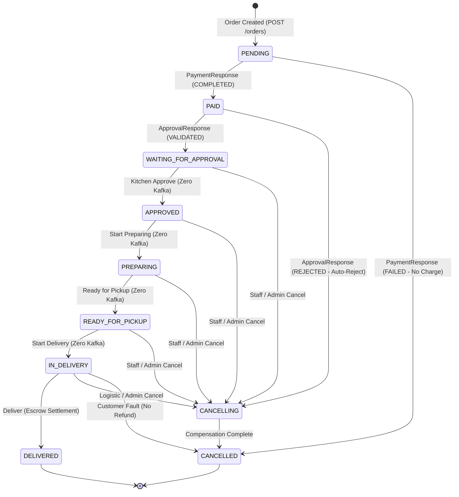
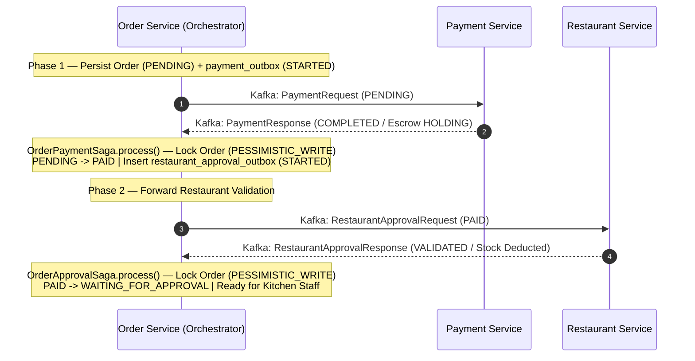
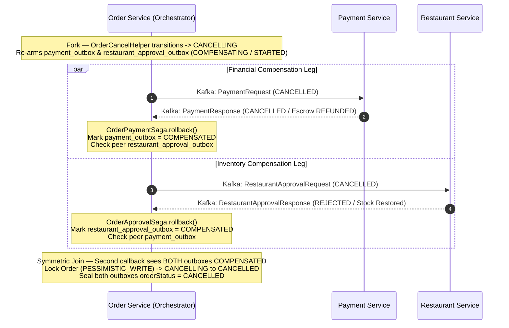

# SAGA Orchestration Pattern

## 1. The Distributed Coordination Problem

In a decoupled microservices architecture, a single business workflow often spans multiple independent databases. In **Take My Order**, fulfilling a food order coordinates state across three autonomous bounded contexts:

1. **Order Service (`order-service`):** Owns the order aggregate, its operational lifecycle, and the central SAGA state machine.
2. **Payment Service (`payment-service`):** Captures customer wallet funds into escrow (`payment.order_escrows`), processes refunds on cancellation, and settles payouts upon delivery.
3. **Restaurant Service (`restaurant-service`):** Validates restaurant availability, menu prices, and product inventory, deducting stock on validation and restoring stock when required by a cancellation.

Synchronous two-phase commit (2PC) across these boundaries would couple service availability, increase tail latency, and introduce distributed locking hazards. Instead, the platform implements the **SAGA Orchestration Pattern** backed by the **Transactional Outbox Pattern** and **Apache Kafka** to guarantee eventual consistency across asynchronous message boundaries.

> **Direct Zero-Kafka Terminal Path:** In addition to `IN_DELIVERY` customer-fault cancellations (`CUSTOMER_UNREACHABLE` / `WRONG_ADDRESS`), an administrator executing `POST /orders/{orderId}/force-cancel` on a `READY_FOR_PICKUP` or `IN_DELIVERY` order with `forceRefund = false` also short-circuits directly to `CANCELLED` without publishing Kafka compensation commands.

---

## 2. Orchestration vs. Choreography

The platform deliberately applies **Orchestration** for the transactional core and reserves **Choreography** for decoupled post-terminal side effects:

| Dimension | Choreography (Decentralized) | Orchestration (Core Order SAGA) |
| :--- | :--- | :--- |
| **Coordination Point** | Decentralized; each service subscribes to peer domain events independently. | Centralized in `order-service` (`OrderPaymentSaga`, `OrderApprovalSaga`, `OrderCancelHelper`). |
| **Flow Observability** | Distributed state is spread across multiple services and consumer offsets. | Explicit; the active lifecycle state and outbox progress live in one orchestrator database. |
| **Cyclic Risk** | High risk of cascading loops when multi-leg compensations overlap. | Eliminated; participants reply only to the orchestrator over dedicated response topics. |
| **Testing & Determinism** | Requires orchestrating multi-service integration setups for every failure path. | State transitions, preconditions, and Fork-Join rules are unit-tested deterministically. |

**Where Choreography Is Used:** Once an order reaches a terminal state, `order-service` emits fire-and-forget integration events via dedicated outboxes — specifically `delivery_outbox` (`order-delivered` → `payment-service` escrow settlement) and `restaurant_rating_outbox` (`restaurant-rating-updated` → `restaurant-service` rating sync) — so downstream consumers react without cycling back into the order SAGA.

---

## 3. Order State Machine & Outbox Lifecycle

Domain transition invariants are enforced inside `Order.java`, while `OrderSagaHelper.orderStatusToSagaStatus()` maps aggregate states onto `SagaStatus` (`STARTED`, `PROCESSING`, `SUCCEEDED`, `COMPENSATING`, `COMPENSATED`, plus `FAILED` when initial payment capture fails).

**In-Place Outbox State Machine:** `order-service` uses `order_id` as the `saga_id` and reuses the single `payment_outbox` and `restaurant_approval_outbox` records **in-place** across forward (`STARTED` → `PROCESSING` → `SUCCEEDED`) and compensating (`COMPENSATING` → `COMPENSATED`) phases. Re-arming an existing outbox row back to `OutboxStatus.STARTED` during cancellation avoids duplicate rows per saga and guarantees clean scheduler polling.

### 3.1 Formal State Invariants

All operational transition endpoints below sit under `/orders/{orderId}/...` inside `order-service`:

| State & Next States | Triggering Event / Action | Invariants, Outbox & SAGA Impact |
| :--- | :--- | :--- |
| `PENDING` → `PAID`, `CANCELLED` | `OrderCreateCommandHandler` (`POST /orders` + `Idempotency-Key`) | Validates customer, active/open restaurant, product availability and visibility, minimum order amount, `deliveryFee`, and total price (`sum(items) + deliveryFee`). Persists order + `payment_outbox` (`STARTED` / `STARTED`). |
| `PAID` → `WAITING_FOR_APPROVAL`, `CANCELLING` | `OrderPaymentSaga` `process()` (`PaymentStatus.COMPLETED`) | Customer wallet debited into `payment.order_escrows` (`HOLDING`). Updates `payment_outbox` (`PROCESSING`) and inserts `restaurant_approval_outbox` (`PROCESSING` / `STARTED`). |
| `WAITING_FOR_APPROVAL` → `APPROVED`, `CANCELLING` | `OrderApprovalSaga` `process()` (`VALIDATED` approval response) | `restaurant-service` validates catalog, price, and stock under a `PESSIMISTIC_WRITE` restaurant lock and deducts stock (`Validate-First, Mutate-Last`). Marks `restaurant_approval_outbox` (`COMPLETED` / `PROCESSING`). |
| `APPROVED` → `PREPARING`, `CANCELLING` | Authorized restaurant staff (`POST .../approve`) | Internal `order-service` transition (**Zero Kafka**). Outboxes remain `PROCESSING`. |
| `PREPARING` → `READY_FOR_PICKUP`, `CANCELLING` | Authorized restaurant staff (`POST .../start-preparing`) | Internal kitchen progress transition (**Zero Kafka**). |
| `READY_FOR_PICKUP` → `IN_DELIVERY`, `CANCELLING` | Authorized restaurant staff (`POST .../ready-for-pickup`) | Meal packaged and awaiting courier pickup (**Zero Kafka**). |
| `IN_DELIVERY` → `DELIVERED`, `CANCELLING`, `CANCELLED` | Authorized courier/staff (`POST .../start-delivery`) | Order in transit (**Zero Kafka**). Customer-fault cancel (`CUSTOMER_UNREACHABLE` / `WRONG_ADDRESS`) skips `CANCELLING` and finalizes directly as `CANCELLED` with no refund. |
| `DELIVERED` → *None (Terminal)* | Authorized courier/staff (`POST .../deliver`) | `OrderSagaHelper` `sealSagaAsSucceeded()` seals both outboxes (`SagaStatus.SUCCEEDED` / `DELIVERED`) and creates a `delivery_outbox` row (`STARTED`) to trigger Escrow Settlement Choreography. |
| `CANCELLING` → `CANCELLED` | Restaurant auto-reject (`PAID`), staff cancel (`POST .../cancel`), or admin (`POST .../force-cancel`) | Active rollback leg(s) re-armed in-place (`COMPENSATING` / `STARTED`); unnecessary leg(s) closed locally as `COMPENSATED` / `COMPLETED`. |
| `CANCELLED` → *None (Terminal)* | Payment `FAILED`, satisfied compensation barrier, or zero-Kafka termination | Step 1 payment failure seals `payment_outbox` as **`SagaStatus.FAILED`**; compensated and zero-Kafka cancellations seal outboxes as **`SagaStatus.COMPENSATED`**. |

---

## 4. Sequential Gating & Fork-Join Barrier

The orchestrator prevents asynchronous race conditions using two distinct coordination patterns: **Sequential Stage Gating** on the forward path and a **Symmetric Fork-Join Barrier** on the compensating path.

### 4.1 Sequential Forward Stage Gating

On order placement, `order-service` strictly serializes financial capture ahead of inventory deduction so restaurant stock is never reserved for an unpaid order:

1. **Strict Stage Precondition:** `restaurant_approval_outbox` is never created while an order is `PENDING`. Only inside the same database transaction where `OrderPaymentSaga.process()` transitions `PENDING` → `PAID` is the restaurant validation command staged.
2. **Row-Level Locking & Outbox Guards:** `OrderSagaHelper.findOrder()` acquires a PostgreSQL **`PESSIMISTIC_WRITE`** lock (`SELECT ... FOR UPDATE` via `OrderJpaRepository.findByIdWithLock`) to serialize concurrent state updates on the order aggregate. In parallel, outbox lookups filter by `(saga_id, saga_status)` and rely on JPA **`@Version` optimistic locking**, allowing Kafka listeners to safely ignore duplicate or out-of-order deliveries.

### 4.2 Fork-Join Compensation Barrier

When a post-validation order is cancelled with `MaterialAction.RESTORE_STOCK`, **both** external participants must roll back their side effects (escrow refund in `payment-service` and stock restoration in `restaurant-service`). Because Kafka replies arrive asynchronously in arbitrary order, `OrderPaymentSaga.rollback()` and `OrderApprovalSaga.rollback()` implement a **Symmetric Fork-Join Synchronization Barrier**:

- **Order-Independent Convergence:** Whichever reply arrives **first** marks its own outbox row `COMPENSATED` / `COMPLETED`, checks the peer outbox, observes it is still `COMPENSATING`, and leaves the order in `CANCELLING`. Whichever reply arrives **second** sees both outboxes `COMPENSATED`, locks the order row, transitions `CANCELLING` → `CANCELLED`, and seals both outboxes as `OrderStatus.CANCELLED`.
- **Unified Single-Leg Handling:** Single-leg compensations (such as Step 2 restaurant auto-rejection, `RECORD_WASTE` cancellations, or admin force cancellations with one leg disabled) reuse the exact same barrier by closing the unneeded outbox row **locally** as `COMPENSATED` / `COMPLETED` up front — so the lone external reply satisfies the barrier immediately.

---

## 5. Compensating Transactions & Recovery

Distributed state changes committed on peer services cannot be rolled back with a local SQL `ROLLBACK`. Every failure or cancellation path maps deterministically to its required compensating action(s):

| Failure / Cancel Scenario | Orchestrator & Outbox Action | Participant Compensation & Final State |
| :--- | :--- | :--- |
| **Step 1: Payment Failure** (Insufficient balance or wallet error) | `OrderPaymentSaga` `rollback()` transitions `PENDING` → `CANCELLED` (`PAYMENT_FAILED`) and seals `payment_outbox` as `SagaStatus.FAILED`. | No funds were captured and no stock was touched; zero external compensation required. **Final:** `CANCELLED` |
| **Step 2: Restaurant Auto-Reject** (Closed/inactive, hidden or out-of-stock item, min-order or price/fee drift) | `OrderApprovalSaga` `rollback()` (`PROCESSING` branch) moves `PAID` → `CANCELLING`, closes `restaurant_approval_outbox` locally (`COMPENSATED`), and re-arms `payment_outbox` (`COMPENSATING` / `STARTED`). | Stock was never deducted (`Validate-First`). `payment-service` moves `order_escrows` (`HOLDING` → `REFUNDED`) and credits customer wallet (`REFUND`). **Final:** `CANCELLED` |
| **Step 3a: Staff Cancel — `RESTORE_STOCK`** (`POST .../cancel` in `WAITING_FOR_APPROVAL`, `APPROVED`, or `PREPARING` under `OPERATIONAL_DISRUPTIONS`) | `OrderCancelHelper` moves order → `CANCELLING` and re-arms **both** `payment_outbox` and `restaurant_approval_outbox` (`COMPENSATING` / `STARTED`). | **Fork-Join Dual Compensation:** `restaurant-service` restores deducted stock (`restoreStock`) AND `payment-service` refunds customer escrow. **Final:** `CANCELLED` |
| **Step 3b: Staff Cancel — `RECORD_WASTE`** (`INSUFFICIENT_STOCK`, `READY_FOR_PICKUP`, `IN_DELIVERY` `LOGISTIC_DISRUPTIONS`, or wasted `APPROVED`/`PREPARING` items) | Moves order → `CANCELLING`, closes `restaurant_approval_outbox` locally (`COMPENSATED`, zero restaurant Kafka), and re-arms **only** `payment_outbox`. | Cooked or wasted items cannot return to stock. `payment-service` refunds customer from `order_escrows` (`REFUNDED`). **Final:** `CANCELLED` |
| **Step 3c: Delivery Customer Fault** (Authorized courier/staff in `IN_DELIVERY` with `CUSTOMER_UNREACHABLE` or `WRONG_ADDRESS`) | `Order` `cancelWithoutRefund()` transitions **directly `IN_DELIVERY` → `CANCELLED`** (`RECORD_WASTE`) and seals both outboxes locally (`CANCELLED` / `COMPENSATED`). | **Zero Kafka messages.** Customer is not refunded; food recorded as waste. **Final:** `CANCELLED` |
| **Step 3d: Admin Force Cancel** (Platform admin via `POST .../force-cancel` in `WAITING_FOR_APPROVAL`..`IN_DELIVERY`) | Derives `RESTORE_STOCK` vs `RECORD_WASTE` from current status and applies the admin's `forceRefund` flag (`PENDING`, `PAID`, `CANCELLING`, `DELIVERED`, `CANCELLED` rejected with `409`). | Executes dual compensation, single-leg refund, single-leg stock restore, or instant zero-Kafka `CANCELLED` (`forceRefund = false` + `RECORD_WASTE`). **Final:** `CANCELLED` |
| **Infrastructure Crash** (Orchestrator or participant pod restarts mid-flight) | Unsent outbox rows remain `OutboxStatus.STARTED` in PostgreSQL across restarts. | Scheduled outbox pollers (payment & approval outbox schedulers) re-publish pending commands; consumers deduplicate. **Final:** Resumes automatically |

> **Cancellation Authorization Boundary:** Customers do not have a self-service cancel endpoint. Operational cancellations (`POST /orders/{orderId}/cancel`) require restaurant-scoped, status-specific RBAC permissions (`OrderAuthService.hasCancelPermissionForOrder`), while administrative overrides require `can_force_cancel_order`.

### 5.1 Idempotent Compensation Guarantees

Under Kafka at-least-once delivery, retries and redeliveries are expected rather than exceptional. The platform enforces end-to-end idempotency across every hop:

- **HTTP Ingress Protection:** `POST /orders` requires an `Idempotency-Key` header verified via `orderRepository.findByIdempotencyKey()`, returning the existing order instead of spawning a duplicate SAGA. `POST /orders/{orderId}/cancel` returns an idempotent `200 OK` if the order is already `CANCELLING` or `CANCELLED`, while rejecting stale client `currentStatus` values with `409 Conflict`.
- **Orchestrator Consumer Guards:** `OrderPaymentSaga` and `OrderApprovalSaga` match incoming responses against expected `(saga_id, saga_status)` outbox rows, serialize aggregate writes via `PESSIMISTIC_WRITE`, and swallow `OptimisticLockingFailureException` as an intentional no-op in `PaymentResponseKafkaListener` and `RestaurantApprovalResponseKafkaListener`.
- **Participant Outbox Deduplication:** Before mutating balances or stock, `PaymentRequestHelper` checks `payment.order_outbox` for `(saga_id, payment_status, COMPLETED)` (backed by `UNIQUE` `wallet_transactions.idempotency_key`), and `RestaurantApprovalRequestHelper` checks `restaurant.order_outbox` for `(saga_id, approval_status, COMPLETED)` under a `PESSIMISTIC_WRITE` restaurant lock. If an operation already completed, the participant simply re-publishes its stored response without double-refunding or double-restoring inventory.

### 5.2 Related Documentation

- [Cancel SAGA Deep Dive](cancel-saga-deep-dive.md) — Detailed cancellation reason matrix, `MaterialAction` rules, permission model, and concurrency edge cases.
- [Transactional Outbox Pattern](transactional-outbox.md) — Polling schedulers, cleaner jobs, and atomic DB-plus-event guarantees.
- [Escrow & Settlement](escrow-and-settlement.md) — Mini Order Escrow Pool (`HOLDING` → `RELEASED` / `REFUNDED`) and ledger accounting.
- [Idempotency & Messaging](idempotency-and-messaging.md) — End-to-end consumer deduplication and Kafka delivery semantics.
- Service Specifications: [Order Service](../services/order-service.md) · [Payment Service](../services/payment-service.md) · [Restaurant Service](../services/restaurant-service.md)
