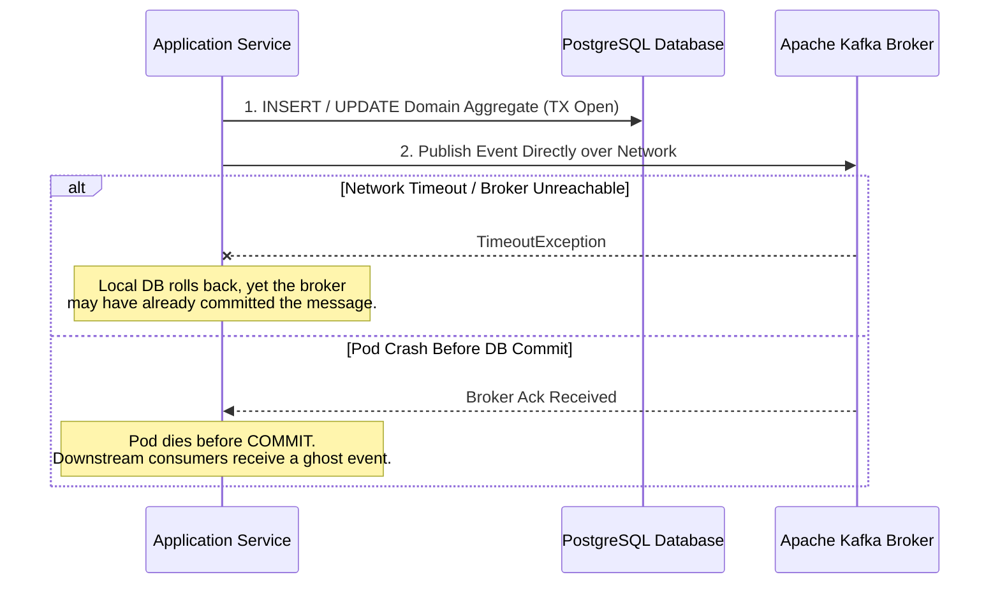
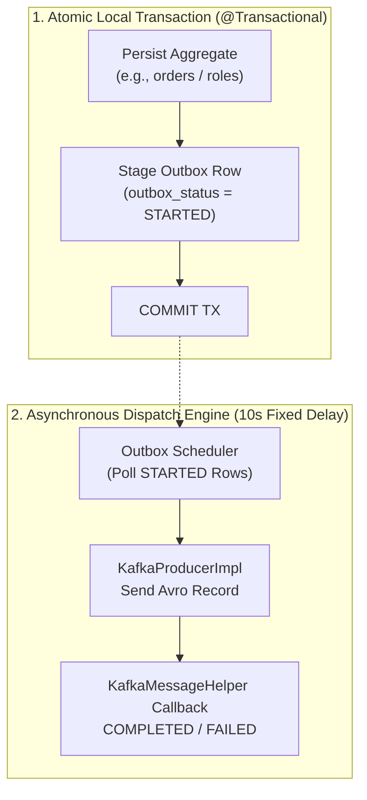
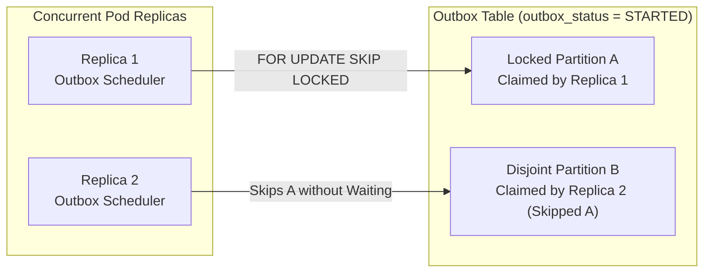

# Transactional Outbox & Concurrent Polling

## 1. The Dual-Write Vulnerability

In event-driven microservices, a single business operation must frequently update a local PostgreSQL database and publish an integration event to Apache Kafka. Performing both operations sequentially inside one service method creates the **Dual-Write Trap**: relational databases and Kafka do not share an atomic distributed transaction (XA / 2PC), so any crash or network fault between the two calls leaves the system inconsistent.

---

## 2. Transactional Outbox Architecture

The **Transactional Outbox Pattern** eliminates dual-writes by replacing the in-band Kafka call with an insert or in-place update into a co-located PostgreSQL outbox table inside the exact same `@Transactional` boundary. A background scheduler then reads pending rows (`OutboxStatus.STARTED`), dispatches Avro messages asynchronously via `KafkaProducerImpl`, and updates `outbox_status` in the Kafka completion callback.

### 2.1 Platform Outbox Topology

All outbox schemas are managed via Flyway migration scripts and share the common `OutboxStatus` lifecycle (`STARTED`, `COMPLETED`, `FAILED`), `@Version` optimistic locking, and a `10s` (`10000 ms`) scheduler polling cadence (`outbox-scheduler-fixed-rate` / `outbox-scheduler-initial-delay`):

| Service & Outbox Tables | Key Schema & Type Contract | Polling & Cleanup Behavior |
| :--- | :--- | :--- |
| **`order-service`** `payment_outbox`, `restaurant_approval_outbox`, `delivery_outbox`, `restaurant_rating_outbox` | SAGA outboxes use `type = "OrderProcessingSaga"`, `saga_id`, `saga_status`, `order_status`, `INTEGER @Version`, and composite unique `(type, saga_id, saga_status)`. Post-terminal choreography uses `delivery_outbox` (`order-delivered`) and `restaurant_rating_outbox` (`restaurant-rating-updated`). | Polled every `10s` via Spring Data JPA queries. SAGA outboxes are cleaned at `@midnight` **only** when `COMPLETED` and in terminal `SagaStatus` (`SUCCEEDED`, `FAILED`, `COMPENSATED`); `restaurant_rating_outbox` cleans `COMPLETED` rows at `@midnight`. |
| **`payment-service`** `payment.order_outbox` | Tracks `saga_id`, `payment_status`, `outbox_status`, and `INTEGER @Version` with unique index `(type, saga_id, payment_status, outbox_status)` for forward/refund deduplication. | Polled every `10s` (`OrderOutboxScheduler`); `COMPLETED` rows purged at `@midnight` (`OrderOutboxCleanerScheduler`). |
| **`restaurant-service`** `restaurant.order_outbox`, `restaurant.restaurant_outbox` | `order_outbox` enforces unique `(type, saga_id, approval_status, outbox_status)` for SAGA replies; `restaurant_outbox` dispatches catalog and personnel sync events (`TEXT` payload, `@Version`). | Polled every `10s` (order, restaurant, and personnel schedulers); `COMPLETED` rows purged at `@midnight`. |
| **`identity-service`** `role_outbox`, `permission_outbox` | Stores domain event `type` (e.g., `ROLE_CREATED`, `ROLE_UPDATED`), `TEXT` payload, `outbox_status`, and `BIGINT @Version`. | `role_outbox` is polled every `10s` using **`FOR UPDATE SKIP LOCKED`** (`RoleOutboxJpaRepository`); `permission_outbox` polls `STARTED` rows every `10s`; both purge `COMPLETED` rows at `@midnight`. |

---

## 3. High-Concurrency Polling & `SKIP LOCKED`

When multiple Kubernetes replicas of a microservice run simultaneously under HPA autoscaling, every replica executes its scheduled outbox poller in parallel.

### 3.1 Multi-Replica Contention Problem

- **Plain `SELECT` (Duplicate Dispatch):** Two replicas querying `WHERE outbox_status = 'STARTED'` simultaneously read the exact same batch and publish duplicate messages to Kafka.
- **Blocking `SELECT ... FOR UPDATE` (Lock Contention):** Replica 1 locks pending rows while awaiting Kafka broker I/O; Replica 2 blocks on those exact row locks until Replica 1 commits, collapsing horizontal throughput.

### 3.2 `FOR UPDATE SKIP LOCKED` Mechanics

PostgreSQL's `FOR UPDATE SKIP LOCKED` locks available matching rows for the active transaction while immediately skipping any rows already locked by a peer replica:

**Codebase Implementation Scope:**

- **Active `SKIP LOCKED` (`identity-service`):** `RoleOutboxRepositoryImpl.findByOutboxStatus()` executes a native PostgreSQL `SELECT * FROM role_outbox WHERE outbox_status = :outboxStatus ORDER BY created_at ASC FOR UPDATE SKIP LOCKED` query (alongside a single-row `LIMIT 1` variant `findNextOutboxMessageWithLock`) inside `RoleOutboxScheduler`'s `@Transactional` boundary. The shared `infrastructure/outbox` module also defines `AbstractRetryableScheduler` as the DB-agnostic base contract formalizing `SKIP LOCKED` repository polling.
- **Optimistic Locking & Idempotent Guards (SAGA & Domain Outboxes):** The remaining service outbox repositories currently poll `STARTED` records through Spring Data JPA derived queries on a `10s` fixed delay. Every outbox entity enforces JPA `@Version` optimistic locking on status updates, and every Kafka consumer enforces composite deduplication so overlapping claims under multi-replica scaling cannot double-charge wallets or double-deduct stock.

**Engineering Guarantees of `SKIP LOCKED`:**

- **Zero Thread Blocking:** Replicas never stall behind peer row locks, allowing polling throughput to scale horizontally.
- **Disjoint Row Claiming:** Concurrent transactions never claim the same locked outbox row simultaneously.
- **Crash-Safe Lock Release:** If a pod crashes mid-dispatch, PostgreSQL terminates its transaction and releases the row locks automatically so surviving pods pick up the work on the next tick.

---

## 4. JPA Flush Timing & `@Version` Propagation

A subtle JPA edge case in outbox-backed services is the **Stale Version Payload Anomaly**:

1. A command handler mutates a `@Version`-annotated entity and invokes `repository.save(entity)`.
2. Hibernate queues the SQL `UPDATE` inside its First-Level Cache (Persistence Context) and defers execution until flush or transaction commit.
3. If the handler constructs the outbox event payload from the entity's `@Version` field *before* Hibernate flushes the `UPDATE`, the serialized payload can carry the pre-increment version number — causing downstream replicas with version-based stale-event checks to discard the update.

**Platform Safeguards:**

- **Explicit `saveAndFlush()` Enforcement:** Where immediate database synchronization and version hydration are required inside an orchestration step — such as `UserUpdateIntentRepositoryImpl.save()` — the adapter loads the persisted version and calls `saveAndFlush(entity)` so PostgreSQL executes the `UPDATE` and returns the newly incremented `@Version` immediately.
- **Persist-Before-Stage Ordering:** Command handlers (e.g., `UpdateRoleCommandHandler` and SAGA handlers) persist the domain aggregate before mapping and inserting the outbox message, while Hexagonal data-access mappers propagate `@Version` bidirectionally between JPA entities and domain models.

---

## 5. Broker Failures & At-Least-Once Semantics

`KafkaProducerImpl` publishes Avro records asynchronously via `KafkaTemplate.send()` and attaches `KafkaMessageHelper.getKafkaCallback()` via `CompletableFuture.whenComplete()`. Outbox state transitions respond deterministically to each failure class:

| Execution / Failure Mode | Actual Runtime Behavior | Recovery & Consistency Guarantee |
| :--- | :--- | :--- |
| **Broker Ack Succeeded (`ex == null`)** | `KafkaMessageHelper` invokes `outboxCallback` with `OutboxStatus.COMPLETED`. | Row leaves the `STARTED` poll set and becomes eligible for `@midnight` cleanup (subject to terminal `SagaStatus` for SAGA outboxes). |
| **Async Broker Send Failure (`ex != null`)** | `KafkaMessageHelper` logs the error and invokes `outboxCallback` with `OutboxStatus.FAILED`. | Failed records are quarantined out of active polling instead of repeatedly blocking healthy batches, while remaining auditable in PostgreSQL. |
| **Synchronous Publish / Payload Error** | `RoleEventKafkaPublisher` and `RestaurantPersonnelEventKafkaPublisher` catch synchronous exceptions and mark `OutboxStatus.FAILED`; SAGA publishers (e.g., `OrderPaymentEventKafkaPublisher`) log send-block errors while leaving transient failures in `STARTED`. | Quarantines malformed event payloads immediately in event publishers while allowing transient SAGA dispatch errors to retry on the next `10s` tick. |
| **Crash Between Kafka Ack & DB Update** | Broker commits the Avro message, but the pod dies before updating `outbox_status = COMPLETED` in PostgreSQL. | On restart, the row remains `STARTED` and is re-published (**at-least-once delivery**). Downstream consumers guarantee exactly-once business effects via idempotency guards. |

### 5.1 Related Documentation

- [SAGA Orchestration Pattern](saga-orchestration.md) — Forward stage gating, Fork-Join compensation barrier, and SAGA outbox coordination.
- [Cancel SAGA Deep Dive](cancel-saga-deep-dive.md) — In-Place Outbox single-row invariant, re-arming, and `@midnight` cleaner protection.
- [Idempotency & Messaging](idempotency-and-messaging.md) — Consumer deduplication, composite unique keys, and stale-event protection.
- [Avro Contracts](avro-contracts.md) — Schema Registry serialization and event contract evolution.
- Service Specifications: [Order Service](../services/order-service.md) · [Payment Service](../services/payment-service.md) · [Restaurant Service](../services/restaurant-service.md) · [Identity Service](../services/identity-service.md)
