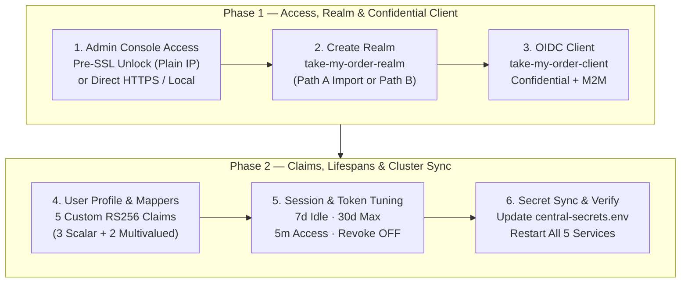

# Keycloak Realm Configuration

This step-by-step runbook walks you through provisioning **Keycloak `24.0.1`** for the **Take My Order** ecosystem—covering both the **1-Click JSON Import (Recommended)** and the **Manual Click-by-Click UI Setup** across local development (`http://localhost:30080`) and production Kubernetes (`http://<MASTER_PUBLIC_IP>:30080` or `https://<keycloak-sub>.<YOUR_DOMAIN>`). Every menu click, toggle state, blank field, CLI command, and verification gate is documented in exact execution order.

!!! note "Looking for Architectural Deep-Dive?"
    This page focuses exclusively on operational setup. For the design rationale behind Headless IAM, cached JWKS verification, Redis token revocation, and M2M sync, see [Keycloak OIDC & Token Architecture](../security/keycloak-architecture.md).

---

## 1. Provisioning Paths & Matrix

Keycloak persists its state in the dedicated **`keycloak`** schema of PostgreSQL and issues RS256 JWT tokens carrying **5 custom claims** (`internal_id`, `user_type`, `account_status`, `role_ids`, `organizational_unit_ids`) validated by `JwtAuthenticationFilter` (`identity-service`) and `JwtSecurityFilter` (`order-service`, `payment-service`, `restaurant-service`).

Choose your matching row before starting Section 2:

| Environment | Admin URL & Issuer URI | Proxy Setting | Recommended Provisioning Path |
| :--- | :--- | :---: | :--- |
| **Local Mode A**<br>*(Docker Compose + IDE)* | `http://localhost:30080` | `KC_PROXY=none` | **Automatic** (`start-dev --import-realm` auto-imports `realm-export.json`; no clicks needed) |
| **Local Mode B**<br>*(Docker Desktop K8s)* | `http://localhost:30080` | `KC_PROXY=none` | **Path A** (Import `realm-export.json`, keep or rotate secret in `overlays/dev/central-secrets.env`) |
| **Production Pre-SSL**<br>*(Plain Public IP)* | `http://<MASTER_PUBLIC_IP>:30080` | `KC_PROXY=none` | Run **Section 2.1** (`sslRequired=NONE`) → **Path A** (or **B**) → **MUST Rotate Secret** |
| **Production HTTPS**<br>*(Cloudflare Active)* | `https://<keycloak-sub>.<YOUR_DOMAIN>` | `KC_PROXY=edge` | Skip Section 2.1 → **Path A** (or **B**) → **MUST Rotate Secret** |



---

## 2. Admin Console Access & Pre-SSL

### 2.1 Unlock Plain HTTP (Pre-SSL Only)

!!! warning "When Should You Run This Step?"
    *   **RUN this step** ONLY when logging in to a freshly deployed production Keycloak pod over plain HTTP on a public IP (`http://<MASTER_PUBLIC_IP>:30080`) **before** Cloudflare HTTPS is enabled. Without it, Keycloak's default `sslRequired=EXTERNAL` blocks non-HTTPS admin cookies with `Cookie not found` or `HTTPS required`.
    *   **SKIP this step** for Local Mode A/B (`http://localhost:30080`, which Keycloak treats as loopback) or when Cloudflare HTTPS (`https://<keycloak-sub>.<YOUR_DOMAIN>`) is already active.

Wait until `keycloak` reports `1/1 Running` (`sudo kubectl get pods -n take-my-order`), then run both commands on **`k8s-master-infra`**:

```bash
sudo kubectl exec -n take-my-order deployment/keycloak -- \
  /opt/keycloak/bin/kcadm.sh config credentials \
  --server http://localhost:8080 --realm master \
  --user <KEYCLOAK_ADMIN_USERNAME> --password '<KEYCLOAK_ADMIN_PASSWORD>'

sudo kubectl exec -n take-my-order deployment/keycloak -- \
  /opt/keycloak/bin/kcadm.sh update realms/master -s sslRequired=NONE
```

*(Note: Because `keycloak.yaml` sets `readinessProbe.initialDelaySeconds: 120`, allow ~2–3 minutes on ARM64 nodes after first deployment before `kcadm.sh` responds.)*

### 2.2 Sign In to Admin Console

1.  Open a **Private / Incognito** browser window *(prevents stale session cookies across restarts)*.
2.  Navigate to your environment's **Admin Console URL** from Section 1:
    *   Local Mode A / Mode B: **`http://localhost:30080`** *(credentials defined in `docker-compose.yml` for Mode A or `infrastructure/k8s/overlays/dev/central-secrets.env` for Mode B)*
    *   Production Pre-SSL: **`http://<MASTER_PUBLIC_IP>:30080`** *(credentials from `central-secrets.env`)*
    *   Production HTTPS: **`https://<keycloak-sub>.<YOUR_DOMAIN>`** *(credentials from `central-secrets.env`)*
3.  Enter **`KEYCLOAK_ADMIN_USERNAME`** and **`KEYCLOAK_ADMIN_PASSWORD`**, then click **Sign In**.
4.  **Verification Gate:** Confirm the top-left realm selector reads **`Keycloak master`** (with `Current realm` set to `master`).

---

## 3. Path A — 1-Click JSON Import

Use **Path A** for the fastest, zero-typo setup in Local Mode B or Production. *(If you want to build every screen manually from scratch to learn or audit each knob, skip Section 3 and follow Sections 4–6 instead.)*

### 3.1 Import `realm-export.json`

1.  Click the top-left **`Keycloak master`** dropdown → click the blue **Create Realm** button.
2.  On the **Create Realm** screen:
    *   **Resource file:** Click **Browse...** and select **`local-env/keycloak/realm-export.json`** from your local clone of the repository.
    *   **Realm name:** Automatically populates as **`take-my-order-realm`** *(do not edit)*.
    *   **Enabled:** Leave **`ON`**.
3.  Click **Create**.

In a single import, `realm-export.json` provisions:

*   Realm **`take-my-order-realm`** with `RS256` signing and production session/token lifespans (`7 Days` idle, `30 Days` max, `5 Minutes` access token, `Revoke refresh tokens: OFF`).
*   Confidential client **`take-my-order-client`** with `Standard flow`, `Direct access grants`, and `Service accounts roles` enabled.
*   All **5 Declarative User Profile attributes** (`internal_id`, `user_type`, `account_status`, `role_ids`, `organizational_unit_ids`) and all **5 matching OIDC User Attribute protocol mappers**.

### 3.2 Pre-SSL Setting & Secret Rotation

1.  **Pre-SSL Plain HTTP Only** *(skip on `localhost` or active Cloudflare HTTPS)*:
    *   Confirm top-left realm selector shows **`take-my-order-realm`**.
    *   Go to **Realm settings → General** tab.
    *   Change **Require SSL** from `External requests` to **`None`** → scroll down and click **Save**.
2.  **Rotate Client Secret (MANDATORY in Production!):**
    *   Go to **Clients** (left sidebar) → click **`take-my-order-client`** → open the **Credentials** tab.
    *   Next to **Client Secret**, click **Regenerate** → confirm regeneration, then click the **Copy** icon and save the new secret to your secure local notepad.

!!! danger "Never Leave `local-dummy-secret` in Production"
    `local-env/keycloak/realm-export.json` is committed to Git with `"secret": "local-dummy-secret"` for local development convenience. In **every** production cluster (Option A or Option B), you **MUST** click **Regenerate** on the **Credentials** tab and paste the new random secret into `central-secrets.env`.

*(Finished Path A? Jump directly to **Section 7 — Sync Client Secret Across Cluster**!)*

---

## 4. Path B — Manual Realm & Client

Follow Sections 4, 5, and 6 **only** if you skipped Path A and want to configure Keycloak manually click-by-click from an empty `master` installation.

### 4.1 Create `take-my-order-realm`

1.  Click the top-left **`Keycloak master`** dropdown → click **Create Realm**.
2.  Configure the fields:
    *   **Resource file:** Leave **blank**.
    *   **Realm name:** Type **`take-my-order-realm`** *(exact lowercase spelling with hyphens)*.
    *   **Enabled:** Leave **`ON`**.
3.  Click **Create**. Keycloak switches automatically into `take-my-order-realm`.
4.  Open **Realm settings → General** tab:
    *   **Require SSL:** Set to **`None`** if on Pre-SSL plain public IP *(otherwise leave default **`External requests`** for `localhost` or Cloudflare HTTPS)*.
    *   **All other General fields** (`Display name`, `Frontend URL`, `Unmanaged Attributes`): Leave at defaults *(see optional `phone_number` note in Section 5.1)*.
    *   Click **Save** if changed.

### 4.2 Create `take-my-order-client`

Confirm top-left realm selector reads **`take-my-order-realm`**. Open **Clients** (left sidebar) → click **Create client**:

1.  **Step 1 — General settings:**
    *   **Client type:** Leave default **`OpenID Connect`**.
    *   **Client ID:** Type **`take-my-order-client`**.
    *   **Name / Description:** Leave **blank**.
    *   **Always display in UI:** Leave **`OFF`**.
    *   Click **Next**.
2.  **Step 2 — Capability config:**
    *   **Client authentication:** Switch **`ON`** *(marks client Confidential and generates a Client Secret)*.
    *   **Authorization:** Leave **`OFF`** *(fine-grained RBAC is enforced locally by microservice `roles_replica` tables)*.
    *   **Authentication flow checkboxes:**
        *   ✅ **Standard flow:** **`ON`** *(checked)*
        *   ✅ **Direct access grants:** **`ON`** *(checked — required by `identity-service` headless `/auth/login/*` endpoints)*
        *   ⬜ **Implicit flow:** **`OFF`** *(unchecked)*
        *   ✅ **Service accounts roles:** **`ON`** *(checked — enables `grant_type=client_credentials` M2M tokens used by `RoleInitialSyncJob` in `order`, `payment`, and `restaurant` services)*
        *   ⬜ **OAuth 2.0 Device Authorization Grant:** **`OFF`** *(unchecked)*
        *   ⬜ **OIDC CIBA Grant:** **`OFF`** *(unchecked)*
    *   Click **Next**.
3.  **Step 3 — Login settings:**
    *   **Root URL:** Leave **blank**.
    *   **Home URL:** Leave **blank**.
    *   **Valid redirect URIs:** Type **`/*`** *(or `*`)*
    *   **Valid post logout redirect URIs:** Type **`*`** *(or `+`)*
    *   **Web origins:** Type **`/*`** *(or `*`)*
    *   **Admin URL:** Leave **blank**.
    *   Click **Save**.
4.  **Copy the Generated Client Secret:**
    *   Inside `take-my-order-client`, open the **Credentials** tab.
    *   Leave **Client Authenticator** as **`Client Id and Secret`**.
    *   Click the **Copy** icon next to **Client Secret** and save it in your local notepad for Section 7.

!!! note "Do You Need to Assign `realm-management` Roles to the Service Account?"
    **No—leave the `Service accounts roles` tab untouched.** `identity-service` performs user creation and profile updates via the `master` realm `admin-cli` (`KeycloakConfig.java`), while `take-my-order-client`'s service account is used exclusively to mint M2M JWTs recognized by `JwtAuthenticationFilter` (`azp == "take-my-order-client"`) for `GET /internal/sync/roles`.

---

## 5. User Profile & 5 JWT Mappers

### 5.1 Declarative User Profile (KC 24+)

Starting with **Keycloak 24**, the **Declarative User Profile** is active by default—any custom user attribute written via the Admin API is silently dropped unless declared in the realm's User Profile schema.

Confirm you are inside **`take-my-order-realm`**, then open **Realm settings → User profile** tab → **Attributes** sub-tab. Keep the 4 built-in attributes (`username`, `email`, `firstName`, `lastName`) untouched.

**For each of the 5 attributes in the table below, click `Create attribute` and set:**

*   **Attribute [Name]:** Type the exact key (`internal_id`, `user_type`, `account_status`, `role_ids`, `organizational_unit_ids`).
*   **Display name:** Leave **blank**.
*   **Multivalued:** Set **`OFF`** for #1–#3; switch **`ON`** for #4 (`role_ids`) and #5 (`organizational_unit_ids`).
*   **Attribute group:** Leave **blank** (`None`).
*   **Enabled when:** Leave default **`Always`**.
*   **Required field:** Leave **`OFF`**.
*   **Permissions — Who can edit?:** Check **`Admin`** only *(leave **`User`** unchecked)*.
*   **Permissions — Who can view?:** Leave both unchecked *(matches `realm-export.json`; checking `Admin` is also safe if you wish to inspect raw values in the Admin Console)*.
*   **Validations & Annotations:** Leave **empty** → click **Create**.

| # | Attribute Name | Multivalued | Required | Who Can Edit | Purpose in Backend |
| :---: | :--- | :---: | :---: | :---: | :--- |
| **1** | `internal_id` | **OFF** | OFF | `Admin` | PostgreSQL `identity.users` UUID |
| **2** | `user_type` | **OFF** | OFF | `Admin` | Portal guard (`CUSTOMER`, `MERCHANT`, `INTERNAL`) |
| **3** | `account_status` | **OFF** | OFF | `Admin` | Edge ban shield (`ACTIVE`, `BANNED`) |
| **4** | `role_ids` | **ON 🟢** | OFF | `Admin` | Assigned RBAC role UUID list |
| **5** | `organizational_unit_ids` | **ON 🟢** | OFF | `Admin` | Merchant branch/restaurant UUID list |

!!! tip "Optional `phone_number` Storage (PII Minimization)"
    `KeycloakMapper` also sends `phone_number` during registration, but **never** embeds it in JWT tokens to avoid leaking PII into every microservice log. If you want `phone_number` stored on Keycloak user records too, either add a 6th User Profile attribute `phone_number` (`Multivalued: OFF`, `Edit: Admin`) or set **Realm settings → General → Unmanaged Attributes** to **`Only administrators can write`**. Do **not** add a JWT protocol mapper for `phone_number`.

### 5.2 Attach 5 User Attribute Mappers

Declaring User Profile attributes stores them on the user record; **Protocol Mappers** copy those 5 attributes into every signed RS256 JWT access token.

1.  Open **Clients → `take-my-order-client` → Client scopes** tab.
2.  Click **`take-my-order-client-dedicated`** in the table.
3.  On the **Mappers** tab:
    *   For **Mapper #1**, click **Configure a new mapper** → choose **`User Attribute`**.
    *   For **Mappers #2–#5**, click **Add mapper → By configuration → `User Attribute`**.
4.  Fill in every field on the **Add mapper** form:
    *   **Name:** Exact name from the table below.
    *   **User Attribute:** Select the attribute from the dropdown—or click **`Type a key`** on the right and type the exact lowercase name.
    *   **Token Claim Name:** Same exact name as **User Attribute**.
    *   **Claim JSON Type:** Select **`String`**.
    *   **Toggle states (exact checklist):**
        *   ✅ **Add to ID token:** **`ON`**
        *   ✅ **Add to access token:** **`ON`**
        *   ⬜ **Add to lightweight access token:** **`OFF`**
        *   ✅ **Add to userinfo:** **`ON`**
        *   ✅ **Add to token introspection:** **`ON`**
        *   **Multivalued:** **`OFF`** for #1–#3; **`ON`** for #4 (`role_ids`) and #5 (`organizational_unit_ids`)
        *   ⬜ **Aggregate attribute values:** **`OFF`**
    *   Click **Save**, then return to **`take-my-order-client-dedicated`** and repeat for all 5 mappers.

| # | Name / User Attribute / Token Claim Name *(identical)* | Claim JSON Type | Multivalued |
| :---: | :--- | :---: | :---: |
| **1** | `internal_id` | `String` | **OFF** |
| **2** | `user_type` | `String` | **OFF** |
| **3** | `account_status` | `String` | **OFF** |
| **4** | `role_ids` | `String` | **ON 🟢** |
| **5** | `organizational_unit_ids` | `String` | **ON 🟢** |

**Verification Gate:** Inside `take-my-order-client-dedicated → Mappers`, confirm all **5** mappers appear with type **`User Attribute`**.

---

## 6. Session & Token Lifespans

Keycloak defaults to a 30-minute idle session timeout (`1800s`), which causes logged-in SPA users to hit `invalid_grant: Session not active` after 30 minutes of inactivity. Align the realm with `realm-export.json` using either the UI below or the 1-command CLI alternative.

### 6.1 Sessions Tab (`7 Days` / `30 Days`)

Open **Realm settings → Sessions** tab (inside `take-my-order-realm`):

*   **SSO Session Idle:** Type **`7`** and select **`Days`** (`604800` seconds).
*   **SSO Session Max:** Type **`30`** and select **`Days`** (`2592000` seconds).
*   **SSO Session Idle Remember Me / Max Remember Me:** Leave **blank** / `0`.
*   **Client Session Idle / Client Session Max:** Leave **blank** / `0` *(inherits Realm SSO timeouts)*.
*   **Offline Session & Login settings:** Leave all remaining fields at defaults.
*   Click **Save**.

### 6.2 Tokens Tab (`5 Min` / No Revoke)

Open **Realm settings → Tokens** tab (inside `take-my-order-realm`):

*   **Default Signature Algorithm:** Leave default **`RS256`**.
*   **Revoke Refresh Token:** Leave **`OFF`** *(prevents concurrent SPA API requests hitting `/auth/refresh` simultaneously from racing and killing the active session)*.
*   **Refresh Token Max Reuse:** Leave **`0`**.
*   **Access Token Lifespan:** Type **`5`** and select **`Minutes`** (`300` seconds).
*   **All other token lifespans** *(Implicit Flow, Client login timeout, Action tokens)*: Leave at defaults.
*   Click **Save**.

!!! tip "Single-Command CLI Alternative (`kcadm.sh` on `k8s-master-infra`)"
    Instead of clicking through Sections 6.1 and 6.2, you can apply all four settings in one shot (run `kcadm.sh config credentials` from Section 2.1 first if your CLI token expired):
    ```bash
    sudo kubectl exec -n take-my-order deployment/keycloak -- \
      /opt/keycloak/bin/kcadm.sh update realms/take-my-order-realm \
      -s ssoSessionIdleTimeout=604800 \
      -s ssoSessionMaxLifespan=2592000 \
      -s accessTokenLifespan=300 \
      -s revokeRefreshToken=false
    ```

---

## 7. Sync Client Secret Across Cluster

### 7.1 Production (`overlays/central-hub`)

Both `identity-service` (user login/refresh) **and** the three domain services (`order-service`, `payment-service`, `restaurant-service` via M2M `RoleInitialSyncJob`) consume `KEYCLOAK_CLIENT_SECRET` from `service-secrets`.

On **`k8s-master-infra`**, paste the copied Client Secret into `KEYCLOAK_CLIENT_SECRET=`, re-apply Kustomize, and restart **all 5 microservices**:

```bash
nano ~/infrastructure/k8s/overlays/central-hub/central-secrets.env
# Update: KEYCLOAK_CLIENT_SECRET=<COPIED_CLIENT_SECRET>
# Save & exit: Ctrl+O -> Enter -> Ctrl+X

sudo kubectl apply -k ~/infrastructure/k8s/overlays/central-hub
sudo kubectl rollout restart deployment \
  gateway-service identity-service order-service \
  payment-service restaurant-service -n take-my-order
```

### 7.2 Local Modes (Mode A & Mode B)

*   **Local Mode A (Docker Compose + IntelliJ):** `docker-compose.yml` auto-imports `realm-export.json` (`local-dummy-secret`), which already matches the fallback default `${KEYCLOAK_CLIENT_SECRET:local-dummy-secret}` in every service's `application.yml`—**zero changes required** unless you intentionally rotated the secret.
*   **Local Mode B (Docker Desktop K8s):** Update `KEYCLOAK_CLIENT_SECRET=` inside `infrastructure/k8s/overlays/dev/central-secrets.env` (using `local-dummy-secret` if unrotated, or your generated secret), then re-apply and restart all 5 services from the repository root *(on macOS/Linux, use `\` instead of `` ` ``)*:
    ```powershell
    kubectl apply -k infrastructure/k8s/overlays/dev
    kubectl rollout restart deployment `
      gateway-service identity-service order-service `
      payment-service restaurant-service -n take-my-order
    ```

### 7.3 Post-Cloudflare SSL Hardening

Once Cloudflare HTTPS (`https://<keycloak-sub>.<YOUR_DOMAIN>`) and `KC_PROXY=edge` are active in production (see [7-Node Setup](seven-node-cluster-setup.md) or [4-Node Hybrid Setup](hybrid-cloud-aws-oracle-setup.md)), tighten **Require SSL** back from `None` to **`External requests`** on **both** `master` and `take-my-order-realm` (**Realm settings → General → Require SSL → `External requests` → Save**).

---

## 8. Verification Gates & Troubleshooting

### 8.1 OIDC, JWT Claim & M2M Smoke Tests

Run these four checks after the restarted pods report `1/1 Running` (substitute `<KEYCLOAK_BASE_URL>` with `http://localhost:30080`, `http://<MASTER_PUBLIC_IP>:30080`, or `https://<keycloak-sub>.<YOUR_DOMAIN>`, and `<API_BASE_URL>` with `http://localhost:30180` or `https://api.<YOUR_DOMAIN>`):

1.  **Verify OIDC Issuer Alignment (Zero Trailing Slash):**
    ```bash
    KC_REALM="<KEYCLOAK_BASE_URL>/realms/take-my-order-realm"
    curl -s "$KC_REALM/.well-known/openid-configuration" | grep '"issuer"'
    ```
    **Expected Result:** `"issuer":"<KEYCLOAK_BASE_URL>/realms/take-my-order-realm"` — must match your `KEYCLOAK_ISSUER_URI` character-for-character.
2.  **Verify `identity-service` Admin Seed (K8s):**
    ```bash
    sudo kubectl logs deployment/identity-service -n take-my-order | tail -n 30
    ```
    **Expected Result:** Logs **`Default system admin created successfully.`** *(or `System admin already exists...` on subsequent restarts)*.
3.  **Verify Headless Login & All 5 Custom JWT Claims:**
    ```bash
    curl -s -X POST "<API_BASE_URL>/auth/login/internal" \
      -H "Content-Type: application/json" \
      -d '{
        "email": "<CHOOSE_SYSTEM_ADMIN_EMAIL>",
        "password": "<CHOOSE_STRONG_SYSTEM_ADMIN_PASS>"
      }'
    ```
    Copy `accessToken` from the HTTP `200 OK` JSON response and decode its middle Base64 payload segment (e.g., locally via `jq` / Python or [jwt.io](https://jwt.io/)). **Expected Claims:**
    *   `"internal_id": "<uuid>"` *(string)*
    *   `"user_type": "INTERNAL"` *(string)*
    *   `"account_status": "ACTIVE"` *(string)*
    *   `"role_ids": ["<uuid>"]` *(JSON array)*
    *   `"organizational_unit_ids": []` *(JSON array — or non-empty array for merchants)*
4.  **Verify M2M `client_credentials` Grant (`RoleInitialSyncJob`):**
    ```bash
    KC_REALM="<KEYCLOAK_BASE_URL>/realms/take-my-order-realm"
    curl -s -X POST "$KC_REALM/protocol/openid-connect/token" \
      -d "grant_type=client_credentials" \
      -d "client_id=take-my-order-client" \
      -d "client_secret=<COPIED_CLIENT_SECRET>"
    ```
    **Expected Result:** HTTP `200 OK` returning an `access_token` whose payload contains `"azp": "take-my-order-client"` (no `internal_id`, which domain services recognize as `UserType.M2M`).

### 8.2 Keycloak Troubleshooting

*   **`Cookie not found` or `HTTPS required` on public IP login:** Run Section 2.1 (`kcadm.sh update realms/master -s sslRequired=NONE`), clear cookies / use an Incognito tab, and verify `KC_PROXY=none` while on plain HTTP (or `KC_PROXY=edge` once Cloudflare HTTPS is active).
*   **`401 Unauthorized: Invalid Token Payload: Missing custom claims`:** One or more of the 5 attributes (`internal_id`, `user_type`, `account_status`, `role_ids`, `organizational_unit_ids`) was missing in **User Profile** (Section 5.1) when the user was created, or its **Protocol Mapper** (Section 5.2) is missing. Fix the profile/mappers, verify the user's attributes in Keycloak **Users**, and re-authenticate.
*   **`401 invalid_client` or `Failed to retrieve M2M token from Keycloak`:** `KEYCLOAK_CLIENT_SECRET` in `central-secrets.env` does not match `take-my-order-client → Credentials`, or you forgot to restart `order-service`, `payment-service`, and `restaurant-service` after updating the secret (Section 7.1).
*   **`401 Invalid JWT Signature` / `iss` claim mismatch:** Check for a stray trailing `/` on `KEYCLOAK_ISSUER_URI` in `central-secrets.env` or `patch-config-maps.yaml`, and confirm `keycloak`, `gateway-service`, and all 4 domain services were restarted together after changing `KEYCLOAK_ISSUER_URI`.
*   **Users logged out after 30 minutes or on parallel frontend calls (`invalid_grant: Session not active`):** Confirm **SSO Session Idle = `7 Days`** (Section 6.1) and **Revoke Refresh Token = `OFF`** (Section 6.2).
