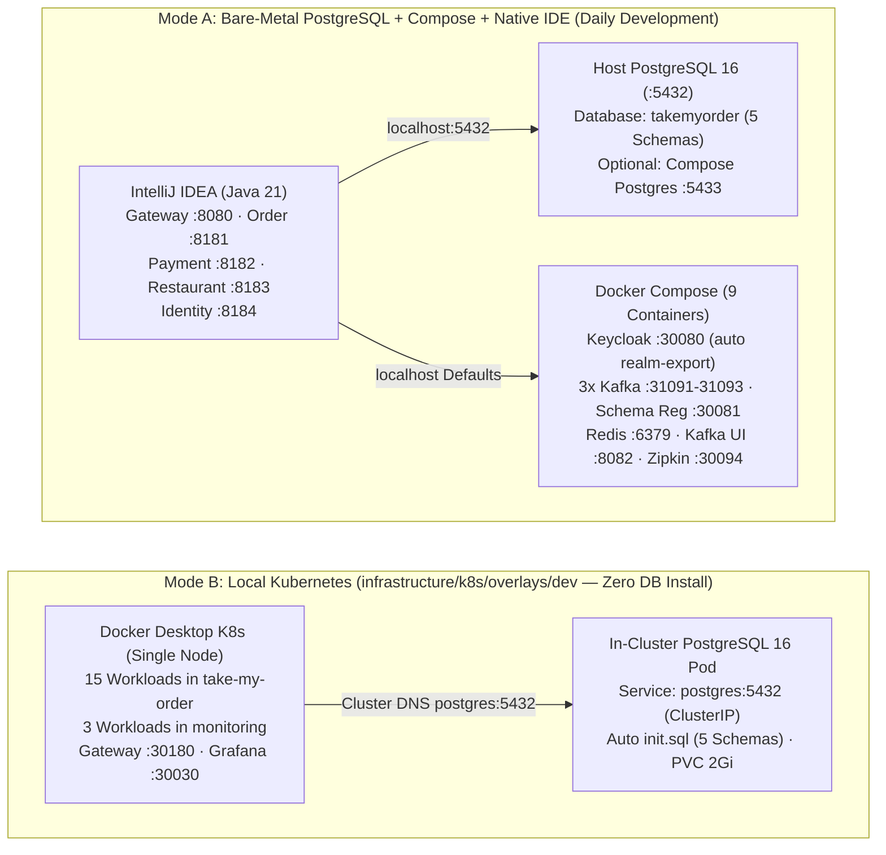

# Local Development & Local Kubernetes Setup

This runbook provides a complete, step-by-step setup guide to run the **Take My Order** microservices platform locally from a clean workstation—whether you are evaluating the platform in Docker Desktop Kubernetes with zero local database setup, or running all 5 microservices natively inside IntelliJ IDEA for daily breakpoint debugging.

---

## 1. Execution Modes & Port Map

Choose the execution mode that matches your workflow:

*   **Mode A — Bare-Metal PostgreSQL 16 + Docker Compose + IntelliJ IDEA (Best for Active Development):** Runs **PostgreSQL 16** natively on `localhost:5432` (with an optional commented-out Docker PostgreSQL 16 toggle on `:5433` if you prefer not to install PostgreSQL locally), runs Kafka, Schema Registry, Keycloak, Redis, Kafka UI, and Zipkin via `docker-compose.yml` (`realm-export.json` auto-loads on first boot), and executes all 5 Java 21 microservices directly inside **IntelliJ IDEA** for instant restarts and breakpoint debugging.
*   **Mode B — Local Single-Node Kubernetes (`overlays/dev`, Best for Reviewers & Full-Stack Demos):** Packages all 5 microservices into local Docker images (`berkayozr/*:v1`) and deploys the **entire platform—including an in-cluster PostgreSQL 16 pod (auto-creating all 5 schemas), Prometheus, and Grafana—into Docker Desktop Kubernetes**. Requires **zero local PostgreSQL installation** and no IDE.



!!! warning "Never Run Mode A and Mode B Simultaneously"
    Both modes bind host ports **`30080`** (Keycloak), **`30081`** (Schema Registry), **`30094`** (Zipkin), and **`31091–31093`** (Kafka brokers). Always stop Mode A (`docker compose down`) before starting Mode B, or delete Mode B (`kubectl delete -k infrastructure/k8s/overlays/dev`) before returning to Mode A.

### 1.1 Port & Service Reference

| Component | Mode A (Host DB + Compose + IDE) | Mode B (K8s `overlays/dev`) |
| :--- | :--- | :--- |
| **API Gateway & Swagger UI** | `localhost:8080/swagger-ui.html` | `localhost:30180/swagger-ui.html` |
| **Domain Services (HTTP)** | Order `:8181`, Payment `:8182`,<br>Restaurant `:8183`, Identity `:8184` | Order `:30181`, Payment `:30182`,<br>Restaurant `:30183`, Identity `:30184` |
| **PostgreSQL 16 (`takemyorder`)** | Native host on **`localhost:5432`**<br>*(optional Compose container `:5433`)* | In-cluster pod **`postgres:5432`**<br>*(auto-runs `init.sql`; `ClusterIP`)* |
| **Keycloak IAM** | `http://localhost:30080`<br>*(auto-imports `realm-export.json`)* | `http://localhost:30080`<br>*(manual UI realm import on first boot)* |
| **Kafka Brokers (3 Nodes)** | `localhost:31091,31092,31093` | `localhost:31091,31092,31093` |
| **Schema Registry** | `http://localhost:30081` | `http://localhost:30081` (NodePort) |
| **Redis** | `localhost:6379` | Internal `redis:6379` (`ClusterIP`) |
| **Kafka UI** | `http://localhost:8082` | `http://localhost:30091` (login form) |
| **Zipkin Tracing** | `http://localhost:30094` | `http://localhost:30094` |
| **Prometheus & Grafana** | *Not deployed in Compose* | Prometheus `:30090`, Grafana `:30030` |

---

## 2. Workstation Prerequisites

Running 3 Kafka brokers, Zookeeper, Schema Registry, Keycloak, Redis, PostgreSQL 16, and 5 Spring Boot JVMs requires a workstation with at least **16 GB RAM** (allocate **8 GB+ RAM** and **4+ CPUs** to Docker Desktop—10–12 GB is recommended for Mode B).

### 2.1 Install Required Tooling

Install and verify each prerequisite below. Primary steps target **Windows (PowerShell)** with **macOS / Linux** equivalents noted inline.

1.  **Git:**
    *   **Windows:** Install from [git-scm.com](https://git-scm.com/downloads) (keep all installer defaults) or run `winget install Git.Git`.
    *   **macOS / Linux:** `brew install git` or `sudo apt install git`.
    *   **Verify (PowerShell / Bash):** `git --version` → confirms Git is on `PATH`.

2.  **Java Development Kit (JDK 21):**
    *   **Windows:** Download **Eclipse Temurin JDK 21 (LTS)** `.msi` from [adoptium.net](https://adoptium.net/). On the **Custom Setup** screen, ensure both **Add to PATH** and **Set `JAVA_HOME` variable** are set to **Will be installed on local hard drive**, then finish installation and open a **new** terminal.
    *   **macOS / Linux:** `brew install --cask temurin@21` or `sudo apt install temurin-21-jdk`, and export `JAVA_HOME` in `~/.zshrc` or `~/.bashrc`.
    *   **Verify (New PowerShell / Bash):**
        ```powershell
        java -version
        ```
        Expected output includes `openjdk version "21.x.x"`.

3.  **Apache Maven 3.9+:**
    *   **Windows:** Run `winget install Apache.Maven` (or extract the binary ZIP from [maven.apache.org](https://maven.apache.org/download.cgi) and add its `bin` folder to System `PATH`), then open a **new** terminal.
    *   **macOS / Linux:** `brew install maven` or `sudo apt install maven`.
    *   **Verify (New PowerShell / Bash):**
        ```powershell
        mvn -v
        ```
        Expected output shows `Apache Maven 3.9.x` **and** `Java version: 21.x.x`. If Maven reports an older Java version, double-check your `JAVA_HOME` environment variable.

4.  **Docker Desktop:**
    *   **Windows:** Install [Docker Desktop for Windows](https://www.docker.com/products/docker-desktop/). During installation, keep **Use WSL 2 instead of Hyper-V** checked and restart Windows if prompted.
    *   **Resource Allocation (Required):** Launch Docker Desktop → click the **Settings (gear icon)** → **Resources** → set **Memory limit** to at least **8 GB** (10–12 GB for Mode B) and **CPUs** to **4+** → click **Apply & Restart**. *(On Windows with WSL 2 backend, Docker shares WSL memory; if constrained, configure `memory=10GB` in `%USERPROFILE%\.wslconfig`.)*
    *   **macOS / Linux:** Install Docker Desktop for Mac (Apple Silicon or Intel) or Docker Engine + Docker Compose plugin on Linux.
    *   **Verify (PowerShell / Bash):**
        ```powershell
        docker --version
        docker compose version
        ```
        Expected output confirms Docker Engine is running and Compose v2 is available.

5.  **IntelliJ IDEA** *(Required for Mode A; optional for Mode B)*:
    *   Install IntelliJ IDEA (Community or Ultimate) from [jetbrains.com](https://www.jetbrains.com/idea/download/).

### 2.2 Clone & Compile the Repository

This build step is **mandatory for both Mode A and Mode B**. It generates Java classes from the Avro `.avsc` schemas (`infrastructure/kafka/kafka-model`), installs shared internal modules (`common`, `outbox`, `kafka-*`) into your local `~/.m2` repository, and packages the 5 executable Spring Boot JARs used by Mode B's Dockerfiles.

Open **PowerShell** (Windows) or **Terminal** (macOS/Linux), navigate to your preferred workspace folder, and run:

```powershell
git clone https://github.com/OzerBerkay/take-my-order.git
cd take-my-order
mvn clean install -DskipTests
```

**Expected Verification Gate:** Maven prints `Reactor Summary for take-my-order` with every module marked `SUCCESS`, ending with **`BUILD SUCCESS`**.

---

## 3. Mode A: Bare-Metal PostgreSQL, Compose & IDE

Mode A is the recommended setup for day-to-day backend coding and breakpoint debugging. By default, it pairs a **bare-metal PostgreSQL 16** instance on `localhost:5432` (matching production's PostgreSQL 16 version) with Docker Compose backing services and all 5 microservices running natively in IntelliJ IDEA.

### 3.1 Host PostgreSQL 16 Setup (`:5432`)

All 4 domain services (`identity`, `order`, `payment`, `restaurant`) default to `localhost:5432` (`${DB_PORT:5432}`), and the Compose Keycloak container connects to your host database via `host.docker.internal:5432`.

!!! tip "Optional: Use Docker PostgreSQL 16 (`:5433`) Instead of Installing Bare-Metal"
    If you already run another PostgreSQL server on `:5432` that you do not want to touch—or simply prefer not to install PostgreSQL natively—skip Steps 1 & 2 below and activate the pre-configured container in `docker-compose.yml`:

    1.  Open `docker-compose.yml` and uncomment the **`postgres:`** service block (`image: postgres:16`, binds host port **`5433`**, auto-runs `local-env/postgres/init.sql`).
    2.  Inside the **`keycloak:`** service in `docker-compose.yml`, comment out the `host.docker.internal:5432` `KC_DB_URL` line, uncomment `KC_DB_URL: jdbc:postgresql://postgres:5432/takemyorder?currentSchema=keycloak`, and uncomment `depends_on: - postgres`.
    3.  In IntelliJ IDEA Run Configurations for the 4 domain services (`identity`, `order`, `payment`, `restaurant`), add environment variable **`DB_PORT=5433`**.
    4.  **Switching to Mode B Later:** Always run `docker compose down` before starting Mode B so shared host ports (`30080`, `30081`, `30094`, `31091–31093`) are released and RAM is freed. Keep in mind that Mode A's optional Compose Postgres (`postgres-data` on `:5433`) and Mode B's in-cluster Kubernetes `postgres` pod (`postgres-pvc`) are **completely separate databases**—data created in one mode will not appear in the other. *(If upgrading from an older major PostgreSQL volume, run `docker compose down -v` once before starting PostgreSQL 16.)*

**Step 1 — Windows Installation (EDB PostgreSQL 16):**

1.  Download the **PostgreSQL 16** Windows x86-64 installer from [postgresql.org/download/windows](https://www.postgresql.org/download/windows/) (EnterpriseDB) and launch it.
2.  **Installation Directory:** Change the default `C:\Program Files\PostgreSQL\16` path to **`C:\Postgresql\16`**. Keeping PostgreSQL outside `Program Files` prevents Windows UAC path permission failures.
3.  **Select Components:** Leave all 4 components checked (**PostgreSQL Server**, **pgAdmin 4**, **Stack Builder**, **Command Line Tools**).
4.  **Data Directory:** Leave the default (`C:\Postgresql\16\data`).
5.  **Superuser Password:** Enter the `DB_PASSWORD` value matching the microservice defaults in `application.yml` (default local value: `admin`).
6.  **Port:** Leave default **`5432`**.
7.  **Locale:** Leave `[Default locale]`. Click **Next** to install, and uncheck **Launch Stack Builder** on the final screen.

!!! note "Clean Reinstall Checklist (Only If Upgrading Over a Broken Windows Install)"
    If a previous PostgreSQL installation failed partway, uninstall PostgreSQL from Windows **Installed Apps**, delete leftover `PostgreSQL` folders and `%APPDATA%\pgAdmin`, open `services.msc` to stop any lingering `postgresql-*` service, and remove it in an **Administrator CMD** via `sc delete "<service-name>"` before reinstalling.

!!! tip "Troubleshooting: `'running post install step... Database Cluster Initialisation failed'`"
    If the Windows installer finishes without initializing `data` and no PostgreSQL service appears in `services.msc`, initialize and register it manually using **two separate terminals**:

    1.  Open a **Standard (Non-Administrator) Command Prompt (CMD)** *(do NOT run as Administrator—`initdb.exe` refuses elevated execution)*:
        ```cmd
        echo admin > pass.txt
        "C:\Postgresql\16\bin\initdb.exe" -D "C:\Postgresql\16\data" -U postgres -A scram-sha-256 --pwfile=pass.txt -E UTF8 --locale=C
        del pass.txt
        ```
        *(Replace `admin` with your chosen `DB_PASSWORD` if customized.)*
    2.  Open an **Administrator Command Prompt (CMD)** to register and start the Windows service:
        ```cmd
        "C:\Postgresql\16\bin\pg_ctl.exe" register -N "postgresql-x64-16" -D "C:\Postgresql\16\data"
        net start postgresql-x64-16
        ```

**Step 2 — Create the `takemyorder` Database & 5 Schemas (pgAdmin 4):**

1.  Launch **pgAdmin 4** from the Start Menu.
2.  In the left browser tree, right-click **Servers → Register → Server**:
    *   **General tab:** Set **Name** to `postgres`.
    *   **Connection tab:** Set **Host name/address** to `localhost`, **Port** to `5432`, **Username** to `postgres`, **Password** to your `DB_PASSWORD` (default `admin`), check **Save password**, and click **Save**.
3.  Expand **postgres → Databases**, right-click **Databases → Create → Database**, set **Database** to **`takemyorder`** and **Owner** to `postgres`, and click **Save**.
4.  Right-click **`takemyorder` → Query Tool**, paste the SQL below, and press **F5 (Execute)**:

```sql
CREATE SCHEMA IF NOT EXISTS keycloak AUTHORIZATION postgres;
CREATE SCHEMA IF NOT EXISTS identity AUTHORIZATION postgres;
CREATE SCHEMA IF NOT EXISTS "order" AUTHORIZATION postgres;
CREATE SCHEMA IF NOT EXISTS payment AUTHORIZATION postgres;
CREATE SCHEMA IF NOT EXISTS restaurant AUTHORIZATION postgres;
```

**Verification Gate:** Right-click **Schemas** under `takemyorder` → **Refresh**, and confirm all 5 schemas (`keycloak`, `identity`, `order`, `payment`, `restaurant`) appear alongside `public`.

!!! note "macOS / Linux Host PostgreSQL 16 Equivalent"
    Install PostgreSQL 16 natively (`brew install postgresql@16 && brew services start postgresql@16` on macOS, or `sudo apt install postgresql` on Ubuntu 24.04), set the `postgres` role password to match `DB_PASSWORD`, then initialize the database from the repository root:
    `createdb -U postgres takemyorder && psql -U postgres -d takemyorder -f local-env/postgres/init.sql` *(creates all 5 active schemas plus a harmless legacy `customer` schema)*.

!!! warning "Allowing the Docker Keycloak Container to Reach Host PostgreSQL (`:5432`)"
    In default Mode A, Keycloak runs inside Docker Compose and connects to your bare-metal PostgreSQL via `host.docker.internal:5432`. If Keycloak logs `Connection refused` or `no pg_hba.conf entry`, verify that `postgresql.conf` sets `listen_addresses = '*'`, `pg_hba.conf` permits `scram-sha-256` authentication from your local Docker/WSL subnet, and Windows Defender Firewall allows inbound **TCP 5432** on the Private network, then restart the PostgreSQL service.

### 3.2 Start Backing Containers

In **PowerShell** (Windows) or **Terminal** (macOS/Linux), from the repository root (`take-my-order/`), run:

```powershell
docker compose up -d
```

What starts automatically:

*   **Keycloak 24.0.1 (`localhost:30080`):** Runs `start-dev --import-realm` against your `keycloak` schema and automatically imports `local-env/keycloak/realm-export.json`, creating `take-my-order-realm`, `take-my-order-client` (with the matching local dev secret), and all 5 custom JWT claim mappers (`internal_id`, `role_ids`, `user_type`, `account_status`, `organizational_unit_ids`). *(To inspect every realm setting and custom mapper—or configure Keycloak manually from scratch instead of auto-importing `realm-export.json`—see the [Keycloak IAM Setup Guide](keycloak-setup.md).)*
*   **Messaging, Cache & Tracing:** 3 Kafka brokers (`:31091`, `:31092`, `:31093`), Zookeeper (`:2181`), Schema Registry (`:30081`), Redis (`:6379`), Kafka UI (`:8082`), and Zipkin (`:30094`).

**Verification Gate:** Wait 30–60 seconds, then run `docker compose ps` from `take-my-order/`:

```powershell
docker compose ps
```

Confirm all **9 containers** *(or **10** if you enabled the optional Compose `postgres` service)* show status **`Up`**. Open `http://localhost:30080` (Keycloak login page loads) and `http://localhost:8082` (Kafka UI displays the `local` cluster with 3 online brokers).

!!! warning "Never Remove Broker Ports from `bootstrap-servers`"
    Because the local Kafka cluster runs 3 brokers (`31091`, `31092`, `31093`), every microservice `application.yml` must keep all three listed:
    `bootstrap-servers: ${KAFKA_BOOTSTRAP_SERVERS:localhost:31091,localhost:31092,localhost:31093}`.
    Omitting `31092` or `31093` causes Kafka consumers to loop on `"Requesting disconnect from last known coordinator"` whenever a consumer group coordinator is elected on Broker 2 or Broker 3.

### 3.3 Launch Microservices in IntelliJ

1.  Open **IntelliJ IDEA** → click **Open** → select the root **`take-my-order`** folder (or its root `pom.xml` → **Open as Project**).
2.  Wait for Maven dependency indexing in the bottom progress bar to finish.
3.  Confirm JDK 21 is selected: **File → Project Structure → Project → SDK = `21`**, then click **OK**.
4.  **No custom environment variables are needed for default bare-metal Mode A.** Every service `application.yml` already defaults to `DB_PORT=5432`, `localhost:30080`, `localhost:31091..31093`, `localhost:30081`, and `localhost:6379`. *(Only if you enabled the optional Compose Postgres container on `:5433`, set `DB_PORT=5433` in the 4 domain services' Run Configurations.)*
5.  Start the 5 Spring Boot main classes in the exact order below (open each class and click the green **Run** icon):

    1.  **`IdentityServiceApplication`** (`identity-service/.../IdentityServiceApplication.java`, port **`:8184`**):
        Runs Flyway migrations on the `identity` schema, executes `@Order(2) SystemAdminInitializer` to seed the initial `SYSTEM_ADMIN` account in PostgreSQL and Keycloak, and publishes initial RBAC roles/permissions to Kafka. *(Optional dev-only reset flags `RESET_DB` and `RESET_KEYCLOAK` default to `false`.)*
        **Wait** until the console logs `Default system admin created successfully.` (or `System admin already exists...`) before starting the next service.
    2.  **`RestaurantServiceApplication`** (`restaurant-service/.../RestaurantServiceApplication.java`, port **`:8183`**):
        Migrates the `restaurant` schema and consumes replicated RBAC roles/permissions.
    3.  **`PaymentServiceApplication`** (`payment-service/.../PaymentServiceApplication.java`, port **`:8182`**):
        Migrates the `payment` schema (`wallets`, `wallet_transactions`, `order_escrows`).
    4.  **`OrderServiceApplication`** (`order-service/.../OrderServiceApplication.java`, port **`:8181`**):
        Migrates the `"order"` schema and activates SAGA outbox schedulers.
    5.  **`GatewayServiceApplication`** (`gateway-service/.../GatewayServiceApplication.java`, port **`:8080`**):
        Starts the reactive Spring Cloud Gateway routing traffic to `localhost:8181`–`8184`.

### 3.4 Verify & Teardown Mode A

1.  **Unified Swagger UI:** Open `http://localhost:8080/swagger-ui.html`. In the top-right **Select a definition** dropdown, confirm all 5 API definitions load (`00 - Architecture & Security Hub`, `Identity API`, `Order API`, `Payment API`, `Restaurant API`).
2.  **Authentication Smoke Test:** Select **Identity API**, expand **`POST /auth/login/internal`**, click **Try it out**, and submit the default `SYSTEM_ADMIN_EMAIL` and `SYSTEM_ADMIN_PASSWORD` defined in `identity-service/identity-container/src/main/resources/application.yml`.
    **Expected Result:** HTTP **`200 OK`** returning a JSON body containing `accessToken` and `refreshToken`.
3.  **Inspect Live Telemetry:** View auto-created topics and Avro messages at `http://localhost:8082` (Kafka UI) and distributed traces at `http://localhost:30094` (Zipkin).
4.  **Stop Mode A (PowerShell / Bash, repo root `take-my-order/`):**
    *   Stop Compose containers: `docker compose down`
    *   If using the optional Compose Postgres container and wanting a clean wipe: `docker compose down -v`

---

## 4. Mode B: Local Kubernetes (`overlays/dev`)

Mode B runs all 5 microservices, an **in-cluster PostgreSQL 16 pod**, and the full observability stack (Prometheus, Grafana, Zipkin) inside Docker Desktop's single-node Kubernetes cluster. You do **not** need IntelliJ IDEA or a local PostgreSQL installation—making Mode B the fastest zero-install evaluation environment.

### 4.1 Enable Docker Desktop Kubernetes

1.  If Mode A is running, stop it first from `take-my-order/`:
    ```powershell
    docker compose down
    ```
2.  Open **Docker Desktop** → click **Settings (gear icon)** → **Kubernetes** in the left sidebar.
3.  Check **Enable Kubernetes** (keep the cluster provisioning method on **`kubeadm`**).
4.  Click **Apply & Restart** and wait until the Kubernetes status badge in the bottom-left corner turns green.
5.  **Verification Gate (PowerShell / Bash)** *(Docker Desktop bundles `kubectl` automatically)*:
    ```powershell
    kubectl config use-context docker-desktop
    kubectl get nodes
    ```
    Expected output shows a single node named `docker-desktop` with `STATUS = Ready`.

### 4.2 Build Local Docker Images

Ensure you already ran `mvn clean install -DskipTests` (Section 2.2) so each service's executable JAR exists in its `target/` directory. Then build all 5 local `berkayozr/*:v1` images (`eclipse-temurin:21-jre-alpine`) from the repository root (`take-my-order/`):

*   **Windows (PowerShell):**
    ```powershell
    .\scripts\local-k8s-build-images.ps1
    ```
    *(If Windows blocks unsigned local scripts, run `Set-ExecutionPolicy -Scope CurrentUser RemoteSigned` once in PowerShell and retry.)*
*   **macOS / Linux (Bash):**
    ```bash
    chmod +x ./scripts/local-k8s-build-images.sh
    ./scripts/local-k8s-build-images.sh
    ```

**Expected Verification Gate:** The script finishes with **`*** ALL 5 MICROSERVICE IMAGES BUILT SUCCESSFULLY! ***`**, and `docker images "berkayozr/*"` lists all 5 `:v1` images (`gateway-service`, `identity-service`, `order-service`, `payment-service`, `restaurant-service`).

**How `overlays/dev` Adapts Production Manifests to a Single Local Node:**

*   **Dev-Only In-Cluster PostgreSQL 16 (`overlays/dev/postgres.yaml`):** While production (`overlays/central-hub`) uses external bare-metal PostgreSQL 16, `overlays/dev` adds a self-contained `postgres:16` Deployment, `2Gi` `postgres-pvc`, `ClusterIP` Service (`postgres:5432`), and `postgres-init-sql` ConfigMap that creates all 5 schemas (`keycloak`, `identity`, `"order"`, `payment`, `restaurant`) automatically on first boot (`MASTER_PRIVATE_IP=postgres` in `overlays/dev/central-secrets.env`). *(Optional: if you prefer Mode B to share your Mode A bare-metal host PostgreSQL instead, set `MASTER_PRIVATE_IP=host.docker.internal` in `overlays/dev/central-secrets.env` and comment out `- postgres.yaml` in `overlays/dev/kustomization.yaml`.)*
*   **Local Image Loading (`imagePullPolicy: Never`):** Every base microservice deployment (`infrastructure/k8s/base/services/*.yaml`) sets `imagePullPolicy: Never`, instructing Docker Desktop Kubernetes to load your freshly built local `berkayozr/*:v1` images directly without pulling from Docker Hub.
*   **Stripping Multi-Node `nodeSelector` (`patch-global.yaml`):** Production manifests pin pods to dedicated node roles (`node-type: infra | app | gateway | monitoring`). Because Docker Desktop has a single unlabeled node, `infrastructure/k8s/overlays/dev/kustomization.yaml` applies `patch-global.yaml`—a 2-line **JSON Patch** (`op: remove`, `path: /spec/template/spec/nodeSelector`)—across all `Deployment` and `Job` resources so every pod schedules locally.

### 4.3 Deploy the Dev Overlay

From the repository root (`take-my-order/`) in **PowerShell** (or Bash), apply the Kustomize dev overlay and watch pods start:

```powershell
kubectl apply -k infrastructure/k8s/overlays/dev
kubectl get pods -n take-my-order -w
```

Open a second terminal to watch the observability stack in the `monitoring` namespace:

```powershell
kubectl get pods -n monitoring -w
```

**Expected Verification Gate (allow 2–3 minutes):**

*   **`take-my-order` namespace (15 workloads):** The 9 infrastructure pods (`postgres`, `zookeeper`, `kafka-broker-1/2/3`, `schema-registry`, `keycloak`, `redis`, `kafka-ui`) reach **`1/1 Running`**, **`Job/init-kafka`** reaches **`0/1 Completed`** (creating all 12 Kafka topics with 3 partitions and replication factor 3), and the 5 Spring Boot microservices (`gateway`, `identity`, `order`, `payment`, `restaurant`) start up *(completing full OIDC/Keycloak initialization after Step 4.4 below)*.
*   **`monitoring` namespace (3 workloads):** `grafana-deployment`, `prometheus-deployment`, and `zipkin` reach **`1/1 Running`**.
*   *(Readiness probes intentionally wait `120s` for Keycloak and `90s` for Spring Boot services before marking pods Ready.)*

### 4.4 First-Boot Keycloak & Secret Sync

Unlike Mode A (Compose), Kubernetes `keycloak.yaml` launches with `args: ["start-dev"]` against the in-cluster `postgres` pod's `keycloak` schema and does **not** mount `realm-export.json`. Complete these steps once on your first Mode B boot:

1.  Confirm the `keycloak` pod is **`1/1 Running`**, then open `http://localhost:30080` in your browser.
2.  Sign in with `KEYCLOAK_ADMIN_USERNAME` and `KEYCLOAK_ADMIN_PASSWORD` from `infrastructure/k8s/overlays/dev/central-secrets.env`.
3.  **Import the Realm (3-Click Fast Path):** Click the top-left **Keycloak master** realm dropdown → **Create Realm** → click **Browse...** → choose **`local-env/keycloak/realm-export.json`** from your cloned repository → click **Create**.
    *(If you prefer building the realm, client, and custom token mappers manually from scratch, follow the [Keycloak IAM Setup Guide](keycloak-setup.md).)*
4.  **Copy the Client Secret:** Ensure **`take-my-order-realm`** is active in the top-left dropdown → click **Clients** → click **`take-my-order-client`** → open the **Credentials** tab → click **Copy** next to **Client Secret**.
5.  **Update `central-secrets.env`:** Open `infrastructure/k8s/overlays/dev/central-secrets.env`, replace `KEYCLOAK_CLIENT_SECRET=dev-secret-placeholder` with the secret you copied, and save the file.
6.  **Re-Apply Secrets & Restart Only the 5 Microservices** (PowerShell from `take-my-order/`):
    ```powershell
    kubectl apply -k infrastructure/k8s/overlays/dev
    .\scripts\local-k8s-restart-services.ps1
    ```
    *(On macOS/Linux, replace the second line with `kubectl rollout restart deployment gateway-service identity-service order-service payment-service restaurant-service -n take-my-order`.)*
7.  **Verification Gate:** Run `kubectl get pods -n take-my-order` until all 5 microservice pods show **`1/1 Running`**, then verify initial admin seeding:
    ```powershell
    kubectl logs deployment/identity-service -n take-my-order
    ```
    Expected output includes `Default system admin created successfully.` (or `System admin already exists...`).

### 4.5 Verify & Teardown Mode B

1.  **Unified Swagger UI:** Open `http://localhost:30180/swagger-ui.html`, select **Identity API**, and run **`POST /auth/login/internal`** with `SYSTEM_ADMIN_EMAIL` and `SYSTEM_ADMIN_PASSWORD` from `infrastructure/k8s/overlays/dev/central-secrets.env` → confirms HTTP **`200 OK`** with JWT tokens.
2.  **Platform & Observability Consoles:**
    *   **Grafana:** `http://localhost:30030` *(credentials in `infrastructure/k8s/overlays/dev/monitoring-secrets.env`)*
    *   **Prometheus:** `http://localhost:30090`
    *   **Kafka UI:** `http://localhost:30091` *(login form credentials in `overlays/dev/central-secrets.env`)*
    *   **Zipkin:** `http://localhost:30094`
    *   **Keycloak Admin:** `http://localhost:30080`
    *   **Optional SQL Access to In-Cluster PostgreSQL:** Run `kubectl port-forward svc/postgres 5434:5432 -n take-my-order` and connect your SQL client to `localhost:5434`.
3.  **Stop & Clean Up Mode B (PowerShell / Bash, repo root `take-my-order/`):**
    ```powershell
    kubectl delete -k infrastructure/k8s/overlays/dev
    ```

!!! tip "Re-Running `init-kafka` After Adding a New Kafka Topic"
    Kubernetes `Job` resources are immutable once `Completed`. Whenever you add a topic to `infrastructure/k8s/base/platform/init-kafka.yaml`, delete the finished Job before re-applying the overlay:
    ```powershell
    kubectl delete job init-kafka -n take-my-order
    kubectl apply -k infrastructure/k8s/overlays/dev
    kubectl rollout restart deployment order-service -n take-my-order
    ```

---

## 5. Why Full IDE (Mode A) Beats Mixed Hybrid Debugging

Every microservice `application.yml` uses Spring's `${ENV_VAR:default_value}` syntax—for example, `uri: ${ORDER_SERVICE_URI:http://localhost:8181}` in `gateway-service` and `url: jdbc:postgresql://${MASTER_PRIVATE_IP:localhost}:${DB_PORT:5432}/takemyorder` in domain services. This allows the exact same JAR to run either **100% inside Kubernetes** (Mode B / Production, where ConfigMaps and Secrets inject cluster DNS names like `http://order-service:80` and `postgres`) or **100% natively inside IntelliJ IDEA** (Mode A, where Spring falls back cleanly to `localhost` defaults).

**Why Splitting Microservices Across IntelliJ and Kubernetes Is Discouraged:**

Attempting to run some microservices in IntelliJ IDEA while leaving the Gateway or other microservices inside Docker Desktop Kubernetes creates severe operational friction:

*   **Port-Forwarding Sprawl:** Internal `ClusterIP` services (`postgres:5432`, `redis:6379`) and inter-service HTTP endpoints (such as `IDENTITY_SERVICE_URL` used by cold-start role sync) must each be manually tunneled via `kubectl port-forward` or overridden with `host.docker.internal` URLs.
*   **Kafka Consumer Group Partition Theft:** If a microservice runs both inside Kubernetes (`replicas: 1`) and locally in IntelliJ at the same time, both join the same Kafka Consumer Group—causing Kafka to route half of your SAGA events to the cluster pod instead of your IDE breakpoint unless you remember to scale the Kubernetes deployment down to `0`.
*   **Split State & Routing Drift:** Keeping `DB_PORT`, `ORDER_SERVICE_URI`, `IDENTITY_SERVICE_URI`, and `SCHEMA_REGISTRY_URL` synchronized across two runtimes quickly degrades developer velocity.

**Recommended Strategy:** Pick one complete runtime per session—use **Mode A (all 5 services in IntelliJ)** whenever you are writing code or setting breakpoints, and use **Mode B (all 5 services in Kubernetes)** for containerized full-stack verification. If you ever need temporary host access to a single internal Mode B service (such as inspecting the in-cluster PostgreSQL or Redis instance), open a targeted `kubectl port-forward` tunnel (e.g., `kubectl port-forward svc/postgres 5434:5432 -n take-my-order`) rather than splitting microservices across runtimes.

---

## 6. Split-Horizon OIDC & Overlays

When running Kubernetes, OAuth2/OIDC introduces a **Split-Horizon DNS** requirement:

1.  **External Caller (Browser / Swagger UI / Postman):** Obtains a JWT from Keycloak's externally reachable address (for example, `http://localhost:30080` in Mode B or `https://auth.<domain>.com` in production). Keycloak stamps that external base URL into the token's `iss` (Issuer) claim.
2.  **Internal Verifier (Microservice & Gateway Pods):** Fetches Keycloak's RSA signing keys (`JWKS`) fast over internal cluster DNS (`http://keycloak-service:8080`).
3.  **Spring Security Decoupling:** Every service configures `issuer-uri` from **`KEYCLOAK_ISSUER_URI`** (strict character-for-character `iss` match) independently from `jwk-set-uri`, which uses **`KEYCLOAK_SERVER_URL`** (internal JWKS fetch). If both used `http://keycloak-service:8080`, every externally minted JWT would fail with `401 Unauthorized (Invalid Issuer)`.

Kustomize overlays separate these two endpoints cleanly across environments (all pods inject `KEYCLOAK_SERVER_URL` from `service-config` and `KEYCLOAK_ISSUER_URI` from `service-secrets` generated via `central-secrets.env`, while `patch-config-maps.yaml` keeps `service-config` synchronized):

| Environment & Overlay | `KEYCLOAK_SERVER_URL` *(Internal JWKS)* | `KEYCLOAK_ISSUER_URI` *(Token `iss` Check)* |
| :--- | :--- | :--- |
| **Base** (`base/global/config-maps.yaml`) | `http://keycloak-service:8080` | `http://keycloak-service:8080` *(cluster default)* |
| **Local Dev** (`overlays/dev/patch-config-maps.yaml` & `central-secrets.env`) | `http://keycloak-service:8080` | `http://localhost:30080` *(host NodePort issuer)* |
| **Production** (`overlays/central-hub/patch-config-maps.yaml` & `central-secrets.env`) | `http://keycloak-service:8080` | `https://auth.<domain>.com` *(or `http://<MASTER_PUBLIC_IP>:30080`)* |
