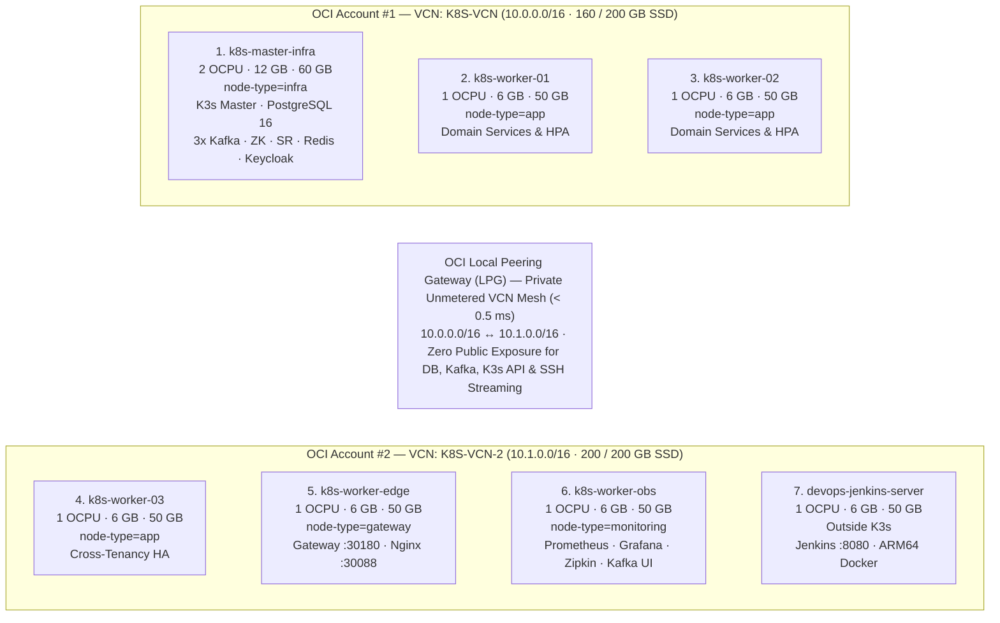

# Production 7-Node Cluster Setup (2x OCI)

This step-by-step operational runbook walks you through provisioning the **Take My Order** production environment (**Option B — 7-Node Cross-Tenancy OCI Architecture**) from two empty **Oracle Cloud Infrastructure (OCI)** Always Free accounts up to a live, HTTPS-protected, auto-scaling Kubernetes (K3s) cluster with native ARM64 Jenkins CI/CD. Every console click, default toggle, blank field, command, and verification gate is documented in exact execution order.

!!! tip "Have 1x Oracle Cloud Account + 1x AWS Free Tier Account Instead?"
    The repository also supports **Option A — 4-Node Hybrid Multi-Cloud (`1x Oracle ARM64` + `1x AWS EC2 x86_64`)** powered by GitHub Actions multi-arch builds (`.github/workflows/deploy.yml`) and Docker Hub. Follow the dedicated [Alternative 4-Node Hybrid Setup (OCI + AWS)](hybrid-cloud-aws-oracle-setup.md) guide if you prefer that topology.

!!! warning "Architectural Reference & Proprietary License Restriction"
    This production runbook is published strictly as **technical and architectural documentation** demonstrating the author's production infrastructure design. Under the repository's root `LICENSE` (**All Rights Reserved**), deploying, hosting, modifying, or republishing this project (in whole or in part) on any remote or cloud server is strictly prohibited without prior express written permission from the Copyright Holder. Only personal code study and local workstation (`localhost`) evaluation are permitted.

---

## 1. Prerequisites & Cluster Matrix

### 1.1 Accounts & Local Workstation Checklist

Prepare these four items before starting Section 2:

1.  **Two Independent OCI Always Free Accounts in the Exact Same Home Region:**
    *   Register **Account #1** and **Account #2** in the **same OCI region** (for example, **`eu-frankfurt-1` — Germany Central (Frankfurt)**).
    *   **Why the same region is mandatory:** OCI **Local Peering Gateway (LPG)** only bridges Virtual Cloud Networks (VCNs) inside the same region. If the two accounts are in different regions, cross-tenancy LPG peering will not work.
2.  **Authorized GitHub Repository Access *(Prior Written License Required)*:**
    *   Automatic **GitHub Webhook** CI/CD pushes (`Settings → Webhooks`) require repository administrator access on an authorized repository copy (permitted **only** with prior express written permission from the Copyright Holder under the root `LICENSE`).
3.  **Domain Name & Free Cloudflare Account** *(Used in Section 11)*:
    *   Required for production HTTPS (`api.<YOUR_DOMAIN>`, `<keycloak-sub>.<YOUR_DOMAIN>`, etc.) and Cloudflare Origin Rules. Sections 1–10 also work end-to-end over plain server IPs so you can verify the cluster before attaching a domain.
4.  **Local Workstation Tooling:**
    *   Windows 10/11 (**PowerShell** with built-in OpenSSH `ssh` & `scp`) or macOS / Linux (**Terminal**).
    *   A local clone of the authorized repository (`git clone https://github.com/<AUTHORIZED_GITHUB_OWNER>/take-my-order.git`).
    *   Open a blank local notepad (e.g., Notepad / VS Code) to record **14 IP addresses** (7 Public + 7 Private) and **5 OCI OCIDs** as you create resources—never commit that scratch file to Git.

### 1.2 Seven-Node Hardware & Tracking Matrix

Each OCI Always Free tenancy provides **4 OCPU / 24 GB RAM / 200 GB Block Volume** of ARM64 Ampere A1 capacity (`VM.Standard.A1.Flex`). Across two tenancies we provision **8 OCPU / 48 GB RAM / 360 GB allocated SSD** (deliberately holding **40 GB unallocated** in Account #1 so `k8s-master-infra` can expand its `60 GB` boot volume online or attach a dedicated database disk later—cloud boot volumes can grow online, never shrink).

| # | OCI Account & VCN | Instance Name | OCPU / RAM / SSD | Private IP Placeholder | K3s Role & `node-type` Label |
| :---: | :--- | :--- | :---: | :---: | :--- |
| **1** | **Account #1** (`K8S-VCN`: `10.0.0.0/16`) | `k8s-master-infra` | 2 / 12 GB / **60 GB** | `<MASTER_PRIVATE_IP>` *(10.0.0.x)* | K3s Master (`node-type=infra`) + Bare-Metal PG 16 |
| **2** | **Account #1** (`K8S-VCN`: `10.0.0.0/16`) | `k8s-worker-01` | 1 / 6 GB / 50 GB | `<WORKER1_PRIVATE_IP>` *(10.0.0.x)* | App Worker 1 (`node-type=app`) |
| **3** | **Account #1** (`K8S-VCN`: `10.0.0.0/16`) | `k8s-worker-02` | 1 / 6 GB / 50 GB | `<WORKER2_PRIVATE_IP>` *(10.0.0.x)* | App Worker 2 (`node-type=app`) |
| **4** | **Account #2** (`K8S-VCN-2`: `10.1.0.0/16`) | `k8s-worker-03` | 1 / 6 GB / 50 GB | `<WORKER3_PRIVATE_IP>` *(10.1.0.x)* | App Worker 3 (`node-type=app`) |
| **5** | **Account #2** (`K8S-VCN-2`: `10.1.0.0/16`) | `k8s-worker-edge` | 1 / 6 GB / 50 GB | `<EDGE_PRIVATE_IP>` *(10.1.0.x)* | Edge / DMZ Worker (`node-type=gateway`) |
| **6** | **Account #2** (`K8S-VCN-2`: `10.1.0.0/16`) | `k8s-worker-obs` | 1 / 6 GB / 50 GB | `<OBS_PRIVATE_IP>` *(10.1.0.x)* | Observability Worker (`node-type=monitoring`) |
| **7** | **Account #2** (`K8S-VCN-2`: `10.1.0.0/16`) | `devops-jenkins-server` | 1 / 6 GB / 50 GB | `<JENKINS_PRIVATE_IP>` *(10.1.0.x)* | Stand-Alone CI/CD Server *(Outside K3s)* |



---

## 2. Create Non-Overlapping OCI VCNs

!!! warning "Non-Overlapping CIDR Blocks Are Mandatory"
    For two VCNs to peer through an OCI Local Peering Gateway (LPG), their IPv4 address spaces **must not overlap**. Account #1 **must** use **`10.0.0.0/16`** and Account #2 **must** use **`10.1.0.0/16`**.

### 2.1 Account #1 VCN (`K8S-VCN` — `10.0.0.0/16`)

1.  Sign in to **OCI Account #1** and confirm your home region in the top-right header.
2.  Open the top-left Hamburger Menu (**`☰`**) → **Networking → Virtual cloud networks**.
3.  On the left sidebar under **List scope → Compartment**, confirm your root compartment **`(root)`** is selected.
4.  Click **Start VCN Wizard** → select **`Create VCN with Internet Connectivity`** → click **Start VCN Wizard**.
5.  Fill in the form section by section:
    *   **Basic information:**
        *   **VCN name:** `K8S-VCN`
        *   **Compartment:** Leave default `(root)`.
    *   **Configure VCN:**
        *   **VCN IPv4 CIDR block:** Leave default **`10.0.0.0/16`**.
        *   **Enable IPv6 in this VCN:** Leave **unchecked / OFF**.
        *   **Use DNS hostnames in this VCN:** Leave **checked / ON**.
    *   **Configure public subnet:**
        *   **IP address type:** Leave `IPv4 CIDR block`.
        *   **IPv4 CIDR block:** Leave default **`10.0.0.0/24`**.
    *   **Configure private subnet:**
        *   **IP address type:** Leave `IPv4 CIDR block`.
        *   **IPv4 CIDR block:** Leave default **`10.0.1.0/24`**.
    *   **Tags:** Leave completely empty.
6.  Click **Next** → review the summary → click **Create** → click **View Virtual Cloud Network**.

### 2.2 Account #2 VCN (`K8S-VCN-2` — `10.1.0.0/16`)

1.  Sign in to **OCI Account #2** (use a second browser profile or Incognito window so both consoles stay open side-by-side).
2.  Open **`☰` → Networking → Virtual cloud networks** → confirm **`(root)`** compartment → click **Start VCN Wizard → Create VCN with Internet Connectivity → Start VCN Wizard**.
3.  Fill in the form—paying special attention to the **three CIDR overrides**:
    *   **Basic information:**
        *   **VCN name:** `K8S-VCN-2`
        *   **Compartment:** Leave default `(root)`.
    *   **Configure VCN:**
        *   **VCN IPv4 CIDR block:** Delete `10.0.0.0/16` and type **`10.1.0.0/16`**.
        *   **Enable IPv6 in this VCN:** Leave **unchecked / OFF**.
        *   **Use DNS hostnames in this VCN:** Leave **checked / ON**.
    *   **Configure public subnet:**
        *   **IP address type:** Leave `IPv4 CIDR block`.
        *   **IPv4 CIDR block:** Delete `10.0.0.0/24` and type **`10.1.0.0/24`**.
    *   **Configure private subnet:**
        *   **IP address type:** Leave `IPv4 CIDR block`.
        *   **IPv4 CIDR block:** Delete `10.0.1.0/24` and type **`10.1.1.0/24`**.
    *   **Tags:** Leave completely empty.
4.  Click **Next** → verify all three CIDRs begin with `10.1.` → click **Create** → click **View Virtual Cloud Network**.

---

## 3. Provision 7 Ubuntu ARM64 Nodes

### 3.1 Account #1 Instances & SSH Keys

In **OCI Account #1**, open **`☰` → Compute → Instances** and click **Create instance**.

**Server #1 — `k8s-master-infra` (Full Field-by-Field Settings):**

1.  **Name:** `k8s-master-infra` | **Create in compartment:** Leave `(root)` default.
2.  **Placement:**
    *   **Availability domain:** Select **`AD-1`** *(if OCI reports "Out of host capacity", switch to `AD-2` or `AD-3`)*.
    *   Click **Show advanced options** → confirm **Capacity type** is **`On-demand capacity`** *(**NEVER** select Preemptible—Oracle can reclaim preemptible VMs without warning)*.
    *   **Cluster placement group:** Leave **OFF / unchecked**.
    *   **Fault domain:** Leave default (`Let Oracle choose`).
3.  **Image and shape:**
    *   Click **Change image** → select **Canonical Ubuntu** → choose **`Ubuntu 24.04`** → click **Select image**.
    *   Click **Change shape** → **Instance type:** `Virtual machine` → **Shape series:** click **`Ampere`** (Arm-based processor) → select **`VM.Standard.A1.Flex`** (*Always Free-eligible*) → set **Number of OCPUs** to **`2`** and **Amount of memory (GB)** to **`12`** → click **Select shape**.
4.  **Security:** Leave **Shielded instance** and **Confidential computing** **OFF / unchecked**.
5.  **Primary VNIC information (Networking):**
    *   **VNIC name:** Leave **blank** *(optional; leaving it blank ensures Ubuntu sets the hostname cleanly to `k8s-master-infra` instead of appending `-vnic`)*.
    *   **Primary network:** Select existing virtual cloud network → **`K8S-VCN`**.
    *   **Subnet:** Select existing subnet → **`Public Subnet-K8S-VCN`** (`10.0.0.0/24`).
    *   **Public IPv4 address:** Select **`Assign a public IPv4 address`**.
6.  **Add SSH keys (Generate Once, Reuse Across All 7 Nodes):**
    *   Select **`Generate a key pair for me`**.
    *   Click **Save private key** → save and rename the downloaded file to **`cluster-key.key`** inside a dedicated local folder (e.g., `C:\ssh-keys\take-my-order\` or `~/ssh-keys/take-my-order/`).
    *   Click **Save public key** → save and rename it to **`cluster-key.pub`** in the same folder.
7.  **Storage / Boot volume:**
    *   Check **`Specify a custom boot volume size and performance setting`**.
    *   **Boot volume size (GB):** Type **`60`**.
    *   **Boot volume performance (VPU):** Leave `10 (Balanced)`.
    *   **Use in-transit encryption:** Leave **ON / checked**.
    *   **Encrypt this volume with a key that you manage:** Leave **OFF / unchecked**.
    *   **Block volumes:** Leave empty (no extra volumes).
8.  Click **Next** (if shown) → review the summary → click **Create**.

**Server #2 (`k8s-worker-01`) & Server #3 (`k8s-worker-02`):**

Return to **`☰` → Compute → Instances → Create instance** twice and use the exact same settings as Server #1 **except** for the four fields below:

| Field | `k8s-worker-01` | `k8s-worker-02` |
| :--- | :--- | :--- |
| **Name** | `k8s-worker-01` | `k8s-worker-02` |
| **Shape (`VM.Standard.A1.Flex`)** | **`1` OCPU / `6` GB RAM** | **`1` OCPU / `6` GB RAM** |
| **Add SSH keys** | Select **Upload public key files (.pub)** → upload **`cluster-key.pub`** | Select **Upload public key files (.pub)** → upload **`cluster-key.pub`** |
| **Boot volume size (GB)** | **`50`** | **`50`** |

### 3.2 Account #2 Instances (4 Nodes)

Switch to **OCI Account #2**, open **`☰` → Compute → Instances → Create instance**, and create all four servers below. Keep Placement (`On-demand capacity`, Fault domain default), Image (`Canonical Ubuntu 24.04`), Security (both OFF), VNIC name (blank), and **Assign a public IPv4 address: YES** identical on every node:

| # | Instance Name | Shape (`VM.Standard.A1.Flex`) | VCN & Subnet | Add SSH Keys | Boot Volume |
| :---: | :--- | :---: | :--- | :--- | :---: |
| **4** | `k8s-worker-03` | `1` OCPU / `6` GB RAM | `K8S-VCN-2` → `Public Subnet-K8S-VCN-2` (`10.1.0.0/24`) | Upload **`cluster-key.pub`** | **`50` GB** |
| **5** | `k8s-worker-edge` | `1` OCPU / `6` GB RAM | `K8S-VCN-2` → `Public Subnet-K8S-VCN-2` (`10.1.0.0/24`) | Upload **`cluster-key.pub`** | **`50` GB** |
| **6** | `k8s-worker-obs` | `1` OCPU / `6` GB RAM | `K8S-VCN-2` → `Public Subnet-K8S-VCN-2` (`10.1.0.0/24`) | Upload **`cluster-key.pub`** | **`50` GB** |
| **7** | `devops-jenkins-server` | `1` OCPU / `6` GB RAM | `K8S-VCN-2` → `Public Subnet-K8S-VCN-2` (`10.1.0.0/24`) | Upload **`cluster-key.pub`** | **`50` GB** |

### 3.3 SSH Key Permissions & IP Sheet

1.  Wait 1–2 minutes until all 7 instances show **Running (Green)** across both OCI consoles. Open each instance's detail page and record its **Public IP address** and **Private IP address** (`10.0.0.x` in Account #1, `10.1.0.x` in Account #2) in your local scratch notepad.
2.  **Lock Private Key Permissions (Mandatory Before First `ssh`):** OpenSSH rejects private keys readable by other users (`UNPROTECTED PRIVATE KEY FILE`). Run the appropriate command in the folder holding `cluster-key.key`:
    *   **Windows (PowerShell):**
        ```powershell
        cd C:\ssh-keys\take-my-order
        icacls cluster-key.key /inheritance:r
        icacls cluster-key.key /grant:r "$($env:USERNAME):(R)"
        ```
    *   **macOS / Linux (Bash):**
        ```bash
        cd ~/ssh-keys/take-my-order
        chmod 400 cluster-key.key
        ```
3.  **Verification Gate (PowerShell / Bash):**
    ```bash
    ssh -o StrictHostKeyChecking=accept-new \
      -i cluster-key.key ubuntu@<MASTER_PUBLIC_IP> "hostname"
    ```
    *(In Windows PowerShell, place the command on one line without `\`.)*
    Expected output prints `k8s-master-infra` (zero password prompt, zero permission warning).

---

## 4. LPG Peering, Routing & Firewalls

### 4.1 Create LPGs & Collect 5 OCIDs

1.  **In OCI Account #1:**
    *   Go to **`☰` → Networking → Virtual cloud networks → `K8S-VCN`** → click the **`Gateways`** tab → click **Create local peering gateway**.
    *   **Name:** `LPG-TO-ACCOUNT-2` | **Compartment:** `(root)` | **Advanced options (Route Table Association & Tags):** Leave completely empty → click **Create local peering gateway**.
    *   Click the three dots (**`⋮`**) on the right of `LPG-TO-ACCOUNT-2` → **Copy OCID** → save as **`<LPG_1_OCID>`**.
    *   Click the top-right **Profile icon → Tenancy: ...** → click **Copy** next to **OCID** → save as **`<TENANCY_1_OCID>`**.
    *   Go to **`☰` → Identity & Security → Domains → Default → User management → Groups → `Administrators`** → click **Copy** next to **OCID** → save as **`<ADMIN_GROUP_1_OCID>`**.
2.  **In OCI Account #2:**
    *   Go to **`☰` → Networking → Virtual cloud networks → `K8S-VCN-2`** → click the **`Gateways`** tab → click **Create local peering gateway**.
    *   **Name:** `LPG-TO-ACCOUNT-1` | **Compartment:** `(root)` | **Advanced options:** Leave empty → click **Create local peering gateway**.
    *   Click **`⋮`** next to `LPG-TO-ACCOUNT-1` → **Copy OCID** → save as **`<LPG_2_OCID>`**.
    *   Click the top-right **Profile icon → Tenancy: ...** → click **Copy** next to **OCID** → save as **`<TENANCY_2_OCID>`**.

### 4.2 Cross-Tenancy IAM Policies

!!! warning "Two Mandatory OCI Policy Syntax Rules"
    1.  Both policies **must** be created in the **`(root)`** compartment (never a child compartment).
    2.  **Remove all `<` and `>` angle brackets** when pasting your real OCIDs—paste bare `ocid1.tenancy...` / `ocid1.group...` strings or OCI will reject the policy with `Syntax error in policy`.

1.  **In OCI Account #1 (Requestor Policy):**
    *   Go to **`☰` → Identity & Security → Policies** → confirm left **Compartment** is **`(root)`** → click **Create Policy**.
    *   **Name:** `Cross-Tenancy-LPG-Requestor-Policy`
    *   **Description:** `Allow LPG peering with Account 2 VCN`
    *   Under **Policy Builder**, toggle **`Show manual editor`** **ON**, paste the 4 lines below (replacing `<TENANCY_2_OCID>` with Account #2's Tenancy OCID), and click **Create**:
        ```text
        Define tenancy Acceptor as <TENANCY_2_OCID>
        Allow group Administrators to manage local-peering-from in tenancy
        Endorse group Administrators to manage local-peering-to in tenancy Acceptor
        Endorse group Administrators to associate local-peering-gateways in tenancy with local-peering-gateways in tenancy Acceptor
        ```

2.  **In OCI Account #2 (Acceptor Policy):**
    *   Go to **`☰` → Identity & Security → Policies** → confirm left **Compartment** is **`(root)`** → click **Create Policy**.
    *   **Name:** `Cross-Tenancy-LPG-Acceptor-Policy`
    *   **Description:** `Accept LPG peering from Account 1 VCN`
    *   Toggle **`Show manual editor`** **ON**, paste the 4 lines below (replacing `<TENANCY_1_OCID>` and `<ADMIN_GROUP_1_OCID>`), and click **Create**:
        ```text
        Define tenancy Requestor as <TENANCY_1_OCID>
        Define group RequestorAdmins as <ADMIN_GROUP_1_OCID>
        Admit group RequestorAdmins of tenancy Requestor to manage local-peering-to in tenancy
        Admit group RequestorAdmins of tenancy Requestor to associate local-peering-gateways in tenancy Requestor with local-peering-gateways in tenancy
        ```

### 4.3 Establish Peering & Routes

1.  **Establish Peering (From Account #1):**
    *   In **OCI Account #1**, open **`K8S-VCN` → `Gateways`**.
    *   Click **`⋮`** next to `LPG-TO-ACCOUNT-2` → **Establish Peering Connection**.
    *   Select **`Enter the local peering gateway OCID`**, paste Account #2's **`<LPG_2_OCID>`**, and click **Establish Peering Connection**.
    *   **Verification Gate:** Refresh both consoles—both `LPG-TO-ACCOUNT-2` and `LPG-TO-ACCOUNT-1` show green status **`Peered - Connected to a peer`**.
2.  **Account #1 Route Table:**
    *   In **Account #1**, open **`K8S-VCN` → `Routing` → `Default Route Table for K8S-VCN`** → click **Add Route Rules**:
        *   **Target Type:** `Local Peering Gateway`
        *   **Destination CIDR Block:** `10.1.0.0/16`
        *   **Target Local Peering Gateway:** `LPG-TO-ACCOUNT-2`
        *   Click **Add Route Rules**.
3.  **Account #2 Route Table:**
    *   In **Account #2**, open **`K8S-VCN-2` → `Routing` → `Default Route Table for K8S-VCN-2`** → click **Add Route Rules**:
        *   **Target Type:** `Local Peering Gateway`
        *   **Destination CIDR Block:** `10.0.0.0/16`
        *   **Target Local Peering Gateway:** `LPG-TO-ACCOUNT-1`
        *   Click **Add Route Rules**.

### 4.4 Stateful Security Lists

!!! danger "Three Golden OCI Security List Rules"
    1.  **NEVER edit or delete Egress Rules:** Leave the default `Destination: 0.0.0.0/0 — All Protocols` egress rule untouched in both accounts so servers can download APT packages and Docker images.
    2.  **NEVER check the `STATELESS` checkbox** on any Ingress Rule (keep it unchecked/default so stateful connection tracking allows return traffic automatically).
    3.  **Keep all default VCN Wizard Ingress Rules** (`0.0.0.0/0 TCP 22` SSH and default ICMP rules) intact, and leave **Source Port Range** blank (`All`) on every new rule.

**A) Account #1 — `K8S-VCN` → `Security` → `Default Security List for K8S-VCN` → `Add Ingress Rules`:**

Add these **4 rules** (`0.0.0.0/0 TCP 22` is already present from VCN Wizard):

| Source CIDR | IP Protocol | Source Port Range | Destination Port Range | Description |
| :--- | :--- | :---: | :---: | :--- |
| `10.0.0.0/16` | **All Protocols** | *(Blank)* | *(Blank)* | Account #1 internal VCN traffic |
| `10.1.0.0/16` | **All Protocols** | *(Blank)* | *(Blank)* | Account #2 internal VCN traffic via LPG |
| `10.42.0.0/16` | **All Protocols** | *(Blank)* | *(Blank)* | K3s Flannel virtual pod network |
| `0.0.0.0/0` | TCP | *(Blank)* | `30080` | Keycloak IAM external access (`k8s-master-infra`) |

**B) Account #2 — `K8S-VCN-2` → `Security` → `Default Security List for K8S-VCN-2` → `Add Ingress Rules`:**

Add these **8 rules** (`0.0.0.0/0 TCP 22` is already present from VCN Wizard):

| Source CIDR | IP Protocol | Source Port Range | Destination Port Range | Description |
| :--- | :--- | :---: | :---: | :--- |
| `10.0.0.0/16` | **All Protocols** | *(Blank)* | *(Blank)* | Account #1 internal VCN traffic via LPG |
| `10.1.0.0/16` | **All Protocols** | *(Blank)* | *(Blank)* | Account #2 internal VCN traffic |
| `10.42.0.0/16` | **All Protocols** | *(Blank)* | *(Blank)* | K3s Flannel virtual pod network |
| `0.0.0.0/0` | TCP | *(Blank)* | `30180` | API Gateway & Swagger Hub (`k8s-worker-edge`) |
| `0.0.0.0/0` | TCP | *(Blank)* | `30088` | Bare-Metal Host Nginx frontend portals (`k8s-worker-edge`) |
| `0.0.0.0/0` | TCP | *(Blank)* | `30030` | Grafana observability dashboard (`k8s-worker-obs`) |
| `0.0.0.0/0` | TCP | *(Blank)* | `30091` | Kafka UI management console (`k8s-worker-obs`) |
| `0.0.0.0/0` | TCP | *(Blank)* | `8080` | Jenkins Web UI & GitHub Webhook (`devops-jenkins-server`) |

!!! note "Why K3s (`6443`, `10250`, `UDP 8472`), PostgreSQL (`5432`), Prometheus (`9090`), and Zipkin (`9411`) Stay Closed to `0.0.0.0/0`"
    Because the LPG peering bridge connects all 7 servers over private RFC1918 subnets (`10.0.0.0/16` ↔ `10.1.0.0/16`), K3s control-plane, Kubelet, Flannel VXLAN, Kafka (`9092`), Redis (`6379`), and PostgreSQL (`5432`) communicate exclusively inside the private cloud mesh and are completely unreachable from the public internet. Prometheus and Zipkin lack built-in authentication screens, so they remain internal `ClusterIP` services queried by Grafana inside the cluster (or via SSH `kubectl port-forward`).

---

## 5. OS iptables & LPG Ping Test

Oracle Cloud Ubuntu images ship with restrictive host-level `iptables` `REJECT` rules that drop inter-node traffic **even when OCI Security Lists allow it**. Because OCI Security Lists already act as your stateful network perimeter firewall, flush the host `iptables` rules and persist the clean state across reboots on **all 7 servers**.

**Option 1 — Run Automatically on All 7 Servers from Your Local Workstation (Recommended):**

*   **Windows (PowerShell, inside your `cluster-key.key` folder):**
    ```powershell
    $servers = @(
      "<MASTER_PUBLIC_IP>", "<WORKER1_PUBLIC_IP>", "<WORKER2_PUBLIC_IP>",
      "<WORKER3_PUBLIC_IP>", "<EDGE_PUBLIC_IP>", "<OBS_PUBLIC_IP>",
      "<JENKINS_PUBLIC_IP>"
    )
    $cmd = "sudo iptables -F && sudo iptables -X && sudo iptables -t nat -F && " +
      "sudo iptables -t nat -X && sudo iptables -t mangle -F && " +
      "sudo iptables -t mangle -X && sudo iptables -P INPUT ACCEPT && " +
      "sudo iptables -P FORWARD ACCEPT && sudo iptables -P OUTPUT ACCEPT && " +
      "sudo DEBIAN_FRONTEND=noninteractive apt-get update -y && " +
      "sudo DEBIAN_FRONTEND=noninteractive apt-get install -y iptables-persistent && " +
      "sudo netfilter-persistent save"
    foreach ($ip in $servers) {
      Write-Host ">>> Configuring iptables on $ip ..." -ForegroundColor Cyan
      ssh -o StrictHostKeyChecking=accept-new -i cluster-key.key ubuntu@$ip $cmd
    }
    ```
*   **macOS / Linux (Bash):**
    ```bash
    SERVERS=(
      <MASTER_PUBLIC_IP> <WORKER1_PUBLIC_IP> <WORKER2_PUBLIC_IP>
      <WORKER3_PUBLIC_IP> <EDGE_PUBLIC_IP> <OBS_PUBLIC_IP> <JENKINS_PUBLIC_IP>
    )
    CMD="sudo iptables -F && sudo iptables -X && sudo iptables -t nat -F && \
      sudo iptables -t nat -X && sudo iptables -t mangle -F && \
      sudo iptables -t mangle -X && sudo iptables -P INPUT ACCEPT && \
      sudo iptables -P FORWARD ACCEPT && sudo iptables -P OUTPUT ACCEPT && \
      sudo DEBIAN_FRONTEND=noninteractive apt-get update -y && \
      sudo DEBIAN_FRONTEND=noninteractive apt-get install -y iptables-persistent && \
      sudo netfilter-persistent save"
    for ip in "${SERVERS[@]}"; do
      echo ">>> Configuring iptables on $ip ..."
      ssh -o StrictHostKeyChecking=accept-new -i cluster-key.key ubuntu@"$ip" "$CMD"
    done
    ```

*(Option 2: SSH individually into each server with `ssh -i cluster-key.key ubuntu@<PUBLIC_IP>` and run the `iptables` + `netfilter-persistent save` chain directly.)*

**Verification Gate — Cross-Tenancy LPG Ping Test:**

SSH into **`k8s-worker-03`** (Account #2) and ping **`k8s-master-infra`**'s **Private IP** (Account #1):

```bash
ssh -i cluster-key.key ubuntu@<WORKER3_PUBLIC_IP>
ping -c 3 <MASTER_PRIVATE_IP>
```

**Expected Result:** `3 packets transmitted, 3 received, 0% packet loss` with `rtt avg` under **`0.5 ms`** (typically `~0.37 ms`). If packets time out, re-check Section 4.3 (Route Tables) and Section 4.4 (Security Lists) before continuing.

---

## 6. Bare-Metal PostgreSQL 16 Setup

PostgreSQL 16 runs bare-metal directly on **`k8s-master-infra`** (`<MASTER_PRIVATE_IP>`) for maximum SSD I/O throughput and Linux OS Page Cache utilization using the **Schema-per-Service** isolation model (`keycloak`, `identity`, `"order"`, `payment`, `restaurant`).

### 6.1 Install PG 16 & 5 Schemas

1.  SSH into **`k8s-master-infra`**:
    ```powershell
    ssh -i cluster-key.key ubuntu@<MASTER_PUBLIC_IP>
    ```
2.  Install and start PostgreSQL 16:
    ```bash
    sudo apt update && sudo apt install postgresql postgresql-contrib -y
    sudo systemctl enable --now postgresql
    ```
    *(If Ubuntu displays a purple **`Daemons using outdated libraries`** prompt during `apt install`, leave the defaults highlighted and press **`Enter`** on `<Ok>`.)*
3.  Create a dedicated PostgreSQL user (`<CHOOSE_DB_USER>`, lowercase alphanumeric without spaces), the `takemyorder` database, and all 5 logical schemas (also choose a strong alphanumeric `<STRONG_DB_PASSWORD>`—avoid single quotes `'` and `$`—and record both in your notepad for Section 9.1):
    ```bash
    sudo -i -u postgres psql << 'EOF'
    CREATE USER <CHOOSE_DB_USER> WITH PASSWORD '<STRONG_DB_PASSWORD>';
    CREATE DATABASE takemyorder OWNER <CHOOSE_DB_USER>;
    \c takemyorder
    CREATE SCHEMA IF NOT EXISTS keycloak AUTHORIZATION <CHOOSE_DB_USER>;
    CREATE SCHEMA IF NOT EXISTS identity AUTHORIZATION <CHOOSE_DB_USER>;
    CREATE SCHEMA IF NOT EXISTS "order" AUTHORIZATION <CHOOSE_DB_USER>;
    CREATE SCHEMA IF NOT EXISTS payment AUTHORIZATION <CHOOSE_DB_USER>;
    CREATE SCHEMA IF NOT EXISTS restaurant AUTHORIZATION <CHOOSE_DB_USER>;
    GRANT ALL PRIVILEGES ON DATABASE takemyorder TO <CHOOSE_DB_USER>;
    EOF
    ```
    *(`"order"` must remain double-quoted because `ORDER` is a reserved SQL keyword.)*

### 6.2 Network & Pod Subnet Access

By default, PostgreSQL listens only on `localhost`. Open it strictly to the two private OCI VCN subnets and the K3s Flannel virtual pod network:

1.  Edit **`postgresql.conf`**:
    ```bash
    sudo nano /etc/postgresql/16/main/postgresql.conf
    ```
    Press **`Ctrl + W`**, type `listen_addresses`, press **`Enter`**. Remove the leading `#` and change `'localhost'` to `'*'`:
    ```text
    listen_addresses = '*'
    ```
    Save and exit: **`Ctrl + O`** → **`Enter`** → **`Ctrl + X`**.

2.  Edit **`pg_hba.conf`**:
    ```bash
    sudo nano /etc/postgresql/16/main/pg_hba.conf
    ```
    Scroll to the **very bottom** of the file and append these **3 rules**:
    ```text
    # 1. OCI Account #1 VCN Nodes (Master, Worker-01, Worker-02)
    host    all             all             10.0.0.0/16             scram-sha-256

    # 2. OCI Account #2 VCN Nodes via LPG (Worker-03, Edge, Obs, Jenkins)
    host    all             all             10.1.0.0/16             scram-sha-256

    # 3. K3s Flannel Virtual Pod Network (Keycloak & Domain Service Pods)
    host    all             all             10.42.0.0/16            scram-sha-256
    ```
    Save and exit: **`Ctrl + O`** → **`Enter`** → **`Ctrl + X`**.

3.  Restart PostgreSQL to apply both files:
    ```bash
    sudo systemctl restart postgresql
    ```

### 6.3 Cross-Tenancy DB Ping Check

SSH into **`k8s-worker-03`** (Account #2) and test connecting to PostgreSQL over the private LPG bridge:

```bash
ssh -i cluster-key.key ubuntu@<WORKER3_PUBLIC_IP>
sudo apt install postgresql-client -y
psql -h <MASTER_PRIVATE_IP> -U <CHOOSE_DB_USER> -d takemyorder -c "\dn"
```

Enter `<STRONG_DB_PASSWORD>` when prompted. **Expected Output:** All 5 schemas (`identity`, `keycloak`, `order`, `payment`, `restaurant`) appear with owner `<CHOOSE_DB_USER>`.

---

## 7. Six-Node K3s Cluster & Labeling

### 7.1 Install K3s Master

SSH into **`k8s-master-infra`** and install K3s in server mode—advertising the private LPG IP internally while adding the public IP as a TLS SAN:

```bash
curl -sfL https://get.k3s.io | sh -s - server \
  --node-ip <MASTER_PRIVATE_IP> \
  --advertise-address <MASTER_PRIVATE_IP> \
  --tls-san <MASTER_PUBLIC_IP>
```

Wait 15–20 seconds for K3s to finish starting, then print and copy the cluster join token (**`<K3S_TOKEN>`**, starting with `K10...::server:...`):

```bash
sudo cat /var/lib/rancher/k3s/server/node-token
```

### 7.2 Join 5 Workers Over LPG

Thanks to the LPG bridge, all 5 worker nodes across both OCI accounts join the control plane over **`https://<MASTER_PRIVATE_IP>:6443`**. *(Do **not** install K3s on Server #7 `devops-jenkins-server`—it remains an isolated CI/CD host outside Kubernetes.)*

SSH into each worker node and run its corresponding command (substituting `<MASTER_PRIVATE_IP>`, `<K3S_TOKEN>`, and that node's own private IP):

```bash
# 1. On k8s-worker-01 (Account #1):
curl -sfL https://get.k3s.io | K3S_URL=https://<MASTER_PRIVATE_IP>:6443 \
  K3S_TOKEN="<K3S_TOKEN>" sh -s - agent --node-ip <WORKER1_PRIVATE_IP>

# 2. On k8s-worker-02 (Account #1):
curl -sfL https://get.k3s.io | K3S_URL=https://<MASTER_PRIVATE_IP>:6443 \
  K3S_TOKEN="<K3S_TOKEN>" sh -s - agent --node-ip <WORKER2_PRIVATE_IP>

# 3. On k8s-worker-03 (Account #2):
curl -sfL https://get.k3s.io | K3S_URL=https://<MASTER_PRIVATE_IP>:6443 \
  K3S_TOKEN="<K3S_TOKEN>" sh -s - agent --node-ip <WORKER3_PRIVATE_IP>

# 4. On k8s-worker-edge (Account #2):
curl -sfL https://get.k3s.io | K3S_URL=https://<MASTER_PRIVATE_IP>:6443 \
  K3S_TOKEN="<K3S_TOKEN>" sh -s - agent --node-ip <EDGE_PRIVATE_IP>

# 5. On k8s-worker-obs (Account #2):
curl -sfL https://get.k3s.io | K3S_URL=https://<MASTER_PRIVATE_IP>:6443 \
  K3S_TOKEN="<K3S_TOKEN>" sh -s - agent --node-ip <OBS_PRIVATE_IP>
```

**Verification Gate (on `k8s-master-infra`):** K3s bundles `kubectl` automatically on the master node (prefix commands with `sudo`):

```bash
sudo kubectl get nodes -o wide
```

Confirm all **6 nodes** report **`STATUS = Ready`** and display their private `10.0.0.x` / `10.1.0.x` addresses in the **`INTERNAL-IP`** column.

### 7.3 Label All 6 Nodes from Master

Every manifest in `infrastructure/k8s/base/` enforces placement through `nodeSelector: node-type: <tier>`. Run all four labeling commands **exclusively from `k8s-master-infra`** (never on workers; verify exact node names from `sudo kubectl get nodes` above):

```bash
sudo kubectl label nodes $(hostname) node-type=infra --overwrite
sudo kubectl label nodes k8s-worker-01 k8s-worker-02 k8s-worker-03 \
  node-type=app --overwrite
sudo kubectl label nodes k8s-worker-edge node-type=gateway --overwrite
sudo kubectl label nodes k8s-worker-obs node-type=monitoring --overwrite
```

**Verification Gate:**

```bash
sudo kubectl get nodes --show-labels
```

Confirm each node displays its matching `node-type=` label (`infra`, `app`, `gateway`, `monitoring`).

---

## 8. Jenkins CI/CD Server Setup

### 8.1 Install JDK 21, Maven, Docker & Jenkins

SSH into **`devops-jenkins-server`** with SSH keepalive enabled so long APT installs never drop:

```powershell
ssh -o ServerAliveInterval=30 -i cluster-key.key ubuntu@<JENKINS_PUBLIC_IP>
```

Install OpenJDK 21, Maven, Git, Docker, and Jenkins:

```bash
# 1. Install build tools and Docker Engine:
sudo apt-get update && sudo apt-get install -y \
  fontconfig openjdk-21-jdk maven git docker.io curl gnupg

# 2. Add the official Jenkins Debian repository and install Jenkins:
sudo wget -O /usr/share/keyrings/jenkins-keyring.asc \
  https://pkg.jenkins.io/debian-stable/jenkins.io-2026.key
echo "deb [signed-by=/usr/share/keyrings/jenkins-keyring.asc] https://pkg.jenkins.io/debian-stable binary/" \
  | sudo tee /etc/apt/sources.list.d/jenkins.list > /dev/null
sudo apt-get update && sudo apt-get install -y jenkins

# 3. Grant Docker permissions and enable services:
sudo usermod -aG docker jenkins && sudo usermod -aG docker ubuntu
sudo systemctl enable docker jenkins && sudo systemctl restart docker jenkins
```

!!! note "Expected Quiet Pause During OpenJDK 21 Setup"
    When APT prints `Setting up openjdk-21-jre-headless:arm64 ...`, the terminal normally pauses silently for **30–90 seconds** while generating the ARM64 Class Data Sharing archive. **Do not press `Ctrl + C`.** If your SSH session ever disconnects mid-install, reconnect and run `sudo dpkg --configure -a`.

**Verification Gate (on `devops-jenkins-server`):**

```bash
java -version && mvn -v && docker --version && sudo systemctl is-active jenkins
```

Confirm Java `21.x`, Maven, Docker, and `active` for Jenkins before opening the web wizard.

### 8.2 Jenkins Web Setup Wizard

1.  On `devops-jenkins-server`, print and copy the initial admin unlock password:
    ```bash
    sudo cat /var/lib/jenkins/secrets/initialAdminPassword
    ```
2.  Open **`http://<JENKINS_PUBLIC_IP>:8080`** in your browser, paste the unlock password into **Administrator password**, and click **Continue**.
3.  On **Customize Jenkins**, click **Install suggested plugins** and wait 1–2 minutes until all plugins finish installing.
4.  On **Create First Admin User**, choose your own admin username, strong password, full name, and email → click **Save and Continue**.
5.  On **Instance Configuration**, keep the default URL (`http://<JENKINS_PUBLIC_IP>:8080/`) for now *(we upgrade it to HTTPS in Section 11.3)* → click **Save and Finish** → click **Start using Jenkins**.

### 8.3 Add 7 Cluster Credentials

The repository `Jenkinsfile` reads 7 credentials via `withCredentials(...)` to stream native ARM64 images directly into worker `containerd` caches and trigger `kubectl rollout` on Master over the private LPG network.

1.  Open the **Global Credentials** page:
    *   In modern Jenkins (v2.450+), click the **Gear icon (⚙️ Manage Jenkins)** in the top-right header → under **Security**, click **Credentials** → click **System** → click **Global credentials (unrestricted)**.
    *   *Direct URL shortcut:* `http://<JENKINS_PUBLIC_IP>:8080/manage/credentials/store/system/domain/_/`
2.  Click **`+ Add Credentials`** seven times and create every entry below with **exact IDs** (leave **Scope** on `Global` for all 7):

| # | Kind | Exact ID | Secret / Value | Description |
| :---: | :--- | :--- | :--- | :--- |
| **1** | `Secret text` | `k8s-master-ip` | `<MASTER_PRIVATE_IP>` | K3s Master Private IP |
| **2** | `Secret text` | `k8s-worker1-ip` | `<WORKER1_PRIVATE_IP>` | K3s Worker 1 Private IP |
| **3** | `Secret text` | `k8s-worker2-ip` | `<WORKER2_PRIVATE_IP>` | K3s Worker 2 Private IP |
| **4** | `Secret text` | `k8s-worker3-ip` | `<WORKER3_PRIVATE_IP>` | K3s Worker 3 Private IP |
| **5** | `Secret text` | `k8s-gateway-ip` | `<EDGE_PRIVATE_IP>` | K3s Edge Gateway Private IP |
| **6** | `Secret text` | `k8s-master-user` | `ubuntu` | Cluster SSH OS User |
| **7** | `SSH Username with private key` | `k8s-master-ssh-key` | **Username:** `ubuntu` · **Private Key:** select **`Enter directly`** → click **Add** → open `cluster-key.key` in a plain text editor and paste the **entire block** (including `-----BEGIN ... PRIVATE KEY-----` and `-----END ... PRIVATE KEY-----`) · **Passphrase:** leave blank | Cluster SSH Private Key |

!!! danger "Zero Whitespace or Quotes in IP Secret Text Fields"
    When pasting private IPv4 addresses into `Secret text` credentials (`#1–#5`), make sure there are **no leading/trailing spaces, blank newlines, quotes, or `http://` prefixes**. Even one trailing space causes OpenSSH to treat the IP as a hostname and fail Stage 5 with `ssh: Could not resolve hostname: Temporary failure in name resolution`.

### 8.4 Pipeline Job & GitHub Webhook

1.  **Create the Jenkins Pipeline Job:**
    *   From the Jenkins Dashboard, click **`+ New Item`** (left sidebar).
    *   **Enter an item name:** `take-my-order-pipeline` → click **`Pipeline`** → click **OK**.
    *   Under **Triggers**, check **`GitHub hook trigger for GITScm polling`**.
    *   Scroll to the bottom **Pipeline** section:
        *   **Definition:** Select **`Pipeline script from SCM`**.
        *   **SCM:** Select **`Git`**.
        *   **Repository URL:** Enter the authorized repository URL `https://github.com/<AUTHORIZED_GITHUB_OWNER>/take-my-order.git`.
        *   **Credentials:** Leave **`- none -`** (for a public repository, or select your GitHub PAT for a private authorized repository).
        *   **Branches to build (Branch Specifier):** Change `*/main` to **`*/prod`**.
        *   **Script Path:** Leave **`Jenkinsfile`**.
    *   Click **Save**.

2.  **Configure the GitHub Webhook (On the Authorized Repository):**
    *   Open your GitHub repository → **Settings → Webhooks → Add webhook**:
        *   **Payload URL:** `http://<JENKINS_PUBLIC_IP>:8080/github-webhook/` *(the trailing `/` is mandatory; updated to HTTPS in Section 11.3)*.
        *   **Content type:** `application/json`.
        *   **Secret:** Leave blank.
        *   **Which events would you like to trigger this webhook?:** Leave **`Just the push event.`**.
        *   **Active:** Leave **checked**.
    *   Click **Add webhook**.

---

## 9. Secrets, Image Build & Deployment

### 9.1 Production Secrets & Manifest Upload

For security, `.gitignore` excludes both production secret files from GitHub—so they do **not** exist in a fresh clone. Create both files locally inside your cloned `take-my-order` workspace before uploading `infrastructure/k8s` to `k8s-master-infra`.

1.  **Create `infrastructure/k8s/overlays/central-hub/central-secrets.env`** (all **14 required keys** consumed by `service-secrets`):
    ```properties
    # Bare-Metal PostgreSQL 16 (must match Section 6.1)
    DB_USERNAME=<CHOOSE_DB_USER>
    DB_PASSWORD=<STRONG_DB_PASSWORD>

    # Keycloak Admin & Client (update KEYCLOAK_CLIENT_SECRET in Section 10.3)
    # IMPORTANT: Never add a trailing slash '/' to KEYCLOAK_ISSUER_URI!
    KEYCLOAK_ADMIN_USERNAME=<CHOOSE_KEYCLOAK_ADMIN_USER>
    KEYCLOAK_ADMIN_PASSWORD=<CHOOSE_STRONG_KEYCLOAK_PASS>
    KEYCLOAK_CLIENT_SECRET=replace-after-keycloak-setup
    KEYCLOAK_ISSUER_URI=http://<MASTER_PUBLIC_IP>:30080
    KC_PROXY=none

    # Kafka UI Login Form Credentials
    KAFKA_UI_USERNAME=<CHOOSE_KAFKA_UI_USER>
    KAFKA_UI_PASSWORD=<CHOOSE_STRONG_KAFKA_UI_PASS>

    # Master Node Addresses (MASTER_PRIVATE_IP is used by all DB connections)
    MASTER_PUBLIC_IP=<MASTER_PUBLIC_IP>
    MASTER_PRIVATE_IP=<MASTER_PRIVATE_IP>

    # API Gateway CORS Allowed Origins (update with HTTPS domains in Section 11.3)
    ALLOWED_ORIGINS=http://localhost:4200,http://localhost:4201,http://localhost:4202,http://<EDGE_PUBLIC_IP>:30088

    # Initial Platform Super Admin (auto-seeded by identity-service on first boot)
    SYSTEM_ADMIN_EMAIL=<CHOOSE_SYSTEM_ADMIN_EMAIL>
    SYSTEM_ADMIN_PASSWORD=<CHOOSE_STRONG_SYSTEM_ADMIN_PASS>
    ```
    *(Already completed Cloudflare DNS, Flexible SSL, and Origin Rules in Section 11.1–11.2? You may enter `KEYCLOAK_ISSUER_URI=https://<keycloak-sub>.<YOUR_DOMAIN>`, `KC_PROXY=edge`, and your `https://` `ALLOWED_ORIGINS` right away and skip Section 10.1.)*

2.  **Create `infrastructure/k8s/overlays/central-hub/monitoring-secrets.env`** (both required Grafana keys):
    ```properties
    GF_SECURITY_ADMIN_USER=<CHOOSE_GRAFANA_ADMIN_USER>
    GF_SECURITY_ADMIN_PASSWORD=<CHOOSE_STRONG_GRAFANA_PASS>
    ```

3.  **Sync `infrastructure/k8s/overlays/central-hub/patch-config-maps.yaml`:**
    Open `infrastructure/k8s/overlays/central-hub/patch-config-maps.yaml` and update line 11 (`KEYCLOAK_ISSUER_URI`) so it matches `central-secrets.env` exactly (no trailing `/`):
    ```yaml
      KEYCLOAK_ISSUER_URI: "http://<MASTER_PUBLIC_IP>:30080"
    ```

4.  **Upload `infrastructure/k8s` to `k8s-master-infra`:**
    First create the target directory on `k8s-master-infra`:
    ```bash
    ssh -i cluster-key.key ubuntu@<MASTER_PUBLIC_IP> "mkdir -p ~/infrastructure"
    ```
    Then, from your local `take-my-order/` repository root, copy the manifests and your new secret files up to Master:
    *   **Windows (PowerShell):**
        ```powershell
        scp -r -i "C:\ssh-keys\take-my-order\cluster-key.key" `
          .\infrastructure\k8s ubuntu@<MASTER_PUBLIC_IP>:~/infrastructure/
        ```
    *   **macOS / Linux (Bash):**
        ```bash
        scp -r -i ~/ssh-keys/take-my-order/cluster-key.key \
          ./infrastructure/k8s ubuntu@<MASTER_PUBLIC_IP>:~/infrastructure/
        ```

### 9.2 Pre-Load ARM64 Images (Jenkins)

Because every production microservice manifest uses `imagePullPolicy: Never` (requiring **zero Docker Hub account** and zero external registry pulls), pre-load all 5 native ARM64 images into the worker nodes' `containerd` caches before running `kubectl apply`:

1.  Open **`take-my-order-pipeline`** in Jenkins (`http://<JENKINS_PUBLIC_IP>:8080`).
2.  Click **Build Now** in the left sidebar. *(On Build #1, Jenkins has not yet indexed the parameter UI, so it automatically executes with the `Jenkinsfile` defaults: `TARGET_SERVICE=ALL`, `DEPLOY_MODE=MANUAL_APPROVAL`, `SKIP_TESTS=true`. Subsequent runs display **Build with Parameters**.)*
3.  Wait **2–3 minutes** while Stages 1–3 compile the Maven reactor on ARM64, build `docker.io/berkayozr/<service>:v1`, and stream `gateway-service` to `k8s-worker-edge` and the 4 domain services to `k8s-worker-01`, `02`, and `03`.
4.  **Verification Gate:** Build #1 pauses at **Stage 4 (`Deployment Approval Gate` / `Paused for Input`)**. **Do not approve Stage 4 yet**—proceed immediately to Section 9.3.

### 9.3 Deploy Production Overlay

SSH into **`k8s-master-infra`** and apply the production Kustomize overlay:

```bash
cd ~/infrastructure/k8s
sudo kubectl apply -k overlays/central-hub
watch sudo kubectl get pods -A -o wide
```

**Expected Verification Gate (allow 2–3 minutes):**

*   **`take-my-order` namespace (14 workloads):**
    *   On **`k8s-master-infra`**: `zookeeper`, `kafka-broker-1/2/3`, `schema-registry`, `keycloak`, `redis` reach **`1/1 Running`**, and **`Job/init-kafka`** reaches **`0/1 Completed`** (12 Kafka topics created with 3 partitions and replication factor 3).
    *   On **`k8s-worker-obs`**: `kafka-ui` reaches **`1/1 Running`**.
    *   On **`k8s-worker-edge`** & **`k8s-worker-01..03`**: the 5 microservices schedule onto their matching tiers.
*   **`monitoring` namespace (3 workloads):**
    *   On **`k8s-worker-obs`**: `prometheus-deployment`, `grafana-deployment`, and `zipkin` reach **`1/1 Running`**.
*   *(Note: It is completely normal for the 5 Spring Boot microservices to restart or fail health checks until Section 10 creates `take-my-order-realm` and injects the real `KEYCLOAK_CLIENT_SECRET`.)*

---

## 10. Keycloak Realm & Secret Sync

### 10.1 Plain-HTTP Admin Access (Pre-SSL)

*(Skip this subsection if Cloudflare HTTPS is already active.)* Keycloak's default `master` realm enforces `sslRequired=EXTERNAL`, causing `Cookie not found` when logging in over `http://<MASTER_PUBLIC_IP>:30080`. Run these two commands on **`k8s-master-infra`** once `keycloak` is `1/1 Running`:

```bash
sudo kubectl exec -n take-my-order deployment/keycloak -- \
  /opt/keycloak/bin/kcadm.sh config credentials \
  --server http://localhost:8080 --realm master \
  --user <KEYCLOAK_ADMIN_USERNAME> --password '<KEYCLOAK_ADMIN_PASSWORD>'

sudo kubectl exec -n take-my-order deployment/keycloak -- \
  /opt/keycloak/bin/kcadm.sh update realms/master -s sslRequired=NONE
```

### 10.2 Import Realm & Rotate Secret

1.  Open **`http://<MASTER_PUBLIC_IP>:30080`** *(or `https://<keycloak-sub>.<YOUR_DOMAIN>` if Cloudflare is already active)* in an Incognito/Private window and sign in with `KEYCLOAK_ADMIN_USERNAME` and `KEYCLOAK_ADMIN_PASSWORD` from `central-secrets.env`.
2.  **Import Realm (Recommended Fast Path):** Click the top-left **Keycloak master** dropdown → **Create Realm** → click **Browse...** → select **`local-env/keycloak/realm-export.json`** from your local cloned repository → click **Create**.
    *   This automatically provisions `take-my-order-realm`, `take-my-order-client`, all **5 Declarative User Profile attributes**, all **5 custom JWT protocol mappers** (`internal_id`, `user_type`, `account_status`, `role_ids`, `organizational_unit_ids`), and the production session/token lifespans (`7 Days` idle / `30 Days` max / `5 Minutes` access / `Revoke refresh tokens: OFF`).
    *   *(Prefer configuring every Keycloak field manually from scratch? Follow the dedicated [Keycloak Realm Configuration](keycloak-setup.md) guide, then continue with Step 10.3.)*
3.  If you are still on plain HTTP before Cloudflare: go to **Realm settings → General**, set **Require SSL** to **`None`**, and click **Save**.
4.  **Rotate the Production Client Secret (Mandatory Security Step):**
    *   Confirm **`take-my-order-realm`** is selected in the top-left dropdown.
    *   Click **Clients → `take-my-order-client`** → open the **Credentials** tab.
    *   Click **Regenerate** next to **Client Secret** so the local development placeholder (`local-dummy-secret`) is replaced with a unique random production secret, then click **Copy**.

### 10.3 Sync Secret & Complete Rollout

1.  On **`k8s-master-infra`**, paste the copied secret into `KEYCLOAK_CLIENT_SECRET=` inside `central-secrets.env` and re-apply Kustomize:
    ```bash
    nano ~/infrastructure/k8s/overlays/central-hub/central-secrets.env
    sudo kubectl apply -k ~/infrastructure/k8s/overlays/central-hub
    ```
2.  Return to **Jenkins Build #1** (`Paused for Input` → Stage 4) and click **`Onayla ve Dağıtımı Başlat (Deploy Now)`**. *(Alternatively, restart the 5 microservices directly on Master via `sudo kubectl rollout restart deployment gateway-service identity-service order-service payment-service restaurant-service -n take-my-order`.)*
3.  **Verification Gate (allow 2 minutes):**
    ```bash
    sudo kubectl get pods -n take-my-order -o wide
    sudo kubectl logs deployment/identity-service -n take-my-order | tail -n 30
    ```
    Confirm all 5 microservice pods show **`1/1 Running`** and `identity-service` logs **`Default system admin created successfully.`** (or `System admin already exists...`).

---

## 11. Cloudflare HTTPS & Edge Nginx

Cloudflare Free Edge SSL + **Origin Rules** terminate public HTTPS (`443`) for all 7 subdomains without consuming cluster RAM for an in-cluster NGINX Ingress or Cert-Manager.

### 11.1 Onboard Domain & 7 DNS Records

1.  Sign in to [dash.cloudflare.com](https://dash.cloudflare.com/), click **Add a site**, enter **`<YOUR_DOMAIN>`**, and select the **Free** plan.
2.  Copy the **two Cloudflare nameservers** assigned to your account, replace your domain registrar's default nameservers with them, and click **I updated my nameservers** (or **Check nameservers now** on the Cloudflare Overview page).
3.  In the left sidebar, click **DNS → Records**. Delete any default registrar parking `A` records (`Edit → Delete`).
4.  Click **`+ Add record`** seven times to add the **7 `A` records** below—keep **Proxy status** set to **`Proxied` (Orange Cloud 🟠)** and **TTL** on **`Auto`** for every record:

| Type | Name | IPv4 Address (Target) | Proxy Status | Purpose |
| :---: | :--- | :--- | :---: | :--- |
| `A` | `api` | `<EDGE_PUBLIC_IP>` | 🟠 Proxied | API Gateway & Swagger Hub (`k8s-worker-edge`) |
| `A` | `<keycloak-sub>` | `<MASTER_PUBLIC_IP>` | 🟠 Proxied | Keycloak OIDC Authority & Admin (`k8s-master-infra`) |
| `A` | `<grafana-sub>` | `<OBS_PUBLIC_IP>` | 🟠 Proxied | Grafana Dashboard (`k8s-worker-obs`) |
| `A` | `<jenkins-sub>` | `<JENKINS_PUBLIC_IP>` | 🟠 Proxied | Jenkins CI/CD & GitHub Webhook (`devops-jenkins-server`) |
| `A` | `@` | `<EDGE_PUBLIC_IP>` | 🟠 Proxied | B2C Customer Portal (`k8s-worker-edge`) |
| `A` | `partners` | `<EDGE_PUBLIC_IP>` | 🟠 Proxied | B2B Merchant Portal (`k8s-worker-edge`) |
| `A` | `backoffice` | `<EDGE_PUBLIC_IP>` | 🟠 Proxied | Internal Admin Portal (`k8s-worker-edge`) |

!!! tip "Subdomain Obfuscation for Admin Consoles"
    Replace `<keycloak-sub>`, `<grafana-sub>`, and `<jenkins-sub>` with non-obvious prefixes (instead of generic `keycloak`, `grafana`, `jenkins`) to reduce automated scanner probes against management panels.

### 11.2 Flexible SSL & Origin Rules

1.  **Set SSL/TLS Encryption Mode to `Flexible`:**
    *   In the left sidebar, click **SSL/TLS → Overview** → click **Configure** (top right).
    *   Under **Encryption mode**, select **`Flexible`** *(Browser ↔ Cloudflare: HTTPS 🔒; Cloudflare ↔ OCI NodePort: HTTP)* and click **Save**.
    *   Leave the lower **Origin connection & post-quantum encryption** box untouched—Cloudflare greys it out automatically in Flexible mode. *(Leaving `Full` enabled causes `521` / `525` errors because NodePorts listen on plain HTTP behind Cloudflare.)*
2.  **Create Origin Rules (Port Bridging Without In-Cluster Ingress):**
    *   In the left sidebar, click **Rules → Overview** → click **`+ Create rule`** → select **`Origin Rule`**.
    *   For each row in the table below:
        *   **If incoming requests match:** Keep **`Custom filter expression`** selected → **Field:** `Hostname`, **Operator:** `equals` *(use `is in` for the 3-host Frontend rule)*, **Value:** enter the hostname(s).
        *   **Host Header:** Leave **`Preserve`** *(mandatory for Gateway CORS and Nginx virtual hosts)*.
        *   **Server Name Indication (SNI):** Leave **`Preserve`**.
        *   **DNS Record:** Leave **`Preserve`**.
        *   **Destination Port:** Select **`Rewrite to...`** and enter the exact port number.
        *   Verify green `Rule validation passed` at the bottom and click **`Deploy`**.

| Rule Name | Incoming Hostname Match | Destination Port | Target Node |
| :--- | :--- | :---: | :--- |
| `Gateway Port 30180` | `api.<YOUR_DOMAIN>` | **`30180`** | `k8s-worker-edge` |
| `Keycloak Port 30080` | `<keycloak-sub>.<YOUR_DOMAIN>` | **`30080`** | `k8s-master-infra` |
| `Grafana Port 30030` | `<grafana-sub>.<YOUR_DOMAIN>` | **`30030`** | `k8s-worker-obs` |
| `Jenkins Port 8080` | `<jenkins-sub>.<YOUR_DOMAIN>` | **`8080`** | `devops-jenkins-server` |
| `Frontend Port 30088` *(optional)* | `<YOUR_DOMAIN>`, `partners.<YOUR_DOMAIN>`, `backoffice.<YOUR_DOMAIN>` | **`30088`** | `k8s-worker-edge` |

### 11.3 Switch Cluster & Jenkins to HTTPS

1.  On **`k8s-master-infra`**, edit `~/infrastructure/k8s/overlays/central-hub/central-secrets.env` and update these three lines *(**no trailing `/`** on `KEYCLOAK_ISSUER_URI`!)*:
    ```properties
    KEYCLOAK_ISSUER_URI=https://<keycloak-sub>.<YOUR_DOMAIN>
    KC_PROXY=edge
    ALLOWED_ORIGINS=https://<YOUR_DOMAIN>,https://partners.<YOUR_DOMAIN>,https://backoffice.<YOUR_DOMAIN>,http://localhost:4200,http://localhost:4201,http://localhost:4202
    ```
2.  Update `KEYCLOAK_ISSUER_URI` in `~/infrastructure/k8s/overlays/central-hub/patch-config-maps.yaml` to `"https://<keycloak-sub>.<YOUR_DOMAIN>"`, then apply and restart Keycloak + the 5 microservices:
    ```bash
    sudo kubectl apply -k ~/infrastructure/k8s/overlays/central-hub
    sudo kubectl rollout restart deployment \
      keycloak gateway-service identity-service \
      order-service payment-service restaurant-service -n take-my-order
    ```
3.  **Sync Jenkins & GitHub Webhook to HTTPS:**
    *   Open **`https://<jenkins-sub>.<YOUR_DOMAIN>`** → **⚙️ Manage Jenkins → System** → set **Jenkins URL** to `https://<jenkins-sub>.<YOUR_DOMAIN>/` *(keep trailing `/`)* → click **Save**.
    *   In your GitHub repository (**Settings → Webhooks**), edit the webhook **Payload URL** to `https://<jenkins-sub>.<YOUR_DOMAIN>/github-webhook/` → click **Update webhook**.

### 11.4 Optional: Edge Host Nginx (`:30088`)

Complete this subsection **only** if you host the 3 Angular SPA portals on `k8s-worker-edge`. Because K3s Traefik binds ports `80` and `443`, Host Nginx listens exclusively on **`30088`** (paired with the `Frontend Port 30088` Cloudflare Origin Rule and Account #2 `TCP 30088` Security List rule):

```bash
ssh -i cluster-key.key ubuntu@<EDGE_PUBLIC_IP>
sudo apt update && sudo apt install -y nginx
sudo rm -f /etc/nginx/sites-enabled/default
sudo mkdir -p /var/www/take-my-order/{customer,merchant,admin}
sudo chown -R ubuntu:www-data /var/www/take-my-order
sudo chmod -R 755 /var/www/take-my-order
```

Create `/etc/nginx/sites-available/take-my-order.conf` (`sudo nano /etc/nginx/sites-available/take-my-order.conf`) with one `server` block per portal (repeating the block for `partners.<YOUR_DOMAIN>` → `/merchant` and `backoffice.<YOUR_DOMAIN>` → `/admin`):

```nginx
server {
    listen 30088;
    server_name <YOUR_DOMAIN>;
    root /var/www/take-my-order/customer;
    index index.html;
    gzip on;
    gzip_types text/plain text/css application/json application/javascript;

    add_header X-Frame-Options "SAMEORIGIN" always;
    add_header X-Content-Type-Options "nosniff" always;
    add_header Referrer-Policy "no-referrer" always;

    location / {
        try_files $uri $uri/ /index.html;
    }
}
```

Enable and reload Nginx:

```bash
sudo ln -sf /etc/nginx/sites-available/take-my-order.conf \
  /etc/nginx/sites-enabled/take-my-order.conf
sudo nginx -t && sudo systemctl enable --now nginx && sudo systemctl reload nginx
```

*(Deploy your compiled Angular portal bundles into `/var/www/take-my-order/{customer,merchant,admin}`—until files are copied there, Nginx returns `403`/`404` on empty folders.)*

---

## 12. Final Verification & Operations

### 12.1 Health, OIDC & Login Smoke Test

1.  **Verify All Pods, Node Placement & HPA (on `k8s-master-infra`):**
    ```bash
    sudo kubectl get pods -n take-my-order -o wide
    sudo kubectl get pods -n monitoring -o wide
    sudo kubectl get hpa -n take-my-order
    ```
    Confirm all **14 workloads** in `take-my-order` (`13` pods `1/1 Running` + `init-kafka` `0/1 Completed`), all **3 pods** in `monitoring` (`1/1 Running`), and all **5 HPAs** displaying live CPU percentages instead of `<unknown>`.
2.  **Verify Split-Horizon OIDC Issuer (from any terminal):**
    ```bash
    curl -s https://<keycloak-sub>.<YOUR_DOMAIN>/realms/take-my-order-realm/.well-known/openid-configuration \
      | grep '"issuer"'
    ```
    **Expected Result:** `"issuer":"https://<keycloak-sub>.<YOUR_DOMAIN>/realms/take-my-order-realm"`.
3.  **Verify Unified Swagger UI Hub:**
    Open **`https://api.<YOUR_DOMAIN>/swagger-ui.html`** and confirm all 5 definitions load in the top-right dropdown. *(Production sets `SWAGGER_SUPPORTED_SUBMIT_METHODS: ""` in `base/global/config-maps.yaml`, keeping Swagger in Read-Only Showcase Mode.)*
4.  **Live Authentication Smoke Test:**
    ```bash
    curl -i -X POST https://api.<YOUR_DOMAIN>/auth/login/internal \
      -H "Content-Type: application/json" \
      -d '{"email":"<CHOOSE_SYSTEM_ADMIN_EMAIL>","password":"<CHOOSE_STRONG_SYSTEM_ADMIN_PASS>"}'
    ```
    **Expected Result:** HTTP **`200 OK`** returning a JSON body with `accessToken` and `refreshToken`.

### 12.2 Grafana Sources & Debug Tunnels

1.  **Connect Prometheus & Zipkin inside Grafana:**
    *   Open **`https://<grafana-sub>.<YOUR_DOMAIN>`** and log in with `GF_SECURITY_ADMIN_USER` / `GF_SECURITY_ADMIN_PASSWORD` from `monitoring-secrets.env`.
    *   Navigate to **Connections → Data sources → Add data source**:
        *   **Prometheus:** Set **Connection URL** to **`http://prometheus-service:9090`** → click **Save & test** *(green success banner confirms internal ClusterIP scraping)*.
        *   **Zipkin:** Set **URL** to **`http://zipkin:9411`** → click **Save & test**.
2.  **Kafka UI Console:** Open `http://<OBS_PUBLIC_IP>:30091` and sign in with `KAFKA_UI_USERNAME` / `KAFKA_UI_PASSWORD` from `central-secrets.env` to inspect all 3 Kafka brokers, 12 topics, and Avro schemas.
3.  **On-Demand Raw Prometheus / Zipkin Inspection (SSH Local Port Forward):**
    Because Prometheus and Zipkin have no login screen, open a local SSH tunnel from your workstation to `k8s-master-infra` and bind `kubectl port-forward` inside that session:
    ```bash
    # 1. From your local workstation (forwards local :9090 and :9411 to Master):
    ssh -i cluster-key.key -L 9090:127.0.0.1:9090 -L 9411:127.0.0.1:9411 \
      ubuntu@<MASTER_PUBLIC_IP>

    # 2. Inside that Master SSH session:
    sudo kubectl port-forward -n monitoring svc/prometheus-service 9090:9090 &
    sudo kubectl port-forward -n monitoring svc/zipkin 9411:9411
    ```
    Then open **`http://localhost:9090`** (Prometheus) and **`http://localhost:9411`** (Zipkin) in your browser; press **`Ctrl + C`** and run `kill %1` when done.

### 12.3 First-Boot Troubleshooting

*   **Jenkins Stage 5 fails with `ssh: Could not resolve hostname ****: Temporary failure in name resolution`:** Edit `k8s-master-ip` (or worker IP credentials) in Jenkins Global Credentials, clear the box completely, and re-type the bare private IP with **zero leading/trailing spaces or newlines**. Because Stage 3 already streamed the images to the workers, you can immediately roll out from Master via `sudo kubectl rollout restart deployment gateway-service identity-service order-service payment-service restaurant-service -n take-my-order`.
*   **Need to add a new Kafka topic after first boot:** Kubernetes `Job` resources are immutable once `Completed`. Delete the old job on `k8s-master-infra` and re-apply:
    ```bash
    sudo kubectl delete job init-kafka -n take-my-order
    sudo kubectl apply -k ~/infrastructure/k8s/overlays/central-hub
    ```
*   **Keycloak returns `Cookie not found` on plain HTTP before Cloudflare:** Re-run the two `kcadm.sh` commands in Section 10.1 (`sslRequired=NONE`) and open the admin console in a fresh Incognito window.
