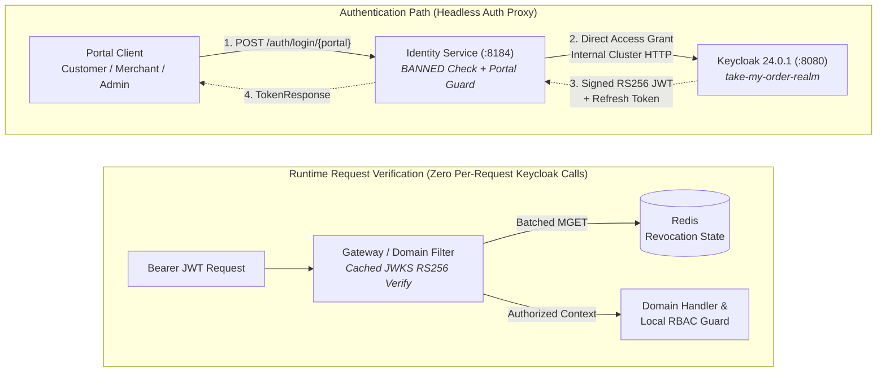
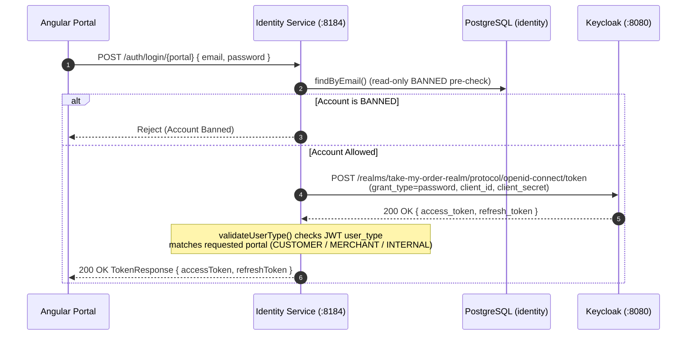
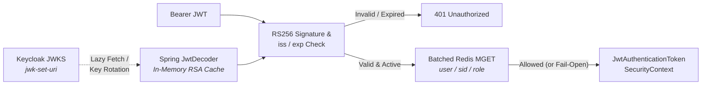
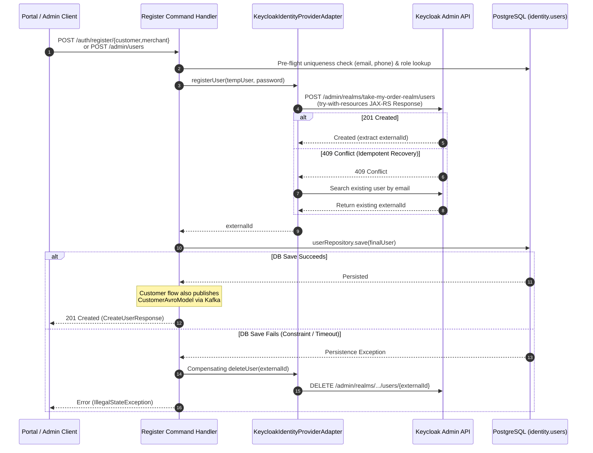
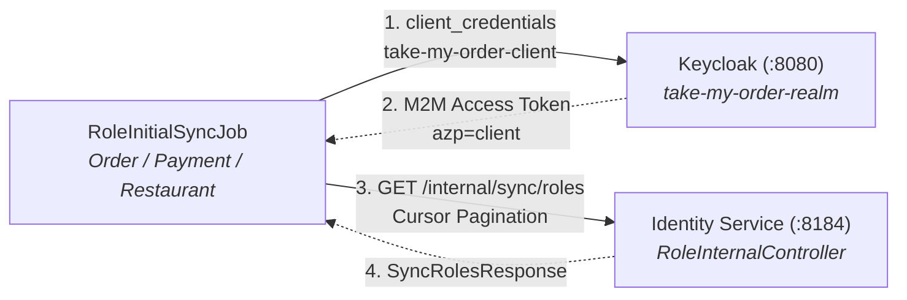

# Keycloak OIDC Integration & Stateless Token Architecture

## 1. Identity Governance & Separation of Concerns

In the **Take My Order** ecosystem, **Keycloak (`24.0.1`)** serves as the central OpenID Connect (OIDC) and OAuth 2.0 Identity Provider (IdP), backed by a dedicated PostgreSQL schema (`keycloak`) inside the `take-my-order` Kubernetes namespace (`keycloak-service:8080`). Identity responsibilities are strictly partitioned between the IdP and the domain master:

* **Keycloak (The Gatekeeper):** Authoritative store for credentials, password hashes, cryptographic RS256 token signing, JWKS key publishing, and OIDC session lifecycles within the `take-my-order-realm` realm.
* **Identity Service (The Profile & Business Master):** Authoritative owner of internal user UUIDs (`identity.users`), portal user types, dynamic RBAC roles, multi-tenant organizational unit memberships, and Redis-backed instant token revocation.

---

## 2. The Auth Proxy & Headless IAM Pattern

Redirecting e-commerce consumers to Keycloak's hosted web login UI (Authorization Code Flow) breaks native SPA UX across separate customer, merchant, and internal portals. Instead, the platform implements a **Headless IAM Facade** through [Identity Service](../services/identity-service.md):

1. **Client-Facing Isolation:** While Keycloak's canonical external issuer (`KEYCLOAK_ISSUER_URI`) is configured for `iss` claim alignment and administrative access, end-user applications never submit credentials directly to Keycloak. All login, registration, token refresh, and password-update flows route through `identity-service`, which calls Keycloak over the internal cluster network (`http://keycloak-service:8080`).
2. **Confidential Client Shielding:** The `take-my-order-client` secret (`publicClient: false`, `directAccessGrantsEnabled: true`, `serviceAccountsEnabled: true`) resides strictly in Kubernetes Secrets (`service-secrets`) and is never exposed to browser JavaScript bundles.
3. **Portal-Segregated Login & Cross-Portal Guard:** `UserAuthController` exposes dedicated endpoints (`POST /auth/login/customer`, `POST /auth/login/merchant`, `POST /auth/login/internal`) accepting `{ email, password }`. `AuthCommandHandler` verifies local `AccountStatus.BANNED` status **before** contacting Keycloak, and `UserAuthController` validates the issued JWT's `user_type` claim against the target portal—rejecting cross-portal login attempts with `InvalidCredentialsException` (`"You do not have access to this panel"`).

---

## 3. Cached JWKS Validation & Runtime Resiliency

Calling Keycloak's `/protocol/openid-connect/introspect` endpoint on every API call turns the IdP into a latency multiplier and single point of failure. Conversely, baking static public keys into environment variables breaks standard OIDC key rotation.

The platform resolves both trade-offs through **Split-URL OAuth 2.0 Resource Server Configuration** across [Gateway Service](../services/gateway-service.md), `identity-service`, and every domain microservice (`order-service`, `payment-service`, `restaurant-service`):

### 3.1 Split Issuer vs. Internal JWKS Resolution

| Configuration Key | Cluster Source | Runtime Purpose |
| :--- | :--- | :--- |
| `issuer-uri` | `KEYCLOAK_ISSUER_URI` + `/realms/take-my-order-realm` | Validates the JWT `iss` claim against the canonical public realm issuer. |
| `jwk-set-uri` | `KEYCLOAK_SERVER_URL` (`http://keycloak-service:8080`) + `.../certs` | Fetches RS256 public signing keys over internal cluster networking without hairpinning through public ingress. |
| `JwtDecoder` / `ReactiveJwtDecoder` | Spring Security OAuth2 Resource Server | Caches JWKS keys in JVM memory; re-fetches only on unknown `kid` key rotation (**zero** per-request Keycloak HTTP calls). |

### 3.2 Filter-Level Safeguards

* **IdP Outage Tolerance:** Once public keys are cached in memory, existing valid access tokens continue to authenticate across the ecosystem until their `exp` timestamp even if Keycloak restarts or becomes temporarily unreachable.
* **Explicit Claim & Status Guards:** Both `JwtSecurityFilter` (shared across domain services via `common-application`) and `JwtAuthenticationFilter` (`identity-service`) verify the RS256 signature via `jwtDecoder.decode(token)`, check `exp`, immediately reject `account_status == BANNED` (`403 Forbidden`), and execute a single batched Redis `MGET` (`user:{internalId}:revoke`, `sid:{sid}:revoke`, `role:{roleId}:revoke`) with a 5-second clock-skew grace period (`gracePeriod = 5L`).
* **Fail-Open Availability:** In downstream microservices, `JwtSecurityFilter` wraps the Redis revocation lookup in a resilient catch block—if Redis is temporarily unavailable, the filter logs the error and falls back to the 5-minute cryptographic JWT expiration rather than halting order or payment traffic.

---

## 4. Protocol Mappers & Custom JWT Claims

To enable stateless ownership checks ([Stateless IDOR Shield](stateless-idor-shield.md)) and local RBAC permission evaluation ([RBAC Governance](rbac-governance.md)) without querying `identity-service` on every request, `take-my-order-client` configures custom `oidc-usermodel-attribute-mapper` protocol mappers inside `take-my-order-realm`:

| Mapper & Claim Name | Cardinality | Purpose in JWT Payload |
| :--- | :--- | :--- |
| `internal_id` | Single-valued (`String`) | Authoritative PostgreSQL `identity.users` UUID used across all domain services. |
| `user_type` | Single-valued (`String`) | Actor classification (`CUSTOMER`, `MERCHANT`, `INTERNAL`; `M2M` derived for service accounts). |
| `account_status` | Single-valued (`String`) | Account state (`ACTIVE`, `BANNED`) checked at the security filter boundary. |
| `role_ids` | Multivalued (`String[]`) | Assigned role UUIDs joined against local `roles_replica` tables for permission resolution. |
| `organizational_unit_ids` | Multivalued (`String[]`) | Authorized merchant restaurant/branch UUIDs for tenant isolation. |

### 4.1 Mapping & Serialization Invariants

* **PII Minimization:** `KeycloakMapper` persists six custom attributes on the Keycloak user record (`internal_id`, `user_type`, `phone_number`, `account_status`, `role_ids`, `organizational_unit_ids`), intentionally omitting `phone_number` from JWT protocol mappers to keep bearer headers compact and avoid leaking contact PII into every microservice log context.
* **Scalar vs. Array Defense-in-Depth:** Scalar mappers (`internal_id`, `user_type`, `account_status`) keep `multivalued` disabled so Keycloak emits plain JSON strings, while `role_ids` and `organizational_unit_ids` set `multivalued: true` to emit JSON arrays. As a defensive safeguard against realm misconfiguration, `JwtSecurityFilter` unwraps single-element arrays via `extractFirstElementOrNull()` and parses both JSON arrays and bracketed strings in `extractUuidList()`.

---

## 5. Token Lifecycles & Session Governance

Realm token settings in `take-my-order-realm` balance short exposure windows with frictionless multi-request SPA sessions (see [Token Lifecycle & Revocation](token-lifecycle-and-revocation.md) for the full Redis revocation state machine):

| Realm Setting | Configured Value | Architectural Rationale |
| :--- | :--- | :--- |
| `defaultSignatureAlgorithm` | `RS256` | Asymmetric signing lets services verify tokens with cached public keys without sharing a signing secret. |
| `accessTokenLifespan` | **5 minutes (`300s`)** | Bounds exposure if an access token is compromised or if Redis temporarily fails open. |
| `ssoSessionIdleTimeout` | **7 days (`604800s`)** | Governs active refresh token idle lifetime across mobile and web sessions. |
| `ssoSessionMaxLifespan` | **30 days (`2592000s`)** | Hard absolute session ceiling requiring full re-authentication regardless of activity. |
| `revokeRefreshToken` | `false` (`refreshTokenMaxReuse: 0`) | Prevents concurrent SPA background requests hitting `POST /auth/refresh` from racing and terminating valid sessions. |

### 5.1 Pre-Refresh Revocation Gate

Before forwarding `grant_type=refresh_token` to Keycloak, `AuthCommandHandler.refreshToken()` decodes the refresh token payload (`sid`, `internal_id`—falling back to `sub` via `userRepository.findByExternalId()`—and `iat`) and queries `TokenRevocationPort`. If Redis reports `ALL_TOKENS_REVOKED` (triggered by an admin ban, manual `revoke-all`, or logout), `identity-service` aborts with `TokenRevokedDomainException` instead of minting a fresh access token.

---

## 6. Compensating Registration & Orphan Prevention

Creating a user spans two isolated data stores—**Keycloak** (credentials and OIDC identity) and **PostgreSQL `identity.users`** (domain aggregate, roles, and tenant assignments). Rather than introducing distributed two-phase commit (2PC), registration handlers (`RegisterCustomerCommandHandler`, `RegisterMerchantCommandHandler`, `RegisterInternalUserCommandHandler`) execute a **Compensating Rollback** workflow via `KeycloakIdentityProviderAdapter`:

### 6.1 Registration Reliability Invariants

* **JAX-RS Connection Leak Protection:** `KeycloakIdentityProviderAdapter.registerUser()` wraps every Admin API `Response` inside a Java `try-with-resources` block (and drains error bodies via `response.readEntity(String.class)`), eliminating TCP connection pool exhaustion under concurrent sign-ups.
* **Idempotent `409 Conflict` Handling:** If a retry encounters an existing Keycloak account (`409`), the adapter resolves the existing `externalId` by email instead of failing blindly.
* **Immediate Compensating Prune:** Any PostgreSQL persistence failure triggers `identityProviderPort.deleteUser(externalId)` inside the `catch` block so orphaned "zombie" credentials are not left behind in Keycloak; if the delete itself fails during a Keycloak outage, `KeycloakIntegrationException` is logged with the `externalId` for operational cleanup.
* **Master-Realm Admin Client:** Administrative mutations (user creation, deletion, status toggles, password resets, and attribute synchronization for [User Update Engine](user-update-engine.md)) authenticate through `KeycloakConfig` against Keycloak's `master` realm (`admin-cli`) using credentials injected from Kubernetes Secrets.

---

## 7. Keycloak 24+ Declarative User Profile (`UPConfig`)

Starting with Keycloak 24, the **Declarative User Profile** (`org.keycloak.userprofile.UserProfileProvider`) is enforced by default. Writing undeclared custom attributes via the Admin API causes Keycloak to reject or silently strip fields unless explicitly modeled in the realm's User Profile schema:

| User Profile Attribute | Permissions & Cardinality | Operational Role |
| :--- | :--- | :--- |
| `internal_id`, `user_type`, `account_status` | `admin` edit · Single-valued | Immutable backend-owned claims written exclusively by `identity-service`. |
| `role_ids`, `organizational_unit_ids` | `admin` edit · Multivalued | Synchronized on role or branch assignment changes via `updateUserRolesAndBranches()`. |
| `phone_number` | `admin`, `user` edit · Single-valued | Stored on the Keycloak user profile during registration and automated seeding. |

In addition to declaring these attributes in the realm export (`local-env/keycloak/realm-export.json`) and realm provisioning automation, environment provisioning sets `unmanagedAttributePolicy: "ENABLED"` so administrative writes and future attribute extensions never suffer silent drops during realm upgrades.

---

## 8. Machine-to-Machine (M2M) Service Accounts

Background inter-service synchronization—specifically `RoleInitialSyncJob` in `order-service`, `payment-service`, and `restaurant-service`—cannot rely on interactive user sessions. When a microservice boots with an empty local `roles_replica` table (or receives an explicit force-sync command), it authenticates via the **OAuth 2.0 Client Credentials Grant** (`grant_type=client_credentials`) against `http://keycloak-service:8080/realms/take-my-order-realm/protocol/openid-connect/token` using `take-my-order-client` (`serviceAccountsEnabled: true`), then pages through `identity-service`'s `GET /internal/sync/roles?limit=100` cursor API.

### 8.1 Strict M2M Identity & Permission Scoping

| Layer | Component | M2M Behavior |
| :--- | :--- | :--- |
| **Token Detection** | `JwtSecurityFilter` & `JwtAuthenticationFilter` | When `internal_id` is absent and `clientId` / `azp` equals `take-my-order-client`, assigns `userType = M2M` and a deterministic UUID (`UUID.nameUUIDFromBytes` of `clientId`). |
| **Domain Services** | `OrderAuthService`, `PaymentAuthService`, `RestaurantAuthService` | **Least-privilege bypass:** M2M tokens are authorized **only** for service-specific role sync permissions (`order_service_can_sync_roles`, `payment_service_can_sync_roles`, `restaurant_service_can_sync_roles`); all business actions (e.g., creating orders or processing payments) are denied (`false`). |
| **Identity Service** | `RoleAuthorizationService` & `SecurityConfig` | Permits internal sync endpoints (`/internal/sync/roles`) over cluster networking and recognizes `UserType.M2M` for internal service-account synchronization. |
