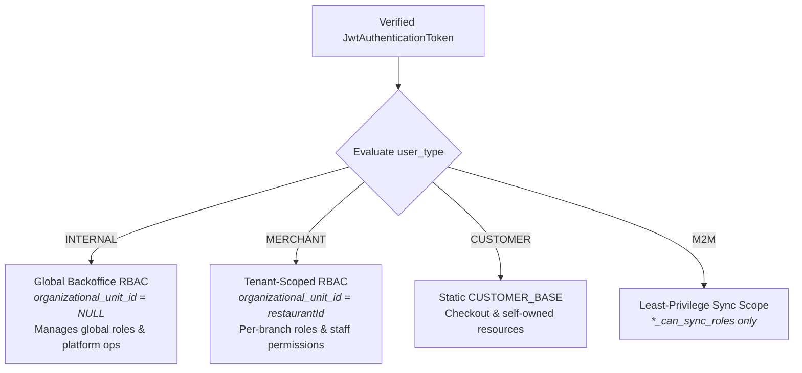
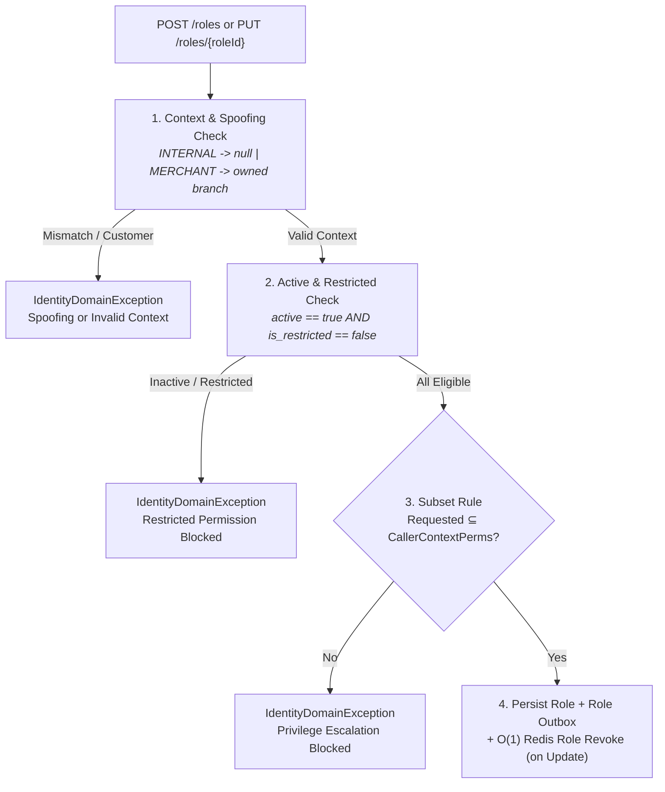
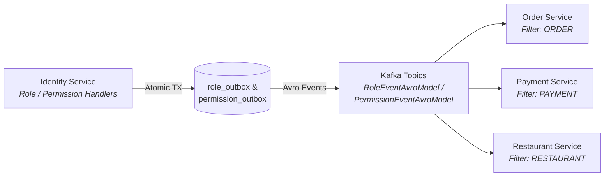

# Multi-Tier RBAC Governance & Permission Modeling

## 1. Multi-Tier Authorization Architecture

Multi-tenant food delivery platforms serve distinct actor populations whose governance rules conflict if forced into a single flat role table:

* **Internal Personnel (`INTERNAL`):** Backoffice operators managing platform-wide operations, global roles, and system settings with `organizational_unit_id = NULL`.
* **Merchant Partners (`MERCHANT`):** Restaurant owners and branch staff strictly isolated to their assigned restaurant context (`organizational_unit_id = {restaurantId}`), with zero visibility into peer tenants.
* **End Customers (`CUSTOMER`):** B2C users assigned the immutable `CUSTOMER_BASE` role at registration with zero role-management capabilities.
* **Service Accounts (`M2M`):** Machine-to-machine sync clients restricted exclusively to internal role-replication endpoints (see [Keycloak OIDC & Token Architecture](keycloak-architecture.md)).

---

## 2. Relational Model, Partial Unique Indexes & Core Roles

Authoritative RBAC tables live in the `identity` PostgreSQL schema (`roles`, `permissions`, `role_permissions`, `user_roles`), managed via Flyway migration scripts.

### 2.1 Solving SQL-92 `NULL != NULL` with Partial Unique Indexes

A naive composite `UNIQUE (organizational_unit_id, name)` constraint fails for global backoffice roles because standard SQL treats every `NULL` as distinct, allowing duplicate global role names (e.g., two separate `SUPPORT_AGENT` roles with `organizational_unit_id = NULL`). The schema enforces uniqueness across both tiers with two **PostgreSQL Partial Unique Indexes**:

* **`uq_roles_name_unit`:** Unique on `(organizational_unit_id, name)` `WHERE organizational_unit_id IS NOT NULL` — prevents duplicate role names inside the same restaurant while allowing Restaurant A and Restaurant B to each define a custom `Cashier` role.
* **`uq_roles_name_global`:** Unique on `(name)` `WHERE organizational_unit_id IS NULL` — guarantees globally unique backoffice role names.

### 2.2 Core Entities & Immutable Role Anchors

| Schema Element | Key Attributes & Constraints | Governance Role |
| :--- | :--- | :--- |
| **`roles`** | UUIDv7 `id`, `name`, immutable `user_type` & `organizational_unit_id`, `is_static`, `created_by_user_id`, optimistic `@Version` | Locking `is_static = true` blocks REST edits and deletes in both `RoleAuthorizationService` and `Role` aggregate methods. |
| **`permissions`** | Unique snake_case `code` (e.g., `can_read_orders`, `can_update_product`), `domain` (`ORDER`, `PAYMENT`, `RESTAURANT`, `IDENTITY`), `active`, `is_restricted` | `active = false` disables a capability system-wide; `is_restricted = true` prevents delegation into any custom role. |
| **Seeded vs. Per-Tenant Static Roles** | Global Flyway roles: `SYSTEM_ADMIN`, `CUSTOMER_BASE`, `MERCHANT_BASE`; Per-restaurant role: `RESTAURANT_OWNER` | `RESTAURANT_OWNER` (`is_static = true`) is dynamically provisioned per restaurant by `RestaurantInformationMessageListenerImpl` upon restaurant creation and synced to Keycloak. |

---

## 3. Anti-Escalation & Delegation Governance

Multi-tenant RBAC must prevent both **Privilege Escalation** (a delegated manager fabricating permissions they do not hold) and **Context Spoofing** (a merchant crafting or editing roles inside a competitor's restaurant).

### 3.1 Subset Delegation & Restricted Permission Guards

In `CreateRoleCommandHandler`, `UpdateRoleCommandHandler`, and `IdentityDomainServiceImpl`, every custom role mutation enforces four layered checks before persisting changes—failing fast with `IdentityDomainException`:

1. **Context & Spoofing Verification:** `INTERNAL` callers must target `organizationalUnitId == null`; `MERCHANT` callers must target a non-null `organizationalUnitId` where they hold at least one active role; `CUSTOMER` callers are rejected unconditionally.
2. **Active & Non-Restricted Filter:** Requested permission IDs must all exist and have `active = true`. Any permission marked `is_restricted = true` (e.g., platform administration or internal role-sync capabilities) is unconditionally rejected on custom (`isStatic = false`) roles.
3. **Context-Scoped Subset Rule (`RequestedPermissions ⊆ CallerContextPermissions`):** Rather than blocking merchants to a single domain—since `RESTAURANT_OWNER` legitimately delegates across `RESTAURANT`, `ORDER`, `PAYMENT`, and `IDENTITY` (e.g., `can_approve_order`, `can_read_payment`, `can_view_merchant_users`)—`IdentityDomainServiceImpl.validateSubsetRule()` verifies that every requested permission is a **mathematical subset** of the caller's own active permissions **within that exact target context**.
4. **Aggregate Invariants (`Role`):** Domain entities independently enforce non-empty names, at least one active permission, immutability of `userType` and `organizationalUnitId`, and static-role protection (`is_static = true`).

### 3.2 User Role Assignment Guardrails

Assigning roles to users (`AssignUserRoleCommandHandler` and `UpdateMerchantUserRolesCommandHandler`) enforces complementary organizational boundaries:

* **Strict Tier Separation:** Global roles (`organizational_unit_id = NULL`) can only be assigned by `INTERNAL` actors with `can_assign_role` to `INTERNAL` targets; restaurant-scoped roles can only be assigned by `MERCHANT` actors holding `can_assign_role` in that exact restaurant—platform administrators cannot alter restaurant staff roles.
* **Membership & Self-Edit Blocks:** The target user must already belong to the role's restaurant (`user.getOrganizationalUnitIds().contains(orgUnitId)`), callers cannot modify their own roles (`CANNOT_MODIFY_OWN_ROLES`), and existing `RESTAURANT_OWNER` accounts are protected from redundant personnel role assignments.
* **Crash-Safe Dual Sync:** Role assignments coordinate Keycloak attribute updates and PostgreSQL commits through `UserUpdateIntentHelper` (see [User Update Engine](user-update-engine.md)) before revoking the target user's access token.

---

## 4. Event-Driven Role Replication & Domain Filtering

To keep runtime authorization decoupled from `identity-service`, every role or permission mutation propagates asynchronously via the **Transactional Outbox** pattern (see [Transactional Outbox Pattern](../distributed-systems/transactional-outbox.md)):

| Replication Mechanism | Implementation Component | Operational Benefit |
| :--- | :--- | :--- |
| **Domain-Filtered Projection** | `RoleRepositoryImpl` in `order-service`, `payment-service`, `restaurant-service` | Each microservice persists **only** permissions matching its own `DomainType` (`ORDER`, `PAYMENT`, or `RESTAURANT`), keeping local replica tables minimal. |
| **Version-Guarded Idempotency** | `RoleReplicaEntity.version` check (`incoming <= existing` ignored) | Prevents out-of-order Kafka deliveries from regressing a role to stale permissions. |
| **Zero-N+1 Bulk Upsert** | `findAllById` + in-memory set difference + `saveAll` + junction replace-all | Eliminates per-permission database round-trips during high-permission role updates. |
| **Permission Kill-Switch & Bootstrap** | `UpdatePermissionCommandHandler` (`PERMISSION_UPDATED`) & `RoleInitialSyncJob` | Toggling a permission's `active` flag propagates immediately across replicas; empty replicas self-hydrate on startup via cursor-paginated `GET /internal/sync/roles`. |

---

## 5. Runtime Resolution & `O(1)` Role-Level Revocation

At request time, downstream microservices never call `identity-service` to evaluate permissions. Instead, authorization beans resolve the JWT's `role_ids` against per-pod L1 Caffeine caches (`roles` and `roleOrgUnits` / `role_org_units`) backed by local `roles_replica` tables:

* **Global Capability Checks (`hasPermission`):** Iterates the caller's `role_ids` and checks `Set.contains(requiredPermission)` in `O(1)` lookup time per role—forming the effective union across assigned roles for non-tenant endpoints (e.g., `can_read_all_orders`, `can_view_permissions`).
* **Tenant-Scoped Checks (`hasPermissionForRestaurant`, `hasPermissionForWallet`, `hasPermissionForOrg`):** Never flattens permissions across branches; each `roleId` is verified individually against its bound `organizationalUnitId` before testing `Set.contains(requiredPermission)` to eliminate Cross-Branch Privilege Bleed (detailed in [Stateless Zero-SQL IDOR Shield](stateless-idor-shield.md)).
* **`O(1)` Role-Level Token Invalidation:** Whenever a custom role is modified (`UpdateRoleCommandHandler`) or deleted (`DeleteRoleCommandHandler`), `identity-service` does **not** scan or revoke individual users (`O(N)`). Instead, it writes a single Redis key—`role:{roleId}:revoke` with a 5-minute TTL matching access token lifetime—so the very next request from any affected user triggers `401 ACCESS_TOKEN_REVOKED` via the batched Redis `MGET` filter and performs a silent token refresh (see [Token Lifecycle & Revocation](token-lifecycle-and-revocation.md)).
