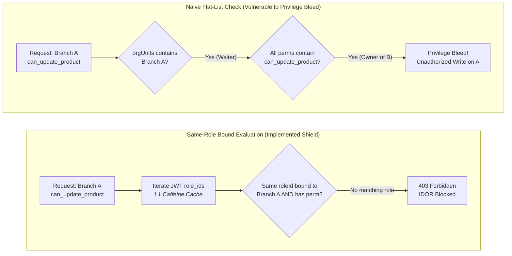
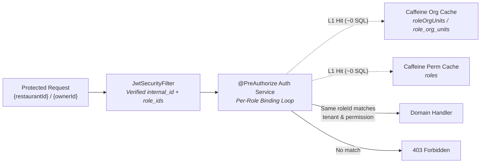

# Stateless Zero-SQL IDOR Shield Architecture

## 1. The Multi-Tenant IDOR Threat Model

In a multi-tenant food delivery platform serving customers, restaurant merchants, and internal administrators, **Insecure Direct Object Reference (IDOR)** is a primary authorization hazard. Role-only checks fail because multiple tenants share identical permission codes (such as `can_update_product`, `can_approve_order`, or `can_read_payment`):

* **Cross-Branch Merchant Hijack:** A merchant authorized at Restaurant A manipulates `{restaurantId}` on `PUT /restaurants/{restaurantId}/products/{productId}` or `{orderId}` on `POST /orders/{orderId}/approve` to mutate Restaurant B's menu or orders.
* **Cross-Branch Privilege Bleed:** A user who works as a **Waiter** at Branch A and owns **Branch B** holds both branches in their profile and possesses `can_update_product` from Branch B. Evaluating branch membership and permissions as two separate flat lists would allow the waiter to edit Branch A's catalog.
* **Customer & Wallet Enumeration:** A customer substitutes another user's `{orderId}`, `{trackingId}`, or `{ownerId}` on order detail, tracking, review, or `/wallets/{ownerId}/balance` endpoints.

---

## 2. Why Traditional Per-Request SQL Guards Fail at Scale

The conventional defense queries a relational membership table (`user_branches` or cross-service user lookups) on every protected HTTP request. In a distributed microservice architecture, this introduces three structural bottlenecks:

* **Latency Amplification:** Every read and write request incurs extra database round-trips before domain logic begins.
* **Connection Pool Starvation:** Traffic bursts or automated ID enumeration scans exhaust `HikariCP` pools on authorization checks ahead of checkout and payment transactions.
* **Tight Service Coupling:** `order-service`, `payment-service`, and `restaurant-service` would either need synchronous HTTP calls back to `identity-service` or duplicate user-to-branch join tables across every database.

---

## 3. Role-Bound In-Memory Shield Architecture

Rather than checking flat `organizational_unit_ids` lists against flat permission lists, domain microservices resolve authorization **per `roleId`** from the signed JWT ([Keycloak OIDC & Token Architecture](keycloak-architecture.md)).

Downstream filters (`JwtSecurityFilter`) deliberately do **not** trust or evaluate flat branch arrays from the token; they populate `JwtAuthenticationToken` with the verified `internal_id`, `user_type`, and `role_ids`. Each service's authorization bean (`RestaurantAuthService`, `OrderAuthService`, `PaymentAuthService`) evaluates every `roleId` against two **L1 Caffeine caches** backed by Kafka-replicated `roles_replica` tables (see [RBAC Governance](rbac-governance.md)):

### 3.1 Cache Topology & Invalidation

| Cache Layer | Service Scope | Eviction & Lifecycle |
| :--- | :--- | :--- |
| `roles` (Permissions per `roleId`) | `order-service`, `payment-service`, `restaurant-service` | Caffeine L1 (`maximumSize = 500`, `60 min` `expireAfterAccess`), backed by local `roles_replica`. |
| `roleOrgUnits` / `role_org_units` | `order-service` & `restaurant-service` (`roleOrgUnits`); `payment-service` (`role_org_units`) | Resolves each role's bound `organizationalUnitId` (`null` for platform-level global roles). |
| `roles_cache` & Kafka Eviction | `identity-service` (`RoleAuthorizationService`) & domain replica adapters | `@CacheEvict` evicts affected role keys on replica writes (`RoleReplicaRepository`) and permission updates (`RoleRepositoryImpl` in `restaurant-service`). |

### 3.2 Core Anti-IDOR Invariants

1. **Same-Role Tuple Binding:** Authorization succeeds only if a **single `roleId`** in the caller's token simultaneously maps to the target tenant (`roleOrgUnitId == targetId`) and grants the requested permission code—eliminating Cross-Branch Privilege Bleed.
2. **Explicit M2M Isolation:** Machine-to-machine service tokens (`userType == M2M`) are explicitly denied (`false`) on every tenant, order, and wallet ownership method (`hasPermissionForRestaurant`, `hasPermissionForWallet`, `isOwner`); they are restricted strictly to internal role synchronization.
3. **Path & Principal Authority:** Client-supplied `customerId` or `merchantId` fields in request bodies are ignored or overwritten with the authenticated principal, and tenant-scoped routes declare the target resource directly in the URL path or required `orgUnitId` parameter.

---

## 4. Defense Patterns Across Microservices

Not every endpoint carries a `{restaurantId}` directly in the path. The platform applies four complementary IDOR patterns tailored to each domain boundary:

| IDOR Defense Pattern | Components & Example Routes | Verification Mechanism |
| :--- | :--- | :--- |
| **1. Principal-Derived Identity (0 SQL)** | `OrderController` (`POST /orders`, `GET /orders`), `RestaurantController` (`POST /restaurants`), `/users/me/**` controllers | Ignores client-supplied user IDs; injects `@AuthenticationPrincipal` `internalId` (or `SecurityContextHolder` principal) directly into commands and queries. |
| **2. Direct Tenant Role Binding (0 SQL on Hit)** | `RestaurantController` (`/restaurants/{id}/...`), `RestaurantOrderQueryController`, `MerchantUserController` (`?orgUnitId=...`) | Verifies same-role binding via `hasPermissionForRestaurant` or `RoleAuthorizationService` (`hasPermissionForOrg`). `MerchantUserController` also passes JWT `organizational_unit_ids` as a query filter. |
| **3. Dual Self-Access & Wallet Guard** | `WalletController` (`/wallets/{ownerId}/...`) via `PaymentAuthService` (`hasPermissionForWallet`) | **Tier 1 (0 SQL):** Grants self-access when `internalId == ownerId`. **Tier 2 (L1 Cache):** Grants cross-owner access only via a role bound to `ownerId` or a global (`null` org) finance role with `can_read_payment` / `can_manage_payment`. |
| **4. Scalar Projection & `@PostAuthorize`** | `OrderController` (`/{orderId}/approve`, `cancel`, `/{trackingId}/track`), `OrderReviewController` (`/{orderId}/reviews`) | Resolves ownership without loading full aggregates: `OrderAuthProjection` fetches only 3 columns (`customerId`, `restaurantId`, `orderStatus`), while tracking uses `@PostAuthorize` (`isOwner`) on the response. |

---

## 5. Granular Guardrails & Edge-Case Protections

Beyond basic tenant matching, the authorization services encode domain-specific guardrails verified directly at the `@PreAuthorize` boundary:

* **State-Granular Cancel Authorization (`OrderAuthService`):** Because `OrderAuthProjection` includes `orderStatus` alongside `customerId` and `restaurantId`, `hasCancelPermissionForOrder()` dynamically maps the order's current lifecycle state (`WAITING_FOR_APPROVAL` → `can_cancel_waiting_order`, `PREPARING` → `can_cancel_preparing_order`, `IN_DELIVERY` → `can_cancel_in_delivery_order`, etc.) before running the same-role restaurant check. If the order is already `CANCELLING` or `CANCELLED`, any valid cancel permission for that restaurant is accepted to preserve double-click idempotency (see [Order Service](../services/order-service.md)).
* **Zero Platform-Admin Impersonation on Reviews & Menus:** While `OrderAuthService` permits platform-level roles (`roleOrgUnitId == null`) with global permissions (such as `can_read_all_orders`) to inspect orders, two strict boundaries block over-broad access:
    * `OrderAuthService` explicitly restricts `can_reply_restaurant_review` to roles with a non-null `roleOrgUnitId` matching `targetRestaurantId`—platform administrators cannot post replies pretending to be a restaurant.
    * `RestaurantAuthService.hasPermissionForRestaurant()` requires a non-null `roleOrgUnitId.equals(targetRestaurantId)` on all merchant catalog and restaurant mutations.

---

## 6. Scaling Trade-Offs: JWT Claims vs. Externalized Lookups

Embedding `role_ids` in the JWT and resolving bindings through per-pod Caffeine caches eliminates runtime database I/O for standard multi-branch operations while keeping token headers compact. As tenant portfolios scale to enterprise franchises, the hexagonal `RolePermissionQueryPort` boundary allows evolving the lookup backing store without modifying controllers or `@PreAuthorize` expressions:

| Dimension | Active Architecture (JWT `role_ids` + L1 Caffeine) | Franchise Scale Target (Centralized Redis Lookup) |
| :--- | :--- | :--- |
| **Token Payload** | Compact JWT carrying `internal_id` and assigned `role_ids` (plus `organizational_unit_ids` for `identity-service`). | Fixed-size JWT containing only `internal_id` (no role or branch arrays). |
| **Runtime Lookup** | In-memory L1 Caffeine cache (`roles`, `roleOrgUnits` / `role_org_units`) with **0 SQL** on cache hit. | Sub-millisecond Redis set / hash reads (`SISMEMBER` / `HGET`) alongside existing revocation `MGET` ([Token Lifecycle & Revocation](token-lifecycle-and-revocation.md)). |
| **Sweet Spot & Ceiling** | Ideal for standard customers and merchants operating tens of branches (well within HTTP 8 KB header budgets). | Necessary when enterprise franchise managers hold hundreds of branch-scoped roles that would inflate JWT headers. |
