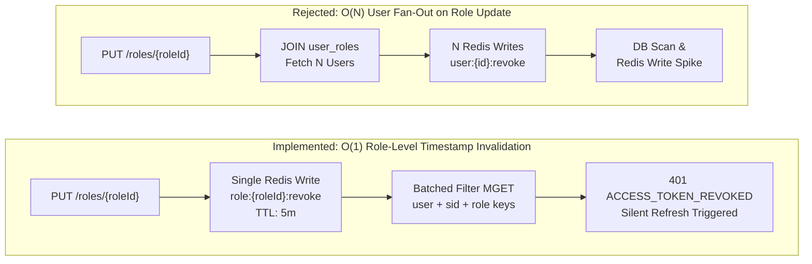
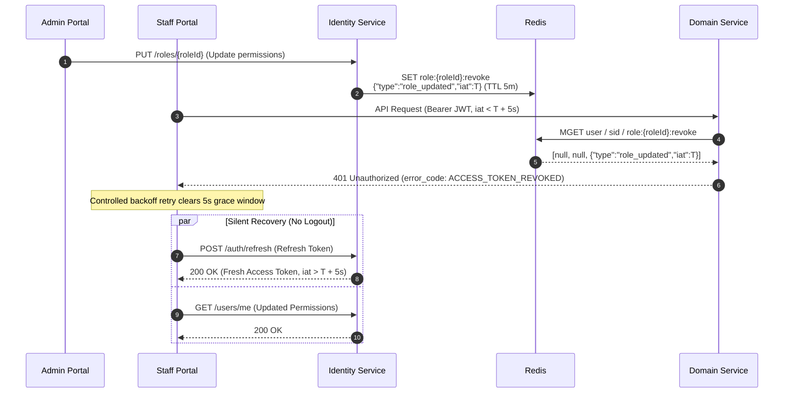

# Token Lifecycle & Multi-Tier Redis Revocation

## 1. The Stateless JWT Revocation Paradox

Because every microservice validates RS256 bearer tokens in memory via cached JWKS keys without calling Keycloak per request (see [Keycloak OIDC & Token Architecture](keycloak-architecture.md)), three real-time invalidation problems arise:

1. **Bans & Session Termination:** If an administrator bans an account (`AccountStatus.BANNED`) or a user logs out, a purely stateless 5-minute access token remains valid until its `exp` claim expires.
2. **Stale Role or Branch Claims:** When a merchant creates a restaurant, changes branch personnel, or receives a role assignment, existing access tokens lack the newly synchronized `role_ids` or `organizational_unit_ids`.
3. **Role Permission Drift:** When an administrator edits or deletes an existing role (`PUT /roles/{roleId}`, `DELETE /roles/{roleId}`), users holding that role still carry valid tokens for up to 5 minutes—leaving portal UI permissions out of sync with backend authorization.

The platform resolves all three challenges without adding database joins to the request path using a **Three-Dimensional Redis `MGET` Revocation Architecture** spanning **user**, **session (`sid`)**, and **role** keys.

---

## 2. Architectural Design Trade-Offs

| Approach | Operational Trade-Off | Platform Decision |
| :--- | :--- | :--- |
| **Per-Request DB / IdP Introspection** | Adds synchronous SQL or Keycloak round-trips to every API call and turns the IdP into a single point of failure. | **Rejected** — violates stateless latency and availability goals. |
| **`O(N)` Per-User Fan-Out on Role Edit** | Requires joining `user_roles` and issuing `N` Redis writes whenever a shared role changes (`10,000` writes for `10,000` holders). | **Rejected** — causes database scan pressure and Redis write spikes. |
| **3-Dimensional Redis `MGET` + `O(1)` Role Keys** | Always **1 Redis write** per revocation (`O(1)`) and **1 batched `MGET`** per request across `user`, `sid`, and `role` keys; zero extra SQL. | **Implemented** across `identity-service` and `common-application`. |

---

## 3. Redis Key Taxonomy & Revocation Triggers

All revocation writes go through `TokenRevocationPort` (`TokenRevocationAdapter`) in `identity-service`. Soft revocations carry a **5-minute TTL** (matching `accessTokenLifespan = 300s`), while hard revocations carry a **7-day TTL** (matching `ssoSessionIdleTimeout = 604800s`):

| Redis Key & Payload | TTL & Scope | HTTP `401` `error_code` & Client Action |
| :--- | :--- | :--- |
| `sid:{sessionId}:revoke` `{"type":"single_logout"}` | **7 days** · Hard (single device) | `ALL_TOKENS_REVOKED` — terminates only the current session (`sid`), blocks `/auth/refresh` for that session, leaves other devices active. |
| `user:{userId}:revoke` `{"type":"all_tokens","iat":<sec>}` | **7 days** · Hard (all devices) | `ALL_TOKENS_REVOKED` — global logout across all devices and blocks `POST /auth/refresh` for tokens issued before the cutoff. |
| `user:{userId}:revoke` `{"type":"access_token","iat":<sec>}` | **5 minutes** · Soft (user claims) | `ACCESS_TOKEN_REVOKED` — preserves the refresh session; client silently refreshes token and reloads `/users/me`. |
| `role:{roleId}:revoke` `{"type":"role_updated","iat":<sec>}` | **5 minutes** · Soft (`O(1)` role-wide) | `ACCESS_TOKEN_REVOKED` — immediately prompts every holder of `roleId` to refresh and sync updated permissions. |

### 3.1 Representative Application Triggers

* **Hard Revocations (`ALL_TOKENS_REVOKED`):** Triggered by single-device logout (`UserLogoutCommandHandler.logout` → `POST /users/logout` via `revokeTokenBySessionId`), global logout (`POST /users/logout-all` via `revokeAllTokens`), administrative account bans (`UpdateUserStatusCommandHandler` when `status == BANNED`), and manual admin session kill (`AdminUserCommandHandler.revokeAll` → `POST /admin/users/{userId}/revoke-all`).
* **Soft User Revocations (`ACCESS_TOKEN_REVOKED` via `revokeAccessToken`):** Triggered whenever a user's JWT claims become stale without warranting logout—for example, role assignment updates (e.g., `AssignUserRoleCommandHandler`, `UpdateMerchantUserRolesCommandHandler`), restaurant/personnel membership events (e.g., `RestaurantInformationMessageListenerImpl`), profile edits (`UpdateUserProfileCommandHandler`), or manual admin access revocation (`POST /admin/users/{userId}/revoke-access`).
* **Soft `O(1)` Role Revocations (`ACCESS_TOKEN_REVOKED` via `revokeRole`):** Triggered automatically by `UpdateRoleCommandHandler` and `DeleteRoleCommandHandler` immediately after persisting role changes and outbox events (see [Multi-Tier RBAC Governance](rbac-governance.md)).

---

## 4. Batched Filter Verification & Clock-Skew Grace Window

On every authenticated request carrying both `internal_id` and `sid`, both `JwtSecurityFilter` (`common-application` for `order-service`, `payment-service`, `restaurant-service`) and `JwtAuthenticationFilter` (`identity-service`) execute a **single Redis `MGET`** covering `user:{internalId}:revoke`, `sid:{sid}:revoke`, and one `role:{roleId}:revoke` entry per role in the token.

### 4.1 5-Second Clock-Skew Grace Period

Distributed pods and Keycloak can exhibit minor NTP clock skew. Timestamp-based revocations (`user` and `role` keys) therefore apply a symmetric **5-second grace period (`gracePeriod = 5L`)**: any token whose `iat` satisfies `iat <= revokedIat + 5` is rejected with HTTP `401 Unauthorized` and a standardized JSON envelope (`status`, `error_code`, `message` mapped by `GlobalExceptionHandler` and `IdentityGlobalExceptionHandler`).

### 4.2 Fail-Open Availability Guardrail

In downstream domain services (`JwtSecurityFilter`), the Redis `MGET` check is enclosed in a resilient `catch (Exception)` block while explicitly re-throwing `TokenRevokedException`. If the Redis cluster becomes unreachable, business APIs **fail open** to the 5-minute RS256 cryptographic expiration rather than causing a platform-wide checkout outage.

---

## 5. Refresh Token Gate & Standardized Error Codes

When a client calls `POST /auth/refresh`, `AuthCommandHandler.refreshToken()` decodes the refresh token's `sid`, `internal_id` (falling back to `sub` via `userRepository.findByExternalId()`), and `iat`, then queries `TokenRevocationPort.checkTokenRevocation()` (`MGET` on `user:{userId}:revoke` and `sid:{sid}:revoke`):

| Revocation / Lifecycle Condition | Refresh Endpoint Behavior (`POST /auth/refresh`) | Resulting `error_code` (`401`) |
| :--- | :--- | :--- |
| **`single_logout` or `all_tokens` (`iat <= revokedIat + 5`)** | **Blocked before Keycloak** — throws `TokenRevokedDomainException` so revoked sessions cannot mint new tokens. | `ALL_TOKENS_REVOKED` |
| **`access_token` or `role_updated` (Soft Revocation)** | **Permitted** — forwards `grant_type=refresh_token` to Keycloak and returns a fresh `TokenResponse` without forcing logout. | *(200 OK — Silent Refresh)* |
| **Expired Refresh Token (`invalid_grant`)** | Keycloak rejects the refresh grant; `KeycloakIdentityProviderAdapter` maps it to `TokenExpiredDomainException`. | `REFRESH_TOKEN_EXPIRED` |
| **Expired or Malformed Access Token** | Rejected directly in `JwtSecurityFilter` / `JwtAuthenticationFilter` prior to controller dispatch. | `ACCESS_TOKEN_EXPIRED` / `INVALID_TOKEN` |

For the crash-safe state machine coordinating Keycloak attribute updates and PostgreSQL writes immediately prior to soft user revocations, see [User Update Engine](user-update-engine.md).
