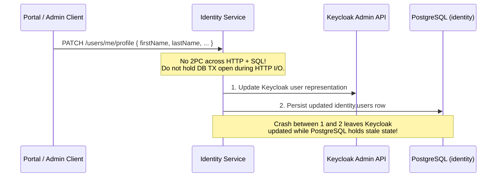
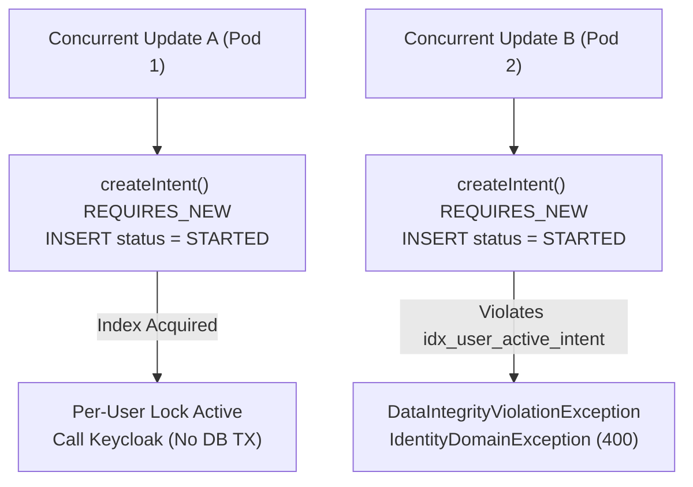
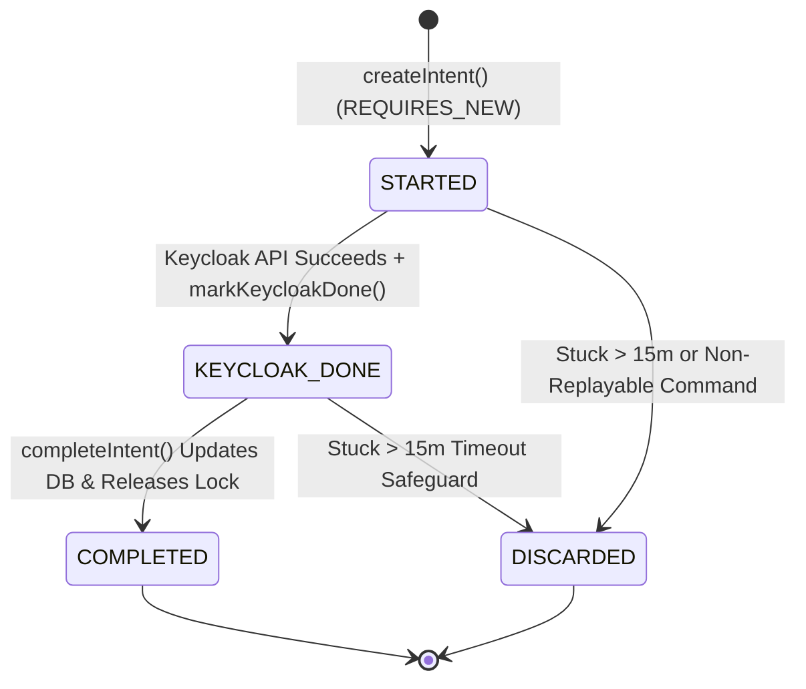
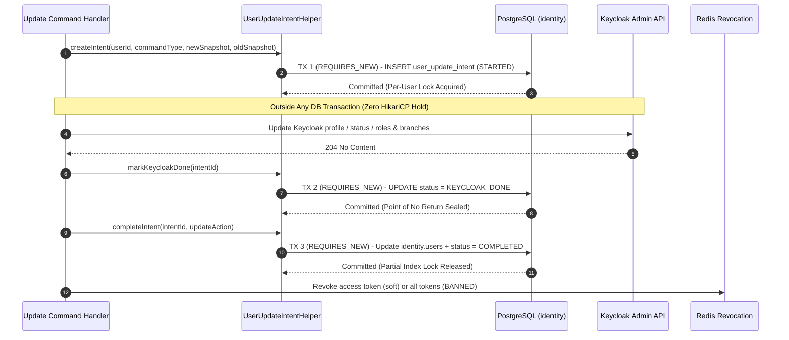
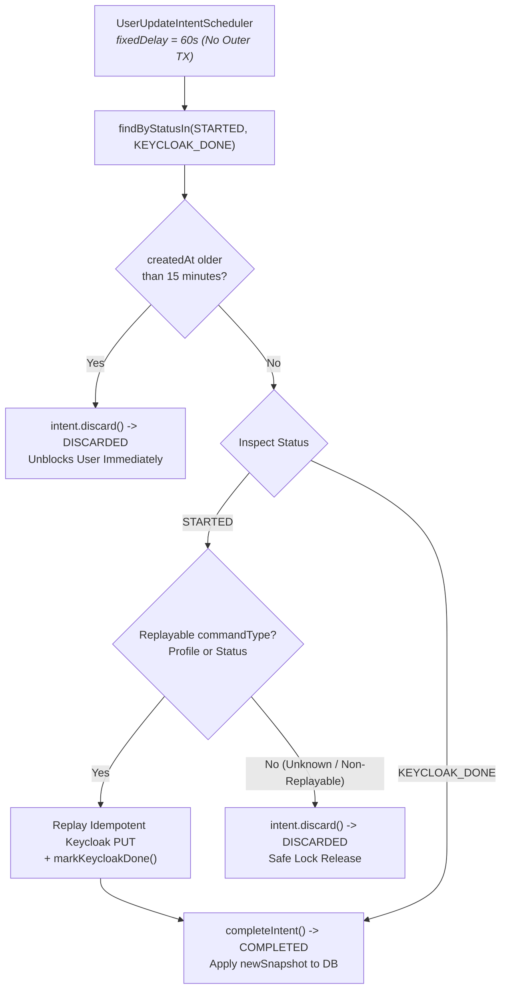

# Crash-Safe Distributed User Update Engine

## 1. The Dual-Write Problem Without Distributed 2PC

User mutations in [Identity Service](../services/identity-service.md)—such as profile edits (`PATCH /users/me/profile`), administrative account bans (`PATCH /admin/users/{userId}/status`), merchant role updates, and restaurant personnel synchronization—must update two isolated systems:

1. **PostgreSQL (`identity.users`):** Authoritative business record for user profile fields, account status, roles, and organizational units.
2. **Keycloak Admin API:** External OIDC identity store responsible for login enablement and JWT claim attributes (`firstName`, `lastName`, `role_ids`, `organizational_unit_ids`).

Because Keycloak exposes an HTTP REST API outside PostgreSQL's ACID transaction boundary, a pod crash or network timeout between the two writes causes **Data Drift**, while keeping a database transaction open during Keycloak HTTP I/O risks exhausting `HikariCP` connection pools under latency spikes.

---

## 2. Single Active Intent Lock & Zero-Hold Transactions

To serialize concurrent mutations per user across horizontally scaled pods without distributed Redis locks or long-lived SQL transactions, the platform introduces the **`user_update_intent`** state log orchestrated by `UserUpdateIntentHelper`:

* **Database-Enforced Per-User Lock (`idx_user_active_intent`):** A PostgreSQL partial unique index on `user_update_intent (user_id) WHERE status IN ('STARTED', 'KEYCLOAK_DONE')` guarantees that at most **one** active update intent can exist per user at any instant.
* **Fast-Fail Concurrency Rejection:** If two concurrent requests target the same user across different pods, the second `INSERT` violates `idx_user_active_intent`; `UserUpdateIntentHelper.createIntent()` catches `DataIntegrityViolationException` and throws `IdentityDomainException` (*"Another update operation is currently in progress for this user"*), mapped by `IdentityGlobalExceptionHandler` to HTTP `400 Bad Request`.
* **Zero DB Connection Hold During Keycloak I/O:** Enclosing command handlers (e.g., `UpdateUserProfileCommandHandler`, `UpdateUserStatusCommandHandler`, `AssignUserRoleCommandHandler`) are intentionally **not** `@Transactional`. Instead, `UserUpdateIntentHelper` isolates each database phase in its own `@Transactional(propagation = REQUIRES_NEW)` transaction, leaving the external Keycloak HTTP call completely outside any open database connection.

---

## 3. Intent State Machine & Execution Pipeline

`UserUpdateIntent` (`IntentStatus`) models five lifecycle states (`STARTED`, `KEYCLOAK_DONE`, `COMPLETED`, `DISCARDED`, and `FAILED` for explicit permanent failure marking), where only `STARTED` and `KEYCLOAK_DONE` hold the partial unique index lock:

### 3.1 Four-Stage Execution Pipeline

| Execution Stage | Transaction Boundary | Consistency Guarantee |
| :--- | :--- | :--- |
| **1. `createIntent()`** | `REQUIRES_NEW` (`TX #1`) | Persists serialized JSON `old_snapshot` & `new_snapshot` with `STARTED`, acquiring `idx_user_active_intent`. |
| **2. Keycloak Mutation** | **None (Non-Transactional)** | Executes REST write to Keycloak without holding a JDBC connection; if it throws, the intent remains `STARTED` for recovery. |
| **3. `markKeycloakDone()`** | `REQUIRES_NEW` (`TX #2`) | Seals `KEYCLOAK_DONE` on disk using optimistic `@Version` (`saveAndFlush`), preventing duplicate Keycloak replays if `TX #3` fails. |
| **4. `completeIntent()` + Revoke** | `REQUIRES_NEW` (`TX #3`) + Redis | Applies the domain mutation to `identity.users`, marks `COMPLETED` (idempotently ignoring already-completed intents), frees the lock, and triggers [Token Lifecycle & Revocation](token-lifecycle-and-revocation.md). |

---

## 4. Automated Forward Recovery & Stale-Lock Safeguard

If a pod crashes or loses network connectivity mid-pipeline, `UserUpdateIntentScheduler.processPendingIntents()` runs every **60 seconds** (`@Scheduled(fixedDelay = 60000)`) **without an outer `@Transactional` annotation** so recovery Keycloak calls never hold database connections open. It queries all intents in `STARTED` or `KEYCLOAK_DONE` via `findByStatusIn(...)` and drives forward convergence:

### 4.1 Recovery & Anti-Deadlock Invariants

| Recovery Scenario | Scheduler Action | Operational Effect |
| :--- | :--- | :--- |
| **Crash at `STARTED` (Profile / Status)** | Deserializes `newSnapshot` (`UpdateUserProfileCommand` or `UpdateUserStatusCommand`), replays the idempotent Keycloak update, marks `KEYCLOAK_DONE`, and completes PostgreSQL persistence. | Converges Keycloak and PostgreSQL automatically without user intervention. |
| **Crash at `KEYCLOAK_DONE`** | Skips Keycloak completely and calls `intentHelper.completeIntent()`, applying `newSnapshot` to `identity.users` and marking `COMPLETED`. | Eliminates redundant external API calls while healing DB drift. |
| **Stale Intent (`> 15 min`) or Non-Replayable Type** | Transitions the row to `DISCARDED` via `intent.discard()` and persists it immediately. | Exits `idx_user_active_intent` so a prolonged outage or unrecoverable payload can never permanently lock a user account. |

> **Schema Extensibility Note:** `UserUpdateIntentEntity` also provisions optimistic locking (`@Version`) along with `locked_at` and `locked_by` columns in the `user_update_intent` table, enabling multi-replica worker claiming (`FOR UPDATE SKIP LOCKED`) without schema migrations if horizontal scaling of `identity-service` recovery workers is required.
