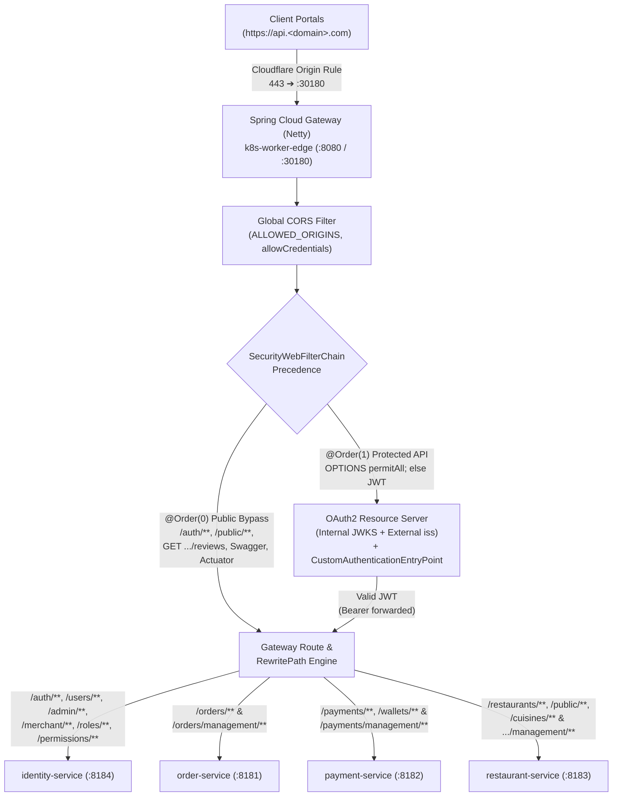

# Gateway Service (Edge Security & Routing) Specification

## 1. Domain Overview & Edge Responsibilities

The **Gateway Service** (`gateway-service`, local port `:8080`) is the singular public backend entry point (`https://api.<domain>.com`) into the **Take My Order** platform. Deployed on the ARM64 edge worker node (`k8s-worker-edge`, `node-type: gateway`) behind Kubernetes `NodePort :30180` and scaled automatically via HPA (`1–2` replicas), it receives HTTPS-terminated traffic from Cloudflare Edge (`443` → `:30180`), executes non-blocking JWT edge verification and CORS enforcement, and routes requests across the OCI Cross-Tenancy LPG & Flannel VXLAN overlay network to internal `ClusterIP` microservices ([Subdomains & Multi-Portal](../architecture/subdomain-and-portals.md), [Cross-Tenancy Topology](../devops/cross-tenancy-topology.md)).

### 1.1 Core Edge Responsibilities
*   **Non-Blocking Reverse Proxy & Path Normalization:** Runs on **Spring Cloud Gateway** over **Spring WebFlux (Netty)**, forwarding requests to downstream services (`identity-service`, `order-service`, `payment-service`, `restaurant-service`) and normalizing management and OpenAPI paths via `RewritePath`.
*   **Dual-Chain Split-Horizon OIDC Verification:** Separates public bypass paths (`@Order(0)`) from protected API traffic (`@Order(1)`), validating JWT RSA signatures against Keycloak's internal cluster JWKS (`KEYCLOAK_SERVER_URL`) while asserting the external `iss` claim (`KEYCLOAK_ISSUER_URI`).
*   **Structured Edge `401` Error Contract:** Uses `CustomAuthenticationEntryPoint` to distinguish `ACCESS_TOKEN_EXPIRED`, `INVALID_TOKEN`, and generic `UNAUTHORIZED` responses so SPA interceptors can trigger transparent token refreshes.
*   **Global CORS Governance:** Centralizes `ALLOWED_ORIGINS` and `OPTIONS` pre-flight handling (`allowCredentials = true`) for the Customer, Merchant, and Backoffice portals.
*   **Centralized Read-Only OpenAPI Hub:** Serves `/swagger-ui.html` aggregating the gateway overview (`/v3/api-docs` via `OpenApiConfig`) and downstream OpenAPI specs (`/api-docs/{identity,order,payment,restaurant}`), with interactive execution (`"Try it out"`) governed by `SWAGGER_SUPPORTED_SUBMIT_METHODS` and `SWAGGER_ENABLED`.

---

## 2. Technical Architecture & Reactive Ingress Flow

`gateway-service` is a stateless single-module reactive service with zero database or Kafka dependencies. Downstream services handle Redis token-revocation checks, `user_type` isolation, and fine-grained `@PreAuthorize` RBAC / IDOR validation using the forwarded `Authorization: Bearer <token>` header:

---

## 3. Route Configuration Matrix

Routes in `application.yml` bind to environment-injected destination URIs (`${<SERVICE>_URI}`), allowing the identical container image to run locally (`http://localhost:8181`–`8184`) and in Kubernetes (`ClusterIP` service URIs injected from `service-config`):

| Route & Path Predicates | Target URI Variable | Rewrite Rule |
| :--- | :--- | :--- |
| **`identity-service`** `/auth/**`, `/admin/**`, `/merchant/**`, `/users/**`, `/roles/**`, `/permissions/**` | `IDENTITY_SERVICE_URI` *(local `localhost:8184`)* | Direct pass-through |
| **`order-management`** `/orders/management/**` | `ORDER_SERVICE_URI` *(local `localhost:8181`)* | `RewritePath=` `/orders/(.*), /$1` |
| **`order-service`** `/orders/**` | `ORDER_SERVICE_URI` *(local `localhost:8181`)* | Direct pass-through |
| **`payment-management`** `/payments/management/**` | `PAYMENT_SERVICE_URI` *(local `localhost:8182`)* | `RewritePath=` `/payments/(.*), /$1` |
| **`payment-service`** `/payments/**`, `/wallets/**` | `PAYMENT_SERVICE_URI` *(local `localhost:8182`)* | Direct pass-through |
| **`restaurant-management`** `/restaurants/management/**` | `RESTAURANT_SERVICE_URI` *(local `localhost:8183`)* | `RewritePath=` `/restaurants/(.*), /$1` |
| **`restaurant-service`** `/restaurants/**`, `/public/restaurants/**`, `/cuisines/**`, `/public/cuisines/**` | `RESTAURANT_SERVICE_URI` *(local `localhost:8183`)* | Direct pass-through |
| **`*-swagger`** `/api-docs/{identity,` `order,payment,restaurant}` | Matching downstream service URI | `RewritePath=` `/api-docs/<svc>, /v3/api-docs` |

---

## 4. Perimeter Security, OpenAPI Hub & Edge Operations

### 4.1 Dual-Chain Reactive Security
`SecurityConfig` intentionally splits WebFlux security into two ordered filter chains instead of relying on a single `.permitAll()` matcher:

1.  **`@Order(0)` Public Bypass Chain (`permitAllWebFilterChain`):** Matches `/auth/**`, `/public/**`, `GET /orders/restaurants/*/reviews`, `/swagger-ui/**`, `/api-docs/**`, `/v3/api-docs/**`, `/webjars/**`, and `/actuator/**` via `OrServerWebExchangeMatcher` without attaching the OAuth2 JWT filter. This guarantees that a client carrying an expired `Authorization` header during `/auth/login/**`, `/auth/refresh`, or public restaurant browsing is never rejected prematurely with `401` at the gateway.
2.  **`@Order(1)` Authenticated Resource Server Chain (`springSecurityFilterChain`):** Permits `OPTIONS /**` pre-flight probes and requires a valid Keycloak JWT for every remaining route:
    *   **Split-Horizon OIDC:** Fetches RSA signing keys internally (`jwk-set-uri: ${KEYCLOAK_SERVER_URL}/realms/${KEYCLOAK_REALM}/protocol/openid-connect/certs`) while validating the token's external issuer (`issuer-uri: ${KEYCLOAK_ISSUER_URI}/realms/${KEYCLOAK_REALM}`) ([Keycloak Architecture](../security/keycloak-architecture.md)).
    *   **Defense-in-Depth Hand-off:** Forwards the original `Authorization: Bearer <token>` header untouched to downstream microservices, which execute Redis token-revocation checks, `user_type` checks, and branch-scoped RBAC / IDOR guards ([Token Lifecycle & Revocation](../security/token-lifecycle-and-revocation.md), [RBAC Governance](../security/rbac-governance.md)).

### 4.2 Edge `401` Error Contract
When JWT authentication fails on the `@Order(1)` chain, `CustomAuthenticationEntryPoint` emits a structured JSON body (`status`, `error_code`, `message`) so clients can distinguish expired tokens from malformed tokens:

| `error_code` | Trigger Condition | Expected Client Action |
| :--- | :--- | :--- |
| `ACCESS_TOKEN_EXPIRED` | `InvalidBearerTokenException` indicates an expired `exp` claim. | Trigger silent token renewal via `POST /auth/refresh` and retry the request. |
| `INVALID_TOKEN` | `InvalidBearerTokenException` due to invalid signature, issuer, or malformed JWT. | Discard session state and redirect user to portal login. |
| `UNAUTHORIZED` | Missing `Authorization` header or generic authentication failure. | Prompt authentication on the appropriate portal. |

### 4.3 Edge Kubernetes Deployment & Observability
*   **Placement & Zero-Downtime Rollouts:** Pinned to `node-type: gateway` (`k8s-worker-edge`) with `podAntiAffinity`, `RollingUpdate` (`maxSurge: 1`, `maxUnavailable: 0`), resource bounds `256Mi–600Mi` RAM / `200m–800m` CPU, and `/actuator/health` liveness & readiness probes.
*   **Autoscaling (`gateway-service-hpa`):** Scales between `1` and `2` replicas at `70%` target CPU utilization ([HPA & Autoscaling](../devops/hpa-and-autoscaling.md)).
*   **Observability & Tracing:** Exposes `/actuator/health`, `/actuator/info`, and `/actuator/prometheus` metrics tagged with `application=gateway-service`, and propagates distributed trace contexts via Micrometer Brave to Zipkin (`ZIPKIN_URL`, `TRACING_SAMPLING_PROBABILITY`).
