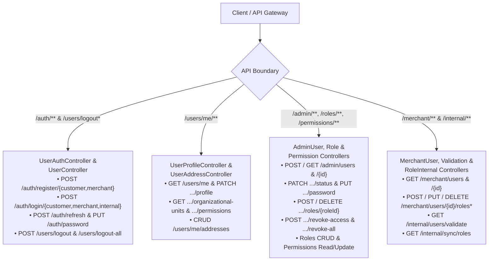
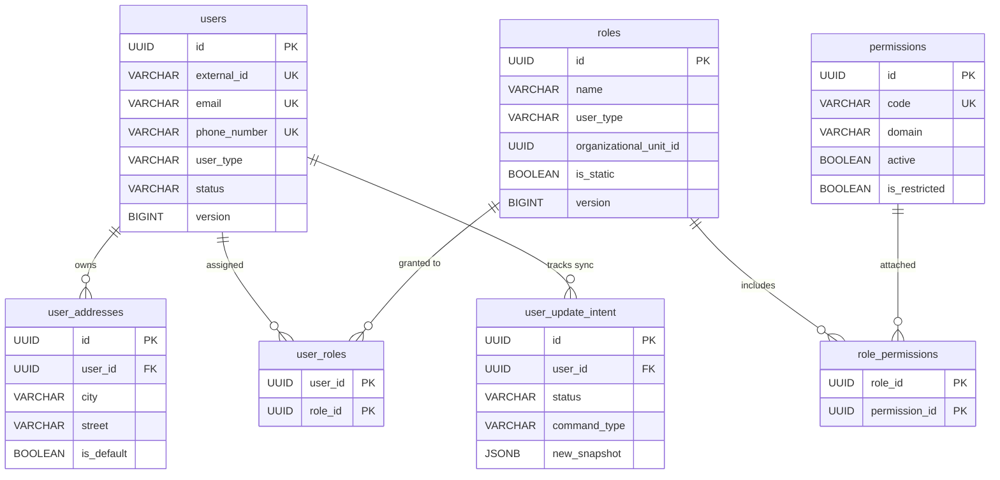

# Identity Service Specification

## 1. Domain Overview & Subdomain Scope

The **Identity Service** (`identity-service`, local port `:8184`, PostgreSQL schema `identity`) is the central authentication, user lifecycle, and decentralized RBAC authority of the **Take My Order** platform. Exposed through the API Gateway under `/auth/**`, `/users/**`, `/admin/**`, `/merchant/**`, `/roles/**`, and `/permissions/**` (while `/internal/**` remains strictly cluster-internal and unrouted at the gateway), it bridges Keycloak IAM with local domain identity and broadcasts role, permission, and customer events across the cluster.

### 1.1 Core Subdomain Responsibilities
*   **Portal-Segregated Authentication & Session Proxy:** Brokers login, token refresh, registration, and password management against Keycloak (`Direct Access Grant`), blocking `BANNED` accounts before login and verifying that the JWT `user_type` (`CUSTOMER`, `MERCHANT`, `INTERNAL`) matches the target portal before returning tokens ([Keycloak Architecture](../security/keycloak-architecture.md)).
*   **Decentralized RBAC Authority:** Owns the master catalog of roles (time-ordered UUIDv7 `RoleId`), permissions (`is_restricted` delegation flags), and branch-scoped assignments, caching role lookups locally via Caffeine (`roles_cache`, `15m` TTL) and replicating mutations to downstream services via Transactional Outbox and Kafka ([RBAC Governance](../security/rbac-governance.md)).
*   **Crash-Safe PostgreSQL ↔ Keycloak Synchronization:** Coordinates distributed profile, status, role, and branch updates through the `user_update_intent` state machine so partial failures never leave PostgreSQL and Keycloak diverged ([User Update Engine](../security/user-update-engine.md)).
*   **Instant Session & Role Revocation:** Writes fine-grained revocation markers (`sid`, `user`, and `role` keys) into Redis for sub-millisecond enforcement inside downstream microservice security filters (`JwtAuthenticationFilter` / `JwtSecurityFilter`) and token refresh flows ([Token Lifecycle & Revocation](../security/token-lifecycle-and-revocation.md)).
*   **Multi-Tenant Branch Synchronization:** Consumes restaurant lifecycle and personnel events from `restaurant-service` to maintain `organizational_units_replica`, auto-provision static branch-scoped `RESTAURANT_OWNER` roles, and synchronize branch staff memberships.

---

## 2. Technical Architecture & Module Structure

Adhering to Hexagonal (Ports & Adapters) architecture, `identity-service` isolates pure identity/RBAC invariants from persistence, Keycloak Admin API calls, Redis revocation, and Kafka messaging:

```text
identity-service/
 ├── identity-domain/
 │    ├── identity-domain-core
 │    │    └── Entities: User, Role (UUIDv7), Permission, Address,
 │    │        UserUpdateIntent; IdentityDomainServiceImpl
 │    └── identity-application-service
 │         └── Auth, Profile, Address, Admin, Merchant, Role/Perm
 │             Handlers; Intent & Outbox Schedulers
 ├── identity-dataaccess
 │    └── JPA Entities (10+), Repositories, TokenRevocationAdapter
 │        (Redis), Flyway Migrations
 ├── identity-infrastructure
 │    └── KeycloakIdentityProviderAdapter (Admin REST & Token API)
 ├── identity-messaging
 │    └── Kafka Publishers (Roles, Permissions, Customer)
 │        Kafka Listeners (RestaurantInfo, Personnel)
 ├── identity-application
 │    └── REST Controllers, SecurityConfig, JwtAuthenticationFilter,
 │        RoleAuthorizationService
 └── identity-container
      └── Spring Boot Entry Point, BeanConfiguration, application.yml
```

---

## 3. REST API Contract & Endpoint Taxonomy

`identity-service` exposes **25+ REST endpoints** across dedicated controllers. Public auth/registration routes and cluster-internal sync routes are permitted at `SecurityConfig`, while all user, merchant, and backoffice routes require a verified JWT (checked against Redis revocation keys in `JwtAuthenticationFilter`) and enforce stateless RBAC via `RoleAuthorizationService` (`roleAuthService`).



### 3.1 Authentication, Sessions & Self-Service

Controllers: `UserAuthController`, `UserController`, `UserProfileController`, `UserAddressController`.

| Endpoint | Authorization | Description |
| :--- | :--- | :--- |
| `POST /auth/register/`<br/>`{customer,merchant}` | Public | Registers a `CUSTOMER` or `MERCHANT` account in Keycloak and PostgreSQL (compensates Keycloak user on DB failure; customer registration publishes `CustomerAvroModel`). |
| `POST /auth/login/`<br/>`{customer,merchant,internal}` | Public | Portal-segregated login; blocks `BANNED` accounts locally, authenticates via Keycloak, and asserts the JWT `user_type` matches the portal before returning tokens. |
| `POST /auth/refresh` | Public | Rejects revoked sessions/users (`ALL_TOKENS_REVOKED`) via Redis `checkTokenRevocation` before exchanging the refresh token in Keycloak. |
| `PUT /auth/password` | Authenticated (Self) | Verifies the caller's current password via Keycloak login and confirms matching new password before updating credentials. |
| `POST /users/logout` &<br/>`POST /users/logout-all` | Authenticated (Self) | Writes instant revocation markers to Redis (`sid:{sid}:revoke` for current device or `user:{userId}:revoke` for all devices, `7d` TTL) without a synchronous Keycloak roundtrip. |
| `GET /users/me` &<br/>`PATCH /users/me/profile` | Authenticated (Self) | Reads profile details or updates profile fields (e.g., `firstName`, `lastName`, `imageUrl`, `dateOfBirth`) via crash-safe `user_update_intent`. |
| `GET /users/me/`<br/>`organizational-units` &<br/>`GET /users/me/permissions` | Authenticated (Self) | Returns the caller's branch UUID bindings and deduplicated effective permissions across assigned roles. |
| `GET / POST / PUT / DELETE`<br/>`/users/me/addresses` *(+ `/{id}`)* | Authenticated (Self) | Full CRUD for structured delivery addresses with automatic single-default toggling (`isDefault`). |

### 3.2 Admin Backoffice, Roles & Permissions

Controllers: `AdminUserController`, `RoleController`, `PermissionController`. *(All `/admin/users/**` routes additionally require `authentication.userType == 'INTERNAL'`.)*

| Endpoint | Authorization | Description |
| :--- | :--- | :--- |
| `POST /admin/users` | `can_manage_system_settings` | Creates an `INTERNAL` backoffice user across Keycloak and PostgreSQL. |
| `GET /admin/users` &<br/>`GET /admin/users/{userId}` | `can_view_users` | Paginated platform-wide user search (e.g., by `email`, `status`, `userType`, `orgUnitId`, `roleId`) and account detail lookup. |
| `PATCH /admin/users/`<br/>`{userId}/status` | `can_update_user_status` | Transitions account status (`ACTIVE`, `BLOCKED`, `BANNED`, etc.) via `user_update_intent`, syncs Keycloak enabled state, and revokes all user tokens in Redis. |
| `PUT /admin/users/`<br/>`{userId}/password` | `can_reset_password` | Administrative force-reset of a target user's password in Keycloak. |
| `POST` / `DELETE /admin/users/`<br/>`{userId}/roles/{roleId}` | `can_manage_system_settings`<br/>*(+ handler `can_assign_role`)* | Assigns or unassigns a role via `user_update_intent`, syncs Keycloak attributes, and revokes the target's active access token (`5m` TTL). |
| `POST /admin/users/{userId}/`<br/>`revoke-access` & `revoke-all` | `can_revoke_user` | Immediately writes access-token (`5m` TTL) or global (`7d` TTL) revocation markers to Redis. |
| `GET / POST / PUT / DELETE`<br/>`/roles` *(+ `/{roleId}`)* | `can_view_roles` /<br/>`canCreateRole` / `canUpdateRole`<br/>/ `canDeleteRole` | Manages global and branch-scoped roles under Subset Delegation rules, emits `role_outbox` events, evicts local `roles_cache`, and revokes role tokens on updates. |
| `GET /permissions`,<br/>`GET /permissions/grouped` &<br/>`PUT /permissions/{id}` | `can_view_permissions`<br/>*(authenticated on `PUT`)* | Lists permissions (flat or domain-grouped by caller persona) and updates metadata/active state—emitting `permission_outbox` events whenever `active` toggles. |

### 3.3 Merchant Team & Internal Service Integration

Controllers: `MerchantUserController`, `UserValidationController`, `RoleInternalController`.

| Endpoint | Authorization | Description |
| :--- | :--- | :--- |
| `GET /merchant/users` &<br/>`GET /merchant/users/{userId}` | `can_view_merchant_users`<br/>*(scoped to `#orgUnitId`)* | Lists or inspects staff assigned to a specific branch (`orgUnitId`) with optional filters (e.g., `email`, `firstName`, `roleId`). |
| `PUT /merchant/users/`<br/>`{userId}/roles?orgUnitId=...` | `can_assign_role`<br/>*(scoped to `#orgUnitId`)* | Batch-replaces a staff member's branch-scoped roles via `user_update_intent` under Subset Delegation checks (protecting `RESTAURANT_OWNER` from redundant personnel roles) and revokes access token. |
| `POST` / `DELETE /merchant/`<br/>`users/{userId}/roles/{roleId}` | Authenticated<br/>*(handler `can_assign_role`)* | Assigns or unassigns a single branch-scoped role after validating requester branch scope, syncing Keycloak, and revoking access token. |
| `GET /internal/users/validate` | Cluster-Internal Only | Called synchronously by `restaurant-service` (`?email=...`) to verify user eligibility before onboarding branch personnel (unexposed at API Gateway). |
| `GET /internal/sync/roles` | Cluster-Internal Only | Cursor-paginated snapshot (`?cursor=...&limit=100`) powering downstream `RoleInitialSyncJob` bootstrap and manual resyncs (unexposed at API Gateway). |

---

## 4. Data Model & Persistence Architecture (`identity` Schema)

Schema evolution is managed via Flyway migration scripts (`identity-dataaccess/src/main/resources/db/migration/`) with Hibernate `ddl-auto: validate`. The relational model separates core user profiles, structured delivery addresses, RBAC definitions, crash-safe update intents, and transactional outboxes:



| Table | Role & Lifecycle | Key Constraints, Locks & Indexes |
| :--- | :--- | :--- |
| `identity.users` &<br/>`user_organizational_units` | Master user account record bridging internal UUID with Keycloak `external_id`, `user_type`, `status` (`PENDING_VERIFICATION`, `PENDING_APPROVAL`, `ACTIVE`, `BLOCKED`, `BANNED`), and branch bindings. | `UNIQUE` on `external_id`, `email`, and `phone_number`; optimistic `@Version` prevents concurrent profile/status overwrites. |
| `identity.user_addresses` | Isolated delivery address aggregate storing structured address fields, recipient contact info, coordinates, and `is_default`. | `FK (user_id)` with `ON DELETE CASCADE`; setting a default address atomically clears prior defaults for that user. |
| `identity.roles`,<br/>`identity.permissions`,<br/>`role_permissions` & `user_roles` | Decentralized RBAC catalog supporting platform-global roles (`organizational_unit_id IS NULL`) and branch-scoped roles (`UUIDv7` `RoleId`, `is_static` guard, `is_restricted` delegation guard). | Partial unique indexes `uq_roles_name_unit` (`WHERE organizational_unit_id IS NOT NULL`) and `uq_roles_name_global` (`WHERE organizational_unit_id IS NULL`); `UNIQUE (code)` on permissions; `@Version` on roles. |
| `identity.`<br/>`user_update_intent` | Crash-safe coordination ledger serializing multi-store updates across Keycloak and PostgreSQL (`STARTED`, `KEYCLOAK_DONE`, `COMPLETED`, `FAILED`, `DISCARDED`). | Partial unique index `idx_user_active_intent` on `(user_id) WHERE status IN ('STARTED', 'KEYCLOAK_DONE')` enforces at most one in-flight distributed update per user; optimistic `@Version`. |
| `identity.role_outbox` &<br/>`identity.permission_outbox` | Transactional Outbox tables storing serialized `TEXT` event payloads atomically alongside RBAC mutations. | Polled every `10,000 ms` with `@Version` optimistic locking and `@midnight` cleanup of `COMPLETED` records. |
| `identity.`<br/>`organizational_units_`<br/>`replica` | Read replica of active business units (e.g., restaurants) populated asynchronously from `restaurant-information`. | Indexed on `(type)` (`idx_org_units_replica_type`) for tenant lookup and role-scoping validation. |

---

## 5. Crash-Safe Synchronization & Instant Token Revocation

### 5.1 Distributed User Update Intent Engine
Mutating user profiles, account statuses, role assignments, or branch memberships requires updating both Keycloak and PostgreSQL. Because Keycloak does not participate in PostgreSQL ACID transactions, `identity-service` records an intent row (`STARTED`) guarded by `idx_user_active_intent`, invokes Keycloak outside any open DB transaction, transitions the intent to `KEYCLOAK_DONE`, and then commits the local PostgreSQL update (`COMPLETED`):

*   **Background Recovery (`fixedDelay = 60,000 ms`):** `UserUpdateIntentScheduler` scans stuck `STARTED` and `KEYCLOAK_DONE` rows without holding a DB connection open during Keycloak retries, automatically replaying unfinished profile (`UpdateUserProfileCommand`) and status (`UpdateUserStatusCommand`) phases.
*   **Anti-Deadlock Stale Cutoff (`15 min`):** Any intent stuck longer than 15 minutes is automatically transitioned to `DISCARDED` so a transient error can never permanently lock a user's account updates ([User Update Engine](../security/user-update-engine.md)).

### 5.2 Redis Instant Token Revocation
Stateless JWTs remain cryptographically valid until expiry; to achieve immediate revocation across downstream microservices (`JwtAuthenticationFilter` / `JwtSecurityFilter`) and `POST /auth/refresh` without stateful session tables, `TokenRevocationAdapter` maintains Redis key patterns queried in a single batched `multiGet` per request:

*   **Single-Session Logout:** `sid:{sessionId}:revoke` (`{"type":"single_logout"}`, TTL `7 days`) — blocks that specific device session while leaving other devices active.
*   **User-Wide Access or Global Revocation:** `user:{userId}:revoke` with `iat` timestamp (`access_token` TTL `5 min` on role/branch changes; `all_tokens` TTL `7 days` on global logout or status ban), evaluated with a `+5s` clock-skew tolerance.
*   **Role-Wide Invalidation:** `role:{roleId}:revoke` (`{"type":"role_updated", "iat":...}`, TTL `5 min`) — forces immediate refresh for every user holding a mutated role ([Token Lifecycle & Revocation](../security/token-lifecycle-and-revocation.md)).

---

## 6. Event-Driven Messaging (Kafka Producers & Consumers)

Kafka producers publish Confluent Avro records (`acks: all`, `retry-count: 5`) via `RoleOutboxScheduler` and `PermissionOutboxScheduler` (`10,000 ms` polling, `@midnight` cleanup) as well as customer onboarding events. Inbound consumers run as batch listeners (`concurrency-level: 3`, `auto-offset-reset: earliest`).

### 6.1 Outbound Topics

| Topic & Avro Contract | Publisher & Mechanism | Behavior & Consumers |
| :--- | :--- | :--- |
| `identity-role-events`<br/>`RoleEventAvroModel` | `RoleEventKafkaPublisher`<br/>(`RoleOutboxScheduler` → `role_outbox`) | Emits `ROLE_CREATED`, `ROLE_UPDATED` (full permission set), and `ROLE_DELETED` to synchronize `roles_replica` across `order-service`, `payment-service`, and `restaurant-service`. |
| `identity-permission-events`<br/>`PermissionEventAvroModel` | `PermissionEventKafkaPublisher`<br/>(`PermissionOutboxScheduler` → `permission_outbox`) | Broadcasts `PERMISSION_UPDATED` metadata (`active`, `isRestricted`, `domain`) when a permission's active state toggles to update downstream `permissions_replica` tables. |
| `customer`<br/>`CustomerAvroModel` | `CustomerEventKafkaPublisher`<br/>*(on customer registration)* | Bootstraps customer read models in `order-service` (`"order".customers`) and initial zero-balance customer wallets in `payment-service`. |

### 6.2 Inbound Topics

| Topic & Avro Contract | Listener & Consumer Group | Purpose |
| :--- | :--- | :--- |
| `restaurant-information`<br/>`RestaurantInformationAvroModel` | `RestaurantInformation`<br/>`KafkaListener`<br/>(`identity-restaurant-info-topic-consumer`) | On `RESTAURANT_CREATED`, records the branch in `organizational_units_replica`, provisions a static branch-scoped `RESTAURANT_OWNER` role (`UUIDv7`) via `role_outbox`, syncs Keycloak attributes, and revokes the owner's access token (`RESTAURANT_UPDATED` is ignored). |
| `restaurant-personnel`<br/>`RestaurantPersonnelAvroModel` | `RestaurantPersonnel`<br/>`KafkaListener`<br/>(`identity-restaurant-personnel-topic-consumer`) | Processes `PERSONNEL_ADDED` and `PERSONNEL_REMOVED` via `user_update_intent`, syncing Keycloak attributes, binding/revoking branch memberships and roles, and revoking the user's access token. |
