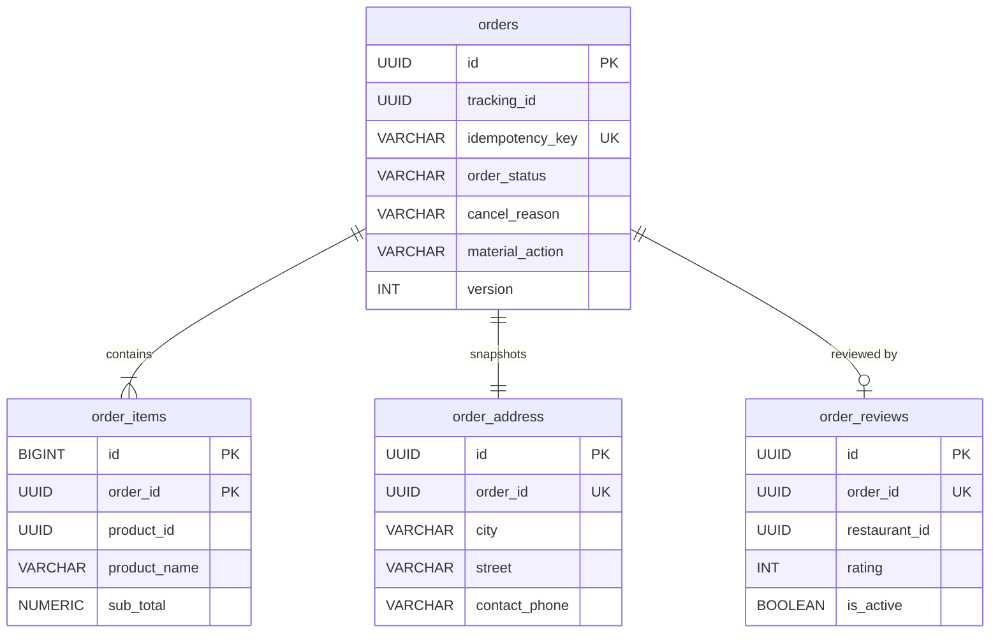

# Order Service (Saga Orchestrator) Specification

## 1. Domain Overview & Subdomain Scope

The **Order Service** (`order-service`, local port `:8181`) is the core domain microservice of the **Take My Order** platform. Operating within the `"order"` PostgreSQL schema, it governs the end-to-end checkout and fulfillment lifecycle and serves as the **Distributed SAGA Orchestrator**, coordinating forward and compensating transactions across the Payment and Restaurant bounded contexts.

### 1.1 Core Subdomain Responsibilities
*   **Checkout & Order Placement:** Validates order items against local CQRS read replicas (`restaurant_replica`, `product_replica`), verifies pricing totals (items + delivery fee) and minimum order rules, snapshots immutable product names and delivery addresses, and enforces `Idempotency-Key` deduplication.
*   **Distributed SAGA Orchestration:** Manages the 10-state finite state machine (`PENDING` → `PAID` → `WAITING_FOR_APPROVAL` → `APPROVED` → `PREPARING` → `READY_FOR_PICKUP` → `IN_DELIVERY` → `DELIVERED` / `CANCELLING` → `CANCELLED`) through the **In-Place Outbox State Machine** and **Symmetric Fork-Join Compensation Barrier**.
*   **Multi-Outbox Coordination:** Persists transactional outbox rows across `"order".payment_outbox`, `"order".restaurant_approval_outbox`, `"order".delivery_outbox`, and `"order".restaurant_rating_outbox` in the same ACID transaction as aggregate mutations.
*   **Waste Accounting & Verified Reviews:** Records kitchen/courier cancellation outcomes (`MaterialAction.RESTORE_STOCK` vs. `RECORD_WASTE`), handles post-delivery customer reviews, single merchant replies, irreversible admin moderation, and asynchronous rating projection.

---

## 2. Technical Architecture & Module Structure

```text
order-service/
 ├── order-domain/
 │    ├── order-domain-core         (Order, OrderItem, OrderReview, StreetAddress)
 │    └── order-application-service (OrderPaymentSaga, OrderApprovalSaga, Outbox)
 ├── order-dataaccess               (JPA, OrderSpecifications, Flyway Migrations)
 ├── order-messaging                (Kafka Producers/Consumers, Avro Mappers)
 ├── order-application              (REST Controllers, OrderAuthService)
 └── order-container                (Main Entry Point, BeanConfiguration, YAML)
```

*(Shared lifecycle enums such as `OrderStatus`, `CancelReason`, and `MaterialAction` reside in `common-domain`.)*

---

## 3. REST API Contract & Endpoint Taxonomy

`order-service` exposes **20+ REST endpoints** across dedicated controllers (e.g., `OrderController`, `RestaurantOrderQueryController`, `OrderReviewController`, `RoleManagementController`):

### 3.1 Customer & Admin Order Endpoints (`OrderController`)

| Endpoint | Authorization (`@PreAuthorize` / `@PostAuthorize`) | Description |
| :--- | :--- | :--- |
| `POST /orders` | `isCustomer` | Creates an order (`Idempotency-Key` required). Returns `200 OK` (new or replay) with `orderTrackingId`, `orderStatus`, and `message`; writes `payment_outbox` (`STARTED`). |
| `GET /orders` | `isCustomer` | Paginated customer order history with `?filter=ALL` / `ACTIVE` / `COMPLETED` / `CANCELLED` (`page`, `size`) and single-query `COUNT(*) FILTER` badge counts. |
| `GET /orders/{trackingId}/track` | `isCustomer` + `@PostAuthorize(isOwner)` | Live customer order status tracking (`TrackOrderResponse`) by `trackingId`. |
| `GET /orders/{orderId}` | `isOrderCustomer` or `can_read_all_orders` | Full customer order breakdown (`CustomerOrderDetailResponse`) including items, delivery address, `cancelReason`, `deliveredAt`, and `isReviewed`. |
| `GET /orders/{orderId}/detail` | `hasPermissionForOrder` (`can_read_orders`) | Merchant/admin operational breakdown (`RestaurantOrderResponse`) including `deliveryAddress`, `materialAction`, and `internalNote`. |
| `GET /orders/admin/{trackingId}` | `hasPermission` (`can_read_all_orders`) | Backoffice platform-wide order lookup by `trackingId`. |

### 3.2 Merchant Queue & Operational Lifecycle (`RestaurantOrderQueryController` & `OrderController`)

| Endpoint | Authorization (`@PreAuthorize`) | Description |
| :--- | :--- | :--- |
| `GET /orders/restaurants/`<br>`{restaurantId}` *(QueryController)* | `hasPermissionForRestaurant`<br>(`can_read_orders`) or `can_read_all_orders` | Paginated merchant order queue (`status`, `search`, `page`, `size=20`, `sort`) protected by the Dark Area Shield (`OrderSpecifications`). |
| `GET /orders/restaurants/`<br>`{restaurantId}/summary` *(QueryController)* | `hasPermissionForRestaurant`<br>(`can_read_orders`) or `can_read_all_orders` | Single-query dashboard counters (`totalCount`, `waitingCount`, `approvedCount`, `preparingCount`, `readyCount`, `inDeliveryCount`, `deliveredCount`, `cancelledCount`). |
| `POST /orders/{orderId}/approve` | `hasPermissionForOrder`<br>(`can_approve_order`) | Kitchen confirms order (`WAITING_FOR_APPROVAL` → `APPROVED`, Zero Kafka). |
| `POST /orders/{orderId}/`<br>`start-preparing` | `hasPermissionForOrder`<br>(`can_start_preparing_order`) | Kitchen starts cooking (`APPROVED` → `PREPARING`, Zero Kafka). |
| `POST /orders/{orderId}/`<br>`ready-for-pickup` | `hasPermissionForOrder`<br>(`can_ready_order`) | Packaging complete (`PREPARING` → `READY_FOR_PICKUP`, Zero Kafka). |
| `POST /orders/{orderId}/`<br>`start-delivery` | `hasPermissionForOrder`<br>(`can_start_delivery`) | Courier transit starts (`READY_FOR_PICKUP` → `IN_DELIVERY`, Zero Kafka). |
| `POST /orders/{orderId}/deliver` | `hasPermissionForOrder`<br>(`can_deliver_order`) | Handover complete (`IN_DELIVERY` → `DELIVERED`); seals SAGA outbox rows as `SUCCEEDED` and writes `delivery_outbox` (`STARTED`). |
| `POST /orders/{orderId}/cancel` | `hasCancelPermissionForOrder` | Stage-specific operational cancel (`can_cancel_waiting_order`, `can_cancel_approved_order`, `can_cancel_preparing_order`, `can_cancel_ready_order`, `can_cancel_in_delivery_order`, plus idempotent replay check). |
| `POST /orders/{orderId}/`<br>`force-cancel` | `hasPermission`<br>(`can_force_cancel_order`) | Emergency admin cancel requiring `adminReason` (min 10 chars) and optional `forceRefund` (`default = false`). |

### 3.3 Verified Reviews & Role Sync (`OrderReviewController` & `RoleManagementController`)

| Endpoint | Authorization (`@PreAuthorize`) | Description |
| :--- | :--- | :--- |
| `POST /orders/{orderId}/reviews` | `isOrderCustomer` | Submits verified post-delivery review (`201 Created`, 1–5 rating, 7-day window) and writes `restaurant_rating_outbox`. |
| `GET /orders/{orderId}/review` | `isOrderCustomer` | Returns the customer's submitted review, merchant reply, and moderation state for a specific order. |
| `POST /orders/restaurants/`<br>`{restaurantId}/reviews/`<br>`{reviewId}/reply` | `hasPermissionForRestaurant`<br>(`can_reply_restaurant_review`) | Merchant single official reply within 7 days (`OrderAuthService` restricts to restaurant-scoped roles; platform `SYSTEM_ADMIN` is blocked). |
| `DELETE /orders/restaurants/`<br>`{restaurantId}/reviews/`<br>`{reviewId}` | `hasPermission`<br>(`can_delete_restaurant_review`) | Irreversible admin soft-deletion (`is_active = false`); recalculates rating via `restaurant_rating_outbox`. |
| `GET /orders/restaurants/`<br>`{restaurantId}/reviews` | Public (`permitAll`) | Paginated active reviews with `?status=ALL` / `PENDING` / `REPLIED`, reply counters, and per-item `canReply`. |
| `GET /orders/admin/restaurants/`<br>`{restaurantId}/reviews` | `hasPermission`<br>(`can_delete_restaurant_review`) | Admin moderation feed supporting `?status=ALL` / `ACTIVE` / `DELETED` and audit metadata. |
| `POST /management/sync-roles`<br>*(GW: `/orders/management/`*<br>*`sync-roles`)* | `hasPermission`<br>(`order_service_can_sync_roles`) | Manual/M2M trigger (`RoleManagementController`) that truncates local role replicas and resyncs from `identity-service`. |

---

### 3.4 Client Ingress Idempotency (`Idempotency-Key` Specification)

To eliminate duplicate orders, double-charging, and duplicate SAGA executions caused by network retries or checkout double-clicks, `POST /orders` enforces the **IETF Idempotency-Key** header contract:

*   **Mandatory HTTP Header:** Every checkout request must supply an `Idempotency-Key` header (trimmed before persistence).
*   **Edge Validation (`OrderGlobalExceptionHandler`):**
    *   *Missing Header:* Returns `400 Bad Request` (`errorCode: MISSING_REQUEST_HEADER`).
    *   *Blank / Whitespace Header:* Returns `400 Bad Request` via `OrderDomainException` (`"Idempotency-Key header cannot be blank!"`).
*   **Behavior on Replay:**
    *   *New Key:* `OrderCreateCommandHandler` persists the order with `idempotency_key`, writes the initial `payment_outbox` record (`STARTED`), and returns `200 OK` with `orderTrackingId`, `orderStatus: PENDING`, and `"Order created successfully"`.
    *   *Existing Key (Idempotent Hit):* `OrderRepository.findByIdempotencyKey(...)` returns the existing order, skips duplicate SAGA creation, and responds `200 OK` with the current `orderStatus` and `"Order already created successfully"`.
    *   *Database Race Safety Net:* Protected by PostgreSQL unique constraint `orders_idempotency_key_key` + B-Tree index `idx_orders_idempotency_key`; concurrent duplicate races return `409 Conflict` (`errorCode: DATA_INTEGRITY_VIOLATION`).

---

## 4. Query Optimization, Dark Area Shield & Role-Based Projections

### 4.1 Role-Based DTO Projections (Preventing Internal Data Leakage)

`order-service` segregates customer-facing and operational responses so kitchen waste accounting (`materialAction`) and internal notes never leak into customer order history or order details:

*   **Customer History & Detail (`OrderSummary`, `CustomerOrderDetailResponse`):** Expose `orderId`, `orderTrackingId`/`trackingId`, `restaurantName`, `orderStatus`, pricing, items, `cancelReason`, `deliveredAt`, and `isReviewed` — strictly excluding `materialAction` and `internalNote`.
*   **Live Tracking (`TrackOrderResponse`):** Exposes `orderTrackingId`, `customerId`, `orderStatus`, `failureMessages`, `cancelReason`, and `internalNote` (never `materialAction`).
*   **Merchant & Backoffice (`RestaurantOrderResponse`):** Exposes full operational context including `orderId`, `trackingId`, `restaurantId`, `orderStatus`, `price`, `deliveryFee`, `createdAt`, immutable `items` (`productName`, `quantity`, `price`, `subTotal`), `deliveryAddress` (`DeliveryAddressResponse` with city/district/neighborhood/street/building/door/floor/instructions and contact details), `cancelReason`, `materialAction`, and `internalNote`.

### 4.2 Customer Order History Filtering & Single-Query Badge Aggregation (`GET /orders`)

`OrderFilterGroup` maps customer tabs to exact status sets (with `ALL` prioritizing active orders first via `findByCustomerIdWithActivePriority`):

*   `ACTIVE` → `('PENDING', 'PAID', 'WAITING_FOR_APPROVAL', 'APPROVED', 'PREPARING', 'READY_FOR_PICKUP', 'IN_DELIVERY')`
*   `COMPLETED` → `('DELIVERED')`
*   `CANCELLED` → `('CANCELLING', 'CANCELLED')`

`OrderJpaRepository.getCustomerOrdersSummary(customerId)` computes all tab counters in a **single PostgreSQL `COUNT(*) FILTER` scan** (and `getRestaurantOrdersSummary(restaurantId)` applies the same single-pass pattern for merchant dashboard counters):

```sql
SELECT
    COUNT(*) AS "allCount",
    COUNT(*) FILTER (WHERE order_status IN (
        'PENDING', 'PAID', 'WAITING_FOR_APPROVAL',
        'APPROVED', 'PREPARING', 'READY_FOR_PICKUP', 'IN_DELIVERY'
    )) AS "activeCount",
    COUNT(*) FILTER (
        WHERE order_status = 'DELIVERED'
    ) AS "succeededCount",
    COUNT(*) FILTER (
        WHERE order_status IN ('CANCELLING', 'CANCELLED')
    ) AS "abortCount"
FROM "order".orders
WHERE customer_id = :customerId;
```

### 4.3 Merchant Order Queue (`OrderSpecifications` & Dark Area Shield)

When merchant staff query `GET /orders/restaurants/{restaurantId}`, `OrderSpecifications.createRestaurantFilter(...)` enforces three database-level guarantees:

1.  **The Dark Area Shield:** Orders still in `PENDING` or `PAID` (not yet stock-validated by `restaurant-service`) and orders cancelled with `cancelReason == PAYMENT_FAILED` are excluded directly in SQL so unpaid or unvalidated orders never appear on kitchen screens:
    ```java
    // Exclude PENDING and PAID orders before kitchen validation
    predicates.add(cb.not(root.get("orderStatus").in(darkAreaStatuses)));
    predicates.add(cb.or(
        cb.isNull(root.get("cancelReason")),
        cb.notEqual(root.get("cancelReason"), CancelReason.PAYMENT_FAILED)
    ));
    ```
2.  **Conditional `LEFT JOIN` Search on `order_address`:** When `search` is blank, zero joins are executed. Only when `search` is provided does Criteria API attach `LEFT JOIN o.address` to match space-stripped customer full names (`replace(coalesce(contactFirstName,'') || coalesce(contactLastName,''), ' ', '')`), `contactPhone`, or `text(trackingId)`.
3.  **N+1 Batching (`@BatchSize(size = 20)`) & Operational Priority Sorting:**
    *   `OrderEntity.items` uses `@BatchSize(size = 20)` to batch-load order line items across a page.
    *   When `status == null` (All Orders), a `CASE WHEN` expression orders active operational stages first (`WAITING_FOR_APPROVAL` → `APPROVED` → `PREPARING` → `READY_FOR_PICKUP` → `IN_DELIVERY` → `CANCELLING` → `DELIVERED` → `CANCELLED`), broken by the secondary sort (`createdAt ASC` FIFO by default, or explicit `sort=createdAt,desc|createdAt,asc|price,desc|price,asc`).

---

## 5. Data Model & Persistence Architecture (`"order"` Schema)

Schema evolution is managed via Flyway migration scripts (`order-dataaccess/src/main/resources/db/migration/`) with Hibernate `ddl-auto: validate`. The aggregate snapshots immutable purchase details at checkout and coordinates dedicated Transactional Outbox tables in the same ACID transaction:



| Table | Role & Lifecycle | Key Constraints, Locks & Indexes |
| :--- | :--- | :--- |
| `"order".orders` | Core `Order` aggregate root holding the 10-state FSM (`order_status`), `cancel_reason`, `material_action`, `internal_note`, and review/delivery timestamps. | `UNIQUE (idempotency_key)` + `idx_orders_idempotency_key`; optimistic `@Version`; composite queue/history indexes on `(restaurant_id, order_status)`, `(customer_id, order_status, created_at DESC)`, and `(tracking_id)`. |
| `"order".order_items` &<br/>`"order".order_address` | Immutable checkout snapshots of ordered line items (`product_name`, unit price, quantity) and structured Turkish delivery address + recipient contact details. | Composite PK `(id, order_id)` on items; `UNIQUE (order_id)` 1:1 FK on address (`ON DELETE CASCADE`); `@BatchSize(size = 20)` eliminates N+1 queries on merchant pages. |
| `"order".order_reviews` | Verified post-delivery customer reviews (`rating` 1–5), single merchant reply, and irreversible admin soft-delete audit (`is_active`, `deactivated_by`). | `UNIQUE (order_id)` (1 review per order) + `CHECK (rating BETWEEN 1 AND 5)`; partial covering indexes (`WHERE is_active = TRUE`) on `(restaurant_id, created_at DESC)` for pagination and `(restaurant_id, rating)` for O(log N) rating recalculation. |
| `"order".payment_outbox` &<br/>`"order".restaurant_approval_outbox` | In-Place SAGA outbox tables tracking forward (`PROCESSING` / `STARTED`) and compensating (`COMPENSATING` / `COMPENSATED`) transitions (`TEXT` JSON payload). | Composite `UNIQUE (type, saga_id, saga_status)` enforces SAGA idempotency and powers the Symmetric Fork-Join Compensation Barrier; optimistic `@Version` guards concurrent scheduler updates. |
| `"order".delivery_outbox` &<br/>`"order".restaurant_rating_outbox` | Dedicated choreography outboxes dispatching `order-delivered` (escrow payout release) and `restaurant-rating-updated` (catalog rating projection). | Scoped by `order_id` and `restaurant_id` respectively with `TEXT` payloads, `outbox_status` lifecycle (`STARTED`, `COMPLETED`, `FAILED`), and `@Version`. |

*(Local CQRS & RBAC read replicas — `customers`, `restaurant_replica`, `product_replica`, `roles_replica`, `permissions_replica`, and `role_permissions_replica` — are maintained asynchronously within the same `"order"` schema.)*

---

## 6. Kafka Messaging Infrastructure

### 6.1 Outbound Topics (Producers)
*   `payment-request`: Publishes `PaymentRequestAvroModel` (`OrderPaymentEventKafkaPublisher`) on order creation (`PENDING`) or refund compensation (`CANCELLING`).
*   `restaurant-approval-request`: Publishes `RestaurantApprovalRequestAvroModel` (`OrderApprovalEventKafkaPublisher`) after payment confirmation (`PAID`) or stock-restoration compensation (`CANCELLING` with `RESTORE_STOCK`).
*   `order-delivered`: Publishes `OrderDeliveredAvroModel` (`OrderDeliveredEventKafkaPublisher`) via `delivery_outbox` upon `DELIVERED`, triggering escrow release in `payment-service`.
*   `restaurant-rating-updated`: Publishes `RestaurantRatingUpdatedAvroModel` (`RestaurantRatingEventKafkaPublisher`) via `restaurant_rating_outbox` when a review is created or soft-deleted.

### 6.2 Inbound Topics (Consumers)
*   `payment-response`: Consumes `PaymentResponseAvroModel` (`COMPLETED`, `CANCELLED`, or `FAILED`).
*   `restaurant-approval-response`: Consumes `RestaurantApprovalResponseAvroModel` (`APPROVED`, `VALIDATED`, or `REJECTED` — stock restoration compensation replies with `REJECTED`).
*   `restaurant-information`: Consumes `RestaurantInformationAvroModel` to synchronize `"order".restaurant_replica` and `"order".product_replica`.
*   `customer`: Consumes `CustomerAvroModel` (`CustomerKafkaListener`) to populate `"order".customers`.
*   `identity-role-events` & `identity-permission-events`: Consume `RoleEventAvroModel` and `PermissionEventAvroModel` to maintain `"order".roles_replica`, `"order".permissions_replica`, and `"order".role_permissions_replica`.
