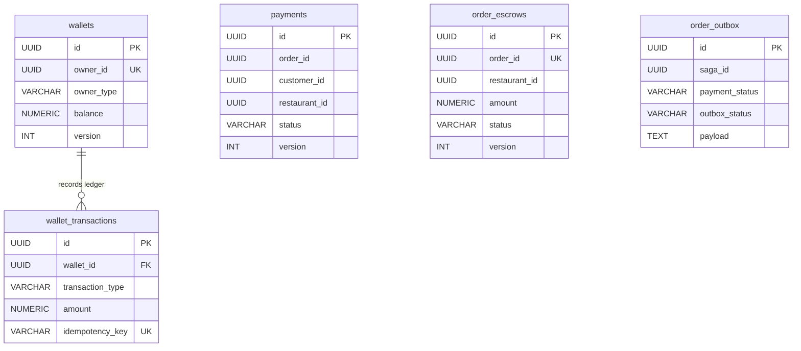
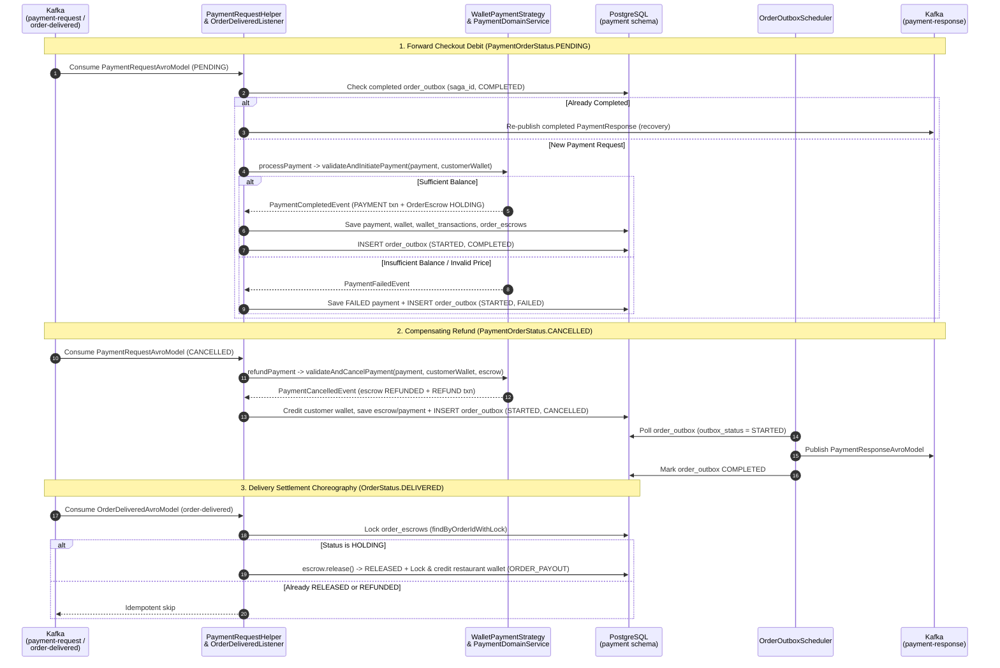

# Payment Service Specification

## 1. Domain Overview & Subdomain Scope

The **Payment Service** (`payment-service`, local port `:8182`) manages customer and merchant wallets, immutable financial transaction ledgers, order-scoped escrow custody, and SAGA payment/refund processing across the **Take My Order** platform. Operating within the `payment` PostgreSQL schema, it acts as an asynchronous participant in the distributed SAGA orchestrated by `order-service` and settles merchant payouts upon delivery.

### 1.1 Core Subdomain Responsibilities
*   **Wallet Hierarchy & Non-Negative Invariants:** Maintains `CustomerWallet` and `RestaurantWallet` balances (`Wallet` aggregate root) with pessimistic row locking (`findByOwnerIdWithLock`) during deposits, withdrawals, and escrow payouts.
*   **Deposit Cap Governance:** Enforces a single-transaction maximum deposit threshold (`Wallet.MAX_DEPOSIT_AMOUNT = 99,999.99`) alongside positive-amount checks inside the domain core.
*   **Mini Order Escrow Engine:** Holds checkout funds in isolated, order-scoped `payment.order_escrows` records (`HOLDING`) rather than crediting merchants prematurely, transitioning atomically to `RELEASED` upon delivery or `REFUNDED` upon cancellation.
*   **Strategy-Based SAGA Payment & Refund Execution:** Routes `payment-request` commands through `PaymentProcessorStrategy` (`WalletPaymentStrategyImpl`) to process forward debits (`PENDING`) and compensating escrow refunds (`CANCELLED`) with outbox-backed idempotency.
*   **Immutable Ledger & Financial Summary:** Persists every balance mutation in `payment.wallet_transactions` (`DEPOSIT`, `WITHDRAWAL`, `PAYMENT`, `REFUND`, `ORDER_PAYOUT`) and computes merchant daily financial summaries in a single `SUM(...) FILTER` scan on `payment.order_escrows`.

---

## 2. Technical Architecture & Module Structure

```text
payment-service/
 ├── payment-domain/
 │    ├── payment-domain-core         (Wallet, Escrow, Payment)
 │    └── payment-application-service (PaymentRequestHelper, Strategy, Outbox)
 ├── payment-dataaccess               (JPA, Pessimistic Locks, Flyway Migrations)
 ├── payment-messaging                (Kafka Publisher & Avro Listeners)
 ├── payment-application              (Wallet & RoleSync Controllers, Auth)
 └── payment-container                (Main Entry Point, BeanConfig, YAML)
```

---

## 3. REST API Contract & Endpoint Taxonomy

`payment-service` exposes its REST API across `WalletController` and `RoleManagementController`. Wallet access via [`PaymentAuthService`](../security/rbac-governance.md) allows either **Self-Access** (`jwtAuth.getInternalId().equals(ownerId)`) or **Role-Based Access** (platform-level or restaurant-scoped role holding `can_manage_payment` / `can_read_payment`):

| Endpoint | Authorization (`@PreAuthorize`) | Description |
| :--- | :--- | :--- |
| `POST /wallets/{ownerId}/`<br>`deposit` | `hasPermissionForWallet`<br>(`can_manage_payment`) | Deposits funds (`> 0` and `≤ 99,999.99`) under pessimistic wallet lock. Requires `Idempotency-Key` header (duplicate key returns `409 Conflict`). |
| `POST /wallets/{ownerId}/`<br>`withdraw` | `hasPermissionForWallet`<br>(`can_manage_payment`) | Withdraws funds under pessimistic wallet lock if balance suffices. Requires `Idempotency-Key` header; records `WITHDRAWAL` ledger entry. |
| `GET /wallets/{ownerId}/`<br>`balance` | `hasPermissionForWallet`<br>(`can_read_payment`) | Returns current wallet balance (`ownerId`, `balance`). |
| `GET /wallets/{ownerId}/`<br>`history` | `hasPermissionForWallet`<br>(`can_read_payment`) | Paginated `wallet_transactions` history with optional `?type=` (`DEPOSIT`, `WITHDRAWAL`, `PAYMENT`, `REFUND`, `ORDER_PAYOUT`), `page=0`, `size=10`. |
| `GET /wallets/{ownerId}/`<br>`financial-summary` | `hasPermissionForWallet`<br>(`can_read_payment`) | Merchant dashboard summary (`restaurantId`, `withdrawableBalance`, `dailySettledRevenue`, `pendingPayout`, `dailyRefundedAmount`) from UTC start-of-day escrow aggregates. |
| `POST /management/sync-roles`<br>*(GW: `/payments/management/`*<br>*`sync-roles`)* | `hasPermission`<br>(`payment_service_`<br>`can_sync_roles`) | Manual/M2M trigger (`RoleManagementController`) that truncates local role replicas and resyncs from `identity-service`. |

---

## 4. Data Model & Persistence Architecture (`payment` Schema)

Schema evolution is managed via Flyway migration scripts (`payment-dataaccess/src/main/resources/db/migration/`) with Hibernate `ddl-auto: validate`. Financial integrity relies on database-enforced uniqueness, row-level locking on wallets/escrows, and an append-only ledger:



| Table | Role & Lifecycle | Key Constraints, Locks & Indexes |
| :--- | :--- | :--- |
| `payment.payments` | Tracks SAGA payment execution records (`COMPLETED`, `CANCELLED`, `FAILED`) per order. | Optimistic `@Version`; `idx_payments_restaurant_id` for merchant lookups. |
| `payment.wallets` | Stores `CUSTOMER` and `RESTAURANT` balances with non-negative domain invariants. | `UNIQUE (owner_id)` (1 wallet per actor); `@Version` + `PESSIMISTIC_WRITE` (`findByOwnerIdWithLock`) during balance mutations. |
| `payment.wallet_transactions` | Immutable append-only financial ledger (`DEPOSIT`, `WITHDRAWAL`, `PAYMENT`, `REFUND`, `ORDER_PAYOUT`). | `UNIQUE (idempotency_key)` prevents duplicate HTTP deposits/withdrawals; composite history indexes on `(wallet_id, created_at DESC)` and `(wallet_id, transaction_type, created_at DESC)`. |
| `payment.order_escrows` | Order-scoped custody pool holding customer funds (`HOLDING`) until delivery (`RELEASED`) or cancellation (`REFUNDED`). | `UNIQUE (order_id)` (1 escrow per order); `@Version` + `PESSIMISTIC_WRITE` (`findByOrderIdWithLock`); `(restaurant_id, status)` and `(created_at)` indexes power single-scan financial summaries. |
| `payment.order_outbox` | Transactional Outbox bridging ACID DB commits to `payment-response` Kafka delivery (`TEXT` JSON payload). | Composite `UNIQUE (type, saga_id, payment_status, outbox_status)` enforces SAGA-level consumer idempotency. |

*(Local RBAC read replicas — `roles_replica`, `permissions_replica`, and `role_permissions_replica` — are synchronized asynchronously within the same `payment` schema.)*

---

## 5. Asynchronous SAGA, Refund & Escrow Settlement Workflows



---

## 6. Kafka Messaging Infrastructure

### 6.1 Outbound Topics (Producer)
*   `payment-response`: Publishes `PaymentResponseAvroModel` (`PaymentEventKafkaPublisher`) with status `COMPLETED`, `CANCELLED`, or `FAILED` back to `order-service`.

### 6.2 Inbound Topics (Consumers)
*   `payment-request`: Consumes `PaymentRequestAvroModel` (`PaymentRequestKafkaListener`, handling `PENDING` debits and `CANCELLED` refunds; ignores `PSQLState.UNIQUE_VIOLATION` duplicates safely).
*   `order-delivered`: Consumes `OrderDeliveredAvroModel` (`OrderDeliveredKafkaListener`) to release `HOLDING` escrows and credit merchant wallets (`ORDER_PAYOUT`).
*   `customer`: Consumes `CustomerAvroModel` (`CustomerKafkaListener`) to bootstrap initial `CustomerWallet` records (`0.00` balance) idempotently.
*   `restaurant-information`: Consumes `RestaurantInformationAvroModel` (`RestaurantInformationKafkaListener`) to bootstrap initial `RestaurantWallet` records idempotently.
*   `identity-role-events` & `identity-permission-events`: Consume `RoleEventAvroModel` and `PermissionEventAvroModel` to maintain `roles_replica`, `permissions_replica`, and `role_permissions_replica`.
