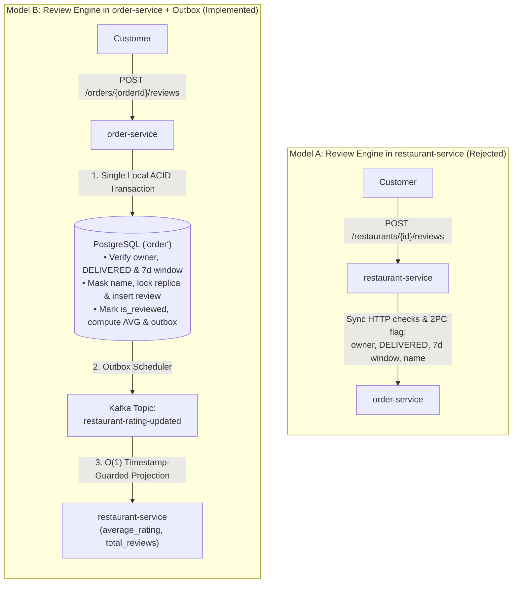
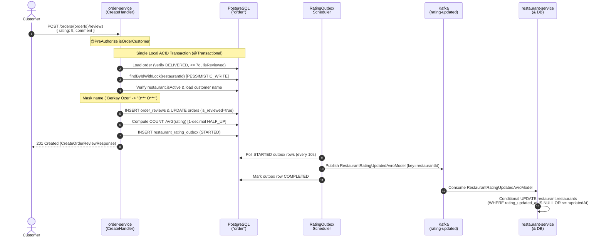
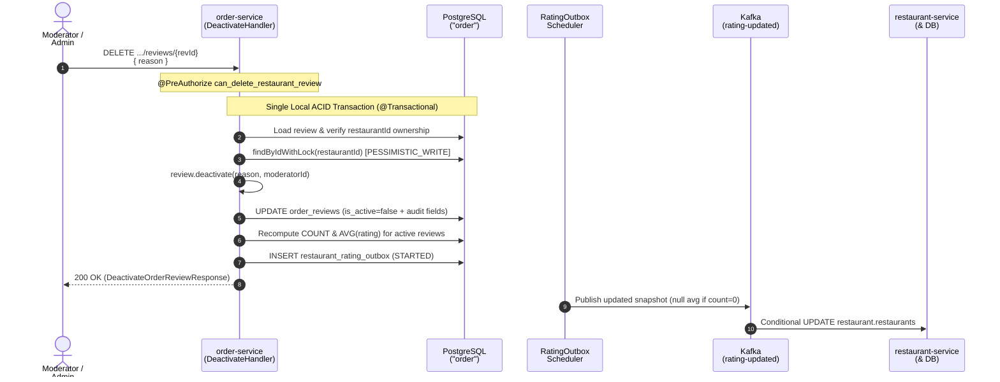
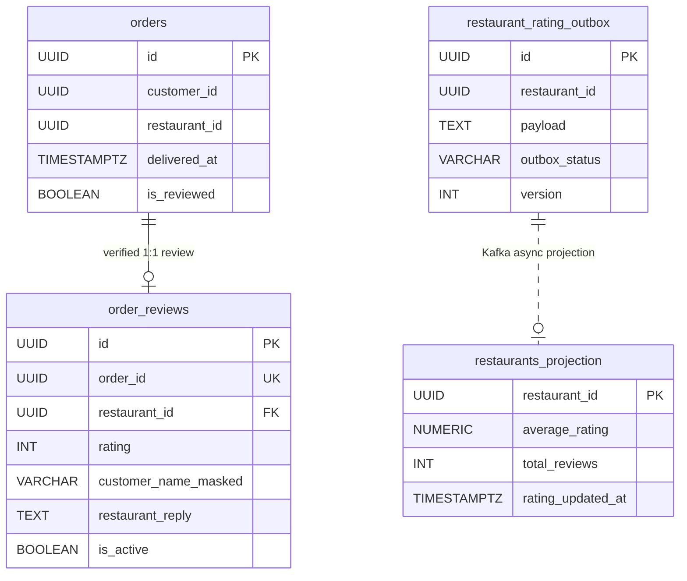

# Verified Restaurant Review & Rating Engine

## 1. Architectural Positioning (Bounded Context Decision)

When designing a verified customer review and rating system in a distributed food delivery platform, the foundational architectural question is: **Which microservice Bounded Context should own the review engine?**

Placing reviews inside `restaurant-service` might seem intuitive because restaurants are the subject of ratings. However, under strict **Database-per-Service** and **Event-Driven Microservices** boundaries, command ownership belongs to the service that holds the **transactional state and anti-fraud invariants** required to authorize and validate the write:

*   **"Did this authenticated customer actually place this order?"** → Owned by `order-service`
*   **"Has the order reached `OrderStatus.DELIVERED`?"** → Owned by `order-service`
*   **"Is the order still within the 7-day review window (`delivered_at`)?"** → Owned by `order-service`
*   **"Has this order already been reviewed (`is_reviewed`)?"** → Owned by `order-service`
*   **"What is the verified account holder's name (`"order".customers`) for privacy masking?"** → Owned by `order-service`

Hosting the review engine in `restaurant-service` would either force synchronous cross-service HTTP chains to `order-service` (creating a coupled distributed monolith with 2PC risk on `is_reviewed`) or require replicating full order lifecycles and customer profiles across services. Instead, `order-service` owns the verified review lifecycle locally and projects pre-aggregated ratings to `restaurant-service` via Transactional Outbox and Kafka.

### 1.1 Architectural Comparison Matrix

| Dimension | Model A: `restaurant-service` (Rejected) | Model B: `order-service` + Outbox (Implemented) |
| :--- | :--- | :--- |
| **Customer Masking Source** | Missing (requires remote lookup or user replication). | **Local in `"order".customers` (`first_name`, `last_name`).** |
| **Delivery & Window Check** | Missing (`DELIVERED` and `delivered_at` live in `order-service`). | **Verified locally on `"order".orders` in the same transaction.** |
| **1:1 Order-to-Review Guard** | Requires distributed locking / 2PC across services. | **Single ACID transaction (`uk_order_reviews_order_id` + `is_reviewed`).** |
| **Order History Integration** | Requires cross-service joins to render review status. | **Zero network hops (`deliveredAt`, `isReviewed` directly on orders).** |
| **Write-Path Network Hops** | Multiple synchronous remote HTTP calls. | **Zero synchronous remote calls.** |
| **Public Discovery Reads** | Local read. | **Local `O(1)` read on `restaurant.restaurants` (`average_rating`, `total_reviews`).** |

---

## 2. Core Domain Invariants & Anti-Fraud Guardrails

Review business rules are enforced inside `OrderReview` (`order-domain-core`), dedicated application handlers (`CreateOrderReviewCommandHandler`, `ReplyOrderReviewCommandHandler`, `DeactivateOrderReviewCommandHandler`), and `OrderAuthService`.

### 2.1 Submission Eligibility & Anti-Fraud
*   **Order Ownership (`isOrderCustomer`):** Only the customer who placed the order (`order.customerId == jwt.internal_id`) can submit or view a review for that order; mismatches return `403 Forbidden`.
*   **Verified Delivery & Active Branch:** Reviews require `order.getOrderStatus() == OrderStatus.DELIVERED` (otherwise `400 ORDER_NOT_DELIVERED`) and an active branch in `"order".restaurant_replica` (`restaurant.isActive()`).
*   **7-Day Review Window:** `Order.deliver()` stamps `delivered_at` in UTC. Submissions are accepted only while `deliveredAt.plusDays(7)` has not elapsed (falling back to `createdAt` for legacy delivered orders); expired attempts fail with `400 REVIEW_TIME_EXPIRED`.
*   **Strict 1:1 Uniqueness & Immutability:** Each order can be reviewed at most once—enforced both in `CreateOrderReviewCommandHandler` (`order.isReviewed()` / repository check → `409 REVIEW_ALREADY_EXISTS`) and at the database level (`uk_order_reviews_order_id`). Submitted reviews cannot be edited by customers.
*   **Score & Comment Bounds:** `rating` is mandatory and restricted to integers `1–5` (`@Min(1) @Max(5)` and PostgreSQL `CHECK`); `comment` is optional and capped at `1000` characters.
*   **Order History Integration:** `OrderSummary` (`GET /orders`) and `CustomerOrderDetailResponse` (`GET /orders/{orderId}`) expose `deliveredAt` and `isReviewed` so clients can determine review eligibility without extra roundtrips. Once reviewed, `GET /orders/{orderId}/review` returns `CustomerOrderReviewResponse` (rating, comment, masked name, merchant reply, timestamps) while keeping internal moderation audit fields strictly hidden from customers.

### 2.2 Privacy Masking & Unrated Catalog Semantics
*   **Account-Owner Name Masking (`"order".customers` vs. `order_address`):** Because an order's delivery address may name a gift recipient or reception contact, `OrderReviewDataMapper.maskCustomerName()` reads `first_name` and `last_name` from `"order".customers`—always attributing reviews to the verified account owner. Each non-blank name part is masked to its uppercase initial followed by fixed `***` (e.g., `Berkay Özer` → `B*** Ö***`), falling back to `Müşteri` when blank.
*   **Unrated Restaurant State (`NULL` vs. `0.0`):** Newly onboarded branches (or branches whose only reviews were deactivated) store `average_rating = NULL` and `total_reviews = 0`. Catalog sorting uses `average_rating DESC NULLS LAST` so unrated restaurants never appear as `0.0 ★` and sort cleanly below rated venues.

### 2.3 Merchant Replies, Moderation & RBAC Governance
*   **Single Official Merchant Reply (7-Day Window):** `OrderReview.reply()` allows at most one official response (`reply`, non-blank, max `1000` characters) to an active review for an active branch. Inactive reviews throw `400 REVIEW_INACTIVE`, duplicate replies throw `400 REVIEW_ALREADY_REPLIED`, and replies attempted more than **7 days** after `review.createdAt` throw `400 REVIEW_TIME_EXPIRED`.
*   **Strict Persona Separation (`MERCHANT` Only):** `OrderReviewController` guards replies with `@PreAuthorize("@orderAuthService.hasPermissionForRestaurant(authentication, 'can_reply_restaurant_review', #restaurantId)")`. Inside `OrderAuthService`, `can_reply_restaurant_review` explicitly requires a branch-scoped role (`roleOrgUnitId.equals(targetRestaurantId)`), blocking platform-level `SYSTEM_ADMIN` accounts (`roleOrgUnitId == null`) from replying on behalf of a merchant.
*   **Public & Merchant Review Feed:** `GET /orders/restaurants/{restaurantId}/reviews` (`permitAll`) serves active reviews ordered by `created_at DESC` with `?status=ALL` / `PENDING` (or `AWAITING_REPLY`, scoped to active unreplied reviews still within the 7-day reply window) / `REPLIED`. A single aggregate query (`getReviewStatistics`) populates `repliedCount` and `pendingReplyCount` alongside pagination metadata (`GetRestaurantReviewsResponse`), and each item computes domain-level `canReply` (`active && restaurantReply == null && within 7 days`).
*   **Irreversible Admin Soft-Deletion & Audit Feed:** Reviews are never physically deleted. Backoffice moderators holding `can_delete_restaurant_review` call `DELETE /orders/restaurants/{restaurantId}/reviews/{reviewId}` with a mandatory `reason` (max `500` chars). `OrderReview.deactivate()` marks `is_active = false` with `deactivation_reason`, `deactivated_at`, and `deactivated_by`, recalculates the branch rating within the same ACID transaction, and leaves `orders.is_reviewed = true` so removed abusive reviews cannot be re-submitted. `GET /orders/admin/restaurants/{restaurantId}/reviews` supports `?status=ALL` / `ACTIVE` / `DELETED` with full moderation metadata (`AdminOrderReviewResponse`).
*   **Delegable Dynamic Permissions:** Both `can_reply_restaurant_review` (default `RESTAURANT_OWNER`) and `can_delete_restaurant_review` (default `SYSTEM_ADMIN`) are seeded with `is_restricted = false`, enabling delegation to custom branch or moderation roles under the Subset Delegation Rule ([RBAC Governance](../security/rbac-governance.md)).

---

## 3. Concurrency Control & Asynchronous Rating Propagation

### 3.1 Serializing Concurrent Rating Recalculations (`PESSIMISTIC_WRITE`)
Consider a restaurant with one 5★ review when Customer A submits a 1★ review (`Tx1`) and Customer B submits a 5★ review (`Tx2`) concurrently. Under PostgreSQL's default `READ COMMITTED` isolation without serialization, neither transaction sees the other's uncommitted row—each computing an incorrect 2-review average instead of the true 3-review average.

To eliminate this race without locking the entire `order_reviews` table, both `CreateOrderReviewCommandHandler` and `DeactivateOrderReviewCommandHandler` acquire a row-level **Pessimistic Write Lock** on the target restaurant's single row in `"order".restaurant_replica` (`RestaurantJpaRepository.findByIdWithLock(restaurantId)`) before mutating `order_reviews` and executing `SELECT COUNT(r.id), AVG(r.rating) ... WHERE restaurant_id = :id AND is_active = true`:

*   **Zero Cross-Restaurant Contention:** Concurrent reviews for separate restaurants lock distinct `restaurant_replica` rows and proceed fully in parallel.
*   **Exact Aggregate Calculation:** Same-restaurant writes serialize cleanly for a few milliseconds, reading committed rows through the covering partial index `idx_order_reviews_calc` and rounding `averageRating` to **1 decimal place** (`BigDecimal.setScale(1, RoundingMode.HALF_UP)`).

### 3.2 Outbox Dispatch & Timestamp-Guarded Projection
Within the same ACID transaction as review creation or soft-deletion, `order-service` inserts a snapshot (`id`, `restaurantId`, nullable `averageRating`, `totalReviews`, `updatedAt`) into `"order".restaurant_rating_outbox` (`STARTED`).

1.  **Outbox Publishing & Cleanup:** `RestaurantRatingOutboxScheduler` polls every `10,000 ms` and publishes `RestaurantRatingUpdatedAvroModel` (`updatedAt` as `timestamp-millis`) to `restaurant-rating-updated` partitioned by `restaurantId` (`RestaurantRatingEventKafkaPublisher`). `RestaurantRatingOutboxCleanerScheduler` purges `COMPLETED` rows at `@midnight` ([Transactional Outbox](../distributed-systems/transactional-outbox.md)).
2.  **`O(1)` Conditional Projection in `restaurant-service`:** `RestaurantRatingUpdatedKafkaListener` delegates to `RestaurantRatingMessageListenerImpl`, which scales `averageRating` to 1 decimal place (`HALF_UP`, matching `NUMERIC(2, 1)`) and executes a single timestamp-guarded `UPDATE` (`rating_updated_at IS NULL OR rating_updated_at <= :ratingUpdatedAt`) on `restaurant.restaurants` ([Restaurant Service](restaurant-service.md)).
    *   **Replay & Reorder Safe:** Duplicate deliveries are idempotent; out-of-order stale events silently match `0` rows and are discarded without locking or bumping `restaurants.version`.
    *   **Zero-Review Reset:** When the last active review is soft-deleted, `order-service` emits `averageRating = null, totalReviews = 0`, cleanly resetting the branch back to its unrated state.

---

## 4. End-to-End Event-Driven Workflows

### 4.1 Customer Review Submission & Async Rating Projection

### 4.2 Admin Soft-Deletion & Automatic Rating Recalculation

### 4.3 Read & Merchant Reply Flows
*   **Customer Review Lookup (`GET /orders/{orderId}/review`):** Guarded by `isOrderCustomer`; loads `"order".order_reviews` by `order_id` (`404 REVIEW_NOT_FOUND` if absent) and returns `CustomerOrderReviewResponse`.
*   **Merchant Official Reply (`POST /orders/restaurants/{restaurantId}/reviews/{reviewId}/reply`):** Guarded by `hasPermissionForRestaurant('can_reply_restaurant_review', #restaurantId)` (merchant branch roles only); verifies branch ownership and active branch state, enforces `OrderReview.reply()` invariants (active, unreplied, within 7 days), persists the reply, and returns `ReplyOrderReviewResponse`.
*   **Public & Admin Feeds (`GET .../reviews`):** Public feed queries active reviews filtered by `status` (`ALL`, `PENDING` / `AWAITING_REPLY`, `REPLIED`) plus single-query statistics (`repliedCount`, `pendingReplyCount`); admin feed (`can_delete_restaurant_review`) filters by `status` (`ALL`, `ACTIVE`, `DELETED`) and includes deactivation audit metadata.

---

## 5. Data Model & Indexing Architecture

Schema evolution is managed via Flyway migration scripts in `order-dataaccess` (`"order"` schema) and `restaurant-dataaccess` (`restaurant` schema) with Hibernate `ddl-auto: validate`. The indexing strategy specifically optimizes write-path rating recalculation (Index-Only Scan) and read-path catalog sorting:

| Table / Schema | Architectural Role | Key Constraints & Performance Indexes |
| :--- | :--- | :--- |
| `"order".orders` | Source of truth for delivery timing (`delivered_at`) and single-review tracking (`is_reviewed`). | Verified locally during review creation; `is_reviewed` stays `true` even after admin soft-deletion to block re-review spam. |
| `"order".` `order_reviews` | Verified review record storing masked customer name, 1–5 rating, optional comment, single merchant reply, and soft-delete audit fields. | `UNIQUE (order_id)` & `CHECK (rating BETWEEN 1 AND 5)`; covering partial index `idx_order_reviews_calc` on `(restaurant_id, rating) WHERE is_active = TRUE` (Index-Only Scan); partial feed index on `(restaurant_id, created_at DESC) WHERE is_active = TRUE`; plus admin moderation and customer lookup indexes. |
| `"order".` `restaurant_rating_` `outbox` | Transactional Outbox persisting recalculated rating snapshots (`TEXT` JSON payload) atomically with review writes. | `idx_rating_outbox_status` on `(type, outbox_status)` for scheduler polling; `idx_rating_outbox_restaurant_id`; optimistic `@Version`. |
| `restaurant.` `restaurants` | Read-optimized public catalog projection storing `average_rating` (`NUMERIC(2,1) DEFAULT NULL`), `total_reviews`, and `rating_updated_at`. | `idx_restaurants_rating` on `(average_rating DESC NULLS LAST, total_reviews DESC)` accelerates `HIGHEST_RATING` / `MOST_REVIEWS` discovery sorting without cross-service joins. |

---

## 6. REST API Contract & Error Code Matrix

All review endpoints are exposed by `OrderReviewController` in `order-service` under `/orders` and authorized via `OrderAuthService`:

| Endpoint | Authorization | Description |
| :--- | :--- | :--- |
| `POST /orders/{orderId}/` `reviews` | `isOrderCustomer` | Submits a 1–5 star rating and optional comment (`<= 1000` chars) within 7 days of delivery (`201 Created`). |
| `GET /orders/{orderId}/` `review` | `isOrderCustomer` | Retrieves the customer's review and merchant reply for a specific order (`CustomerOrderReviewResponse`). |
| `POST /orders/restaurants/` `{restaurantId}/reviews/` `{reviewId}/reply` | `can_reply_restaurant_review` *(branch-scoped, merchant only)* | Publishes a single official merchant reply (`<= 1000` chars) within 7 days of review creation. |
| `GET /orders/restaurants/` `{restaurantId}/reviews` | Public (`permitAll`) | Paginated active reviews (`page=0`, `size=10`) with `?status=ALL` / `PENDING` / `REPLIED`, reply counters, and per-item `canReply`. |
| `DELETE /orders/restaurants/` `{restaurantId}/reviews/` `{reviewId}` | `can_delete_restaurant_review` | Irreversibly soft-deletes a review with mandatory `reason` (`<= 500` chars) and triggers rating recalculation via outbox. |
| `GET /orders/admin/` `restaurants/{restaurantId}/` `reviews` | `can_delete_restaurant_review` | Paginated admin moderation feed supporting `?status=ALL` / `ACTIVE` / `DELETED` with deactivation audit fields. |

### 6.1 Standardized Error Code Contract

Handled centrally by `OrderGlobalExceptionHandler` via standardized `ErrorDTO` responses:

| Status | `errorCode` | Trigger Condition |
| :---: | :--- | :--- |
| `400` | `ORDER_NOT_DELIVERED` | Target order is not in `OrderStatus.DELIVERED`. |
| `400` | `REVIEW_TIME_EXPIRED` | Customer review exceeds 7 days from `delivered_at`, or merchant reply exceeds 7 days from `review.createdAt`. |
| `400` | `REVIEW_INACTIVE` | Merchant attempts to reply to a soft-deleted (`is_active = false`) review. |
| `400` | `REVIEW_ALREADY_REPLIED` | Merchant attempts to submit a second reply (`restaurant_reply != null`). |
| `400` | `REVIEW_ALREADY_DEACTIVATED` | Moderator attempts to deactivate a review that is already `is_active = false`. |
| `400` | `INVALID_REVIEW_RATING` / `REPLY_CANNOT_BE_EMPTY` / `DEACTIVATION_REASON_` `CANNOT_BE_EMPTY` | Domain validation failures on rating bounds (`1–5`), blank reply, or blank moderation reason. |
| `403` | `ACCESS_DENIED` | Order ownership mismatch, missing permission, or platform `SYSTEM_ADMIN` attempting a branch-scoped merchant reply. |
| `404` | `ORDER_NOT_FOUND` / `REVIEW_NOT_FOUND` | Target `orderId` or `reviewId` does not exist. |
| `409` | `REVIEW_ALREADY_EXISTS` | Order has already been reviewed (`is_reviewed == true` or `uk_order_reviews_order_id` conflict). |
| `409` | `ORDER_CONFLICT` | Optimistic lock collision on concurrent aggregate modification. |
