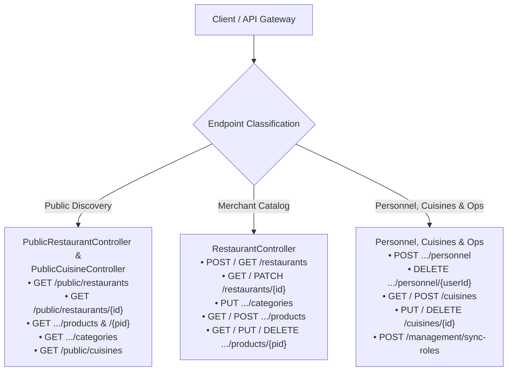
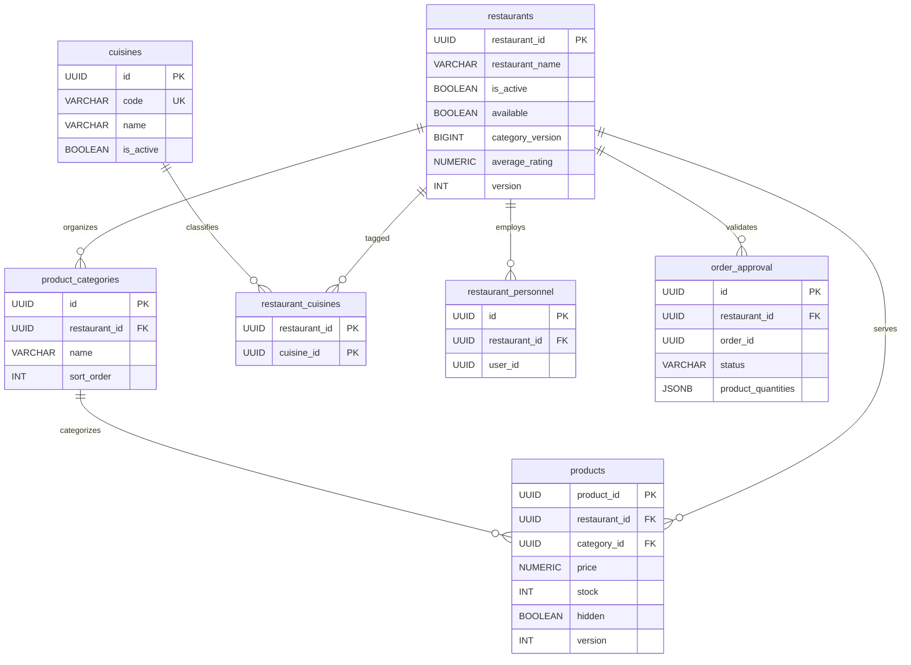
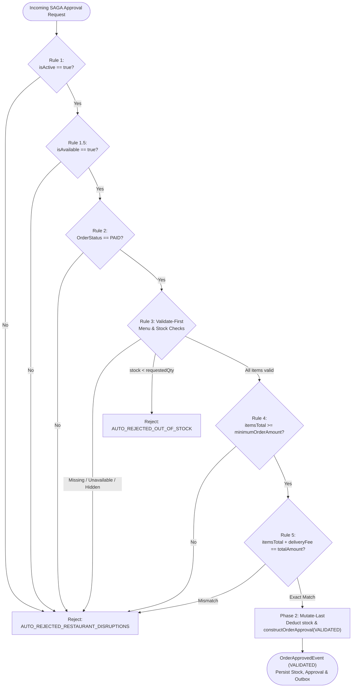
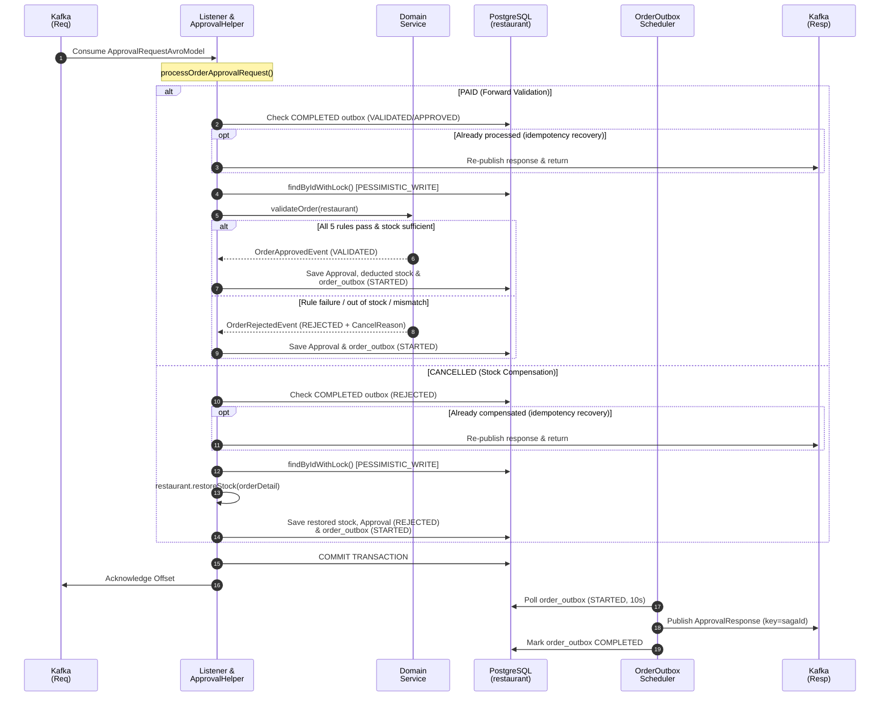

# Restaurant Service Specification

## 1. Domain Overview & Subdomain Scope

The **Restaurant Service** (local port `:8183`, PostgreSQL schema `restaurant`) is the system of record for merchant branches, menus, product categories, dynamic cuisines, branch personnel assignments, and kitchen-level order inventory validation within the **Take My Order** platform. Exposed through the API Gateway under `/restaurants/**`, `/public/restaurants/**`, `/cuisines/**`, `/public/cuisines/**`, and `/restaurants/management/**`, it serves both high-throughput public catalog discovery and strongly consistent SAGA execution.

### 1.1 Core Subdomain Responsibilities
*   **Restaurant & Branch Lifecycle:** Manages merchant branch registration, operational availability (`available`), operating hours (`opening_time` / `closing_time`), structured Turkish address metadata, delivery fee, and minimum order thresholds—emitting `RESTAURANT_CREATED` and `RESTAURANT_UPDATED` events via `restaurant_outbox` for downstream RBAC and read-model synchronization.
*   **Menu, Category & Inventory Management:** Maintains products, real-time physical stock, visibility flags (`available`, `hidden`), and versioned product categories protected by isolated optimistic locking (`category_version`) and non-empty deletion guardrails.
*   **Forward SAGA Validation & Cancel Compensation:** Executes a strict **Validate-First, Mutate-Last** 5-rule order verification engine on incoming `PAID` order approval requests (atomically deducting stock under an aggregate-root pessimistic lock) and handles `CANCELLED` compensation requests via `restoreStock()` to safely return reserved inventory ([SAGA Orchestration](../distributed-systems/saga-orchestration.md), [Cancel SAGA Deep Dive](../distributed-systems/cancel-saga-deep-dive.md)).
*   **Branch Personnel Onboarding & Revocation:** Validates prospective staff emails synchronously against `identity-service` (`/internal/users/validate`) and emits `PERSONNEL_ADDED` / `PERSONNEL_REMOVED` outbox events to synchronize branch-scoped RBAC roles.
*   **Dynamic Cuisines & Event-Driven Rating Projection:** Provides backoffice-managed many-to-many cuisine classification and consumes `restaurant-rating-updated` events from `order-service` to keep public catalog sorting (`average_rating`, `total_reviews`) continuously up to date ([Restaurant Rating System](restaurant-rating-system.md)).

---

## 2. Technical Architecture & Module Structure

`restaurant-service` follows the platform's Hexagonal (Ports & Adapters) multi-module Maven architecture with Flyway schema migrations and a locally replicated RBAC store (`roles_replica`, `permissions_replica`, `role_permissions_replica`):

```text
restaurant-service/
 ├── restaurant-domain/
 │    ├── restaurant-domain-core
 │    │    └── Aggregate: Restaurant; Entities: Product,
 │    │        ProductCategory, Cuisine, OrderApproval, Personnel
 │    │        Domain Service: RestaurantDomainServiceImpl
 │    └── restaurant-application-service
 │         └── Handlers: RestaurantApprovalRequestHelper, Menu,
 │             Category, Cuisine, Personnel, Rating; Outbox Jobs
 ├── restaurant-dataaccess
 │    └── JPA Entities (10+), RestaurantJpaRepository (WRITE Lock),
 │        IdentityServiceApiAdapter, Flyway Migrations
 ├── restaurant-messaging
 │    └── Kafka Publishers (e.g., Approval, Information, Personnel)
 │        Kafka Listeners (e.g., ApprovalReq, Rating, Roles, Perms)
 ├── restaurant-application
 │    └── REST Controllers, RestaurantAuthService, RoleSyncJob
 └── restaurant-container
      └── Spring Boot Entry Point, BeanConfiguration, application.yml
```

---

## 3. REST API Contract & Endpoint Taxonomy

`restaurant-service` exposes **20+ REST endpoints** across **5+ controllers**. Public catalog and cuisine discovery endpoints require no token, while merchant, personnel, backoffice cuisine, and operational endpoints enforce stateless JWT RBAC via `RestaurantAuthService` against the local role-permission replica ([RBAC Governance](../security/rbac-governance.md), [Stateless IDOR Shield](../security/stateless-idor-shield.md)).



### 3.1 Public Discovery

Controllers: `PublicRestaurantController`, `PublicCuisineController`.

| Endpoint | Authorization | Description |
| :--- | :--- | :--- |
| `GET /public/restaurants` | Public | Paginated discovery (`page=0`, `size=20`). Filters: `searchName` (restaurant name, product name, or description), `cuisineCodes`, `available`, `maxMinimumOrderAmount`, `maxDeliveryTime`, `minRating`. `sortBy`: `MOST_REVIEWS`, `HIGHEST_RATING`, `LOWEST_DELIVERY_FEE`, `FASTEST_DELIVERY` (default: `available DESC, restaurantName ASC`). |
| `GET /public/restaurants/`<br/>`{restaurantId}` | Public | Fetches public profile, address, delivery terms, operating hours, cuisines, and rating summary for an active restaurant. |
| `GET /public/restaurants/`<br/>`{restaurantId}/products` | Public | Lists visible, customer-facing menu items for the specified restaurant. |
| `GET /public/restaurants/`<br/>`{restaurantId}/products/`<br/>`{productId}` | Public | Fetches customer-facing details for a single visible menu product. |
| `GET /public/restaurants/`<br/>`{restaurantId}/categories` | Public | Fetches `sort_order`-ordered product categories for the specified restaurant. |
| `GET /public/cuisines` | Public | Lists all active platform cuisines (`is_active = true`) for catalog filter chips. |

### 3.2 Merchant Catalog & Personnel

Controllers: `RestaurantController`, `RestaurantPersonnelController`.

| Endpoint | Authorization | Description |
| :--- | :--- | :--- |
| `POST /restaurants` | `isMerchant` | Registers a new restaurant branch using JWT `internal_id` as merchant owner and writes a `RESTAURANT_CREATED` outbox event for RBAC provisioning. |
| `GET /restaurants` | `isMerchant` | Lists all restaurant branches accessible to the authenticated merchant (`internal_id`). |
| `GET /restaurants/`<br/>`{restaurantId}` | `isMemberOfRestaurant`<br/>`(#restaurantId)` | Fetches merchant-view restaurant profile and full branch configuration. |
| `PATCH /restaurants/`<br/>`{restaurantId}` | `can_manage_restaurant`<br/>*(branch-scoped)* | Partially updates profile, availability, operating hours (supports clearing `openingTime`/`closingTime`), delivery fee, minimum order, cuisines, and emits `RESTAURANT_UPDATED`. |
| `PUT /restaurants/`<br/>`{restaurantId}/categories` | `can_manage_category`<br/>*(branch-scoped)* | Batch-reconciles category hierarchy guarded by `categoryVersion` optimistic locking and non-empty deletion checks. |
| `GET /restaurants/`<br/>`{restaurantId}/products` | `isMemberOfRestaurant`<br/>`(#restaurantId)` | Lists all branch menu products (including hidden and out-of-stock items) for merchant administration. |
| `GET /restaurants/`<br/>`{restaurantId}/products/`<br/>`{productId}` | `isMemberOfRestaurant`<br/>`(#restaurantId)` | Fetches merchant-view details of a single branch product. |
| `POST /restaurants/`<br/>`{restaurantId}/products` | `can_create_product`<br/>*(branch-scoped)* | Adds a batch of products to the menu (validating unique names, positive prices, and category ownership). |
| `PUT /restaurants/`<br/>`{restaurantId}/products/`<br/>`{productId}` | `can_update_product`<br/>*(branch-scoped)* | Updates price, stock, availability, visibility (`hidden`), description, image URL, or category for an existing product. |
| `DELETE /restaurants/`<br/>`{restaurantId}/products/`<br/>`{productId}` | `can_delete_product`<br/>*(branch-scoped)* | Removes a product from the restaurant's menu. |
| `POST /restaurants/`<br/>`{restaurantId}/personnel` | `can_add_personnel`<br/>*(branch-scoped, imperative)* | Validates user email synchronously via `identity-service` (`/internal/users/validate`), persists branch personnel, and writes `PERSONNEL_ADDED` to `restaurant_outbox`. |
| `DELETE /restaurants/`<br/>`{restaurantId}/personnel/`<br/>`{userId}` | `can_remove_personnel`<br/>*(branch-scoped, imperative)* | Deletes branch personnel assignment and writes a `PERSONNEL_REMOVED` payload to `restaurant_outbox` to revoke branch roles. |

*(Branch-scoped checks evaluate `restaurantAuthService.hasPermissionForRestaurant(authentication, permission, restaurantId)` against the local RBAC replica; `RestaurantPersonnelController` invokes this check imperatively and returns HTTP `403` on failure.)*

### 3.3 Backoffice Cuisines & Operations

Controllers: `InternalCuisineController`, `RoleManagementController`.

| Endpoint | Authorization | Description |
| :--- | :--- | :--- |
| `GET /cuisines` | `can_read_cuisine_type` | Lists platform cuisines for backoffice management; supports optional `?active=true` / `false` filtering. |
| `POST /cuisines` | `can_create_cuisine_type` | Creates a new dynamic cuisine definition (`code`, `name`, `description`, `iconUrl`, `isActive`). |
| `PUT /cuisines/{cuisineId}` | `can_update_cuisine_type` | Updates metadata or active state of an existing cuisine definition. |
| `DELETE /cuisines/{cuisineId}` | `can_delete_cuisine_type` | Deletes a cuisine definition from the catalog. |
| `POST /management/sync-roles`<br/>*(GW: `/restaurants/management/`*<br/>*`sync-roles`)* | `restaurant_service_`<br/>`can_sync_roles`<br/>*(or M2M token)* | Clears `roles_replica` and triggers `RoleInitialSyncJob.forceSyncRoles()` against `identity-service`. |

---

## 4. Data Model & Persistence Architecture (`restaurant` Schema)

Schema evolution is managed via Flyway migration scripts (`restaurant-dataaccess/src/main/resources/db/migration/`) with Hibernate `ddl-auto: validate`. The relational design prioritizes deadlock-free aggregate serialization, orphan-free menu hierarchies, flexible `VARCHAR(50)` status storage, and outbox-guaranteed event delivery:



| Table | Role & Lifecycle | Key Constraints, Locks & Indexes |
| :--- | :--- | :--- |
| `restaurant.restaurants` | Master branch aggregate storing profile, structured Turkish address, operating hours, delivery/min-order terms, and projected rating metrics (`average_rating`, `total_reviews`, `rating_updated_at`). | Parent `PESSIMISTIC_WRITE` lock target (`findByIdWithLock`) for SAGA stock updates; `@Version` optimistic lock + isolated `category_version` (`BIGINT`); `idx_restaurants_rating` on `(average_rating DESC NULLS LAST, total_reviews DESC)`. |
| `restaurant.product_categories` &<br/>`restaurant.products` | Ordered branch menu categories (`sort_order`) and physical inventory items (`price`, `stock`, `available`, `hidden`). | `products.category_id` enforces `ON DELETE RESTRICT` to prevent orphan products at the DB level; `@Version` on products prevents lost updates during concurrent catalog edits. |
| `restaurant.cuisines` &<br/>`restaurant.restaurant_cuisines` | Dynamic backoffice-managed cuisine catalog (seeded with international & Turkish cuisines) linked via many-to-many join table. | `UNIQUE (code)` on cuisines; composite PK `(restaurant_id, cuisine_id)` with `ON DELETE CASCADE` on both FKs. |
| `restaurant.restaurant_personnel` | Maps branch staff (`user_id`) to their assigned `restaurant_id`. | `UNIQUE (restaurant_id, user_id)` (`uq_restaurant_personnel`) prevents duplicate branch assignments; `ON DELETE CASCADE` on restaurant removal. |
| `restaurant.order_approval` &<br/>`restaurant.order_outbox` | Records per-order kitchen validation/compensation audit (`PENDING`, `VALIDATED`, `APPROVED`, `REJECTED` + `JSONB` `product_quantities`) and dispatches SAGA replies (`TEXT` JSON payload). | Composite `UNIQUE (type, saga_id, approval_status, outbox_status)` enforces SAGA consumer idempotency; status index on `(type, approval_status)` speeds scheduler polling. |
| `restaurant.restaurant_outbox` | Decouples branch lifecycle (`RESTAURANT_CREATED`, `RESTAURANT_UPDATED`) and personnel events (`PERSONNEL_ADDED` / `PERSONNEL_REMOVED`) into Kafka (`TEXT` payload, no `saga_id`). | Scheduler index `restaurant_outbox_scheduler_idx` on `(type, outbox_status)` with optimistic `@Version`. |

*(Local RBAC read replicas — `roles_replica`, `permissions_replica`, and `role_permissions_replica` — are synchronized asynchronously within the same `restaurant` schema.)*

---

## 5. Domain Invariants & The 5-Rule Order Approval Engine

Inside `Restaurant.validateOrder()` (`restaurant-domain-core`), incoming `PAID` order approval requests pass through a strict two-phase **Validate-First, Mutate-Last** verification pipeline before any inventory is modified:



### 5.1 Business Rules Formal Specification
1.  **Rule 1 (Platform Activation):** `this.isActive() == true`. Rejects orders with `CancelReason.AUTO_REJECTED_RESTAURANT_DISRUPTIONS` if the branch is deactivated by administrators.
2.  **Rule 1.5 (Operational Availability):** `this.isAvailable() == true`. Checks the branch's live open/closed toggle (`available`) managed manually by the merchant, protecting closed or paused kitchens from receiving orders. *(By design, `opening_time` and `closing_time` are purely informational display fields for customers and never automatically alter a restaurant's open/closed status or block order validation.)*
3.  **Rule 2 (Pre-Paid SAGA Precedence):** `orderDetail.getOrderStatus() == OrderStatus.PAID`. Guarantees kitchens never reserve stock for unescrowed orders.
4.  **Rule 3 (Read-Only Menu & Stock Validation):** Iterates every requested `(ProductId, requestedQuantity)` line item without mutating state:
    *   Item must exist in `this.menu`, be active (`menuProduct.isAvailable()`), and not hidden (`!menuProduct.isHidden()`); otherwise rejects with `AUTO_REJECTED_RESTAURANT_DISRUPTIONS`.
    *   Physical stock must satisfy `menuProduct.getStock() >= requestedQuantity`; otherwise rejects with `CancelReason.AUTO_REJECTED_OUT_OF_STOCK`.
5.  **Rule 4 (Minimum Basket Threshold):** If `minimumOrderAmount > 0`, verifies that the pre-delivery subtotal `itemsTotal` meets or exceeds `this.minimumOrderAmount`.
6.  **Rule 5 (Financial Integrity & Delivery Fee):** Adds `this.deliveryFee` (when positive) to `itemsTotal` and verifies an exact `Money` equality against `orderDetail.getTotalAmount()`.
7.  **Phase 2 (Mutate-Last Atomic Deduction):** Only after all checks succeed does the aggregate deduct stock across every ordered line item and build `OrderApproval` with `OrderApprovalStatus.VALIDATED` (persisting the ordered `productQuantities` map as `JSONB`):
    ```java
    menuProduct.updateWith(
            menuProduct.getName(), menuProduct.getDescription(),
            menuProduct.getPrice(), menuProduct.isAvailable(),
            menuProduct.getStock() - productQuantity.getValue(),
            menuProduct.isHidden(), menuProduct.getImageUrl(),
            menuProduct.getCategoryId());
    constructOrderApproval(OrderApprovalStatus.VALIDATED);
    ```
8.  **Cancel Compensation (`restoreStock`):** When a `CANCELLED` SAGA request arrives (e.g., merchant rejection or customer cancellation after stock reservation), `Restaurant.restoreStock(orderDetail)` atomically adds each item's `quantity` back to `menuProduct.getStock()` and creates a compensating `OrderApproval` record in `OrderApprovalStatus.REJECTED`.

---

## 6. Concurrency Control & Aggregate Root Deadlock Elimination

### 6.1 The Distributed Locking Dilemma
When two concurrent orders target the same restaurant with overlapping menu items in opposite order:

*   Order A requests `[Burger, Soda]`
*   Order B requests `[Soda, Burger]`

Locking individual rows in `restaurant.products` would allow Transaction 1 to lock `Burger` while waiting for `Soda`, and Transaction 2 to lock `Soda` while waiting for `Burger`, causing a PostgreSQL deadlock (`40P01`).

### 6.2 Aggregate Root Serialization & Optimistic Locking
To enforce DDD Aggregate Root boundaries and eliminate inter-product deadlocks, `RestaurantJpaRepository` acquires a row-level **Pessimistic Write Lock** on the parent `restaurant.restaurants` record at the start of both `persistOrderApproval()` and `persistCancelOrderApproval()`:

```java
@Lock(LockModeType.PESSIMISTIC_WRITE)
@Query("SELECT r FROM RestaurantEntity r WHERE r.restaurantId = :id")
Optional<RestaurantEntity> findByIdWithLock(@Param("id") UUID id);
```

1.  All concurrent stock deductions and stock restorations targeting the same restaurant serialize cleanly on the parent row lock, making cross-product lock inversion impossible.
2.  Separate branches execute in full parallel without contention.
3.  On merchant updates, `RestaurantRepositoryImpl.saveRestaurant()` preserves JPA `@Version` fields (`restaurants.version` and `products.version`) before `entityManager.merge()`, protecting against lost updates on concurrent administrative edits.

---

## 7. Menu Categorization, Dynamic Cuisines & Rating Projection

### 7.1 Isolated Category Optimistic Locking (`category_version`)
Category batch operations are isolated via a dedicated `BIGINT` `category_version` column on `restaurant.restaurants`. Clients supply their last-read `categoryVersion` in `PUT /restaurants/{restaurantId}/categories`, preventing stale category tree overwrites while allowing independent menu/stock operations to progress cleanly.

### 7.2 Non-Empty Category Deletion Guardrail (`hasProducts`)
Inside `Restaurant.updateCategories(List<ProductCategory> payload, Long version)`, the aggregate enforces three strict invariants before applying changes:

*   **Version Check:** Verifies `this.categoryVersion.equals(version)` (throwing `RestaurantDomainException("Category version mismatch! Expected: ..., Actual: ...")` on conflict) and increments `this.categoryVersion++` upon success.
*   **Orphan Product Prevention (`hasProducts`):** Identifies existing categories omitted from `payload`. If any item in `this.menu` still references a category scheduled for deletion, the domain throws `RestaurantDomainException("Cannot delete category with id: <uuid> because it contains products.")`, reinforced at the database layer by `ON DELETE RESTRICT` on `products.category_id`.
*   **In-Place Reconciliation:** Existing categories retain their UUID while updating `name` and `sortOrder`; new categories without an ID receive a fresh `ProductCategoryId(UUID.randomUUID())`.

### 7.3 Dynamic Many-to-Many Cuisines
Refactored from a static enum into a first-class database aggregate (seeded with international and Turkish cuisines via Flyway), cuisines are managed dynamically via `InternalCuisineController` and linked through `restaurant.restaurant_cuisines`. `Restaurant.updateCuisines()` enforces that inactive cuisines (`!c.isActive()`) cannot be assigned to a restaurant, while `GET /public/restaurants?cuisineCodes=pizza,burger` supports multi-tag filtering.

### 7.4 Event-Driven Rating Projection
`RestaurantRatingUpdatedKafkaListener` consumes `restaurant-rating-updated` events from `order-service`. `RestaurantRatingMessageListenerImpl` rounds `averageRating` to 1 decimal place (`RoundingMode.HALF_UP`, matching `NUMERIC(2,1)`) and executes a conditional bulk update in `RestaurantJpaRepository.updateRestaurantRating()`:

```java
@Modifying
@Query("UPDATE RestaurantEntity r " +
       "SET r.averageRating = :averageRating, " +
       "    r.totalReviews = :totalReviews, " +
       "    r.ratingUpdatedAt = :ratingUpdatedAt " +
       "WHERE r.restaurantId = :restaurantId " +
       "  AND (r.ratingUpdatedAt IS NULL " +
       "       OR r.ratingUpdatedAt <= :ratingUpdatedAt)")
int updateRestaurantRating(
        @Param("restaurantId") UUID restaurantId,
        @Param("averageRating") BigDecimal averageRating,
        @Param("totalReviews") Integer totalReviews,
        @Param("ratingUpdatedAt") ZonedDateTime ratingUpdatedAt);
```

This single timestamp guard silently discards out-of-order or stale rating events (returning `0` updated rows) without acquiring an aggregate entity lock or bumping `restaurants.version`, keeping public catalog sorting (`idx_restaurants_rating`) fast and consistent.

---

## 8. SAGA Order Verification & Cancel Compensation Workflow

`RestaurantApprovalRequestKafkaListener` routes incoming Avro batches to `RestaurantApprovalRequestHelper.processOrderApprovalRequest()`, which dispatches `PAID` requests to `persistOrderApproval()` and `CANCELLED` requests to `persistCancelOrderApproval()`. Both branches execute outbox-backed idempotency checks (`publishIfOutboxMessageProcessed`) and acquire the restaurant aggregate lock before modifying state. PostgreSQL unique constraint violations (`23505`) and missing-restaurant errors are handled as safe NO-OPs at the Kafka listener boundary.



---

## 9. Kafka Messaging, Outbox Schedulers & Internal Integration

All Kafka producers use Confluent Avro serialization with `acks: all` and `retry-count: 5`. All Kafka consumers run as batch listeners (`concurrency-level: 3`, `auto-offset-reset: earliest`, `specific.avro.reader: true`). Dedicated Transactional Outbox schedulers poll every `10,000 ms`, paired with `@Scheduled(cron = "@midnight")` cleaner jobs (e.g., `OrderOutboxCleanerScheduler`, `RestaurantOutboxCleanerScheduler`, `RestaurantPersonnelOutboxCleanerScheduler`) ([Transactional Outbox](../distributed-systems/transactional-outbox.md)).

### 9.1 Outbound Topics (Transactional Outbox)

| Topic & Avro Contract | Publisher & Scheduler | Partition Key & Behavior |
| :--- | :--- | :--- |
| `restaurant-approval-response`<br/>`RestaurantApprovalResponse`<br/>`AvroModel` | `RestaurantApprovalEvent`<br/>`KafkaPublisher`<br/>(`OrderOutboxScheduler` → `order_outbox`) | Key: `sagaId`. Emits `VALIDATED` or `REJECTED` (with `CancelReason`) for forward SAGA validation and cancel stock restoration. |
| `restaurant-information`<br/>`RestaurantInformation`<br/>`AvroModel` | `RestaurantInformationEvent`<br/>`KafkaPublisher`<br/>(`RestaurantOutboxScheduler` → `restaurant_outbox`) | Key: `restaurantId`. Emits `RESTAURANT_CREATED` and `RESTAURANT_UPDATED` events to `identity-service` and `order-service`. |
| `restaurant-personnel`<br/>`RestaurantPersonnel`<br/>`AvroModel` | `RestaurantPersonnelEvent`<br/>`KafkaPublisher`<br/>(`RestaurantPersonnelOutbox`<br/>`Scheduler` → `restaurant_outbox`) | Key: `restaurantId`. Emits `PERSONNEL_ADDED` and `PERSONNEL_REMOVED` payloads (queued under `PERSONNEL_ADDED` outbox type) to synchronize branch personnel roles in `identity-service`. |

### 9.2 Inbound Topics

| Topic & Avro Contract | Listener & Consumer Group | Purpose |
| :--- | :--- | :--- |
| `restaurant-approval-request`<br/>`RestaurantApprovalRequest`<br/>`AvroModel` | `RestaurantApprovalRequest`<br/>`KafkaListener`<br/>(`restaurant-approval-topic-consumer`) | Processes forward `PAID` order validations and `CANCELLED` stock compensation requests. |
| `restaurant-rating-updated`<br/>`RestaurantRatingUpdated`<br/>`AvroModel` | `RestaurantRatingUpdated`<br/>`KafkaListener`<br/>(`restaurant-rating-topic-consumer`) | Projects `average_rating`, `total_reviews`, and `rating_updated_at` onto `restaurant.restaurants` with stale-event timestamp protection. |
| `identity-role-events`<br/>`RoleEventAvroModel` | `IdentityRoleKafkaListener`<br/>(`restaurant-role-topic-consumer`) | Synchronizes `ROLE_CREATED`, `ROLE_UPDATED`, and `ROLE_DELETED` events into `roles_replica` and `role_permissions_replica`. |
| `identity-permission-events`<br/>`PermissionEventAvroModel` | `IdentityPermissionKafkaListener`<br/>(`restaurant-permission-topic-consumer`) | Replicates `PERMISSION_UPDATED` metadata into `permissions_replica`. |

### 9.3 Synchronous Internal HTTP Integrations (`identity-service`)
*   **Personnel Pre-Validation (`IdentityServiceApiAdapter`):** During `POST /restaurants/{restaurantId}/personnel`, calls `GET {identity-service-url}/internal/users/validate?email={email}` while propagating the caller's `Authorization` bearer header to confirm the target account exists and is eligible before persisting a `restaurant_personnel` record.
*   **RBAC Bootstrap & Recovery (`RoleInitialSyncJob`):** On `ApplicationReadyEvent` (when `roles_replica` is empty) or upon manual invocation of `POST /restaurants/management/sync-roles`, obtains a Keycloak M2M `client_credentials` token and cursor-paginates `GET {identity-service-url}/internal/sync/roles?limit=100` to hydrate the local RBAC replica.
